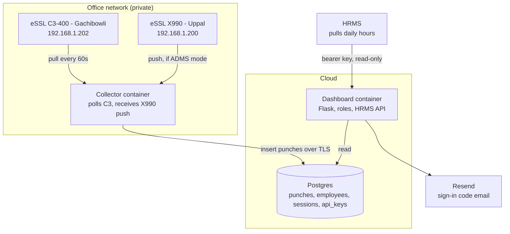
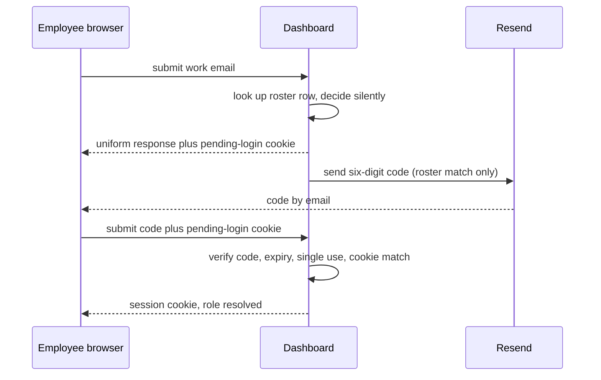
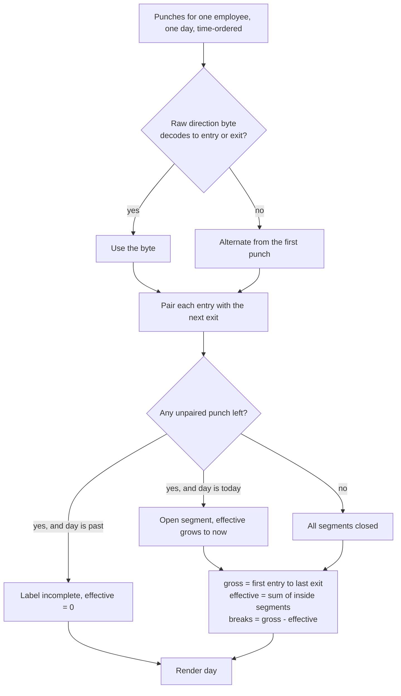

# eSSL Attendance Hours Dashboard - Plan

## Goal Capsule

- **Objective:** Replace the raw-event viewer with a role-aware attendance dashboard that turns eSSL door punches into effective hours per employee, exposes a read-only API to the HRMS, and ships as Docker.
- **Authority hierarchy:** Product Contract requirements outrank Planning Contract mechanism; a Key Technical Decision outranks a unit's Approach within its cited requirements; unit Approach carries only unit-local detail.
- **Execution profile:** Overhaul of an existing small Flask app. Domain logic (direction resolution, day shaping) is test-first. Device protocol work is spike-then-implement because two device behaviors are unconfirmed.
- **Stop conditions:** Stop and ask if a device requires a write, clear, or factory reset to proceed; if the X990 turns out to need inbound network access the office cannot grant; or if roster identity cannot be resolved because the two devices disagree on employee IDs.
- **Tail ownership:** Standalone `ce-work` owns branch, tests, review, and commits.

---

## Product Contract

### Summary

Build a cloud dashboard where each employee sees their own punches, effective hours, and a live timer against an 8-hour target, while HR views and exports everyone and an admin manages devices, roster, and API keys. An on-prem collector keeps talking to the two eSSL devices on the private network and writes to a shared Postgres database, and a read-only bearer-key API feeds the HRMS.

### Problem Frame

Hours are calculated by hand today, a day or a week after the fact. That delay has two costs. Employees cannot tell during the day whether they have met their eight hours, so they discover a shortfall only when an explanation is requested. Whoever prepares the numbers re-derives them from raw device exports every cycle, which is slow and easy to get wrong.

The device data is better than the current process implies. The Gachibowli C3-400 records a direction on every scan, and captured events alternate cleanly per person, including short breaks of five to ten minutes. The raw material for exact break accounting already exists; nothing consumes it.

The existing application collects and stores those events faithfully but stops there. It has no employee identity, no login, no hours logic, and one page that shows raw device fields. It runs on localhost behind a systemd unit, so it is reachable only from the office server.

### Actors

- A1. Employee — checks their own punches, effective hours, and progress against the target.
- A2. HR — views and exports every employee's hours for records and explanations.
- A3. Admin — configures devices, uploads the roster, and manages API keys.
- A4. HRMS — machine consumer that pulls daily hours on a schedule.

### Requirements

**Attendance truth and hours**

- R1. Punches originate only from eSSL devices. No screen, role, or API creates, edits, or deletes a punch.
- R2. Each punch is stored once, carrying its device, timestamp, device user ID, and the unmodified device payload.
- R3. Each punch carries a resolved direction and a record of which method resolved it.
- R4. A day reports gross hours (first entry to last exit) and effective hours (gross minus time spent outside).
- R5. Effective hours is the value compared against the daily target.
- R6. The daily target is a single value applied to every employee, set by an admin.
- R7. A day whose entries and exits do not pair is labelled incomplete and contributes zero effective hours.
- R8. Today's effective hours advance while the employee is inside the office.

**Identity and access**

- R9. An employee signs in with their work email and a six-digit code delivered by email.
- R10. A sign-in code expires within five minutes, is accepted once, and is redeemable only by the browser that requested it.
- R11. The code-request endpoint returns the same response and comparable timing for roster and non-roster emails.
- R12. Sessions are stored server-side and can be revoked.
- R13. Three roles exist: employee sees own data, HR reads and exports all employees, admin manages devices, roster, and API keys.
- R14. Login resolves an employee by email; punches resolve to the same employee by device user ID.

**Screens**

- R15. The employee's landing view is the current week, one row per day, with a week total.
- R16. A day view places that day's inside and outside segments on one horizontal bar.
- R17. Today's view shows a live timer and the time remaining against the target.
- R18. HR selects a day or a date range across all employees and exports the result as CSV.
- R19. Admin sees each device's connection state, last successful contact, and last error.
- R20. Admin uploads the roster as a CSV of name, work email, and device user ID.
- R21. Device user IDs with no roster row are listed to HR and admin as unmapped.

**HRMS integration**

- R22. A read-only HTTP API returns daily hours per employee for a requested date range.
- R23. API callers authenticate with a bearer key that is stored only as a hash.
- R24. Two API keys can be active at once so a key can be rotated without downtime.

**Operations**

- R25. The collector runs on the office network and the dashboard runs in the cloud; both use one Postgres database.
- R26. Both services ship as Docker images built from this repository.
- R27. Credentials and device passwords are supplied by environment variables only.
- R28. No operation writes to, clears, or resets a device.

### Key Decisions

- KD1. **Effective hours is the measure.** (session-settled: user-directed — chosen over first-in-to-last-out span: the obligation is time inside the office, not the width of the day.) Governs R4, R5.
- KD2. **The dashboard is reachable from the internet.** (session-settled: user-directed — chosen over office-network-only: employees must be able to self-check without being on site.) Governs R25.
- KD3. **Both sites are in scope now.** (session-settled: user-directed — chosen over Gachibowli first: Uppal staff need the same visibility, accepting that its collection path is unproven.) Governs R19.
- KD4. **The HRMS pulls; this system never pushes.** (session-settled: user-directed — chosen over scheduled push: a pull API needs no knowledge of HRMS internals, auth, or retry behavior.) Governs R22, R23, R24.
- KD5. **One employee ID serves both devices.** (session-settled: user-directed — chosen over per-device ID columns: the devices share a numbering scheme, so the roster stays a three-column file.) Governs R14, R20.
- KD6. **One target for everyone.** (session-settled: user-directed — chosen over per-person targets.) Governs R6.
- KD7. **No manual punches, ever.** (session-settled: user-directed — chosen over HR punch correction: the device record is the only record, so explanations for a broken day stay outside this system.) Governs R1.

### Scope Boundaries

- Payroll, leave, shift rosters, and overtime rules.
- Regularisation workflows: requesting, approving, or applying a punch correction.
- Manual punch entry or editing by any role, including admin.
- Any device write, log clear, setting change, or factory reset.
- Mobile applications. The dashboard is responsive web only.
- Single sign-on and password login. Email code is the only sign-in method.
- Night-shift and overnight spans that cross midnight.

#### Deferred for later

- Importing historical attendance from vendor CSV exports. (session-settled: user-directed — chosen over importing at launch: the dashboard starts from launch day.)
- Per-employee daily targets.
- Push notifications or email alerts for a short day.
- Choosing between Supabase and Neon as the Postgres host. Both are reached with the same client and connection string, so this is a deploy-time choice.

### Acceptance Examples

- AE1. **A normal day.** Covers R4, R5.
  - **Given:** punches at in 09:00, out 13:00, in 14:00, out 18:15, with the target at 8 hours.
  - **Then:** gross reads 9h15m, breaks read 1h00m, effective reads 8h15m, and the day is marked met.
- AE2. **A forgotten exit on a past day.** Covers R7.
  - **Given:** punches at in 09:00, out 13:00, in 14:00 and nothing further, on a day before today.
  - **Then:** the day is labelled incomplete, effective reads zero, and the unpaired entry is still shown on the timeline.
- AE3. **Today, still inside.** Covers R8, R17.
  - **Given:** punches at in 09:00, out 13:00, in 14:00, and the current time is 15:30.
  - **Then:** effective reads 5h30m and increases each minute, and remaining reads 2h30m.
- AE4. **A code requested for an unknown email.** Covers R11.
  - **Given:** a code request for an address that is not on the roster.
  - **Then:** the response body, status, and timing match the roster case, and no email is sent.
- AE5. **A punch whose direction byte cannot be decoded.** Covers R3.
  - **Given:** a C3-400 event whose direction byte is absent from the library's enum.
  - **Then:** the stored punch retains the raw byte, and the direction is resolved by alternation within that employee's day.
- AE6. **A rotated API key.** Covers R23, R24.
  - **Given:** two active keys, one of which is then revoked.
  - **Then:** the revoked key is refused with 401 and the remaining key continues to succeed.

---

## Planning Contract

### Key Technical Decisions

- KTD1. **Postgres reached with `psycopg3`.** (session-settled: user-directed — chosen over Turso/libSQL: Turso's stable Python client `libsql` has had no release since 2025-09, its recommended successor `pyturso` is PyPI-alpha on a beta engine, and `sqlalchemy-libsql` is experimental and not Windows-supported. This system must stay maintainable for years, and at a few hundred rows a day none of Turso's embedded-replica advantages apply.) Governs R25.
- KTD2. **One Python codebase, two runtime roles.** The device protocol libraries `pyzk` and `zkaccess-c3` exist only in Python, and the devices sit on private addresses, so the collector must run on-prem while the dashboard must be publicly reachable. Rewriting the protocols in another language would be the largest risk in the project for no gain.
- KTD3. **Punches are the record; hours are computed on read.** (session-settled: user-approved.) At roughly 70,000 punches a year, recomputation is trivial for Postgres, and it means a correction to the hours rules fixes every past day at once. No derived-hours table until a measurement says otherwise.
- KTD4. **Direction is resolved by alternation within the employee's day, cross-checked against the stored raw direction byte.** `.packages/c3/consts.py` defines `InOutDirection` as `ENTRY=0, NONE=2, EXIT=3, UNKNOWN_UNSUPPORTED=15`, and `.packages/c3/rtlog.py` falls back to 15 for any other byte, discarding it. Captured events hold only 0 and 15, so 15 is a decode failure of the byte the official PullSDK documents as exit. Alternation is also the only rule that works for the X990, where `pyzk` leaves the `punch` byte uninterpreted. Constrained by R3.
- KTD5. **Server-side sessions with a 30-day lifetime.** Revocability is required for offboarding and role changes under R12, and long sessions keep sign-ins rare enough that Resend's 100-email-per-day free cap is not a daily constraint.
- KTD6. **Bearer API key, SHA-256 at rest, non-secret prefix retained.** HMAC request signing is omitted: for read-only GETs over TLS to one known consumer it adds clock-skew and canonicalisation failure modes and prevents nothing. Governs R23.
- KTD7. **Server-rendered Flask templates with small vanilla JavaScript.** Extends the existing `templates/` and `static/` pattern rather than introducing a build step or a single-page framework. The live timer is the only genuinely dynamic element and needs a few lines of script.
- KTD8. **Adopt Keka and greytHR vocabulary: "gross hours" and "effective hours".** Indian HR products the team already reads use these exact terms for span and span-minus-breaks, so no new vocabulary has to be taught.
- KTD9. **Times are handled in `Asia/Kolkata`, and a day is a calendar day in that zone.** Devices report local wall-clock time with no offset. Spans crossing midnight are out of scope, so a day's punches are bounded by that day.
- KTD10. **The collector polls every 60 seconds and restarts automatically.** The C3-400's realtime log holds only about 30 records in RAM, and reading it is not re-readable, so gaps become permanent loss. Docker's restart policy plus the existing poll loop is the containment; U5 adds recovery from the device's own persistent store.

### High-Level Technical Design

Two containers, one database, one direction of data flow.

Sign-in binds the code to the requesting browser, so a forwarded code is useless elsewhere.

Day shaping is one pure function, and every branch of it is a test case.

### Sequencing

Three device facts are unconfirmed, and two of them change unit shape rather than unit existence. U4 and U5 are spike-then-implement and run early so their findings land before the screens are built. U1 and U2 unblock everything else and carry the heaviest test load. The screens (U8-U10) depend on U2 and U7 but not on each other, so they can proceed in parallel.

### Risks & Dependencies

- **The C3-400 realtime log holds about 30 records and is not re-readable.** A collector outage of a few minutes during a busy period loses punches permanently. Mitigated by KTD10 and by U5, which recovers from the device's ~10,000-record persistent store.
- **The X990 collection path is unproven.** Port 4370 refuses connections while ping and HTTP 80 succeed, which matches ADMS push mode. If confirmed, the device must be able to reach the collector on the office network, which is a network change outside this codebase. U4 resolves this before its implementation half.
- **Direction semantics are inferred, not vendor-confirmed.** The mapping in KTD4 rests on two libraries disagreeing about the exit value (1 in the official SDK wrapper, 3 in the vendored library). U4 logs the raw byte so the inference can be replaced by evidence.
- **Resend's free tier allows 100 emails a day.** Two hundred employees signing in on the same morning would exceed it. Mitigated by KTD5; escalating to a paid tier is a cost decision, not a code change.
- **Postgres host is undecided.** Both candidates are reached identically, but Neon's free tier meters compute-hours and would not suit an always-on reader.

### Open Questions

- Which Postgres host to use — deferred, deploy-time configuration only.
- **U5 finding, live-tested 2026-09-10:** the C3-400's transaction table is correctly named and its schema matches the code's expectations exactly (`Cardno, Pin, Verified, DoorID, EventType, InOutState, Time_second`). Requesting its row data closes the connection (`expected 5 bytes, received b''`), while small config tables answer fine — the likely cause is a size limit in this firmware, not a naming or protocol mismatch. No documented way to page the request exists in this library. Backfill from this table is blocked; the realtime poll (U3) remains the only ingestion path, and the ~30-record RAM queue stays the exposure named in Risks & Dependencies.
- **U4 finding, live-tested 2026-09-10:** the X990 still answers ping and HTTP 80 (status 500 on `/`) while actively refusing TCP 4370 — consistent with ADMS/cloud-push mode. Confirming or changing that setting needs an operator with physical device access or its admin web console credentials, neither of which this codebase has or should obtain unattended. X990 collection remains on its existing pull-path code, unmodified beyond storing the raw `punch` byte; it will produce no punches until an operator resolves this.
- How to treat staff whose shift crosses midnight — deferred, out of scope for this plan.
- How long punch history is retained, and who may delete an employee's records once they leave. This plan moves employee movement data to an internet-reachable service and sets no retention limit, which is a policy decision rather than a technical one. Deferred, but it should be answered before the system holds a full year.

### System-Wide Impact

This plan introduces the first authentication boundary and the first personal-data surface in the project. Three consequences carry beyond any single unit. Every read path must filter by the signed-in employee unless the role is HR or admin, so authorisation belongs in one place rather than per route. The database moves from a local file to a network service, so every query path gains a failure mode the current code does not have. And the punch table becomes personal data reachable from the internet, which makes R11's uniform response and KTD6's hashed keys load-bearing rather than polish.

---

## Implementation Units

### Unit Index

| U-ID | Title | Files touched | Depends on |
|---|---|---|---|
| U1 | Postgres schema and data layer | `essl_hub/db.py`, `essl_hub/config.py`, `requirements.txt` | — |
| U2 | Punch-to-day hours logic | `essl_hub/hours.py` | U1 |
| U3 | Collector service for the C3-400 | `essl_hub/collector_main.py`, `essl_hub/collectors.py` | U1 |
| U4 | X990 collection path | `essl_hub/collectors.py`, `essl_hub/push.py` | U3 |
| U5 | On-device history backfill | `essl_hub/collectors.py` | U3 |
| U6 | Roster upload and ID mapping | `essl_hub/roster.py`, `essl_hub/db.py` | U1 |
| U7 | Email code sign-in, sessions, roles | `essl_hub/auth.py`, `essl_hub/mail.py` | U1, U6 |
| U8 | Employee screens | `essl_hub/web.py`, `templates/`, `static/` | U2, U7 |
| U9 | HR screens and export | `essl_hub/web.py`, `templates/` | U2, U7 |
| U10 | Admin screens | `essl_hub/web.py`, `templates/` | U6, U7 |
| U11 | HRMS read-only API | `essl_hub/api.py` | U2, U7 |
| U12 | Docker packaging | `Dockerfile`, `docker-compose.*.yml` | U3, U8 |
| U13 | Retire the SQLite path and update docs | `essl_hub/database.py`, `README.md` | U12 |

### U1. Postgres schema and data layer

- **Goal:** Replace the SQLite layer with a Postgres one that holds punches, employees, sessions, sign-in codes, API keys, and settings.
- **Requirements:** R2, R25, R27.
- **Dependencies:** none.
- **Files:** `essl_hub/db.py` (new, replaces `essl_hub/database.py`), `essl_hub/config.py`, `requirements.txt`, `tests/test_db.py`.
- **Approach:**
  1. Add `psycopg[binary]` and drop the `sqlite3` usage; read one `DATABASE_URL` from the environment per R27.
  2. Port the schema: `devices`, `punches` (replacing `events`), `employees`, `sessions`, `login_codes`, `api_keys`, `settings`.
  3. Keep the existing deduplication idea but in Postgres terms: `punches.fingerprint` stays a unique column and inserts use `ON CONFLICT (fingerprint) DO NOTHING`, replacing `INSERT OR IGNORE`.
  4. Add `punches.direction` and `punches.direction_source` per R3, plus `punches.raw_direction_byte` so KTD4's inference can later be checked against evidence.
  5. Create the schema on startup as the current `Database.initialize` does; no migration framework for a first schema.
- **Patterns to follow:** the connection-context-manager and `initialize`-on-startup shape already in `essl_hub/database.py`.
- **Test scenarios:**
  - Inserting the same punch fingerprint twice stores one row and reports one insert.
  - Inserting a punch preserves the device payload byte-for-byte on read-back.
  - A punch stores its resolved direction and the source that resolved it.
  - Startup against an empty database creates every table and is safe to run twice.
  - A malformed `DATABASE_URL` fails at startup with a message naming the variable, not a stack trace at first query.
- **Verification:** the new tests pass against a local Postgres container, and no module imports `sqlite3`.

### U2. Punch-to-day hours logic

- **Goal:** Turn one employee's punches for one day into gross hours, effective hours, break total, inside segments, and a complete-or-incomplete verdict.
- **Requirements:** R3, R4, R5, R7, R8.
- **Dependencies:** U1.
- **Files:** `essl_hub/hours.py` (new), `tests/test_hours.py`.
- **Approach:**
  1. One pure function taking time-ordered punches, the target, and the current time; returning a day record. No database access inside it.
  2. Resolve direction per KTD4: trust a raw byte that decodes to entry or exit, otherwise alternate from the first punch of the day, and record which applied.
  3. Pair entries with exits, then compute totals per R4. An unpaired trailing entry on today yields an open segment counted to now per R8; on a past day it yields incomplete with zero effective per R7.
  4. Reuse this function for the week view by calling it per day.
- **Execution note:** Write this unit test-first. Every branch of the day-shaping flowchart is a named case, and the acceptance examples are the first four tests.
- **Test scenarios:**
  - Covers AE1. Four punches with one lunch break give gross 9h15m, breaks 1h00m, effective 8h15m, met.
  - Covers AE2. A trailing entry on a past day gives incomplete, zero effective, and the unpaired punch still present in the segments.
  - Covers AE3. A trailing entry today gives effective measured to the current time and remaining measured against the target.
  - Covers AE5. Punches whose raw byte is undecodable resolve by alternation, and the day records alternation as the source.
  - Three short breaks of eight, five, and eight minutes are each subtracted, matching the captured Ajay Kumar sequence.
  - A single entry with no exit today gives an open day, not an incomplete one.
  - A day with no punches gives zero hours and is neither met nor incomplete.
  - Punches arriving out of order are sorted before pairing.
  - An exit as the first punch of the day (entry recorded before collection began) is reported as incomplete rather than producing negative time.
- **Verification:** the acceptance examples pass as tests, and the module has no import of `essl_hub/db.py`.

### U3. Collector service for the C3-400

- **Goal:** Run the C3-400 poll loop as its own process that writes punches to Postgres.
- **Requirements:** R2, R25, R28.
- **Dependencies:** U1.
- **Files:** `essl_hub/collector_main.py` (new), `essl_hub/collectors.py`, `tests/test_collectors.py`.
- **Approach:**
  1. Move the poll loop out of `essl_hub/web.py`'s `_start_automatic_sync` background thread into a standalone entrypoint, so the collector no longer needs the web app to run.
  2. Keep `collect_c3` as it is for connection and identity, and extend the event normaliser to store the raw direction byte alongside the library's enum per U1's schema.
  3. Keep the existing 60-second interval and batch size as environment settings per KTD10, and keep the device read-only per R28.
  4. On a failed cycle, record the device error as the current `mark_failure` does and continue rather than exiting, so a transient network fault does not stop collection.
- **Patterns to follow:** `SyncService` in `essl_hub/service.py` for attempt/success/failure bookkeeping; `collect_c3` in `essl_hub/collectors.py` for the protocol call shape.
- **Test scenarios:**
  - A collected event is normalised with its raw direction byte retained.
  - A cycle that raises a connection error records the device error and the loop continues.
  - Two cycles returning the same event insert one punch.
  - A cycle that returns no events leaves the device marked connected, not errored.
  - The collector entrypoint starts with no Flask app present.
- **Verification:** the collector runs against the Gachibowli controller and new punches appear in Postgres with a non-null raw direction byte.

### U4. X990 collection path

- **Goal:** Establish how the Uppal X990 can deliver punches, then implement that path.
- **Requirements:** R2, R19, R28.
- **Dependencies:** U3.
- **Files:** `essl_hub/collectors.py`, `essl_hub/push.py` (new, only if push mode is confirmed), `tests/test_push.py`.
- **Approach:**
  1. Spike first, and read only. Confirm whether the device is in ADMS push mode: check its port 80 web interface for a cloud or ADMS server setting, and confirm whether 4370 is closed by configuration rather than by a firewall or duplicate address.
  2. If 4370 can be opened, keep the existing `collect_x990` pull path unchanged and only extend the normaliser to store the raw `punch` byte.
  3. If the device is committed to push mode, add a small receiver on the collector for the `/iclock/cdata` shape: tab-separated records, roughly 30-second heartbeats, and a bare `OK` reply, which the device requires or it retries indefinitely.
  4. Resolve X990 direction by alternation regardless of path. `pyzk` leaves `punch` uninterpreted across seven firmware layouts, so the byte is stored but not trusted, per KTD4.
  5. Change nothing on the device. If the mode must change, report it as an operator step rather than performing a write, per R28.
- **Execution note:** The spike half is investigation, not code. Report the finding before writing the receiver, because the two branches produce very different units.
- **Test scenarios:**
  - A posted `/iclock/cdata` body parses into punches with device user ID and timestamp. Push branch only.
  - The receiver answers exactly `OK` with no trailing content. Push branch only.
  - A replayed identical push body inserts no additional punches.
  - A malformed or truncated body is rejected without partial inserts.
  - An X990 punch stores its raw byte and reports alternation as its direction source.
- **Verification:** punches from the Uppal device appear in Postgres, and the Uppal device shows a real connection state on the admin screen per R19.

### U5. On-device history backfill

- **Goal:** Recover punches from the C3-400's persistent store so a collector outage is not permanent data loss.
- **Requirements:** R2, R28.
- **Dependencies:** U3.
- **Files:** `essl_hub/collectors.py`, `tests/test_collectors.py`.
- **Approach:**
  1. Spike first: dump the controller's advertised data-table configuration. `get_device_data` in `.packages/c3/core.py` looks a name up in the device's own `DATATABLE_CFG` and returns an empty list when absent, which is why `transaction` appears unsupported on this firmware. The real table name is the finding.
  2. If a transaction-like table exists, add a read-only backfill that pulls it and inserts through the same deduplicating path, so overlapping records cost nothing.
  3. Run backfill on collector startup and on demand from the admin screen, not on every cycle.
  4. If no such table exists, record that finding in the plan's Open Questions and leave the realtime poll as the only path.
- **Execution note:** Read-only throughout, per R28. Nothing here may write, clear, or reconfigure the controller.
- **Test scenarios:**
  - Backfilled records that overlap already-stored punches insert nothing new.
  - Backfilled records that predate the earliest stored punch are inserted.
  - A device that advertises no transaction table reports an unavailable backfill rather than raising.
  - A partial or interrupted backfill leaves the punches it did read, with no partial rows.
- **Verification:** with the collector stopped for ten minutes and then started, the punches made during the gap are present.

### U6. Roster upload and ID mapping

- **Goal:** Let an admin upload the employee roster and map device user IDs to people.
- **Requirements:** R14, R20, R21.
- **Dependencies:** U1.
- **Files:** `essl_hub/roster.py` (new), `essl_hub/db.py`, `tests/test_roster.py`.
- **Approach:**
  1. Accept a CSV of name, work email, and device user ID, using the standard-library `csv` module already used for export in `essl_hub/web.py`.
  2. Validate at the boundary: required columns present, email well-formed, device user ID non-empty, no duplicate email and no duplicate device user ID within the file.
  3. Upsert by device user ID per KD5, so re-uploading a corrected file updates rather than duplicates.
  4. Report the outcome per row rather than failing the whole file on one bad line, and never partially apply a file that failed validation.
  5. Expose unmapped device user IDs as a query for U9 and U10 per R21.
- **Test scenarios:**
  - A valid three-column file creates one employee per row.
  - Re-uploading the same file with a corrected name updates the existing row and creates none.
  - A file missing the email column is rejected with no rows written.
  - A file containing two rows with the same email is rejected with both rows named.
  - An email with no at-sign is reported for that row.
  - A device user ID present in punches but absent from the roster appears in the unmapped list.
  - A file with a UTF-8 byte-order mark and Windows line endings parses correctly.
- **Verification:** uploading a roster of the ten known device users maps every punch in the database to a named employee.

### U7. Email code sign-in, sessions, and roles

- **Goal:** Sign an employee in with a six-digit emailed code, hold a revocable session, and gate every route by role.
- **Requirements:** R9, R10, R11, R12, R13.
- **Dependencies:** U1, U6.
- **Files:** `essl_hub/auth.py` (new), `essl_hub/mail.py` (new), `tests/test_auth.py`.
- **Approach:**
  1. Generate the six digits with `secrets`, store only a hash of the code, and set expiry at five minutes with single consumption per R10.
  2. Issue an opaque pending-login cookie when the code is sent and require it at verification, so a forwarded code cannot be redeemed in another browser.
  3. Keep the request-code response identical for roster and non-roster emails per R11, deciding internally whether to send.
  4. Limit code requests to five per email address per hour and twenty per source address per hour, with a burst cap of three per minute per source, and lock a code after five wrong attempts. These are configurable, because the right numbers depend on office size and shared office addresses.
  5. Store sessions as rows keyed by an opaque cookie with a 30-day lifetime per KTD5, so revocation and role changes take effect at once.
  6. Send through Resend's official Python SDK. Keep it behind one small module so a failed send is logged and surfaced, not swallowed.
  7. Express role checks as one decorator applied per route, so R13's boundary lives in a single place.
- **Execution note:** Write the code lifecycle test-first. Expiry, single use, browser binding, and attempt limits are security behavior, not detail.
- **Test scenarios:**
  - Covers AE4. A code request for a non-roster email returns the same status and body as a roster email and sends nothing.
  - A correct code with the matching pending-login cookie creates a session and resolves the role.
  - A correct code without the pending-login cookie is refused.
  - A correct code from a different pending-login cookie is refused.
  - A code older than five minutes is refused.
  - A code already used once is refused on the second attempt.
  - A sixth wrong attempt is refused even when the sixth guess is correct.
  - Exceeding the per-email request limit within the hour is refused without sending.
  - A revoked session is refused on the next request.
  - An employee requesting an HR route receives 403; HR requesting an admin route receives 403.
  - A Resend send failure surfaces an error to the user rather than reporting a code was sent.
- **Verification:** a real sign-in completes end to end with a code delivered by Resend, and a revoked session is rejected immediately.

### U8. Employee screens

- **Goal:** Give an employee a week list, a day view with a timeline bar, and a live timer against the target.
- **Requirements:** R15, R16, R17, R8.
- **Dependencies:** U2, U7.
- **Files:** `essl_hub/web.py`, `templates/week.html`, `templates/day.html`, `static/styles.css`, `static/timer.js`, `tests/test_web.py`.
- **Approach:**
  1. Land on the current week per R15: one row per day showing first entry, last exit, effective, and met-or-short, with a week total.
  2. On the day view, render the inside and outside segments as one horizontal bar per R16, with the punch times listed beneath it rather than only on hover.
  3. Label gross and effective with those exact words per KTD8, shown side by side against the target.
  4. Compute everything server-side through U2. The only client-side script advances the visible timer for an open segment, and it recovers the true value from the server on reload.
  5. Mark an incomplete day "Incomplete — no exit recorded" and show zero effective for it per R7.
  6. Follow the palette, type scale, and status conventions already recorded in `DESIGN.md`, including its rule that colour never carries state alone.
- **Patterns to follow:** the existing `templates/index.html` and `static/styles.css` structure and the token names in `DESIGN.md`.
- **Test scenarios:**
  - A signed-in employee's week view shows only their own days.
  - Requesting another employee's day returns 403.
  - A day with an open segment renders a live timer; a closed day renders none.
  - An incomplete day renders the incomplete label and zero effective.
  - A day with no punches renders an empty state, not an error.
  - The week total equals the sum of the per-day effective values.
  - The week view is readable at 400px width with no horizontal scrolling.
- **Verification:** an employee signs in and sees their own week and day, with the timer advancing while inside and the correct total after reload.

### U9. HR screens and export

- **Goal:** Let HR view every employee for a day or range and export the result.
- **Requirements:** R18, R21, R13.
- **Dependencies:** U2, U7.
- **Files:** `essl_hub/web.py`, `templates/hr.html`, `tests/test_web.py`.
- **Approach:**
  1. One table of all employees for a chosen day, and a range view giving per-employee totals and short-day counts.
  2. Export CSV through the standard-library writer already used by `export_csv` in `essl_hub/web.py`, with the derived columns rather than raw device fields.
  3. Show unmapped device user IDs per R21 so a roster gap is visible rather than silently dropping punches.
  4. Read-only throughout. No route here edits a punch, per KD7.
- **Test scenarios:**
  - The day view lists every rostered employee, including those with no punches.
  - The export contains one row per employee per day for the selected range.
  - An employee role requesting an HR route receives 403.
  - Unmapped device user IDs appear with their punch counts.
  - A range with no punches exports a header row and no data rows rather than failing.
  - An employee with punches at both sites is reported once with merged hours.
- **Verification:** HR exports a week for all employees and the totals match the per-employee day views.

### U10. Admin screens

- **Goal:** Let an admin see device health, upload the roster, set the target, and manage API keys.
- **Requirements:** R6, R19, R20, R24, R13.
- **Dependencies:** U6, U7.
- **Files:** `essl_hub/web.py`, `templates/admin.html`, `tests/test_web.py`.
- **Approach:**
  1. Show each device's state, last successful contact, endpoint, and last error, reusing what `Database.devices` already reports per R19.
  2. Provide the roster upload form over U6 and the daily-target setting per R6.
  3. Create and revoke API keys, showing the full key exactly once at creation and the prefix thereafter per KTD6, and allow two active keys per R24.
  4. Expose no device write, clear, or reset action anywhere on the screen, per R28.
- **Patterns to follow:** the device-panel composition and status-label conventions in `templates/index.html` and `DESIGN.md`.
- **Test scenarios:**
  - Device panels show the stored state, last contact, and last error.
  - Creating a key returns the full key once and never again.
  - Creating a third active key is refused while two are active.
  - Revoking a key takes effect on the next API request.
  - Changing the target changes the met-or-short verdict on the employee week view.
  - An HR role requesting an admin route receives 403.
- **Verification:** an admin uploads the roster, sets the target, and rotates a key without an API consumer seeing a failed request.

### U11. HRMS read-only API

- **Goal:** Expose daily hours per employee to the HRMS behind a bearer key.
- **Requirements:** R22, R23, R24.
- **Dependencies:** U2, U7.
- **Files:** `essl_hub/api.py` (new), `tests/test_api.py`.
- **Approach:**
  1. One read endpoint returning daily records for a date range, and one returning the employee list, both computed through U2 so the API and the screens can never disagree.
  2. Authenticate with `Authorization: Bearer <key>`, comparing against the stored SHA-256 hash per KTD6.
  3. Paginate the range response and cap the range length so one call cannot ask for everything.
  4. Log every call with the key prefix, path, and timestamp, and rate-limit per key.
  5. Reject plain HTTP. No write endpoints exist, per R1.
- **Test scenarios:**
  - Covers AE6. A revoked key is refused with 401 while the second active key succeeds.
  - A missing or malformed Authorization header is refused with 401.
  - A valid key returns one record per employee per day in the range.
  - A range longer than the cap is refused with a message naming the cap.
  - An incomplete day is reported as incomplete with zero effective, matching the screens.
  - No route accepts POST, PUT, PATCH, or DELETE.
  - Two calls for the same range return identical values.
- **Verification:** a call with a real key returns a month of daily hours whose totals match the HR export for the same period.

### U12. Docker packaging

- **Goal:** Ship the collector and the dashboard as containers built from this repository.
- **Requirements:** R26, R27, R25.
- **Dependencies:** U3, U8.
- **Files:** `Dockerfile`, `docker-compose.collector.yml`, `docker-compose.web.yml`, `.dockerignore`, `README.md`.
- **Approach:**
  1. One image, two commands: the collector entrypoint from U3 and the web entrypoint. Two images from one Dockerfile would duplicate the dependency layer for no gain.
  2. Run gunicorn for the web service, which is already in `requirements.txt` but unused by `start.sh`.
  3. Pass every secret by environment variable per R27; commit no `.env`, and keep the existing env-example shape in `deploy/`.
  4. Give the collector `restart: unless-stopped` per KTD10, since its uptime is what protects against permanent punch loss.
  5. Run as a non-root user, matching the hardening already present in `deploy/essl-attendance-hub.service`.
- **Test scenarios:** none for the compose files themselves; verification below is the check.
- **Verification:** `docker compose -f docker-compose.collector.yml config` and the web equivalent both validate; the collector container reaches the Gachibowli device and inserts punches; the web container serves a sign-in page and connects to Postgres.

### U13. Retire the SQLite path and update docs

- **Goal:** Remove the superseded local-file path and describe the new two-part deployment.
- **Requirements:** R25, R26.
- **Dependencies:** U12.
- **Files:** `essl_hub/database.py` (delete), `essl_hub/service.py`, `templates/index.html`, `static/app.js`, `README.md`, `PRODUCT.md`, `install.ps1`, `install.sh`, `start.ps1`, `start.sh`, `.gitignore`.
- **Approach:**
  1. Delete `essl_hub/database.py` and the raw-event page it served once U8 to U10 cover every screen.
  2. Rewrite `README.md` around the two containers, the Postgres connection string, and the Resend key, keeping the existing device-setup and diagnostics sections, which stay accurate and useful.
  3. Update `PRODUCT.md`, whose stated purpose and non-goals no longer match a system that derives hours and holds employee identity.
  4. Remove the `.packages` bootstrap in `app.py` and the Windows target-install scripts if the containers replace them; keep `diagnose.py`, which remains the fastest device triage tool.
  5. Leave `data/attendance.db` on disk untouched and stop reading it. Its 45 captured punches are the evidence behind KTD4 and the U2 test fixtures, and no requirement imports them.
- **Test scenarios:** none. This unit removes code and updates prose.
- **Verification:** the full test suite passes with no module importing `sqlite3`, and a reader following `README.md` alone can bring up both containers.

---

## Verification Contract

| Gate | Command | Applies to |
|---|---|---|
| Unit and integration tests | `python -m unittest discover -s tests -v` | every unit |
| Hours logic proof | `python -m unittest tests.test_hours -v` | U2, and any later change to hours rules |
| Auth lifecycle proof | `python -m unittest tests.test_auth -v` | U7 |
| Compose validity | `docker compose -f docker-compose.collector.yml config` and the web equivalent | U12 |
| Device triage | `python diagnose.py` | U3, U4 |

Postgres-backed tests run against a throwaway local Postgres container, not a shared database.

Two checks are manual because no test can prove them. A real sign-in must complete with a code delivered by Resend. And a real API call with a real key must return a month whose totals equal the HR export for the same period.

---

## Definition of Done

Global:

- Every requirement R1 to R28 is either implemented or named in Scope Boundaries.
- Every acceptance example AE1 to AE6 exists as a passing test.
- The Verification Contract gates pass, including the two manual checks.
- No route, screen, or API endpoint creates, edits, or deletes a punch, per KD7.
- No code path writes to, clears, or reconfigures a device, per R28.
- Secrets appear only as environment variables. No key, password, or connection string is committed.
- Code from abandoned approaches is deleted, not left behind guarded or commented out. This applies especially to U4 and U5, where the spike halves may produce discarded branches.
- Findings from the U4 and U5 spikes are recorded in this plan's Open Questions, replacing the questions they answer.

Per unit: the unit's own Verification line passes, and its test scenarios exist as named tests.

---

## Sources & Research

Evidence that shaped load-bearing decisions.

- `.packages/c3/consts.py` — `InOutDirection` is `ENTRY=0, NONE=2, EXIT=3, UNKNOWN_UNSUPPORTED=15`. With `.packages/c3/rtlog.py` falling back to 15 for any other byte, the stored 15 values are decode failures, not exits. This is the basis of KTD4.
- `.packages/c3/core.py` — `get_device_data` resolves a table name against the device's advertised `DATATABLE_CFG` and returns an empty list when absent, which explains the apparently unsupported `transaction` table and gives U5 its spike.
- Captured events in `data/attendance.db` — ten employees, cleanly alternating punches, including breaks of five to ten minutes. This is the evidence that break accounting is possible at all.
- `pyzkaccess` protocol notes — the official PullSDK wrapper documents exit as 1, which is the value the vendored library cannot decode. Also the source for the roughly 30-record realtime-log limit behind KTD10.
- Keka's gross-versus-effective hours definitions — the vocabulary adopted in KTD8.
- Turso Python client status — `libsql` 0.1.11 dated 2025-09-02, `pyturso` at alpha classification, `sqlalchemy-libsql` experimental and not Windows-supported. The basis of KTD1.
- NIST SP 800-63B on one-time codes — six digits as a floor, single consumption, and attempt limiting, behind U7's code lifecycle.
- Resend free-tier limits — 3,000 emails a month capped at 100 a day, behind KTD5's long session lifetime.
