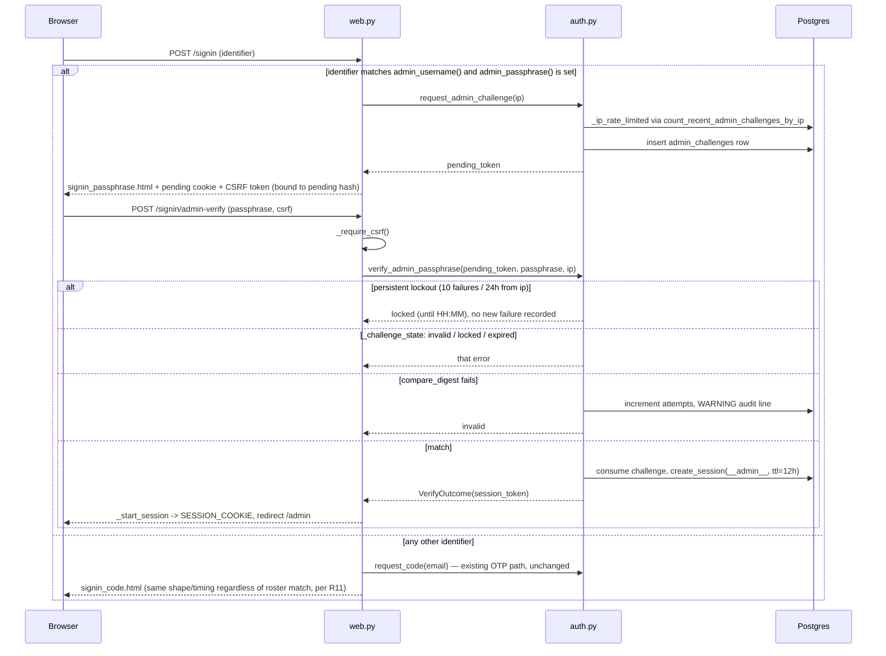
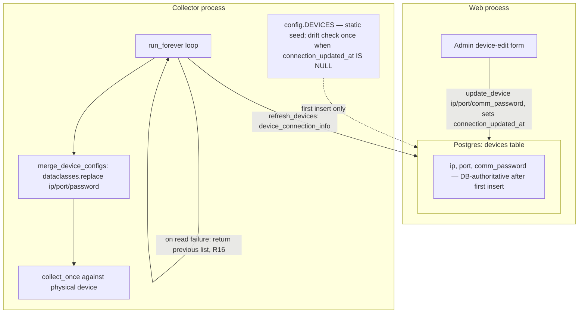
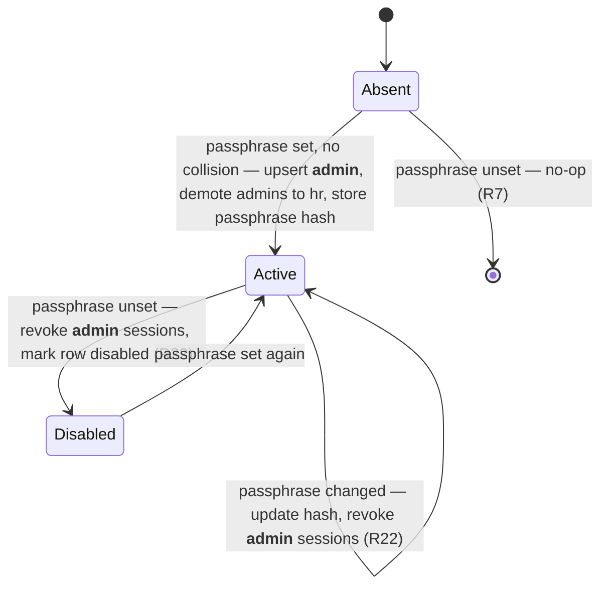

# feat: Admin console upgrades

> **Superseded (2026-10-06): the "Administrator passphrase login" portion of this plan was removed.**
>
> `ESSL_ADMIN_PASSPHRASE`, `ESSL_ADMIN_USERNAME`, and `ESSL_SECRET_KEY` are no longer read; the
> `admin_challenges` table and the synthetic `__admin__` employee row are gone, and
> `/signin/admin-verify` no longer exists. Those requirements -- R7-R15 and R21-R23 below, plus the
> sentinel clauses of R19 -- are historical only.
>
> Sign-in is now email-code only for every account, and admin access is just the `employees.role`
> column. The first admin is created once at `/setup` with `ESSL_SETUP_TOKEN`, or via
> `ESSL_BOOTSTRAP_ADMIN_EMAIL`; after that, roles are managed in `/admin` → **Role**. CSRF tokens are
> stored on the server-side session row rather than signed with a shared secret. See
> README → "Admin access".
>
> The other three upgrades in this plan still describe the app: `.xlsx` roster upload (R1, R2, R18),
> the searchable employee table (R3), and device connection editing with Postgres as the source of
> truth (R4, R5, R6, R16, R17, R20).

## Summary

Four independent admin-facing upgrades: `.xlsx` roster uploads alongside CSV, a searchable employee table on the admin screen, device editing (IP/port/comm password) with Postgres as the persistent source of truth, and an env-configured "Administrator" passphrase login that replaces email one-time codes for admin access.

## Problem Frame

The admin screen (`templates/admin.html`) only lets an admin upload a roster file and manage API keys/target hours — there is no view of the employee roster once uploaded, no way to fix a device's IP or comm password without editing `.env` and redeploying, and roster upload only accepts CSV. Admin sign-in also goes through the same emailed one-time-code flow as every employee, which is unnecessary friction for the one account that needs fast, reliable access and doesn't depend on Resend being up. Device connection settings (`essl_hub/config.py`'s `DEVICES` tuple) are also silently rewritten into the `devices` table from environment variables on every boot (`essl_hub/db.py`, `Database.initialize`), so even a direct SQL edit would not survive a restart.

---

## Requirements

**Roster upload**
- R1. The roster upload form on `/admin` accepts `.xlsx` files in addition to `.csv`, parsed into the same name/email/device-user-ID rows and validated with the existing per-row outcome reporting.
- R2. A malformed, oversized, non-UTF-8, or malicious `.xlsx`/`.csv` upload is rejected with a clear per-file error rendered on the admin page — never a partial import, a bare framework error page, or a server error.
- R18. Parsing a `.xlsx` roster upload enforces an explicit ceiling on decompressed content (row count), independent of the HTTP-layer upload-size cap, since `.xlsx` is a zip container and a small compressed file can expand to a very large payload in memory.
- R19. Roster rows whose device user ID is the synthetic admin sentinel or whose email matches the configured admin username are rejected per-row with a reason, so a roster upload can neither rebind nor crash on the admin identity.

**Employee visibility**
- R3. The admin screen shows a searchable table of every roster employee (name, email, device user ID, role, today's clock status), filterable by a text query against name and email. The synthetic admin row is never listed.

**Device editing**
- R4. An admin can edit a device's IP, port, and comm password from `/admin`, and the change persists across a container restart.
- R5. The collector picks up an edited device's IP, port, and comm password within one poll cycle, without requiring a restart.
- R6. A device row with no comm password set in the database keeps working exactly as it does today, falling back to the existing environment-variable password. An admin can explicitly clear a stored comm password to return to that fallback.
- R16. A Postgres read failure during the collector's per-cycle device-config refresh does not crash the collector process; the previous cycle's device list is reused and the read is retried next interval, including on the very first poll cycle after process start.
- R17. A device row's `ip`/`port` drifting from `config.DEVICES` is logged once by the collector process, at the point it first diverges — not on every subsequent boot, and not by the web process (whose `config.DEVICES` carries hardcoded defaults, not real values).
- R20. After saving a device edit, the admin can see whether the collector has applied it yet (pending vs. applied), derived from whether the device's last attempt is newer than the edit.

**Admin passphrase login**
- R7. When `ESSL_ADMIN_PASSPHRASE` is unset and has never been set, sign-in behaves exactly as it does today — no behavior change, no new UI, no employee demoted.
- R8. When `ESSL_ADMIN_PASSPHRASE` is set, entering the configured `ESSL_ADMIN_USERNAME` value (default `Administrator`) in the sign-in identifier field prompts for a passphrase instead of sending an emailed code; a correct passphrase signs the admin in without a code round-trip. The sign-in field must accept a non-email value in the browser, not only via the test client.
- R9. Challenge creation is rate-limited per IP, and the passphrase challenge locks after repeated wrong attempts, in the same shape as the existing one-time-code flow.
- R10. Existing employee rows with `role='admin'` are demoted to `role='hr'` once the passphrase login is enabled, except a row whose email matches `ESSL_ADMIN_USERNAME`. Demoted users keep HR access; only device/roster/API-key control moves to the Administrator identity.
- R11. The uniform-response behavior for regular sign-in emails (no timing or shape difference for roster vs. non-roster addresses) is unchanged by the new admin-username branch.
- R12. Cumulative failed passphrase attempts from the same IP are tracked across challenge expiry: 10 failures within a rolling 24 hours trigger a 1-hour lockout. Attempts during lockout are refused with a message stating when sign-in reopens, and do not extend the lockout. Requesting a fresh challenge does not reset the counter.
- R13. Every failed admin-passphrase attempt is logged at WARNING level for audit (IP, timestamp); the passphrase value itself never appears in logs, tracebacks, or error responses.
- R14. Startup of the web process fails loudly (refuses to start, naming the variable) if `ESSL_ADMIN_USERNAME` collides with an existing non-synthetic employee's email, if `ESSL_ADMIN_PASSPHRASE` is set but shorter than 12 characters, or if `ESSL_ADMIN_PASSPHRASE` is set and `ESSL_SECRET_KEY` is unset. The collector never evaluates these checks.
- R15. `POST /signin/admin-verify` and `POST /admin/devices/<device_id>` are both protected against CSRF using a token signed with `ESSL_SECRET_KEY`, which is shared across gunicorn workers and restarts.
- R21. The Administrator session expires 12 hours after sign-in (employees keep the existing 30 days).
- R22. Changing `ESSL_ADMIN_PASSPHRASE` revokes every existing Administrator session on the next web boot. Unsetting it after it was enabled disables the synthetic admin row and revokes its sessions on the next web boot; previously demoted admins stay demoted (manual restore, documented).
- R23. The synthetic admin row is excluded from every roster-employee read: HR table, CSV export, `/api/v1/hours`, unmapped-ID detection, and the admin employee table.

---

## Key Technical Decisions

- **The whole admin-passphrase feature is gated on `ESSL_ADMIN_PASSPHRASE` being set.** An unset value on a never-enabled deployment preserves current behavior byte-for-byte. Once enabled and later unset, R22 governs (disable + revoke), because "leave everything as-is" would leave the literal username routable into the OTP mailer path (R7, R22).
- **Env-derived scalars become config functions, not import-time constants.** `config.py` today validates only `database_url()`, and it does so as a function called from `Database.__init__`. `admin_username()`, `admin_passphrase()`, and `secret_key()` follow that shape; startup validation (R14) runs in `create_app`, which is the web process's de-facto startup site. A module-level raise would break `import essl_hub.config` for every test and for the collector (R14).
- **The admin identity is a synthetic system employee row, not a real `employees` FK rework.** `sessions.employee_id` and `_role_required` already assume every principal is an `employees` row; reusing that machinery means `create_session`/`resolve_session`/`revoke_session` need no changes. The row is keyed by `device_user_id='__admin__'`, with `name` and `email` both set to the configured username. Every roster read filters the sentinel out (R23).
- **Admin bootstrap runs in the web process only.** `Database.initialize` keeps schema + device seeding (both processes). A separate `Database.ensure_admin_identity(...)` runs from `create_app` only: collision check, demotion to `hr`, synthetic upsert, passphrase-change detection (hash stored in `settings`), and the disable/revoke path when unset. The collector never touches it — an R14 refusal in the collector would lose C3-400 punches (R10, R14, R22).
- **The admin-username branch is a clean fork in `signin_submit`, before any template render.** `ESSL_ADMIN_USERNAME` is an operator-chosen literal, so branching on an exact case-insensitive match doesn't reintroduce the R11 enumeration risk — that invariant only has to hold across roster emails. Accepted residual: probing with the literal username confirms the feature is on. Mitigation is R9's rate limit on challenge creation, not username secrecy (R11).
- **Extract shared auth predicates first, then mirror.** `request_code` inlines its IP rate-limit checks and `verify_code` inlines its invalid/locked/expired state machine. U8 extracts `_ip_rate_limited(...)` (takes a counting callable) and `_challenge_state(...)` and refactors the OTP path onto them (covered by existing `tests/test_auth.py`). U6's `request_admin_challenge`/`verify_admin_passphrase` reuse them and return the existing `VerifyOutcome` type, so `signin_verify`'s cookie block can be lifted into a shared `_start_session` helper. Parallel *tables* stay: admin volume must not perturb `login_codes` counts that R11 depends on (R9, R11).
- **One `admin_challenges` table, no second failures table.** Each failed attempt increments the challenge's `attempts`; the persistent counter is a count of failed attempts per IP over 24h computed from `admin_challenges` rows. This keeps table naming in the plural-noun convention and avoids a second write per failure (R12).
- **Lockout is fully specified.** Per-challenge: 5 attempts, 5-minute TTL (mirrors OTP). Persistent: 10 failures per IP in a rolling 24h window → refuse for 1 hour with "Admin sign-in locked until HH:MM". Attempts during lockout return `locked` without recording a new failure, so an attacker cannot pin the window open. Break-glass: operator deletes that IP's recent `admin_challenges` rows via SQL — documented in U7 (R12).
- **The passphrase is compared with `secrets.compare_digest` on UTF-8 encoded bytes** (both operands `.encode("utf-8")`) against the env value on each attempt rather than stored — `compare_digest` raises `TypeError` on non-ASCII `str` input, which would turn any accented character in a submitted or configured passphrase into a 500. A SHA-256 of it is stored in `settings` solely to detect rotation between boots (R22).
- **Admin session TTL is 12 hours.** `create_session` gains an optional TTL argument; the OTP path keeps `SESSION_TTL` (R21).
- **CSRF via `itsdangerous`-signed synchronizer tokens, keyed off `ESSL_SECRET_KEY`.** `itsdangerous` is already a transitive Flask dependency. Helpers live in `auth.py` next to `_hash`: the token is bound to the hash of the pending cookie for `/signin/admin-verify` (no session exists yet) and to the hash of the session cookie for `/admin/devices/<id>`. `web.py` gets a `_require_csrf()` that aborts 400, in the shape of `_authenticate_api_key`. The key must be env-supplied: gunicorn runs `-w 2`, and a per-process random key would reject roughly half of admin POSTs. `create_app` accepts a `secret_key` kwarg mirroring the existing `database` injection so tests don't depend on env (R15).
- **The passphrase is a session-signing-tier secret.** Never logged, never in tracebacks, rotation is redeploy-only (R13).
- **`comm_password` supersedes R27 from the origin plan ("credentials only via env vars") for device passwords specifically.** Low-sensitivity local comm key (README default `0`), stored alongside IP/port in the same table; applied via `ALTER TABLE ... ADD COLUMN IF NOT EXISTS` (R4).
- **`Database.initialize` stops overwriting `ip`/`port` on an existing device row.** Only a first insert seeds them; afterwards only `update_device` touches connection columns (R4).
- **The drift warning fires once per device and only in the collector.** `update_device` sets `connection_updated_at`; the collector's boot comparison against `config.DEVICES` logs only when that column is `NULL`. The web process skips the comparison entirely — `docker-compose.web.yml` passes no device env vars, so web's `config.DEVICES` are hardcoded defaults and its warning would be false (R17).
- **Blank comm-password input means "keep"; an explicit checkbox means "clear".** A C3 controller password can legitimately be blank (README), so blank-as-keep alone would make the env fallback unreachable once any value is stored (R6).
- **The collector re-reads connection info every poll cycle through two pure helpers.** `merge_device_configs(static, rows)` (uses `dataclasses.replace` — `DeviceConfig` is frozen) and `refresh_devices(database, previous)` (try/except, returns `previous` on failure). `run_forever` calls them; tests target the helpers, since `run_forever` is an untestable infinite loop. The per-cycle read uses a lean `device_connection_info()` query, not `devices()`, which carries a per-device `COUNT(*) FROM punches` subquery meant for the admin card (R5, R16).
- **`DeviceConfig` gains an optional `password` field; `password_for` prefers it.** Keeps `essl_hub/collectors.py` untouched. Its numeric-password `ValueError` is reworded to name the device, not the env var, since env is no longer the only source (R6).
- **Logging.** `_logger = logging.getLogger(__name__)` (pattern: `auth.py`) added to `db.py` and `collector_main.py`. No `basicConfig` exists anywhere, so Python's last-resort handler drops INFO; audit and drift lines use WARNING. Format `"Admin passphrase attempt failed ip=%s"` — never form data (R13, R17).
- **Roster `.xlsx` parsing normalizes into the same row shape the CSV path already consumes** via a `parse_csv`/`parse_xlsx`/`apply_rows` split; `apply_roster` stays as a CSV-compat wrapper so existing tests keep passing (R1).
- **`openpyxl==3.1.5` (read-only, `data_only`) plus `defusedxml`**, `MAX_CONTENT_LENGTH` at the HTTP layer, and an explicit row-count ceiling inside `parse_xlsx` because the HTTP cap bounds only the compressed size (R2, R18).
- **Validation errors re-render at 200 with flat context keys; success redirects.** Convention is `roster_error`/`key_error` strings and `redirect(url_for("admin_view"))` on success. U2 uses `device_error`, `device_error_id`, `device_form` (one card can error per POST) and redirects with `?saved=<device_id>`; `flash()` is unused in the codebase (R4).

---

## High-Level Technical Design

**Admin passphrase login sequence.** The fork at `POST /signin` and every branch of the verify step:



**Device-config data flow.** After U1-U3, Postgres is the sole coordination point between the two processes:



**Admin identity lifecycle** (web boot, `ensure_admin_identity`):



---

## System-Wide Impact

- **The collector gains a live read dependency on Postgres every poll cycle.** A failed `device_connection_info()` read must fall back to the previous cycle's list (R16); a transient blip must never become a collector outage, since the C3-400 realtime queue holds only ~30 records.
- **`Database.initialize()` runs concurrently in three callers at full-stack boot**: two gunicorn workers and the collector. Schema statements and the device upsert are already idempotent. Admin bootstrap is moved out of `initialize` into `ensure_admin_identity`, called from `create_app` only; with `--preload` (Rollout) it runs once per web deploy. Its upsert treats a unique-violation race as "the other worker won".
- **`devices.ip`/`port`/`comm_password` have exactly one writer after this ships: the web process via `update_device`.** The collector only reads.
- **The `employees` table holds one synthetic row.** Every existing `employees()` consumer — `hr_view`, `hr_export`, `api_hours`, `unmapped_device_user_ids`, and U4's table — must exclude it (R23). The HRMS API leaking a fake "Administrator" employee is a regression to guard with tests per consumer.
- **Passphrase rotation and unset are boot-time events with session consequences** (R22). Without them, a compromised admin session would outlive a rotation by up to the TTL.
- **Demotion to `hr` is one-way.** Re-granting `admin` to an employee row requires SQL; no UI exists. Recorded pre-deploy (Rollout).

---

## Implementation Units

### U1. Device config becomes DB-authoritative

**Goal:** Stop `Database.initialize` from clobbering `ip`/`port` on every boot, add `comm_password` and `connection_updated_at` columns, add `update_device`, `device_by_id`, and `device_connection_info`.

**Requirements:** R4, R6, R17

**Files:**
- `essl_hub/db.py`
- `tests/test_db.py`
- `tests/test_web.py` (FakeDatabase row dict gains the new keys)

**Approach:** Append `ALTER TABLE devices ADD COLUMN IF NOT EXISTS comm_password TEXT;` and `ALTER TABLE devices ADD COLUMN IF NOT EXISTS connection_updated_at TIMESTAMP;` to `SCHEMA_STATEMENTS`. Change the `ON CONFLICT (id) DO UPDATE` clause to update only `site`, `model`, `protocol`. Add `update_device(device_id, *, ip, port, comm_password)` (always sets the value it's given, including `NULL`, and sets `connection_updated_at` via `_now()`), `device_by_id(device_id)` (singular lookup for U2's 404, pattern: `employee_by_email`), and `device_connection_info()` returning only `id, ip, port, comm_password` for the collector's hot loop. Add `_logger = logging.getLogger(__name__)` (pattern: `auth.py`).

Add a `warn_device_drift(devices)` method that, for each row with `connection_updated_at IS NULL`, compares `ip`/`port` to the matching `DeviceConfig` and logs a WARNING when they differ. It is called by `collector_main.main()` only (U3) — not by `initialize`, not by web — because web's `config.DEVICES` are hardcoded defaults (R17).

**Patterns to follow:** `mark_attempt`/`mark_success`/`mark_failure` for the connect-and-execute shape; `_now()` for all timestamps (tz-naive IST) — do not mix SQL `now()` defaults with Python-side comparison, an inconsistency `login_codes` already carries and U6 must not copy.

**Test scenarios:**
- `initialize` twice with different `DEVICES` IPs does not change an existing row's `ip`/`port` (regression for current clobbering).
- New device ID is inserted with `ip`/`port` from `DEVICES`, `connection_updated_at` NULL.
- `update_device` changes all three columns and sets `connection_updated_at`; survives a later `initialize()`.
- `update_device(comm_password=None)` sets NULL (this is the "clear" path U2 exposes via checkbox).
- `device_by_id` returns the row, or None for unknown ID.
- `device_connection_info` returns exactly the four connection columns for every device.
- `warn_device_drift` logs once for a never-edited row whose IP differs; logs nothing for that row after `update_device` has run (R17).
- `test_initialize_creates_every_table_and_is_idempotent` still passes (table set unchanged in U1; U6 updates it).

**Verification:** `tests/test_db.py` passes against a Postgres reachable via `TEST_DATABASE_URL` (the suite skips without it — note this in the PR); manual `initialize()` → `update_device()` → `initialize()` confirms the edit survives.

---

### U8. Config functions, secret key, CSRF helpers, shared auth predicates

**Goal:** Land the plumbing both U2 and U6 depend on: lazily-validated config functions, `ESSL_SECRET_KEY`, CSRF issue/verify, and the extracted rate-limit/challenge-state helpers.

**Requirements:** R14 (length and secret-key checks), R15

**Dependencies:** none

**Files:**
- `essl_hub/config.py`
- `essl_hub/auth.py`
- `essl_hub/web.py`
- `tests/test_auth.py`
- `tests/test_web.py`

**Approach:** Add `admin_username()`, `admin_passphrase()`, `secret_key()` to `config.py` as functions (pattern: `database_url()`), raising `RuntimeError` naming the variable when invalid (pattern: `test_malformed_database_url_fails_at_startup_naming_the_variable`). `create_app(database=None, secret_key=None)` resolves the key from the kwarg or `secret_key()`, sets `app.secret_key`, and refuses to start if a passphrase is set without a key or is shorter than 12 characters.

In `auth.py`: extract `_ip_rate_limited(database, count_by_ip, ip, now)` (burst + hourly) and `_challenge_state(row, now)` (`invalid|locked|expired|None`) from `request_code`/`verify_code`; refactor both onto the helpers — pure refactor, existing `tests/test_auth.py` must pass unchanged. Add `issue_csrf_token(secret, binding)` / `verify_csrf_token(secret, token, binding)` using `itsdangerous.URLSafeTimedSerializer`, where `binding` is `_hash(cookie_value)`. In `web.py`: `_require_csrf(binding_cookie)` aborting 400, shaped like `_authenticate_api_key`; `_start_session(outcome, redirect_to)` lifted from `signin_verify`'s cookie block.

**Patterns to follow:** `config.database_url()`; `auth._hash`, `secrets.token_urlsafe`; `web._secure_cookies()`; `tests/test_auth.py` `VerifyCodeTest`.

**Test scenarios:**
- `secret_key()` raises naming `ESSL_SECRET_KEY` when unset and a passphrase is set; returns the value otherwise.
- `admin_passphrase()` of 11 characters raises naming `ESSL_ADMIN_PASSPHRASE`; 12 passes.
- Importing `essl_hub.config` with a short `ESSL_ADMIN_PASSPHRASE` in env does not raise (validation is lazy).
- A CSRF token issued by one `create_app(secret_key=K)` instance verifies in a second instance with the same `K` (multi-worker simulation); fails with a different key, a different binding, or after tampering.
- Existing `request_code`/`verify_code` tests pass unchanged after the refactor.

**Verification:** `tests/test_auth.py` and `tests/test_web.py` pass; no behavior change to the OTP flow.

---

### U2. Admin device-edit UI

**Goal:** Let an admin edit a device's IP, port, and comm password from `/admin`, see whether the collector has applied it, and clear a stored password.

**Requirements:** R4, R6, R15, R20

**Dependencies:** U1, U8

**Files:**
- `essl_hub/web.py`
- `templates/admin.html`
- `static/styles.css`
- `tests/test_web.py`

**Approach:** Add `POST /admin/devices/<device_id>` under `_role_required("admin")`, calling `_require_csrf` bound to the session cookie (R15). Unknown ID → `abort(404)` via `device_by_id` (new precedent; `admin_revoke_key` silently no-ops — note the deliberate divergence). Validate: port integer 1-65535, IP non-empty, and for the `zk-attendance` protocol the comm password must be numeric (matches the collector's constraint). On validation failure re-render at 200 with `device_error`, `device_error_id`, and `device_form` (submitted values) in the `_render_admin` context — flat keys per convention. Comm password: blank input = keep (pass current value through); a "Clear stored password (use env fallback)" checkbox = set NULL (R6). On success `redirect(url_for("admin_view", saved=device_id))`; the card reads `saved` from `request.args` (pattern: `hr_view`'s `q`) to show a success indicator.

Each `.device-card` gets an Edit toggle revealing the inputs. Applied/pending: when `connection_updated_at` is set and `last_attempt` is older than it, show "Saved HH:MM — collector applies within N s" (N from `ESSL_COLLECTOR_INTERVAL_SECONDS`); otherwise nothing (R20). Comm-password input placeholder: "Leave blank to keep current password". Replace the header banner "Read-only. This dashboard never writes to, clears, or resets a device." with copy that is still true (the dashboard edits connection settings; it never clears or resets a device). `_render_admin` must also pass `employees` (U4) on every POST re-render, or the employee table empties after any admin POST.

**Patterns to follow:** `admin_set_target` (validate → redirect), `admin_roster_upload` (re-render with error), `_render_admin(**overrides)`, `.device-details`/`.status-chip`/`.roster-drop` CSS.

**Test scenarios:**
- Happy path: valid IP/port POST → 302 to `/admin?saved=<id>`; GET shows new values and success indicator.
- Pending indicator shown when `last_attempt < connection_updated_at`; hidden after a newer attempt (R20).
- Non-numeric port → 200, `device_error_id` equals that device, submitted values redisplayed, no DB write.
- Non-numeric comm password on a `zk-attendance` device → card-scoped error.
- Blank comm password keeps the stored value; "clear" checkbox sets NULL and `password_for` falls back to env (R6).
- Unknown `device_id` → 404.
- Non-admin role → 403; anonymous → 302 to sign-in (matches `_role_required`).
- Missing/invalid CSRF token → 400, no write (R15).
- After a device POST with a validation error, the employee table is still populated.

**Verification:** `tests/test_web.py` covers the above via `FakeDatabase` (add `update_device`, `device_by_id`, new row keys); manual check confirms the header copy no longer claims read-only.

---

### U3. Collector reads device connection info from the database each cycle

**Goal:** An edit made through U2 takes effect on the collector's next poll, without a restart.

**Requirements:** R5, R6, R16, R17

**Dependencies:** U1

**Files:**
- `essl_hub/config.py`
- `essl_hub/collector_main.py`
- `essl_hub/collectors.py` (error message wording only)
- `tests/test_collector_main.py`

**Approach:** Add `password: str | None = None` as the last field of the frozen `DeviceConfig`; `password_for` returns it when non-empty, else the env lookup. Add two pure functions to `collector_main.py`: `merge_device_configs(static, rows)` — for each static `DeviceConfig`, `dataclasses.replace` with the matching row's `ip`/`port`/`comm_password` (static values when no row), then apply the existing `device_id` filter; and `refresh_devices(database, previous)` — calls `database.device_connection_info()` inside try/except, logs a WARNING and returns `previous` on any exception. `run_forever` seeds `previous` from `merge_device_configs(DEVICES, [])` before the loop and calls `refresh_devices` each iteration. `main()` calls `database.warn_device_drift(DEVICES)` once after `initialize` (R17). Reword `collectors.py`'s numeric-password `ValueError` to name the device ("comm password for <site> must be a number"), not `ESSL_X990_PASSWORD`. Add `_logger` to `collector_main.py`. Avoid the substring "flask" anywhere in the file, including comments — the structural test greps for it.

**Patterns to follow:** `collect_once`'s injected-`collector` test style; `test_collector_main_does_not_import_flask_or_the_web_app`.

**Test scenarios:**
- `merge_device_configs` overrides `ip`/`port`/`password` from rows; keeps static values when a row is missing; drops devices not in the static list.
- Row with `comm_password=NULL` → `password_for` returns the env value (R6). Non-null → preferred.
- `refresh_devices` returns the merged list on success; returns `previous` unchanged and logs when the database raises (R16).
- Seeded `previous` equals the static list, so a first-cycle failure yields the env-configured devices (R16).
- Structural "no Flask import" test still passes.

**Verification:** `tests/test_collector_main.py` passes (FakeDatabase gains `device_connection_info` and `warn_device_drift`); manual run shows an edit taking effect within one interval without restart.

---

### U4. Employee table on the admin screen

**Goal:** Give the admin a searchable view of every roster employee and their status today.

**Requirements:** R3, R23

**Dependencies:** U6 (for the `__admin__` exclusion in `employees()`; U4 may land first if `employees()` already filters the sentinel)

**Files:**
- `essl_hub/web.py`
- `templates/admin.html`
- `tests/test_web.py`

**Approach:** Read `q` as `(request.args.get("q") or "").strip().lower()` (exact `hr_view` expression). Filter on name and email — a deliberate divergence from `hr_view`, which filters name and device user ID; the admin's question is "who is this person", the HR view's is "whose badge is this". Add `employees` to the `_render_admin` context (populated on every render, including POST re-renders). Reuse `_day_for_employee`/`hours.compute_day` and the `status-chip status-{{ value }}` mapping from `templates/hr.html` (`empty|incomplete|open|met|short`). Use the existing `.search-field` class from `static/styles.css` rather than an inline-styled input.

**Patterns to follow:** `hr_view`; `templates/hr.html` table and chip markup; `.search-field`, `.hours-table`; `tests/test_web.py` `AdminViewTest`.

**Test scenarios:**
- `GET /admin` lists every roster employee with name, email, device ID, role, status chip.
- `GET /admin?q=ajay` filters case-insensitively on name or email.
- No match → empty table, not an error.
- Employee with no punches today shows the `empty` chip.
- Synthetic `__admin__` row is never listed (R23).

**Verification:** `tests/test_web.py` `AdminViewTest` extended and passing.

---

### U5. Roster `.xlsx` upload support

**Goal:** Accept `.xlsx` roster files through the same form, parsed into the same validated row shape as CSV, with every failure rendered on the admin page.

**Requirements:** R1, R2, R18, R19

**Dependencies:** U8 (for `admin_username()`; the sentinel check needs no other dependency)

**Files:**
- `requirements.txt`
- `essl_hub/roster.py`
- `essl_hub/web.py`
- `templates/admin.html`
- `tests/test_roster.py`
- `tests/test_web.py`

**Approach:** Add `openpyxl==3.1.5` and `defusedxml` (pinned) to `requirements.txt` (Dockerfile already installs from it). In `roster.py`: rename `_parse` → `parse_csv`; extract the validate/upsert/outcome loop into `apply_rows(database, rows)`; keep `apply_roster(database, csv_text)` as a wrapper so existing tests pass. Add `parse_xlsx(file_bytes)`: `load_workbook(BytesIO(...), read_only=True, data_only=True)` in try/finally, active sheet, `iter_rows(values_only=True)`, header aliases via `REQUIRED_COLUMNS`, skip fully-empty rows, coerce numeric cells to clean strings (`1023.0` → `"1023"`), and raise `RosterFileError` the moment 5,000 rows are exceeded (R18). Error messages name the sheet ("no header row found in first row of sheet 'Sheet1'"). In `apply_rows`, reject per-row any device ID equal to `__admin__` or email case-insensitively equal to `admin_username()` (R19); also catch `UniqueViolation` from `upsert_employee` and report it as a per-row rejection instead of a 500 (pre-existing gap, same change).

In `web.py` `admin_roster_upload`: branch on extension *before* decoding — `.csv` decodes as `utf-8-sig` inside the try, with `UnicodeDecodeError` → `RosterFileError("file is not UTF-8 text; if this came from Excel, upload it as .xlsx")`; `.xlsx` passes bytes; `.xls` → "save as .xlsx"; other → unsupported. Set `MAX_CONTENT_LENGTH` (5 MB) in `create_app` and register an `errorhandler(413)` that returns `_render_admin(roster_error=...)` instead of Flask's bare page (R2). Update `admin.html` `accept=".csv,.xlsx"`, the "Columns, in order" copy, and the "Choose a CSV file" message.

**Technical design (directional):**
```
POST /admin/roster
  ext = filename.rsplit(".", 1)[-1].lower()
  try:
    if ext == "csv":   rows = roster.parse_csv(bytes.decode("utf-8-sig"))
    elif ext == "xlsx": rows = roster.parse_xlsx(bytes)
    elif ext == "xls":  raise RosterFileError("save as .xlsx")
    else:               raise RosterFileError("unsupported file type")
    outcomes = roster.apply_rows(database, rows)
  except (RosterFileError, UnicodeDecodeError) as e: render admin with roster_error
```

**Patterns to follow:** `roster.py`'s `_parse`/`apply_roster` split; `_shape_error`; `tests/test_roster.py` fixtures.

**Test scenarios:**
- Well-formed `.xlsx` with header aliases produces the same outcomes as the equivalent CSV.
- Numeric device-ID cells coerce to `"1023"`, not `"1023.0"`.
- Trailing empty rows skipped; multi-sheet workbook uses the active sheet; blank active sheet yields a sheet-named error.
- `.xls` and unknown extensions rejected with the specified messages before parsing.
- Corrupt bytes with `.xlsx` extension → `RosterFileError`.
- Binary bytes with `.csv` extension → `RosterFileError`, not 500 (R2).
- `.xlsx` containing an external entity → `RosterFileError`, no network/file access (R2, defusedxml).
- Row count past the ceiling → `RosterFileError` before full materialization (R18).
- Upload over `MAX_CONTENT_LENGTH` → admin page renders with `roster_error`, not a bare 413 (R2).
- Row with device ID `__admin__` or email equal to the admin username → per-row rejection (R19).
- Two rows sharing an email with different device IDs → per-row rejection, not 500.

**Verification:** `tests/test_roster.py` and `tests/test_web.py` pass; `.xlsx` fixtures built with `openpyxl` in test setup (no binary committed).

---

### U6. Admin passphrase login

**Goal:** Replace the emailed one-time code with an env-configured passphrase for a single Administrator identity, gated on `ESSL_ADMIN_PASSPHRASE`.

**Requirements:** R7-R15, R21, R22, R23

**Dependencies:** U1, U8

**Files:**
- `essl_hub/db.py`
- `essl_hub/auth.py`
- `essl_hub/web.py`
- `templates/signin_email.html`
- `templates/signin_passphrase.html` (new)
- `tests/test_db.py`
- `tests/test_auth.py`
- `tests/test_web.py`

**Approach — identity.** Add `Database.ensure_admin_identity(username, passphrase)` called from `create_app` only. Passphrase set: refuse (raise naming the variable) if a non-sentinel employee's email matches the username (R14); demote every other `role='admin'` row to `hr` (R10); upsert the sentinel row (`device_user_id='__admin__'`, name and email = username, `role='admin'`, `disabled=false`) keyed by `device_user_id`, treating a unique-violation race as "other worker won"; compare SHA-256 of the passphrase to `settings['admin_passphrase_hash']` — on change, store the new hash and revoke every session for the sentinel row (R22). Passphrase unset and a sentinel row exists: set `disabled=true` and revoke its sessions (R22). Passphrase unset and no sentinel: no-op (R7). Add `ALTER TABLE employees ADD COLUMN IF NOT EXISTS disabled BOOLEAN NOT NULL DEFAULT false`. Filter `device_user_id <> '__admin__'` in `employees()` and `unmapped_device_user_ids` (R23); `resolve_session` denies a disabled principal.

**Approach — challenge.** Add `admin_challenges` (`id`, `pending_token_hash`, `requested_ip`, `expires_at`, `consumed_at`, `attempts`, `created_at` via `_now()`) to `SCHEMA_STATEMENTS`; update `tests/test_db.py`'s drop list and asserted table set. Database methods mirror `login_codes` names: `create_admin_challenge`, `active_admin_challenge`, `increment_admin_challenge_attempts`, `consume_admin_challenge`, `count_recent_admin_challenges_by_ip`, `count_recent_admin_failures_by_ip` (failed = `attempts > 0 AND consumed_at IS NULL`, over 24h). In `auth.py`: `request_admin_challenge(database, *, requested_ip)` using `_ip_rate_limited`; `verify_admin_passphrase(database, *, pending_token, passphrase, requested_ip)` — persistent lockout first (10 failures/24h → `locked` with `until` timestamp, no increment), then `_challenge_state`, then `secrets.compare_digest`, WARNING audit on failure, `create_session(..., ttl=12h)` on success, returning `VerifyOutcome` (R9, R12, R13, R21).

**Approach — routes.** In `signin_submit`, fork *before* the `render_template` call: if a passphrase is configured and the identifier case-insensitively equals the username, call `request_admin_challenge`, set `PENDING_COOKIE`, render `signin_passphrase.html` with a CSRF token bound to the pending hash; otherwise the existing path, untouched (R11). Add `POST /signin/admin-verify`: `_require_csrf(PENDING_COOKIE)`, then `verify_admin_passphrase`, then `_start_session` (R15). Message map adds `locked_until` ("Admin sign-in locked until HH:MM"). `signin_email.html`: change the identifier input to `type="text" inputmode="email"` (browser `type="email"` rejects the literal `Administrator`, making R8 unreachable outside the test client), and adjust the "There is no password" copy when the feature is on. `signin_passphrase.html` mirrors `signin_code.html` including its "Start again" link.

**Patterns to follow:** `request_code`/`verify_code` (via U8 helpers); `signin_code.html`; `_secure_cookies`; `tests/test_web.py` mailer-monkeypatch idiom (admin path must not call the mailer); per-test env control with `unittest.mock.patch.dict(os.environ)` — config is now function-based so no module reload is needed.

**Test scenarios:**
- Passphrase set: admin username → passphrase page (mailer not called); correct passphrase → session with `role='admin'`, redirect `/admin`.
- Passphrase unset, never enabled: admin username → OTP path, no sentinel row exists (R7).
- Demotion: existing `role='admin'` employee becomes `hr`, keeps `/hr`, gets 403 on `/admin` on the very next request of an already-active session (R10).
- Passphrase unset: `role='admin'` employees untouched.
- Collision: username equals a roster email → `ensure_admin_identity` raises naming `ESSL_ADMIN_USERNAME` (R14).
- Five wrong attempts lock the challenge (per-challenge cap).
- Ten failures across several fresh challenges from one IP → `locked_until`; an attempt during lockout returns `locked_until` and does not increment or record (R12); lockout expires after 1 hour.
- Fourth `POST /signin` with the admin username from one IP within a minute creates no new challenge (R9).
- Expired challenge → `expired`, no increment.
- Non-ASCII submitted passphrase, and a non-ASCII configured passphrase, both return `invalid`/`match` normally — never a 500.
- Missing/invalid CSRF token on admin-verify → 400 (R15).
- Failed attempt writes one WARNING line containing the IP and never the passphrase (R13).
- Admin session expires after 12 hours; an employee session still lasts 30 days (R21).
- Rotating the passphrase then rebooting revokes existing admin sessions; unchanged passphrase leaves them valid (R22).
- Unsetting after enable: sentinel `disabled`, its sessions revoked, admin username falls to OTP path without a mailer call for the sentinel (R22).
- `employees()`, `hr_export`, `api_hours`, and `unmapped_device_user_ids` never include the sentinel (R23).
- Regular roster email still follows the exact pre-existing response path (R11).
- `test_initialize_creates_every_table_and_is_idempotent` passes with `admin_challenges` added; `initialize()` twice is idempotent.

**Verification:** `tests/test_auth.py`, `tests/test_db.py`, `tests/test_web.py` pass; browser-level manual check (not test client) confirms `Administrator` can be typed and submitted, the passphrase prompt appears only for the configured username, and only when the passphrase is set.

---

### U7. Document the new environment variables, columns, and operator procedures

**Goal:** An operator can configure every new value, deploy safely, and recover from lockout or demotion without reading code.

**Dependencies:** U1, U5, U6, U8

**Files:**
- `README.md`
- `deploy/essl-attendance-hub.env.example`
- `docker-compose.web.yml`
- `docker-compose.collector.yml` (no new vars; confirm none needed)

**Approach:** Add `ESSL_ADMIN_USERNAME`, `ESSL_ADMIN_PASSPHRASE` (min 12), `ESSL_SECRET_KEY`, and the upload cap to the README Configuration table and the env example, marking the three admin vars as **web-only**. Pass them through in `docker-compose.web.yml` (currently passes only `DATABASE_URL`, `RESEND_*`, `ESSL_FORCE_HTTPS_COOKIES`), also pass `ESSL_COLLECTOR_INTERVAL_SECONDS` (default 60) so U2's "applies within N s" copy reflects the real interval (mark it "both" in the README table), and add `--preload` to the gunicorn command. Document: `comm_password` is now edited from `/admin`; the "clear" checkbox restores env fallback; lockout numbers and the SQL break-glass (delete that IP's recent `admin_challenges` rows); re-promoting a demoted admin via SQL; unsetting the passphrase disables the Administrator login. Reproduce the Rollout & Operations section's ordering and verification checklist in the README deployment section.

**Test expectation:** none — documentation and compose configuration only.

**Verification:** Every variable introduced by U1-U8 appears in the README table, the env example, and (for web-only vars) the web compose file.

---

## Rollout & Operations

**Ordering.** Ship one image. Upgrade the collector first, then the web immediately after, in one window. Mixed versions are unsafe in both directions: an old process's boot re-applies its own `config.DEVICES` ip/port (the web's are hardcoded defaults, since the web compose passes no device vars) and silently undoes any admin edit. Make no device edits until both containers are confirmed on the new image.

**Two-phase U6.** Phase A: deploy with `ESSL_ADMIN_PASSPHRASE` unset — zero auth behavior change (R7). Verify U1/U3. Phase B: set `ESSL_ADMIN_USERNAME`, `ESSL_ADMIN_PASSPHRASE`, `ESSL_SECRET_KEY` in the web env only; restart web. The collector never evaluates the admin block.

**Pre-deploy.** Restart the old collector last before upgrading, so its real ip/port are the values U1 freezes. Take a Postgres backup. Record `devices` (id, ip, port) and every `role='admin'` employee (id, email) — demotion has no automatic undo. Confirm the admin username matches no roster email. Build the image before recreating containers so downtime stays in seconds.

**Verify.** U1: collector logs zero or one drift warning per device; `/admin` cards match the collector `.env`; a collector restart changes nothing. U3: a deliberately wrong port edit shows `error` on the card within one interval; reverting shows `connected`; no restart; a brief Postgres outage logs a fetch warning and the collector keeps running. U6: admin username → passphrase page; correct passphrase → `/admin`; demoted employee → `/hr` works, `/admin` 403; a failed attempt → one WARNING line with IP, never the passphrase.

**Rollback.** New columns and tables are harmless to the previous image; `comm_password` is ignored and env passwords resume. Admin ip/port edits are lost on old-code boot — mirror edits into `.env` until the release is stable. Restore demoted roles from the pre-recorded list. Revoke admin sessions: a session minted by U6 remains valid under old code (the sentinel row still has `role='admin'`). Roll back collector first for the same ordering reason as deploy.

**gunicorn.** `ESSL_SECRET_KEY` comes from env and is shared by both workers; a per-process key would reject about half of admin form posts. `--preload` makes `create_app` (and therefore `ensure_admin_identity`) run once per web deploy. Rate-limit and lockout state is DB-backed and worker-safe.

---

## Scope Boundaries

### Deferred to Follow-Up Work
- Promoting/demoting employees to `hr`/`admin` from the UI (U4's table is read-only).
- Employee-visualization charts or trend graphs.
- Editing device `site`, `model`, or `protocol`.
- A background task queue to close the pre-existing timing gap between roster-match and non-match sign-in responses.
- A `docs/solutions/` write-up after this ships.
- Cleanup/expiry of old `admin_challenges` rows — mirrors the existing lack of cleanup on `login_codes`.
- A global (cross-IP) lockout or alerting beyond the per-IP counter.
- A friendly 403 page (codebase has none; demoted admins currently get Flask's default).
- A `logging.basicConfig` pass so INFO-level lines surface under gunicorn (this plan uses WARNING to sidestep it).
- Audit logging of successful admin sign-ins and device edits.

---

## Risks & Dependencies

- **New dependencies (`openpyxl`, `defusedxml`).** First third-party file-parsing dependency; pinned.
- **Schema change on live tables (`ALTER TABLE ... ADD COLUMN IF NOT EXISTS` on `devices` and `employees`).** Idempotent; a genuinely simultaneous first run from two connections is a known Postgres catalog race (`duplicate_column`) that already exists for `CREATE TABLE IF NOT EXISTS` here. `--preload` reduces the web side to one caller (see Rollout).
- **Lockout on a shared office NAT.** Ten failures from any coworker behind the same IP lock the real admin for an hour. Break-glass is SQL (U7). Acceptable for a single-admin deployment; revisit if it bites.
- **One-way demotion to `hr`.** Pre-recorded before deploy; SQL restore documented.
- **`comm_password` in plaintext** — scoped exception to origin R27; not for higher-sensitivity credentials.
- **Passphrase hash in `settings`** is SHA-256 of the raw passphrase, used only for change detection. A DB read exposes an offline-crackable hash of a 12+ character secret; acceptable given DB access already exposes device passwords and session tokens, but noted.

---

## Sources & Research

- `essl_hub/db.py` `Database.initialize` — env-overwrite behavior U1 changes; `_now()` naive-IST convention.
- `essl_hub/auth.py` `request_code`/`verify_code` — R11 invariant, inline rate-limit checks U8 extracts, `_logger` pattern.
- `essl_hub/config.py` `database_url()` — the lazy-validation precedent for new config functions; `DeviceConfig(frozen=True)`.
- `essl_hub/roster.py` — `_parse`/`apply_roster` split U5 refactors.
- `essl_hub/web.py` `_render_admin`, `hr_view`, `admin_set_target`, `_authenticate_api_key`, `signin_submit` render-before-branch.
- `templates/signin_email.html` `type="email"` — the browser-side block on R8.
- `tests/` — four independent `FakeDatabase` classes; `test_db.py` exact table-set assertion and `TEST_DATABASE_URL` skip.
- `docker-compose.web.yml` — `-w 2`, no device env vars, no admin vars.
- `docs/plans/2026-09-10-001-feat-attendance-hours-dashboard-plan.md` — origin plan; R27 superseded for `comm_password` only.
- openpyxl 3.1.5 read-only/`data_only`; `defusedxml`; OWASP File Upload Cheat Sheet.
- 2026-09-11 deepening: security (username oracle, persistent lockout rationale), data integrity (cutover, collector read), architecture. Doc review (six personas): CSRF scope, drift-warning-forever defect, decompression ceiling, U2 interaction states.
- 2026-09-15 deepening: repo-research (test infrastructure, `type="email"`, sentinel leak, roster collision, decode-before-branch, `SECRET_KEY` gap, CSRF ordering); pattern-recognition (config functions, extract-then-mirror, single challenges table, WARNING logging, flat error keys, pure collector helpers); deployment verification (ordering, two-phase U6, web-only drift check, `--preload`, rollback session revocation); spec-flow (lockout spec, rotation/unset, applied-pending signal, clear-password control, 413 handler, demotion target).
