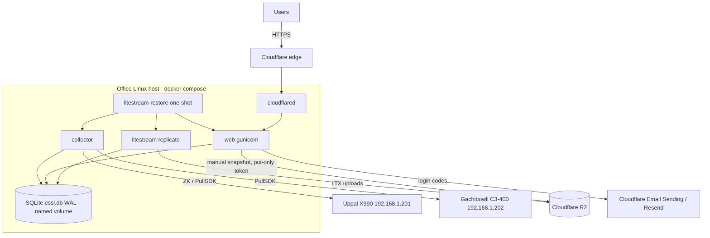
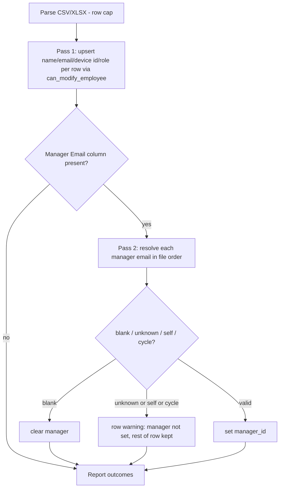

# feat: Four roles with teams, SQLite + Litestream on one Linux host, modern UI

## Summary

Move the hub from a cloud web + on-prem collector sharing Postgres to a single on-prem Linux host running one Docker Compose stack: collector, web, SQLite, Litestream and cloudflared. Litestream replicates continuously to Cloudflare R2, tuned for the free tier, and cloudflared gives public access with no open ports. On that foundation, add a Manager role with a reporting hierarchy, give HR the roster, people, export and backup tools, and replace the dated UI with a restrained, modern design system. The Uppal X990 address is corrected to `192.168.1.201`.

## Problem Frame

- The Uppal device was configured with the wrong IP. The real address is `192.168.1.201`. The `devices` table is the source of truth once seeded, so changing env defaults alone does not fix a running install.
- Access has three roles (`employee`, `hr`, `admin`). There is no manager concept, so team leads cannot see their people, and roster/role tools are admin-only.
- HR can only export CSV, one query per employee per day.
- The UI reads as an old operations console: weak hierarchy, no charts beyond a CSS timeline, everything on one long admin page.
- Postgres plus a split deployment is more infrastructure than 100 employees need, and there are no backups today.

---

## Requirements

**Device**
- R1. The Uppal X990 address is `192.168.1.201` in config defaults, compose/env examples, docs and test fixtures, and the runbook tells the operator how to correct the live `devices` row.

**Storage and backups**
- R2. All application data lives in one SQLite file in WAL mode on a local Docker volume. Postgres and `psycopg` are removed from the runtime.
- R3. Existing Postgres data (devices, employees, punches, API keys, settings) is migrated once into SQLite and verified by row counts plus a field-level check of devices and settings. Sessions and login codes are not migrated.
- R4. Litestream replicates the database continuously to Cloudflare R2. On a rebuilt host it restores the database before the apps start, and it fails closed when a replica is expected but missing.
- R5. Default Litestream and collector settings keep R2 usage well under the free tier (1M Class A ops/month, 10 GB). The knobs that trade backup freshness for fewer writes are env-configurable and documented with an op-count table.
- R6. HR and admin can trigger a full on-demand backup that uploads a consistent, compressed snapshot to R2 and appears in a backup history list.
- R7. A documented restore procedure covers both the Litestream replica and a manual snapshot.

**Roles and teams**
- R8. Four roles exist: `admin`, `hr`, `manager`, `employee`.
- R9. Each employee has at most one manager. A manager sees themselves plus every direct and indirect report, and nobody else.
- R10. HR and admin see every employee.
- R11. An employee sees only their own data.
- R12. A manager assignment that would create a cycle, or point at oneself, is rejected with a clear reason.

**HR tools**
- R13. HR and admin can download the roster template (CSV and XLSX) and upload a roster that now carries `Manager Email` and an optional `Role` column.
- R14. HR and admin can add a single employee and edit name, email, device user ID and manager. Only admin may edit the email, device user ID or role of an employee whose role is `admin`.
- R15. HR can set any role except `admin`, and cannot change an admin's role. Only admin grants or revokes `admin`. The last remaining admin can never be demoted.
- R16. HR can view device health read-only. Only admin edits device connections, API keys and the daily target.
- R17. HR and admin export attendance for any employee set and date range as CSV and Excel. Managers export the same for their own team only.

**UI**
- R18. Every screen uses one design system: self-hosted Inter with tabular numerals, a neutral palette with one accent, consistent buttons/tables/forms, and light and dark themes.
- R19. Hours are shown with server-rendered SVG charts: week bars against the daily target, and a day timeline of in/out segments.
- R20. Navigation is role-aware, and the admin console is split into focused pages (People, Devices, Backups, Settings) instead of one long page.
- R21. Pages meet WCAG AA contrast, keep visible focus, announce dynamic updates to assistive technology, and never convey status by color alone.

**Deploy and mail**
- R22. One `docker compose up -d` on a Linux host starts the full stack. An install script checks prerequisites and creates the env file.
- R23. The web service is reachable publicly only through the Cloudflare Tunnel. No host port is published by default.
- R24. Per-IP rate limiting uses the real client IP from `CF-Connecting-IP`, honored only when the deployment declares it sits behind the tunnel.
- R25. Login codes send through Cloudflare Email Sending by default, with Resend kept as a selectable fallback.

---

## Scope Boundaries

- No change to the hours rules, punch pairing, or the "punches are never edited" principle.
- The HRMS API (`/api/v1/hours`) keeps its contract. Only its storage changes.
- No SPA or front-end build step.
- No multi-host or high-availability setup. One host, with R2 as the recovery path.
- Windows hosting is dropped.
- No manual theme toggle. The theme follows the OS setting.

### Deferred to Follow-Up Work

- Cloudflare Access in front of `/people`, `/devices`, `/backups` and `/settings` (optional hardening, configured in the Cloudflare dashboard, no code).
- Manager-requested edits or approvals of anything (leave, corrections).
- A team distribution chart. Add it only once a manager or HR decision it supports is named.
- Batching the HRMS API's per-employee-per-day queries (only exports are batched here).

---

## Key Technical Decisions

- KTD1. **Single host, single Compose stack.** SQLite is one file on one machine, and the collector must sit on the office LAN, so web moves on-prem next to it. cloudflared gives public HTTPS with no inbound ports, so nothing needs a VPS.
- KTD2. **Storage first, then design system, then features on it.** The hierarchy is built directly on SQLite, so the schema change is written once. Design-system primitives land before the Phase 2 pages, so those pages are built once. Phases: platform; design foundation + roles/HR tools; remaining screen rebuilds.
- KTD3. **Plain `sqlite3`, no ORM.** Keep `Database` as the one data-access class with the same method surface.
  - Every connection sets `journal_mode=WAL`, `synchronous=NORMAL`, `foreign_keys=ON` and `busy_timeout=5000` right after opening, before any transaction. `foreign_keys` is a no-op inside a transaction.
  - Python 3.12 `autocommit=True` mode. Reads run without an explicit transaction.
  - A separate write context issues `BEGIN IMMEDIATE`, so lock waits use the busy timeout instead of failing on upgrade.
- KTD4. **Timestamps are naive IST in one canonical text format.** Every timestamp is stored as `YYYY-MM-DD HH:MM:SS`, written from Python via `_now()` or a parsed `datetime`, never via `CURRENT_TIMESTAMP` (UTC).
  - Explicit adapters/converters return `datetime` objects, so `hours.py` and templates are unchanged.
  - `insert_punches` parses string timestamps from collectors before binding and rejects unparseable ones, matching the old Postgres behavior. This keeps range filters correct, since SQLite compares text lexically.
- KTD5. **Schema versioning via `PRAGMA user_version`.** The fresh SQLite schema is version 1 and already includes `manager_id` and the four-role `CHECK`. Later changes are ordered migration steps keyed on `user_version`, run inside one `BEGIN IMMEDIATE`, so web and collector booting together cannot race.
- KTD6. **Hierarchy is `employees.manager_id`, queried with `WITH RECURSIVE`.** It is a nullable self-FK. At 100 employees a recursive CTE per request is trivial and needs no closure table. Cycle checks walk up from the proposed manager before writing, inside the same write transaction.
- KTD7. **The role is explicit, not derived from having reports.** Team views require role `manager` (or `hr`/`admin`). An employee who has reports but not the role sees only themselves. This keeps access an intentional HR decision.
- KTD8. **One module decides access.** `essl_hub/access.py` owns all the access rules:
  - `visible_employee_ids(viewer)` and `can_view(viewer, target_id)` back every per-employee route and every export.
  - `can_modify_employee(actor, target, field)` and `can_assign_role(actor, target, new_role)` back the form, inline-edit and roster write paths.
  - Templates never decide access.
  - Not-visible and nonexistent employee ids both return 404, so ids cannot be enumerated.
- KTD9. **Roster semantics.**
  - **Manager Email:** a cell that is present but blank clears the manager. If the column is absent, existing managers are left alone. Managers resolve in a second pass after all rows are upserted, so a manager listed later in the file still links. In a cycle among rows of the same file, the later row in file order is rejected.
  - **Role:** accepts `employee|manager|hr` and is ignored for existing admins. Blank keeps the current role.
  - **Admin rows:** roster rows matching an existing admin may not change that admin's email or device user ID unless the uploader is admin.
- KTD10. **Litestream v0.5.17 tuned for R2's free tier.** Uploads track write ticks, not `sync-interval`. At defaults, LIST calls from L0 retention checks dominate, for ~441k Class A ops/month. The tuned config cuts this to ~65-75k:
  - levels 5m/1h
  - `l0-retention-check-interval` 2m
  - `sync-interval` 30s
  - 24h snapshots kept 7 days
- KTD11. **The collector stops writing when nothing changes.**
  - The per-poll `mark_attempt` ("syncing") write is removed.
  - The device row is written only when its post-poll state (status, error, transport, serial, firmware) changes, new punches arrive, a connection edit is applied, or `ESSL_HEARTBEAT_WRITE_SECONDS` (default 300) elapses.
  - Idle minutes then produce no WAL frames and no R2 uploads. Devices shows "last checked" with a staleness warning beyond two heartbeat intervals.
- KTD12. **Restore fails closed.** A one-shot `litestream-restore` service runs `litestream restore -if-db-not-exists` before collector, web and the `litestream` replicate sidecar, which all wait with `service_completed_successfully`.
  - A missing replica is an error unless `ESSL_FIRST_INSTALL=1`. `install.sh` sets that flag once and clears it after the first successful replication.
  - This prevents a wrong bucket or path from silently starting an empty database and replicating it over nothing.
- KTD13. **Manual backup: `VACUUM INTO` + scrub + gzip + boto3, in a background thread.**
  - The snapshot drops the sessions and login-code rows before compression.
  - It costs one PUT under `manual/`, separate from Litestream's path.
  - The route records a `running` row and returns at once, and the thread finishes it as `ok` or `failed`. Web boot marks stale `running` rows failed and removes leftover temp files.
  - Approved new dependency: `boto3`.
- KTD14. **Two R2 tokens, least privilege.** Litestream gets read/write on the bucket. The web container's token can only put objects. The bucket uses versioning plus a lifecycle rule on `manual/`, so a compromised web process cannot erase history. `.env` is created with mode 600.
- KTD15. **UI stays server-rendered.**
  - It uses self-hosted Inter, a Lucide inline-SVG sprite, and vendored htmx for live filtering and inline edits.
  - Approved assets: Inter (OFL) and htmx.
  - Charts are SVG computed in Python, with no chart library. They inherit theme tokens and are made accessible with `<title>`/`role="img"` plus an adjacent data table.
  - `_require_csrf` accepts the token from the `X-CSRF-Token` header (htmx) or the `csrf` form field.
- KTD16. **Client IP from `CF-Connecting-IP` only when `ESSL_BEHIND_TUNNEL=1`.** The shipped compose sets the flag. Without it, `remote_addr` is used, so a published port cannot be fed forged headers.
- KTD17. **Mail is unchanged in code.** `config.mail_provider()` already prefers Cloudflare when its credentials are set and falls back to Resend. Only the compose and env defaults and the docs change.
- KTD18. **Container identity.** The image's `essl` user gets a fixed UID/GID 10001 and owns `/data`. Both Litestream services also run as `10001:10001`, so every container can read and write the database, WAL and SHM files on the shared volume.

---

## High-Level Technical Design

### Runtime topology

### Permission matrix

| Capability | employee | manager | hr | admin |
|---|---|---|---|---|
| Own day/week | yes | yes | yes | yes |
| View others' hours | - | own subtree | all | all |
| Export CSV/XLSX | - | own subtree | all | all |
| Roster template + upload | - | - | yes | yes |
| Add/edit employee, set manager | - | - | yes (not email/device ID of admins) | yes |
| Set role employee/manager/hr | - | - | yes (not on admins) | yes |
| Grant/revoke admin | - | - | - | yes (never last admin) |
| Device health (read) | - | - | yes | yes |
| Edit device connection | - | - | - | yes |
| Back up now / backup history | - | - | yes | yes |
| API keys, daily target | - | - | - | yes |

### Navigation by role

| Role | Landing page | Sidebar entries |
|---|---|---|
| employee | Today | Today, Week |
| manager | Team | Today, Week, Team |
| hr | Team (labelled "Everyone") | Today, Week, Everyone, People, Devices, Backups |
| admin | Team (labelled "Everyone") | Today, Week, Everyone, People, Devices, Backups, Settings |

### Roster upload flow

### R2 Class A budget (collector writes about once a minute in working hours)

| Source | Litestream defaults | Tuned (this plan) |
|---|---|---|
| L0 PUTs | ~43k | ~9-20k (after KTD11) |
| Compaction L1/L2/L3 | ~52k | ~9k |
| L0 retention LIST | ~346k | ~43k |
| Snapshots + manual backups | <100 | <100 |
| Total per month | ~441k | ~65-75k (free limit 1M) |

Web writes (sign-ins, HRMS API key touches) add L0 ticks on top. At 100 users this stays within the tuned estimate's range.

---

## Implementation Units

### Phase 1 - Platform: storage, backups, single-host deploy

### U1. Correct Uppal IP

**Goal:** Every reference to the Uppal address uses `192.168.1.201`.
**Requirements:** R1
**Dependencies:** none
**Files:** `essl_hub/config.py`, `.env.example`, `deploy/essl-attendance-hub.env.example`, `docker-compose.collector.yml`, `README.md`, `PRODUCT.md`, `tests/test_db.py`, `tests/test_web.py`
**Approach:** Update defaults and fixtures. The README tells the operator to fix the live row now via `/admin` → Uppal → Edit connection settings. `initialize()` keeps the stored IP on conflict, and the migration (U3) copies the stored row. The historical plan `docs/plans/2026-09-10-001-*` stays unchanged.
**Test scenarios:**
- Default config with no `ESSL_X990_IP` yields `192.168.1.201` for `uppal-x990`.
- Existing device-seeding tests pass with the updated fixture value.
**Verification:** Searching for `192.168.1.200` finds only the two plan documents under `docs/plans/`.

### U2. SQLite storage layer

**Goal:** Replace psycopg/Postgres with sqlite3 behind the existing `Database` interface.
**Requirements:** R2, R8, R9
**Dependencies:** none
**Files:** `essl_hub/db.py`, `essl_hub/config.py`, `essl_hub/roster.py`, `requirements.txt`, `tests/test_db.py`, `tests/test_roster.py`, `tests/test_collector_main.py`
**Approach:**
- Connections and transactions as in KTD3, timestamps as in KTD4, versioning as in KTD5.
- Schema v1 ports all current tables and adds:
  - `employees.manager_id` (FK to `employees.id`, `ON DELETE SET NULL`) with an index
  - a `CHECK` allowing the four roles
  - a `backups` table (id, created_at, created_by, object_key, size_bytes, status, error)
- `initialize()` is split into `create_schema()` (no seeding) and `seed_defaults()` (devices, settings), so U3 can create the schema without seeding.
- Translate placeholders, `SERIAL`/`BIGSERIAL`, `JSONB` → TEXT, and `now()` → explicit `_now()`. Keep the `ON CONFLICT` upserts.
- `ESSL_DB_PATH` replaces `DATABASE_URL`, default `/data/essl.db`.
- `roster.py` catches `sqlite3.IntegrityError` instead of `psycopg.errors.UniqueViolation`.
- `test_db.py` runs on a temp-file database every time, with no skip path.
**Execution note:** Port `tests/test_db.py` to SQLite first so it is the characterization baseline for every query.
**Patterns to follow:** existing `Database` method shapes and `SCHEMA_STATEMENTS` in `essl_hub/db.py`.
**Test scenarios:**
- **Initialization:** `initialize()` on an empty file creates all tables, seeds devices and settings, and sets `user_version=1`. Running it twice is a no-op.
- **Concurrent boot:** two `initialize()` calls racing on a fresh file both succeed, and the schema is created once.
- **Dedup:** punch insert dedups on fingerprint, and `rowcount` reports 0 for a duplicate.
- **Timestamps:**
  - A `datetime` and the string `"2026-10-09 09:15:00"` both store as `2026-10-09 09:15:00` and read back as equal `datetime` values.
  - A malformed C3 timestamp string is rejected at insert, not stored.
  - A range query from `2026-10-09 00:00:00` to `2026-10-10 00:00:00` returns exactly the punches on the 9th.
- **Constraints:**
  - Inserting an employee with role `manager` succeeds; role `owner` fails the CHECK.
  - Foreign keys are enforced: a punch for an unknown `device_id` is rejected.
- **Locking:** two connections writing concurrently both succeed within the busy timeout. One waits, and neither raises `database is locked`.
- **Roster:** a duplicate email maps to a per-row rejection, not a crash.
**Verification:** The full suite passes with no Postgres available, and `psycopg` is absent from `requirements.txt`.

### U3. One-time Postgres to SQLite migration tool

**Goal:** Carry existing data into the new database, with a delta mode for the cutover window.
**Requirements:** R3
**Dependencies:** U2
**Files:** `scripts/migrate_postgres_to_sqlite.py`, `tests/test_migrate.py`, `README.md`
**Approach:**
- **Full mode:**
  - Refuses to run unless the target has no employees, punches or api_keys.
  - Calls `create_schema()` without seeding.
  - Upserts devices and settings so source values win, including the stored device IP/port/comm password/`connection_updated_at`.
  - Inserts employees, punches and api_keys with their original primary keys.
  - Serializes `raw_json` with `json.dumps` when the source value is a dict.
- **Delta mode (`--punches-since`):** copies only punches with `INSERT ... ON CONFLICT(fingerprint) DO NOTHING` into a non-empty target, to backfill punches the old collector captured during cutover.
- **Verification:** prints per-table source/target counts and a field-by-field diff of devices and settings. Exits non-zero on any mismatch.
- **Packaging:** `psycopg` is installed only for the run, in a throwaway container, and is not an app dependency.
- **Managers:** `manager_id` starts NULL. HR fills it with the first roster upload.
**Test scenarios:**
- **Full copy:** given source rows (an injected reader returning `raw_json` as a dict), the target gets identical rows and counts.
- **Source values win:** a source daily target of 510 and a source Uppal IP `192.168.1.201` overwrite the seed values, and the field diff reports no mismatch.
- **Refusal:** a target with existing employees aborts without writing.
- **Delta mode:** duplicate fingerprints are skipped, and only new punches are added.
- **Timestamps:** values keep their IST wall-clock and the canonical format.
**Verification:** A dry run against a copy of production shows matching counts and an empty field diff.

### U4. Collector write reduction and safe retry

**Goal:** Idle polling produces no database writes, and drained device events are never lost to a busy lock.
**Requirements:** R5
**Dependencies:** U2
**Files:** `essl_hub/collector_main.py`, `essl_hub/collectors.py`, `essl_hub/db.py`, `essl_hub/config.py`, `tests/test_collector_main.py`
**Approach:**
- Per KTD11, the collector keeps the last-written device state in memory and compares the post-poll state against it.
- `device_connection_info()` returns `connection_updated_at`, so an applied edit is detected and forces a write.
- Punch inserts plus the device row commit in one write transaction.
- If the write raises `SQLITE_BUSY`, the drained events stay in an in-memory buffer and are retried first on the next cycle.
**Test scenarios:**
- **Idle polls:** three idle polls with unchanged status issue zero UPDATE statements, with no "syncing" write.
- **Heartbeat:** after the heartbeat interval elapses, an idle poll writes once.
- **Status change:** `connected` → `error` writes immediately.
- **Applied edit:** a newer `connection_updated_at` makes that cycle write `last_attempt`, so Devices shows "applied".
- **Locked database:** a locked database on insert, then a successful insert next cycle, keeps every event exactly once.
**Verification:** The tests above pass, and the heartbeat default is documented.

### U12. Back up now and backup history

**Goal:** On-demand full snapshot to R2, visible to HR and admin.
**Requirements:** R6
**Dependencies:** U2
**Files:** `essl_hub/backup.py`, `essl_hub/web.py`, `essl_hub/db.py`, `templates/backups.html`, `requirements.txt`, `tests/test_backup.py`, `tests/test_web.py`
**Approach:**
- **Snapshot (KTD13):** `VACUUM INTO` a temp file, delete session and login-code rows in the copy, gzip, then upload to `manual/<timestamp>.db.gz` with the put-only R2 token (`R2_ACCOUNT_ID`, `R2_BUCKET`, `R2_BACKUP_ACCESS_KEY_ID`, `R2_BACKUP_SECRET_ACCESS_KEY`). The work runs in a background thread that updates the `backups` row.
- **Page:**
  - A "Back up now" button that shows "Backing up…" while a backup is running, and is disabled with "Available at HH:MM" during the 5-minute cooldown.
  - A history table: time, who, size, a status chip with a text label, and the error on failure.
  - Empty state: "No manual backups yet".
  - When R2 env is missing: a "Backups are not configured" notice with no button.
- **Access:** POST with CSRF, restricted to hr and admin. The page renders with the base template in Phase 1 and is restyled in U11.
**Test scenarios:**
- **Success:** a backup creates a `running` row, then `ok` with key and size (uploader stubbed). The snapshot opens as valid SQLite, with empty sessions and login-code tables.
- **Upload failure:** records `failed` with the error, and the temp file is removed.
- **Cooldown:** a second request within 5 minutes is refused, and the page shows the available time.
- **Boot recovery:** web boot with a stale `running` row marks it `failed`.
- **Access:** employee or manager POST gets 403.
- **Not configured:** with R2 env unset, the page shows the notice and no button.
**Verification:** A manual run against a test bucket puts an object under `manual/`, and a GET with the backup token is denied.

### U13. Single-host Compose stack, Litestream, cloudflared, CI

**Goal:** One-command deploy on a Linux host with continuous replication and tunnel access.
**Requirements:** R4, R5, R7, R22, R23, R24, R25
**Dependencies:** U2, U4
**Files:**
- Created or modified: `docker-compose.yml`, `deploy/litestream.yml`, `deploy/install.sh`, `deploy/restore.sh`, `.env.example`, `Dockerfile`, `essl_hub/web.py`, `essl_hub/auth.py`, `.github/workflows/ci.yml`, `tests/test_web.py`
- Removed: `docker-compose.web.yml`, `docker-compose.collector.yml`, `install.ps1`, `start.ps1`, `start.sh`, `install.sh`, `deploy/essl-attendance-hub.service`, `deploy/essl-attendance-hub.env.example`
**Approach:**
- **Services:**
  - `litestream-restore`: one-shot, `restart: "no"`, KTD12 behavior.
  - `collector`, `web` and `litestream` (`litestream/litestream:0.5.17`) all depend on it completing successfully.
  - `cloudflared`: pinned tag, `TUNNEL_TOKEN`, `tunnel ... ready` healthcheck.
  - All services share the named volume `essl-data`, owned per KTD18. Long-running services use `restart: unless-stopped`.
- **Web port:** not published by default. An opt-in `127.0.0.1` binding is documented for local access.
- **`deploy/litestream.yml`:** per KTD10, with `${LITESTREAM_SYNC_INTERVAL}`, `${LITESTREAM_L0_CHECK_INTERVAL}` and the level intervals as env knobs.
- **`deploy/install.sh`:**
  - checks for Docker and the compose plugin
  - creates `.env` from `.env.example` with mode 600 and lists the required values
  - asks whether this is a first install and sets `ESSL_FIRST_INSTALL` accordingly
  - checks the volume is writable by UID 10001
  - runs `docker compose up -d` and prints service and replication status
- **`deploy/restore.sh`:** restores from the Litestream replica or from a named `manual/` snapshot into a stopped stack.
- **Client IP:** `_client_ip()` follows KTD16 and replaces `request.remote_addr` in sign-in rate limiting. Compose sets `ESSL_BEHIND_TUNNEL=1`.
- **Mail:** compose passes `ESSL_MAIL_PROVIDER` and both providers' credentials from `.env`.
- **CI:** drops the Postgres service and runs the full suite on SQLite.
**Test scenarios:**
- With `ESSL_BEHIND_TUNNEL=1`, a sign-in carrying `CF-Connecting-IP: 203.0.113.9` rate-limits against that address.
- With the flag unset, the same header is ignored and `remote_addr` is used.
- `test_db.py` cannot be skipped in CI.
**Verification:**
- `docker compose config` validates.
- On a scratch Linux host with a test bucket:
  - `install.sh` brings all services healthy.
  - Deleting the volume and re-running restores the data.
  - A wrong replica path with `ESSL_FIRST_INSTALL` unset keeps collector and web from starting.
  - The public hostname serves sign-in.

### Phase 2 - Design foundation, roles, teams and HR tools

### U10. Design system foundation

**Goal:** Tokens, type, icons, components and the app shell that every screen uses, landed before the new pages are built.
**Requirements:** R18, R20, R21
**Dependencies:** none (lands first in Phase 2)
**Files:** `static/styles.css`, `static/fonts/` (Inter variable woff2 + license), `static/vendor/htmx.min.js`, `templates/_icons.html`, `templates/_ui.html` (macros: button, chip, table, field, empty state, inline error), `templates/base.html`, `DESIGN.md`, `THIRD_PARTY_NOTICES.md`
**Approach:**
- **Type and spacing:** a 4px spacing scale and a type scale of 12/13/14/16/20/28 with weights 400/500/600. `font-variant-numeric: tabular-nums` on all numbers. Hours always show as `7h 42m`.
- **Color:**
  - A neutral gray ramp and one accent hue, both named in `DESIGN.md`. The accent is used only for the primary action, links and focus.
  - Status colors appear only on small chips, each paired with a text label.
  - Chart roles are tokens for both themes: worked, target line, incomplete (outline plus label), break.
  - Light and dark themes come from `prefers-color-scheme`.
- **Controls:** 32-36px buttons with 6-8px radius on desktop, at least 44px on touch viewports. One primary button per view.
- **Tables:** sticky muted header, 1px row dividers, right-aligned numbers.
- **Responsive:** one breakpoint at 768px. Below it:
  - The sidebar becomes a top bar with a menu button that opens a labelled disclosure list.
  - Data tables become stacked rows showing name, status and hours, with secondary fields behind a row disclosure.
- **Shell and accessibility:**
  - The shell follows the Navigation-by-role table, with `nav`/`main` landmarks and a skip-to-content link.
  - A CSRF meta tag plus `hx-headers` on `body`, with the KTD15 server-side change to `_require_csrf`.
- **Anti-slop rules,** recorded in `DESIGN.md`:
  - no gradients, glows or glass
  - no cards inside cards
  - no emoji
  - no metric tiles without a decision attached
  - plain copy
  - motion of 150ms or less that respects `prefers-reduced-motion`
**Execution note:** Use the `impeccable` or `frontend-design` skill for the visual pass and verify with screenshots in both themes.
**Test scenarios:**
- An htmx-style POST carrying only the `X-CSRF-Token` header passes `_require_csrf`. A POST with neither header nor field gets 400.
- `base.html` renders the nav entries from the Navigation-by-role table for each of the four roles.
**Verification:**
- Every token used in CSS is defined for both themes.
- A contrast check passes AA for text tokens.
- Existing screens still render on the new `base.html`.

### U5. Role model and team authorization

**Goal:** Four roles and one access module used everywhere.
**Requirements:** R8, R9, R10, R11, R12, R14, R15
**Dependencies:** U2
**Files:** `essl_hub/db.py`, `essl_hub/access.py`, `essl_hub/web.py`, `tests/test_access.py`, `tests/test_web.py`
**Approach:**
- **`essl_hub/access.py`** holds `visible_employee_ids`, `can_view`, `can_modify_employee`, `can_assign_role` and `would_create_cycle`.
- **Guarded writes:** role and manager changes go through `Database` methods that re-check the last-admin and cycle rules inside the same `BEGIN IMMEDIATE`. The `access` functions are the pure pre-checks that drive UI messages.
- **Routing:**
  - `_home_for` covers all four roles per the Navigation-by-role table.
  - `_role_required` lists match the permission matrix.
  - The role route moves from `/admin/employees/<id>/role` to `/people/<id>/role`, open to hr and admin.
**Test scenarios:**
- **Visibility (hierarchy A → B → C):**
  - A sees {A, B, C}; B sees {B, C}; C (role employee) sees {C}.
  - A manager with no reports sees only themselves. HR and admin see everyone.
  - `can_view(B, A)` is false: a manager cannot see their own manager.
- **Manager assignment:**
  - Setting C's manager to A where A reports to C is rejected as a cycle.
  - Setting someone as their own manager is rejected.
- **Role changes:**
  - HR sets employee → manager: allowed.
  - HR sets someone → admin: denied. HR changes an admin's role: denied.
  - Admin demotes the only admin: denied. With two admins, demoting one is allowed.
  - Two concurrent demotions of the last two admins leave at least one admin.
- **Editing admins:** HR editing an admin's email or device user ID is denied. Admin doing the same is allowed.
- Covers R11: an employee requesting `/day?employee=<other id>` gets 404, the same as a nonexistent id.
**Verification:** Every per-employee route and every employee write path calls `access`. A grep for `employee` route params shows no unchecked access.

### U6. Roster with managers and roles, HR access

**Goal:** HR uploads the sheet with managers and downloads the template.
**Requirements:** R13, R9, R12, R14
**Dependencies:** U5, U10
**Files:** `essl_hub/roster.py`, `essl_hub/web.py`, `templates/people_import.html`, `tests/test_roster.py`, `tests/test_web.py`
**Approach:**
- **Columns:** `REQUIRED_COLUMNS` is unchanged. New optional columns `Manager Email` (aliases `manager email`, `manager`) and `Role` follow KTD9.
- **Writes:** pass 1 writes go through `can_modify_employee`. Pass 2 resolves managers against the database after pass 1.
- **Templates:**
  - The CSV template is headers only.
  - The XLSX template has headers on the first sheet and a second "Instructions" sheet with one example row and the column rules, so uploading it unchanged adds nobody.
- **Pages:** upload and template downloads live on `/people/import` (hr and admin), linked from People.
- **Result view:**
  - A summary line: added, updated, warnings, rejected.
  - A table of only the non-clean rows: row number, name, plain-text reason. A manager-only problem is a warning, while a full rejection is an error.
  - A "Download issues (CSV)" link.
**Test scenarios:**
- **Manager resolution:**
  - A row whose manager appears later in the same file gets linked.
  - An unknown manager email gives a warning "manager not found"; the employee is added without a manager.
  - A self-reference gives "cannot manage self".
  - A two-row cycle (X → Y, Y → X) links X → Y and warns on the Y row.
- **Clearing:** `Manager Email` present but blank clears an existing manager. With the column absent, managers are unchanged.
- **Roles:** `Role=manager` sets the role. `Role=admin` gives a warning, and the rest of the row applies. `Role` on an existing admin is ignored.
- **Admin protection:** HR uploading a row that would change an existing admin's device user ID gets that row rejected. An admin uploader is allowed.
- **Templates:** both downloads carry the `Manager Email` and `Role` headers, and the CSV template uploaded unchanged reports zero rows.
- **Access:** an employee or manager POST to upload gets 403.
**Verification:** HR can go from template download to upload to a correct team hierarchy without admin help.

### U7. People management for HR and admin

**Goal:** One People page to find, add and edit employees, change managers and set roles.
**Requirements:** R14, R15, R21
**Dependencies:** U5, U6, U10
**Files:** `essl_hub/web.py`, `essl_hub/db.py`, `templates/people.html`, `templates/_person_row.html`, `templates/person_form.html`, `tests/test_web.py`
**Approach:**
- **Table:** name, email, device ID, role, manager and today's status.
- **Search:** a GET form that works without JS. htmx swaps the results region after a 250ms debounce. The region is `aria-live="polite"` and announces the count ("12 people").
- **Manager and role controls per row:**
  - Each row has manager and role selects plus a Save button. Nothing commits on `change`, so arrow keys never save.
  - For HR, `admin` is not offered, and admin rows show role and identity fields as read-only text with a lock label.
  - Errors (cycle, last admin, permission) render in a `role="alert"` element linked via `aria-describedby`, and focus returns to the row's Save button.
- **Add/edit:** a full-form page with server validation that reuses roster row validation and `can_modify_employee`.
**Test scenarios:**
- **Search:** "ram" matches name or email case-insensitively. An empty search lists everyone.
- **Add:** HR adds an employee with a duplicate email and gets an inline error, with no row created.
- **Edit:**
  - HR changes a manager to a valid person: row updated, and the fragment shows the new manager.
  - A cycle-creating change returns the error fragment, and the database is unchanged.
  - HR opens an admin's edit form: email and device ID are read-only, and a forged POST changing them is rejected.
- **Access:** a manager or employee requesting `/people` gets 403.
**Verification:** HR completes add → assign manager → set role without visiting Settings or Devices.

### U8. Team and employee views

**Goal:** Managers, HR and admin open any visible employee's day and week from one team overview.
**Requirements:** R9, R10, R11
**Dependencies:** U5, U10
**Files:** `essl_hub/web.py`, `templates/team.html`, `templates/day.html`, `templates/week.html`, `templates/hr.html` (removed), `tests/test_web.py`
**Approach:**
- **`/team`:** lists the viewer's visible employees with today's effective hours and status. It is labelled "Team" for managers and "Everyone" for hr/admin.
  - Default sort is by attention: incomplete or no punches first, then name.
  - It uses the same filter pattern as People.
  - `/hr` redirects to `/team`.
- **`/day` and `/week`:** accept `?employee=<id>`, gated by `can_view`. When the parameter is omitted, the viewer's own data is shown.
- **Viewing someone else:** the header names the person and has a back link to Team plus previous/next day or week controls that keep the `employee` parameter.
**Test scenarios:**
- Manager A opens C's week (an indirect report): 200, with C's name in the header.
- Manager B opens A's day: 404.
- HR opens any employee: 200.
- An unknown employee id gives 404.
- An employee hitting `/team` is redirected to their own Today.
- `/hr` redirects to `/team`.
- Team sorts an incomplete day above a complete one.
**Verification:** The view rows in the permission matrix behave as listed.

### U9. Scoped CSV and Excel exports

**Goal:** Exports in both formats, scoped by visibility, efficient for a month of data, reachable from Team.
**Requirements:** R17
**Dependencies:** U5, U8
**Files:** `essl_hub/export.py`, `essl_hub/db.py`, `essl_hub/web.py`, `templates/team.html`, `tests/test_export.py`, `tests/test_web.py`
**Approach:**
- **Routes:** `/export.csv` and `/export.xlsx` take `from`, `to` and optional repeated `employee` filters. The employee set is the intersection with `visible_employee_ids`.
- **Query:** one query loads all punches for the set and range. Rows are grouped in Python and passed through `compute_day`, replacing the N×D queries.
- **Format:**
  - Columns as today plus manager. XLSX via openpyxl with a header row, frozen panes and numeric minute cells.
  - Text cells starting with `=`, `+`, `-`, `@`, tab or CR are prefixed with `'` in both formats.
  - The range is capped at 93 days, with a clear error.
- **Export panel on Team:**
  - from/to date inputs with presets (this week, this month, last month)
  - scope: everyone visible, or the people selected via table checkboxes
  - a primary "Download Excel" button and a secondary "CSV" button
  - range errors shown inline
- `/hr/export.csv` redirects to `/export.csv`.
**Test scenarios:**
- **Scoping:**
  - Manager A's export contains only A, B and C rows. Adding `employee=<outside id>` is silently excluded.
  - HR's export contains every employee.
- **Format:**
  - The XLSX opens with openpyxl, has the expected headers, and its minutes are numeric cells.
  - An incomplete day exports with status `incomplete` and effective minutes 0.
  - A name `=HYPERLINK("x")` exports as text with a leading `'` in CSV and XLSX.
- **Errors:** `from > to` or a range over 93 days gives 400 with a message. An employee export request gets 403.
- **Efficiency:** 100 employees × 31 days runs with a constant number of queries.
**Verification:** CSV and XLSX for the same filter contain identical rows.

### Phase 3 - Remaining screens and charts

### U11. SVG charts and screen rebuilds

**Goal:** Every remaining screen rebuilt on the design system, with real charts.
**Requirements:** R16, R18, R19, R20, R21
**Dependencies:** U10, U8, U12
**Files:** `essl_hub/charts.py`, `essl_hub/web.py`, `templates/signin_email.html`, `templates/signin_code.html`, `templates/setup.html`, `templates/day.html`, `templates/week.html`, `templates/devices.html`, `templates/backups.html`, `templates/settings.html`, `templates/admin.html` (removed), `static/timer.js`, `tests/test_charts.py`, `tests/test_web.py`
**Approach:**
- **`charts.py`:**
  - Week bars with a dashed target line.
  - The day timeline replaces `_timeline_geometry` and keeps its percent math.
  - Each chart has a `<title>`, `role="img"` and an adjacent visually-hidden table.
- **Screen hierarchy:**
  - **Today:** status chip and effective hours vs target first, then the live timer, then the day timeline, then the punch list.
  - **Week:** bars against target, then the week total and a per-day list.
  - **Sign-in:** the code field uses `inputmode="numeric"` and `autocomplete="one-time-code"`. Wrong-code, expired-code and rate-limited states are inline messages.
- **Admin split:**
  - `/admin` redirects to `/devices`.
  - `/devices` (hr and admin) shows status, last checked with a staleness warning, and pending/applied. The edit controls are admin-only.
  - `/settings` (admin only) holds the target and API keys.
- **Empty and error states:** one sentence plus one action.
**Test scenarios:**
- A week with one 9h day and one incomplete day yields a bar above the target line and an outlined "incomplete" bar with a label.
- A day with no punches renders the empty state, not an empty SVG.
- Timeline segments for 09:00-13:00 and 13:30-18:00 get the same percent geometry as the current `_timeline_geometry` tests.
- HR sees Devices without the edit form, and admin sees the form.
- HR requesting `/settings` gets 403.
- `/admin` redirects to `/devices`.
**Verification:** Screenshot review of every screen in light and dark at desktop and 375px width, with the anti-slop checklist from `DESIGN.md` applied.

### U14. Product docs and runbook

**Goal:** Docs match the new system, including a safe cutover.
**Requirements:** R1, R4, R5, R7, R22
**Dependencies:** U13, U3, U5
**Files:** `README.md`, `PRODUCT.md`, `.env.example`
**Approach:**
- **README, Linux install runbook:**
  - Cloudflare setup: tunnel token; R2 bucket with versioning, two scoped API tokens and a `manual/` lifecycle rule; Email Sending domain onboarding and Workers Paid.
  - The R2 budget table and knobs.
  - Restore drills.
  - The Uppal fix.
  - Roster column reference.
- **README, cutover sequence:**
  1. Rehearse on a scratch host and time it.
  2. Schedule an off-hours window. The C3 realtime queue holds only about 30 events and does not replay.
  3. Full-migrate while the old collector still runs.
  4. Start the new stack.
  5. Stop the old collector once the new one is polling.
  6. Run delta mode to backfill gap punches.
  7. Keep the old Postgres stack stopped but intact for 14 days as the rollback path.
- **PRODUCT.md:** four roles and the single-host topology.
**Test expectation:** none, documentation only.
**Verification:** A new operator can follow the README from a bare Linux host to a working sign-in.

---

## System-Wide Impact

- **Authentication and authorization:** `/day`, `/week` and exports gain cross-employee access, and HR gains employee edits. A missed `access` check exposes attendance data or allows an admin takeover via an email change. U5 centralizes the checks, and U5-U9 test the denials.
- **Data lifecycle:** the cutover moves from Postgres with a 14-day rollback window. Sessions are dropped, so everyone signs in again once. Backups exclude sessions and login codes.
- **Network exposure:** web moves from public hosting behind its own port to tunnel-only. Rate limiting depends on U13's client-IP change. Without it, every request shares one IP, and login rate limits lock out everyone.
- **Operations:** one host is now a single point of failure. Recovery is a restore from R2 onto any Linux box, and the drill is documented.

---

## Risks & Dependencies

| Risk | Mitigation |
|---|---|
| C3 realtime punches lost during cutover (queue of ~30, no replay) | Off-hours rehearsed cutover, old collector kept running until the new one polls, delta-mode backfill (U3, U14) |
| Restore misconfiguration starts an empty database | Fail-closed restore unless `ESSL_FIRST_INSTALL=1` (KTD12), drill in U13 |
| Litestream silently stops replicating | `install.sh` prints replication status, monthly restore drill in the runbook |
| R2 usage creeps over the free tier | Tuned defaults at ~7% of the limit, documented knobs, R2 metrics in the Cloudflare dashboard |
| A compromised web process deletes backups | Put-only web token, bucket versioning (KTD14) |
| Cloudflare Email Sending is beta and needs Workers Paid ($5/mo) | Resend stays a supported fallback via `ESSL_MAIL_PROVIDER` |
| SQLite on non-local storage or wrong file ownership | Named volume on local disk, fixed UID 10001 across containers (KTD18) |
| The 19-file uncommitted working tree (passphrase removal, `/setup`) is not yet landed | Commit it before U1. This plan assumes it is the baseline. |

---

## Open Questions

### Deferred to Implementation

- The final cloudflared image tag at implementation time (pin a then-current release).
- Whether the Litestream v0.5.17 restore flag set matches the names used here, to be confirmed against `litestream restore -h` when building U13.
- Whether HR should also be barred from editing a non-admin's device user ID, since it changes punch attribution.

---

## Sources & Research

- **Litestream v0.5.17:**
  - config reference: https://litestream.io/reference/config
  - S3-compatible endpoints: https://litestream.io/guides/s3-compatible
  - Docker sidecar: https://litestream.io/guides/docker
  - restore: https://litestream.io/reference/restore
  - L0 retention LIST behavior from `store.go` `monitorL0Retention`
- **R2 pricing and free tier:** https://developers.cloudflare.com/r2/pricing/
- **cloudflared run parameters and readiness:** https://developers.cloudflare.com/cloudflare-one/networks/connectors/cloudflare-tunnel/configure-tunnels/cloudflared-parameters/run-parameters/
- **Cloudflare Email Sending:**
  - REST API: https://developers.cloudflare.com/email-service/api/send-emails/rest-api/
  - pricing: https://developers.cloudflare.com/email-service/platform/pricing/
- **Python sqlite3 autocommit and transactions:** https://docs.python.org/3/library/sqlite3.html#sqlite3.Connection.autocommit
- **Design references:**
  - Vercel Geist: https://vercel.com/geist/introduction
  - GitHub Primer: https://primer.style/product/getting-started/
  - Apple HIG: https://developer.apple.com/design/human-interface-guidelines/
  - Lucide license: https://lucide.dev/license
- **Code:**
  - `essl_hub/db.py`: `Database.initialize`, `SCHEMA_STATEMENTS`, upserts
  - `essl_hub/collector_main.py`: `collect_once`, `mark_attempt`
  - `essl_hub/web.py`: `_role_required`, `_require_csrf`, `_home_for`, `/hr/export.csv`, `_timeline_geometry`, `_roster_rows`
  - `essl_hub/roster.py`: `REQUIRED_COLUMNS`, `apply_rows`
  - `essl_hub/config.py`: `mail_provider`
- **Prior plan:** `docs/plans/2026-09-11-001-feat-admin-console-upgrades-plan.md` (roster upload limits and the device-edit "pending vs applied" signal carry forward).
