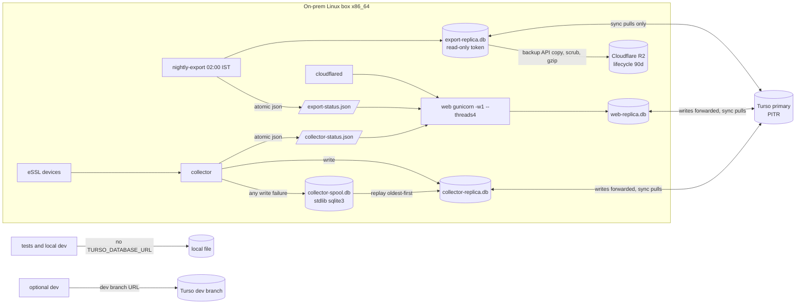
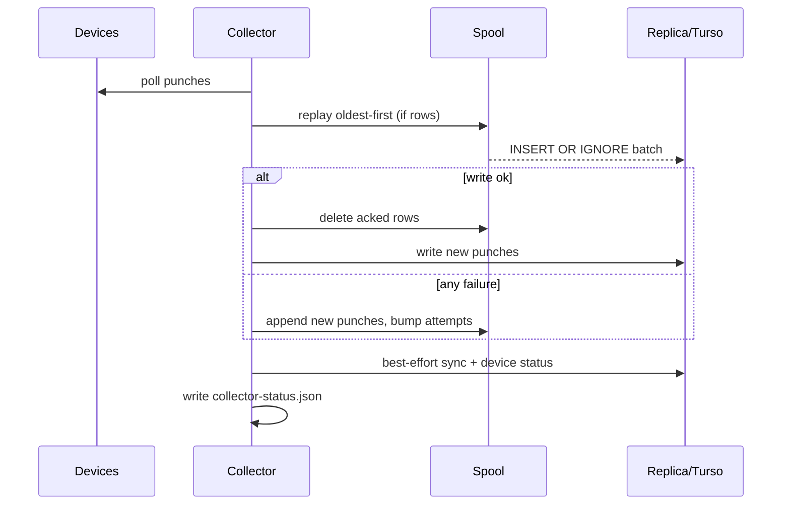

# refactor: Move storage to Turso libSQL embedded replicas, drop Litestream

## Summary

Turso Cloud becomes the system of record.

Every process on the box keeps its own libSQL **embedded replica** file. The web app, the collector and the nightly export each have one. Reads are served from that local file; writes go to the Turso primary.

The collector writes every punch batch to a local **spool** first if Turso is unreachable, and replays it later. Punches survive outages and offline boots.

A nightly export service runs with a **read-only** database token. It syncs its replica, copies it to a SQLite file and strips sessions and sign-in codes. It then gzips the file and puts it in R2.

The nightly export is the only backup this plan adds; Turso point-in-time restore (PITR) is the first recovery path.

The following are deleted:
- Litestream and the restore container
- The manual "Back up now" path, `restore.sh` and `restore_tool.py`
- The Backups page and the HR/Admin backup badge

The badge becomes an **admin-only "Turso sync health" indicator**.

The README, `PRODUCT.md`, `DESIGN.md`, `.env.example`, `install.sh`, compose, CI and the Postgres migration script are retargeted.

---

## Problem Frame

The current stack needs a lot of parts just to keep one SQLite file safe:
- a Litestream sidecar and a fail-closed restore container
- three R2 tokens
- `restore.sh` and `restore_tool.py`
- a manual backup thread and a Backups page

Recovery means shell work on the box, and the data cannot be reached from anywhere but that box.

The user wants data that is always reachable, including for testing, and less operational code. Turso hosts the primary; embedded replicas keep reads local and fast.

The box sits on an office internet line that can drop. **Punch capture must never depend on the internet.**

## Requirements

- **R1.** Turso Cloud is the system of record. The web app, the collector and the export service each connect as a libSQL embedded replica.
- **R2.** The collector never loses punches when Turso is unreachable, including a boot with no internet. Punch writes that fail go to the local spool and are replayed in order. Other collector writes follow KTD13.
- **R3.** A nightly export is gzipped and put in R2. The export is built from a read-only replica with sessions and sign-in codes removed. Its outcome is appended to `/data/export-status.json`.
- **R4.** An admin-only top-bar "Turso sync health" indicator summarises three signals:
  - the web replica's last successful sync
  - the collector's state: status freshness, spool depth, oldest spooled row and dead-letter count
  - the age of the last nightly export

  It links to an admin health page.
- **R5.** Delete Litestream, the restore container, `deploy/restore.sh`, `essl_hub/restore_tool.py`, the manual backup route and thread, the Backups page and the backup badge, with all their tests, env vars and doc mentions.
- **R6.** The test suite and local dev run offline against a plain local file, without a Turso account. Dev can optionally point at a Turso **dev branch** database, never at production.
- **R7.** Update the README runbook, `PRODUCT.md`, `DESIGN.md`, `.env.example`, `deploy/install.sh`, `docker-compose.yml`, `Dockerfile`, CI and the migration script to match.
- **R8.** Add the `libsql` Python client (approved). `boto3` stays, used only by the export service.
- **R9.** When Turso is unreachable, the web app keeps serving reads from its replica. Writes fail with a clear "service offline" page (HTTP 503), not a 500 error.

---

## Key Technical Decisions

### Connection model

- **KTD1. One replica file per process, one connection per process.**
  - Files:
    - collector: `/data/collector-replica.db`
    - web: `/data/web-replica.db`
    - export: `/data/export-replica.db`
  - Each process opens **one** libsql connection for its lifetime and serialises access with a process-wide lock.
  - This keeps read-your-writes intact. Sign-in writes a code on one request and verifies it on another, and both see the same instance.
  - It avoids several replica instances fighting over one file. At about 100 users the lock is not a bottleneck.
  - Today's open-per-call `connect()` becomes "borrow the shared connection under the lock".
- **KTD2. Local mode for tests and dev.**
  - When `TURSO_DATABASE_URL` is unset, `Database` opens `ESSL_DB_PATH` as a plain local libsql file (or `:memory:`) with no sync.
  - The branch lives inside the connection opener; there is no new abstraction layer.
  - `ESSL_DB_PATH` keeps its name in both modes. In replica mode it is the replica file.
- **KTD3. Gunicorn runs `-w 1 --threads 4` without `--preload`.**
  - The connection, the sync thread and the bootstrap open only inside the worker, never in a forking master.
  - The bootstrap-admin promotion is idempotent and runs once per worker start.
- **KTD4. Our own sync loop, not `sync_interval`.**
  - libsql's background `sync_interval` reports nothing back. Each replica process instead runs a daemon thread that calls `sync()` under the lock every `TURSO_SYNC_SECONDS`: web 60, collector 300.
  - Each run records `last_sync_ok_at` and `last_sync_error`.
  - Startup does one `sync()` attempt. Failure is logged, never fatal.
  - The web app sees collector punches within about 60 seconds, plus its own writes immediately.

### Types, errors and transactions

- **KTD5. Rebuild the sqlite3 conveniences explicitly.**
  - libsql has no `row_factory`, `detect_types` or adapters.
  - `db.py` maps rows to dicts from cursor column names. It converts a column-name allowlist of TIMESTAMP columns (naive-IST strings) and JSON columns on read.
  - It formats datetimes and serialises dicts before binding. No implicit adapters.
  - Callers keep receiving the same dict rows.
- **KTD6. DB-agnostic errors.**
  - `db.py` exports `IntegrityError`, mapped from libsql constraint failures, and `OfflineError`, raised when a write cannot reach the primary.
  - `roster.py` and `routes/people.py` catch `db.IntegrityError`.
  - Classification relies on what the U8 spike observes about libsql's exception types and messages. It is covered by a contract test so a libsql upgrade cannot silently change it.
- **KTD7. Guards are single conditional statements, not read-then-write.**
  - Inside a transaction, libsql may serve reads from the stale local replica until the first write.
  - So invariants are enforced in one statement and checked by `rowcount`:
    - "last admin cannot be demoted"
    - "manager change must not create a cycle" (a `WITH RECURSIVE` subtree check inside the `UPDATE … WHERE`)
  - `transaction()` keeps its context-manager shape. Its BEGIN mode follows the spike: `isolation_level=None` plus an explicit `BEGIN`.
  - A failed guard still raises `RuleViolation` as today.
- **KTD8. Schema has one owner and every step is idempotent.**
  - The web app is the schema owner. At startup it runs `sync()`, then migrates if `PRAGMA user_version` on the synced replica is behind.
  - Every step is `IF [NOT] EXISTS`-safe, so a race or a re-run cannot fail. Schema v3 drops `backups`.
  - The collector and export service only read the version. If it's behind, they log and carry on: the collector keeps spooling and the export skips the night.
  - Whether `user_version` round-trips between primary and replica is verified in U8. Fallback: a one-row `schema_meta` table.
  - Existing v1/v2 steps are not edited.

### Offline behaviour

- **KTD9. The collector spool is a stdlib `sqlite3` file that captures everything by default.**
  - `/data/collector-spool.db` is a plain local file with no sync.
  - Any failure of a punch write goes to the spool, whatever the exception type. We don't rely on telling network errors from bugs.
  - Each cycle replays the spool oldest-first before new punches. Inserts are keyed on fingerprints (`INSERT OR IGNORE`), so a half-finished replay can be re-run safely.
  - A row that keeps failing for 20 replays while syncs succeed moves to a `dead` table in the spool, which turns the health indicator red. The punch is kept, never dropped.
  - This replaces the busy-lock retry buffer, which only existed for local SQLite contention.
- **KTD10. The collector boots and polls without the internet.**
  - The spool and device polling start first.
  - Turso work (connect, initial sync, `initialize()` writes such as device-status resets and seed defaults) runs best-effort, and is retried each cycle until it succeeds.
  - Device config comes from the replica if one exists, otherwise from env defaults (`config.DEVICES`).
  - Whether `libsql.connect(sync_url=…)` needs the network at construction time is verified in U8. If it does, the connection is built lazily on the first healthy cycle.
- **KTD11. Web behaviour when offline (R9).**
  - Reads come from the replica. If the replica is empty and offline at first boot, every page shows the offline page.
  - Writes raise `OfflineError` and get a 503 offline page: sign-in code requests, roster edits, role changes and settings.
  - Best-effort writes never block a read:
    - `touch_api_key` is throttled to once an hour per key and swallowed on failure, so offline `/api/v1` pulls still work.
    - `ensure_bootstrap_admin` is skipped with a log line.
  - Sign-in rate limits read through the single shared connection, which sees its own writes (KTD1), so they stay exact.
- **KTD12. Status files on the shared volume, not database rows.**
  - Outage visibility can't depend on the thing that's down.
  - The collector writes `/data/collector-status.json` every cycle. It holds last poll, last sync OK and error, spool depth, oldest spooled row and dead count.
  - The export service appends to `/data/export-status.json`, capped at 30 runs.
  - Both files are written atomically (temp file plus rename). The web app reads them tolerantly: missing or corrupt counts as unknown.
- **KTD13. Collector writes when offline.**
  - Punches go to the spool.
  - Device status updates, the Frappe scheduler and sync-log writes, and the heartbeat are skipped and logged. They are recomputed on the next healthy cycle.
  - The Frappe push needs the internet anyway, so it naturally retries.

### Export and recovery

- **KTD14. The nightly export uses a read-only replica (user decision).**
  - `nightly-export` is the app image running `python -m essl_hub.nightly_export`, with a read-only database token (`turso db tokens create --read-only`) and its own replica. It holds no platform token and needs no Turso CLI on the box.
  - At `ESSL_EXPORT_HOUR` (default 02:00 IST) it:
    1. syncs
    2. closes the libsql connection
    3. copies the replica file with the stdlib `sqlite3` backup API
    4. deletes `sessions` and `login_codes`, then runs `VACUUM`
    5. runs an `integrity_check`
    6. gzips the file and puts it with boto3, using the put-only `R2_EXPORT_*` token and the existing key format and timeouts
  - A `--once` flag runs one export via `docker compose run`.
  - `devices.comm_password` stays in the export, because restoring needs it. This is documented as a reason to keep the R2 bucket private.
- **KTD15. R2 hygiene.**
  - The put-only token cannot delete, so the README tells operators to add an R2 lifecycle rule (default 90 days).
  - Bucket lock is optional; it stops a compromised box from overwriting old exports.
  - Object keys carry the timestamp to the second.
- **KTD16. Recovery runbook.**
  - Path one is Turso PITR: `turso db create <new> --from-db essl --timestamp …` from an operator laptop.
  - Path two is an R2 export: gunzip, then `turso db create <new> --from-file`.
  - Both paths then:
    1. Mint new database tokens: read-write, plus read-only for export.
    2. Stop the stack.
    3. Delete `/data/*-replica.db*` but **keep the spool**.
    4. Update `.env`.
    5. Start the stack.
  - The PITR window for the chosen Turso plan is written down in the README. A restore drill runs once before cutover.
  - No in-app restore UI.

### Migration

- **KTD17. Bulk load with a file, deltas with remote writes.**
  - Row-by-row inserts across the internet would take hours.
  - The full migration builds a schema-v3 SQLite file locally from Postgres; the existing script already does most of this. It is uploaded with `turso db create essl --from-file`, run from an operator laptop.
  - The `--punches-since` delta writes to Turso in batched multi-row inserts through its own replica file. It runs while web and collector are stopped.
  - The `--from-sqlite` idea is dropped: an existing SQLite file can already be uploaded directly.

### Platform

- **KTD18. libsql platform constraints.**
  - `libsql` 0.1.11 (September 2025) ships Linux wheels for **x86_64 only** (cp312 manylinux).
  - `install.sh` checks for `x86_64` and stops with a clear message on other architectures. Building from source would need Rust in the image.
  - The package is 0.1.x and has had no release in over a year. The U8 contract tests pin the behaviour we depend on, so an upgrade or a swap (e.g. to Turso's newer client) is checked rather than assumed.

---

## High-Level Technical Design

Collector cycle:

Health indicator, admin only. Each signal gets a tone, the worst tone wins, and the label names the signal that set it. The title tooltip lists all signals with exact IST times.

| Signal | Green | Amber | Red |
|---|---|---|---|
| Web replica sync | last OK ≤ 5 min | > 5 and ≤ 60 min | > 60 min, or never |
| Collector | status ≤ 10 min old, spool empty, 0 dead | spool has rows, oldest ≤ 60 min | status missing or > 10 min old, oldest spooled row > 60 min, or dead > 0 |
| Nightly export | last OK ≤ 2 days | > 2 and < 7 days | ≥ 7 days, or none |

In local mode the indicator shows a neutral "Local database" chip.

---

## Implementation Units

Order: U8 → U1 → U2, U3 and U9 (independent of each other) → U4 → U5 → U6 → U7.

### U8. libsql contract spike

**Goal:** Turn the plan's libsql assumptions into executable facts before the real refactor starts.

**Requirements:** R1, R2, R9.

**Dependencies:** none.

**Files:**
- `tests/test_libsql_contract.py` (new)
- `requirements.txt` (add `libsql==0.1.11`, or newer if a release at least two weeks old exists)

**Approach:**
- One test module with two groups:
  - **Offline group (always runs):**
    - row and type shapes
    - `isolation_level` and explicit `BEGIN`
    - the exception type for a constraint violation
    - replica-mode behaviour against an unreachable `sync_url` (`http://127.0.0.1:9`): whether connect raises, which exception a write raises, and whether reads of an existing replica file still work
    - whether the stdlib `sqlite3` backup API can read a closed replica file
  - **Turso group (runs only when `TURSO_TEST_URL` and `TURSO_TEST_TOKEN` are set, otherwise skipped):**
    - read-your-writes on one connection
    - whether reads inside a transaction see the primary
    - `PRAGMA user_version` round-trip
    - `foreign_keys` enforcement on forwarded writes
    - read-only token write rejection
- Findings go in the module docstring. Any result that contradicts a KTD updates that KTD's fallback before U1 starts.

**Test scenarios:** the scenarios above, one test each. The offline group must pass in CI.

**Verification:**
- The offline group is green locally and in CI.
- The Turso group is green once against a scratch Turso database.
- The KTD6, KTD7, KTD8 and KTD10 fallbacks are confirmed or switched.

### U1. libsql connection layer in `Database`

**Goal:** Swap stdlib `sqlite3` for `libsql`, in replica and local modes, with the shared connection, explicit types, error mapping, sync loop and guard rewrites.

**Requirements:** R1, R6, R8.

**Dependencies:** U8.

**Files:**
- `essl_hub/db.py`
- `essl_hub/config.py` (`TURSO_DATABASE_URL`, `TURSO_AUTH_TOKEN`, `TURSO_SYNC_SECONDS`; startup error if a URL is set without a token)
- `essl_hub/roster.py`, `essl_hub/routes/people.py` (catch `db.IntegrityError`)
- `tests/test_db.py`, `tests/test_roster.py` (`sqlite3.IntegrityError` → `db.IntegrityError`), `tests/test_frappe_sync.py` (replace direct `sqlite3.connect` fixtures)

**Approach:**
- The shared connection plus lock (KTD1) replaces open-per-call `connect()`.
- Add a row-to-dict helper with TIMESTAMP and JSON allowlist conversion, plus bind-side formatting (KTD5).
- `IntegrityError` and `OfflineError` mapping (KTD6).
- A sync loop helper that records `last_sync_ok_at` and `last_sync_error` (KTD4); it is not started in local mode.
- Guards rewritten as single conditional statements (KTD7).
- Idempotent schema steps, with v3 dropping `backups`. A `migrate_schema()` entry point is used only by the schema owner (KTD8).
- Delete `_enable_wal`, the WAL, busy_timeout and synchronous PRAGMAs, the sqlite3 adapter and converter registration, and the concurrent-fresh-file initialise test. Keep `foreign_keys=ON`.

**Patterns to follow:** existing `transaction()` / `RuleViolation` / `_manager_chain` in `essl_hub/db.py`.

**Test scenarios:**
- Local mode: schema, upsert and read back. Datetime and JSON values round-trip unchanged and dict rows keep their keys.
- An exception inside `transaction()` rolls back.
- A duplicate email (case-insensitive) raises `db.IntegrityError`, and roster import reports it as a row error, not a 500.
- Demoting the last admin raises `RuleViolation`; demoting one of two admins succeeds.
- A manager change creating a two-node or three-node cycle raises `RuleViolation`; a valid change succeeds.
- An orphan `manager_id` insert is rejected.
- The v2→v3 migration drops `backups`, and running it twice is a no-op.
- Two threads share the connection: thread B reads thread A's committed write at once.
- The sync helper in local mode is a no-op. A forced failure records `last_sync_error` and does not raise.
- Config with a URL but no token fails at startup naming the missing variable.

**Verification:**
- The full suite passes in local mode, and `db.py` no longer imports `sqlite3`.
- Manual smoke against a scratch Turso database: an orphan foreign key is rejected and sign-in works end to end.

### U2. Collector spool, offline boot and status file

**Goal:** No punch is lost through any outage or offline boot (R2).

**Requirements:** R1, R2.

**Dependencies:** U1.

**Files:**
- `essl_hub/spool.py` (new)
- `essl_hub/collector_main.py`
- `essl_hub/frappe_sync.py` (skip and log offline, KTD13)
- `tests/test_spool.py` (new), `tests/test_collector_main.py`, `tests/test_frappe_sync.py`

**Approach:**
- Spool API: append batch, iterate oldest-first, ack, bump attempts and move to dead (KTD9). Backed by stdlib `sqlite3`.
- Boot order: spool and polling start first; Turso connect, initial sync and initialise run best-effort and are retried each cycle (KTD10).
- Cycle: replay, write new punches, best-effort device status, then write the status file atomically (KTD12, KTD13).
- Remove the busy-lock retry buffer from `PollState`.

**Test scenarios:**
- A write failure of any exception type appends the batch to the spool and the loop continues.
- The next healthy cycle replays in order and empties the spool.
- An interrupted replay that is re-run produces no duplicates.
- Boot with an unreachable Turso polls devices, spools punches and writes a status file showing the error. When Turso becomes reachable, the spool drains.
- The spool survives a restart.
- A row failing 20 replays while syncs succeed moves to dead, and the status file shows `dead=1`.
- Frappe sync with Turso unreachable logs and skips without crashing the loop.
- The status file is valid JSON after every cycle, written by temp file and rename.

**Verification:** an end-to-end test with a failing writer, then a healthy one, lands every punch exactly once.

### U3. Nightly export service

**Goal:** Nightly read-only export, scrubbed, gzipped and put in R2, with its status recorded (R3).

**Requirements:** R3, R8.

**Dependencies:** U1, U8 (backup-API-on-replica result).

**Files:**
- `essl_hub/nightly_export.py` (new; carries over the R2 key and put helpers from `essl_hub/backup.py`)
- `tests/test_nightly_export.py` (new)
- `docker-compose.yml` (service only; the env pass is in U7)

**Approach:** follow the KTD14 sequence.
- Scheduler: sleep until the next `ESSL_EXPORT_HOUR` in IST. `--once` runs a single export.
- The export file is built in `/data/export-tmp/` and deleted afterwards.
- Status entries hold started, finished, ok or failed, key, size and a truncated error.
- A status-file loader is exported for U5.

**Test scenarios:**
- Happy path, with a local source standing in for the replica: the R2 object is gzip and the decompressed file has no `sessions` or `login_codes` rows. The status shows one put call and `ok` with its size.
- An `integrity_check` failure records `failed`, makes no put and deletes the temp file.
- A boto3 error records `failed` and deletes the temp file.
- Sync failing offline records `failed` with the error, and the next night retries.
- The next-run time crosses midnight correctly in IST.
- `--once` exits 0 on success and non-zero on failure.
- The status history is capped at 30 entries.

**Verification:** tests pass with boto3 stubbed, and one manual `--once` run against scratch Turso and R2 succeeds.

### U9. Web offline behaviour and sync thread

**Goal:** Reads survive outages and writes fail cleanly (R9).

**Requirements:** R9, R1.

**Dependencies:** U1.

**Files:**
- `essl_hub/web.py` (start the sync thread in replica mode; `OfflineError` → 503 handler; skip bootstrap offline)
- `essl_hub/routes/api.py` (`touch_api_key` best-effort and throttled)
- `essl_hub/auth.py` (map an offline write failure during code issue to the offline page)
- `templates/offline.html` (new)
- `tests/test_web.py`, `tests/test_api_checkins.py`

**Approach:** follow KTD3, KTD4 and KTD11. The offline page uses the existing auth/base layout and says what still works: viewing data.

**Test scenarios:**
- A write route that raises `OfflineError` returns 503 with the offline template, never 500.
- A read route still returns 200 while writes are offline.
- A sign-in code request while offline shows the offline page and sends no email.
- An `/api/v1/checkins` pull while offline returns 200, and the failed `touch_api_key` is swallowed.
- `touch_api_key` is called at most once an hour per key.
- Startup with the bootstrap admin while offline logs and serves.

**Verification:** tests pass, and a manual run with an unreachable `TURSO_DATABASE_URL` and an existing replica serves pages.

### U4. Remove Litestream, restore and manual backup

**Goal:** Delete the dead code and its configuration (R5).

**Requirements:** R5.

**Dependencies:** U1, U3.

**Files:**
- Delete:
  - `deploy/litestream.yml`
  - `deploy/restore.sh`
  - `essl_hub/restore_tool.py`
  - `essl_hub/backup.py`
  - `templates/backups.html`
  - `tests/test_restore_tool.py`
  - `tests/test_backup.py`
- Modify:
  - `essl_hub/routes/admin.py`: drop the `/backups` GET and POST
  - `essl_hub/web.py`: drop the `backup` import, `recover_on_boot`, the `backup_status` context processor, `BACKUP_BADGE_ROLES`
  - `essl_hub/routes/common.py`: drop `backup_badge`
  - `essl_hub/db.py`: drop the backup methods (start/finish/fail/stale, `backups()`, `backup_totals`, `last_ok_backup_at`)
  - `templates/base.html`: drop the Backups nav entry and the badge
  - `tests/test_web.py`, `tests/test_shell.py`

**Approach:** remove wholesale. Nothing is deployed, so `/backups` simply 404s with no redirect.

**Test scenarios:**
- `/backups` returns 404 for admin and HR.
- No nav shows Backups, for any role.
- Importing `essl_hub.backup` or `essl_hub.restore_tool` raises `ModuleNotFoundError`.

**Verification:** the suite passes, and nothing under `essl_hub/` references backup code.

### U5. Admin "Turso sync health" indicator and page

**Goal:** An admin-only indicator and page that replace the backup badge (R4).

**Requirements:** R4.

**Dependencies:** U2, U3, U4, U9.

**Files:**
- `essl_hub/routes/common.py` (`sync_health` pure function)
- `essl_hub/web.py` (context processor, admin only)
- `essl_hub/routes/admin.py` (`/health`, admin only, matching the blueprint's unprefixed `/devices` and `/settings`)
- `templates/base.html`, `templates/health.html` (new)
- `static/styles.css`
- `tests/test_shell.py`, `tests/test_web.py`

**Approach:**
- `sync_health` takes the web `last_sync_ok_at`, the parsed collector status, the parsed export status and the current time. It returns tone, label, title, the signal that set the tone, and per-signal detail, following the health-state table.
- The page lists each signal with exact IST times and the last 14 exports from the status file, plus a static recovery summary linking to the README runbook.
- Reuse the existing badge styles, colour plus icon plus text, in light and dark themes.

**Test scenarios:**
- Each boundary is covered:
  - sync at 5 min (green), 5 min 1 s (amber), 60 min 1 s (red), never (red)
  - collector status 10 min old (green), 11 min old (red), spool 1 row 59 min old (amber), 61 min old (red), dead 1 (red), file missing (red)
  - export at 2 days (green), 2.5 days (amber), 6.5 days (amber), 7 days (red), none (red, "No export yet")
- When signals disagree, the worst wins and is named in the label.
- A corrupt status file counts as unknown and goes red; it doesn't crash the page.
- Local mode shows the neutral chip.
- HR, manager and employee see no indicator, and `/health` returns 404 for them.
- The indicator renders in light and dark themes with text, an icon and the IST title.

**Verification:** tests pass, plus screenshots of each tone in both themes.

### U6. Postgres → Turso migration script

**Goal:** A cutover tool that bulk-loads by file and applies deltas remotely (KTD17).

**Requirements:** R7.

**Dependencies:** U1.

**Files:**
- Rename `scripts/migrate_postgres_to_sqlite.py` to `scripts/migrate_postgres.py`
- `tests/test_migrate.py`

**Approach:**
- Full mode writes a schema-v3 local file (local mode). It checkpoints and runs an integrity check, then prints per-table counts and the exact `turso db create … --from-file` command.
- Delta mode (`--punches-since`) connects in replica mode with `--replica-path` (default `/data/migrate-replica.db`). It inserts batched multi-row `INSERT OR IGNORE` and refuses to run if the web or collector replica lock is held.
- Print source and target counts.

**Test scenarios:**
- Full mode into a local file matches source counts, and the file reports schema v3.
- A delta re-run inserts only new punches and is idempotent.
- An empty source exits 0 with zero counts.
- Delta mode without Turso env exits non-zero with a clear message.

**Verification:** migrate tests pass in local mode, and one rehearsal upload to a scratch Turso database succeeds.

### U7. Deploy, docs, env and CI

**Goal:** Make the operational surface and docs match (R5, R7).

**Requirements:** R5, R7.

**Dependencies:** U1–U6, U8, U9.

**Files:**
- `docker-compose.yml`:
  - Remove `litestream`, `litestream-restore` and their anchors.
  - Web: `gunicorn -w 1 --threads 4` without `--preload`, and delete the preload comment. Drop `R2_*` from web.
  - Collector, web and export each get `TURSO_DATABASE_URL`, their own `ESSL_DB_PATH` replica file and `TURSO_SYNC_SECONDS`. Collector and web get `TURSO_AUTH_TOKEN`; export gets `TURSO_EXPORT_AUTH_TOKEN`. Collector also gets `ESSL_SPOOL_PATH`.
  - Export also gets `R2_ACCOUNT_ID`, `R2_BUCKET`, `R2_EXPORT_ACCESS_KEY_ID`, `R2_EXPORT_SECRET_ACCESS_KEY` and `ESSL_EXPORT_HOUR`.
  - Drop `ESSL_FIRST_INSTALL`, `LITESTREAM_*`, `R2_BACKUP_*` and `R2_RESTORE_*`.
- `.env.example`: mirror the above with comments on which token goes where.
- `deploy/install.sh`: drop first-install and Litestream logic; add the `x86_64` check and the required-Turso-vars check.
- `Dockerfile`: drop the Litestream comment.
- `README.md`:
  - architecture and diagram
  - Turso setup from an operator laptop: create the database in the region nearest India, create the read-write and read-only tokens, and the optional dev branch for testing
  - cutover with KTD17
  - recovery runbook and restore drill with KTD16
  - R2 lifecycle and bucket lock with KTD15
  - export schedule and `--once`
  - the health indicator
  - offline behaviour
  - Turso plan limits (free-tier rows, sync bandwidth and PITR window, verified from the Turso pricing page at implementation time) and a usage alert
- `PRODUCT.md`: HR no longer takes backups; Litestream and R2 replication lines replaced with Turso.
- `DESIGN.md`: the shell-bar badge becomes the admin sync-health indicator.
- `THIRD_PARTY_NOTICES.md`: add libsql (MIT).
- `.github/workflows/ci.yml`: local mode only; no secrets; the U8 Turso group is skipped.

**Test expectation:** none; this unit is config and docs only.

**Verification:**
- `docker compose config` validates with a sample `.env`.
- `grep -riE "litestream|restore\.sh|R2_BACKUP|R2_RESTORE|Back up now"` outside `docs/plans/` returns nothing.
- CI is green.

---

## Scope Boundaries

**In:** R1–R9.

**Out:**
- Turso's beta offline-writes feature. The collector spool covers punch writes only; web writes fail with the offline page (KTD11).
- An in-app restore UI, and in-app or manual export triggers beyond `--once`.
- Encrypting exports before upload.
- Changes to roles, UI or Frappe logic, other than replacing the badge, adding the health and offline pages, and the KTD13 offline skips.

### Deferred to Follow-Up Work

- The audit-log decision, still open from the previous plan.
- Encrypting exports (e.g. `age`) if the R2 bucket's threat model changes.
- Moving the web app to remote-only mode if the box is retired.
- ARM support: a Rust build stage for libsql, or a client swap.

---

## Risks & Dependencies

| Risk | Mitigation |
|---|---|
| libsql is 0.1.x with no release in over a year; exception, transaction and connect behaviour is undocumented | U8 contract tests run before U1, and every assumption has a stated fallback. The contract tests guard upgrades. |
| x86_64-only Linux wheels | `install.sh` architecture check; ARM deferred. |
| A long outage fills the spool | Punches are small. Spool depth and age turn the indicator amber, then red. Rows are never dropped. |
| Web writes fail during an outage: sign-in, roster, settings | 503 offline page. Reads and existing sessions keep working. Documented. |
| Web sees collector punches up to about 60 s late | Acceptable for a dashboard; `TURSO_SYNC_SECONDS` is tunable. |
| Exports hold personal data and device passwords | Read-only token, private bucket, put-only R2 token, lifecycle rule, optional bucket lock; encryption deferred. |
| PITR window on the chosen plan is short | Recorded in the README; the nightly export covers longer horizons; restore drill before cutover. |
| Turso pricing or quotas change | Limits recorded in the README with a usage alert; the R2 export makes leaving possible. |
| Token sprawl | The read-write database token is held only by web and collector. The read-only database token is held only by export. The R2 put-only token is held only by export. No platform token on the box. |

---

## Open Questions (deferred to implementation)

- The U8 outcomes listed in each KTD's fallback: connect-time network need, transaction read routing, `user_version` round-trip, exception taxonomy, and backup API on a closed replica file.
- The current Turso free-tier numbers and PITR window, to record in the README.
- Whether `turso db create --from-file` needs the file in WAL mode or a size cap. U6 prepares the file to match.

## Sources & Research

- libsql-python docs via ctx7 (`/tursodatabase/libsql-python`): `connect(path, sync_url, auth_token, sync_interval)`, `conn.sync()`, `with conn:` transactions, `offline=True`.
- libsql consistency model via ctx7 (`/tursodatabase/libsql`, `docs/CONSISTENCY_MODEL.md`): a process sees its own writes; replicas aren't guaranteed to be current; different processes on one replica may read different points in time. This is the basis for KTD1.
- PyPI `libsql` 0.1.11 file list: manylinux x86_64 wheels only (KTD18).
- Code read during review: `essl_hub/db.py`, `essl_hub/auth.py` (rate limits), `essl_hub/web.py` (`recover_on_boot`, the badge context processor, bootstrap), `essl_hub/collector_main.py` (boot `initialize()`, `PollState`), `essl_hub/routes/api.py` (`touch_api_key`), `essl_hub/roster.py` and `essl_hub/routes/people.py` (`sqlite3.IntegrityError`), `docker-compose.yml`.
