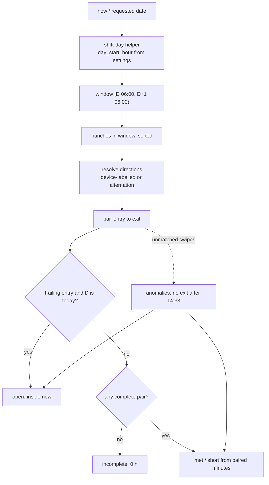
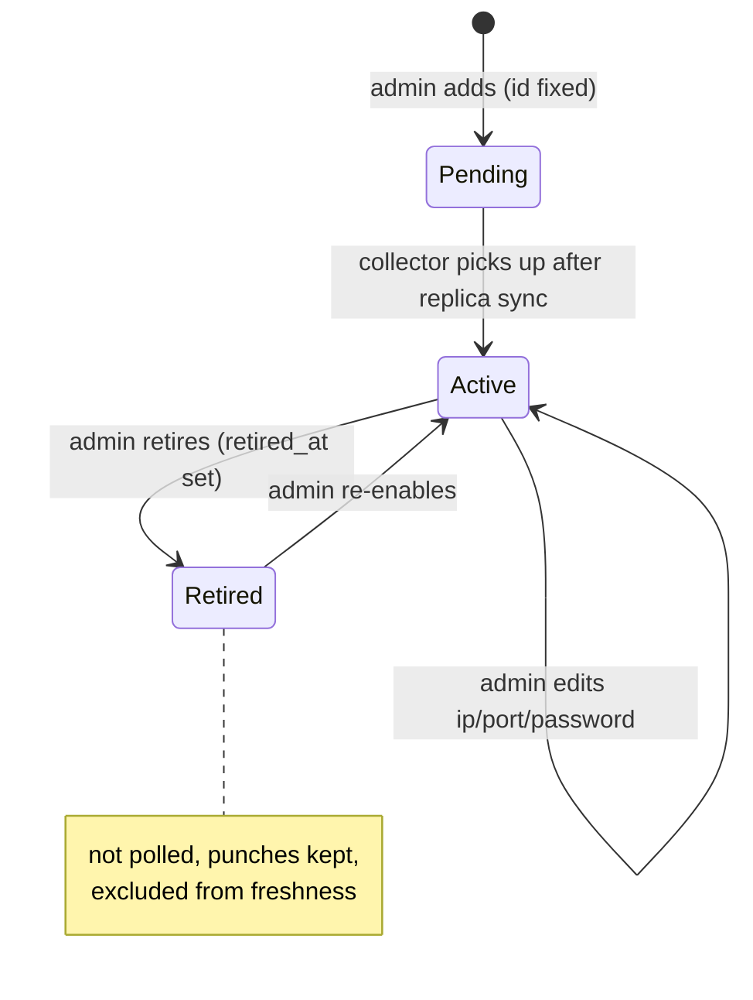
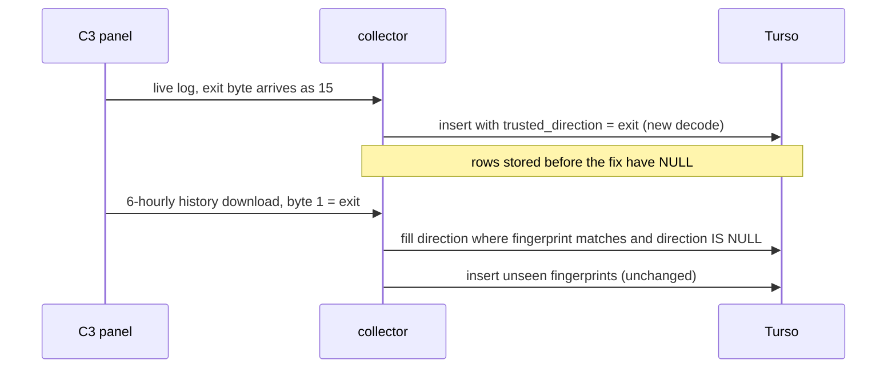
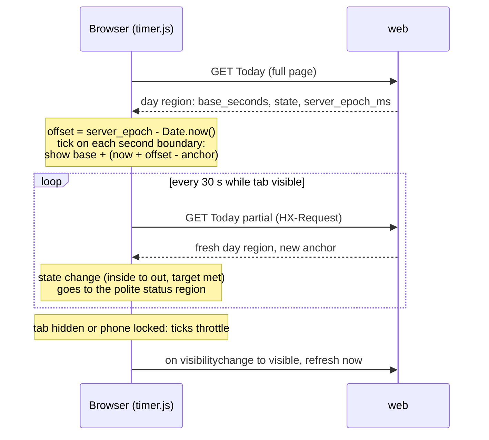

# fix: Night-shift punch accuracy, plus dynamic devices, sign-in branding, People UI, export workbook and live timer

## Summary

Fix why people who are inside show missing punches. Work days are cut at calendar midnight in a night-shift office, any unmatched swipe zeroes the whole day, and C3 live-log exits are stored with no direction. Four admin upgrades follow:
- admins add and retire devices from the UI;
- Settings gets sign-in branding (Nitco logo and background);
- the People and ID issues pages are fixed so they render cleanly and guide the fix;
- the Everyone export becomes a three-sheet workbook with each person's first check-in and last check-out per day;
- hours count exact seconds, and Today gets a live `H:MM:SS` timer that updates itself when a new punch arrives.

---

## Problem Frame

A read-only analysis of the dev Turso database (88,258 punches; X990 since 2026-05-13, C3 since 2025-10-25) found that **50.6% of past person-days compute as incomplete**. Of the X990 days marked "met", 1,821 open with the previous night's tail and carry impossible hours. Collection itself is healthy: no gaps, no duplicates, and device clocks are within about a minute of IST. The faults are in how punches become days:

1. **Calendar-midnight day boundary.** Punches peak 15:00–23:00 and stay heavy 00:00–04:00, and 43% of day changes happen less than 4 h after the previous punch. Every overnight shift is split into two broken days. The fault sits in `essl_hub/routes/common.py` (`_day_for_employee`, `_today`) and `essl_hub/export.py` (`day_results` groups by `stamp.date()`).
2. **One orphan zeroes the day.** `essl_hub/hours.py` `compute_day` returns `incomplete` / 0 h on any entry→entry or exit→exit, and it does this before checking whether the person is inside now. C3 data has 1,012 entry→entry and 832 exit→exit transitions (tailgating and the exit button).
3. **C3 live-log exits lose their direction.** `essl_hub/collectors.py` `_c3_trusted_direction` trusts only bytes 0 and 3. The library turns the exit byte 1 into 15, which is stored as NULL. The later history download carries the correct byte, but `db._unseen` plus `ON CONFLICT DO NOTHING` drop it, because the fingerprint does not include direction.
4. **Roster ID mismatches.** For example, roster `128` vs device `NP0128` (1,628 invisible punches), and `NP0015` and `NP0003` are not on the roster. The ID issues page flags these, but it is hard to act on.

The other asks are independent:
- Devices are a static two-entry `config.DEVICES` tuple that the collector merge is keyed on.
- The sign-in page has no branding.
- The People page ships a full-roster `<select>` in every row: 1.8 MB of HTML at 150 people, which causes the visible re-flow. It also has an htmx history-restore bug that wipes the sidebar.
- The export lacks first-in and last-out.
- Devices record seconds (98% of stored punches carry non-zero seconds), but the app hides them. `hours.py` `_minutes` floors every in/out stretch to whole minutes before summing. Measured with the current pairing on a 06:00 window, across 5,870 complete days this loses 2.6 min a day on average (p90 4.1, max 24). 157 "short" days would be "met" on exact seconds. The Today timer (`static/timer.js`) only changes once a minute and never picks up a new punch without a reload.

---

## Requirements

**Punch accuracy**
- R1. A work day runs from a configurable day-start hour (default 06:00 IST) to the same hour next day. Every view, the API and the export use the same window.
- R2. "Today" is the work day containing now. At 03:00 that is still yesterday's work day.
- R3. An unmatched swipe never zeroes a day that has a complete pair. Cleanly paired segments count, and the day carries a review flag naming the gap, e.g. "No exit after 14:33".
- R4. A person whose last punch is an entry, on today's work day, shows as inside (open), never as "missing exit".
- R5. C3 live-log exits are stored as exits. Existing NULL-direction C3 rows are corrected from the device's history download and by a one-off script.
- R6. Changing the day-start hour re-scores every past day. The active window is shown on day views and export headers, and is returned by the API.

**Devices**
- R7. An admin can add a device of either existing family (X990 attendance, C3 access controller) from the Devices page. The collector picks it up without a redeploy.
- R8. An admin can retire a device and re-enable it later. Retired devices are not polled, keep their punches, and never block freshness signals. No delete and no device-clearing control is exposed.
- R9. Two active devices cannot share an IP:port, and device ids are never reused.

**Sign-in branding**
- R10. An admin can upload a logo (PNG/JPEG/WebP) and choose a sign-in background (default, brand colour, or uploaded image) in Settings. Sign-in, code and setup pages show them, in light and dark.
- R11. An admin can reset either asset to the default. Without uploads, sign-in looks exactly as it does today.

**People and ID issues**
- R12. Opening the People page renders without visible re-flow, and back/forward never strips the page shell.
- R13. Each ID issue states in plain words what is wrong, what it costs (punches or hours not counted), and offers one most-likely fix as the primary action, with alternatives secondary.
- R14. ID issues and People layouts work at 1280px and 375px with no clipped controls.

**Export**
- R15. Everyone and Team export produces one xlsx with three sheets:
  - Daily Detail: one row per person per work day, with first in, last out, gross, break, effective, status and shortfall;
  - Monthly Matrix: people × dates, with a status code plus hours;
  - Person Summary.
- R16. CSV export is Daily Detail only. Times and durations are real Excel values in xlsx, and a flagged or incomplete day never shows a fabricated number.

**Seconds and live timer**
- R17. Effective, gross and break time are the exact sum of paired seconds. Met or short compares exact seconds with the target.
- R18. Today shows a live `H:MM:SS` timer in the progress ring with an Inside / Out state label and the time left to target. The current stretch has its own `H:MM:SS` timer. Both work at 375px and on desktop.
- R19. On Today, durations show `H:MM:SS` and punch times, First in and Last out show `HH:MM:SS`. Log stretches sum exactly to the ring. Team, Week and People tables keep `7h 42m`.
- R20. While the tab is visible, Today checks for new punches every 30 s, and immediately when the tab becomes visible again. This happens even before the first punch or after stepping out. The timer re-anchors to the server value without drifting. A failed refresh is shown, never hidden behind a ticking number.

---

## Key Technical Decisions

- **Fixed day-start hour, stored in `settings`** (`day_start_hour`, default 6, admin-editable next to the daily target). Measured on real data it drops incomplete days from 50.6% to 28.5%, and combined with R3 to roughly 16–18%. A fixed window keeps "which day does this shift belong to" explainable. Gap-based sessions scored slightly better (25.5%) but give unstable day attribution. The user chose fixed.
- **One shared shift-day helper.** Two operations: "the work day containing timestamp T" and "the [start, end) window for work day D". Every caller uses it: day queries, `_today`, the week Monday, team range presets, `export.day_results` grouping, and the API. Delete the unused `hours.group_by_day` so nothing keeps the calendar rule.
- **Retroactive by design.** The setting applies to all past days, per the product rule that a correction to the hours rule fixes every past day. The API returns `day_start` so the HRMS consumer can tell.
- **Review flag, not a new status.** `DayResult` gains an additive `anomalies` field (a tuple of short facts such as "no exit after 14:33"). `status` stays `empty | open | incomplete | met | short`, so the HRMS client's status vocabulary does not break. `met` and `short` are computed from paired minutes only, and the unpaired punch contributes nothing. `incomplete` remains only for days with no complete pair at all. The user chose this over "first in / last out" merging, which could credit time spent outside.
- **Open is checked before orphan on today.** A trailing open entry on today's work day means inside, whatever happened earlier in the day.
- **Direction repair is an UPDATE, not an insert.** History-download punches whose fingerprint already exists with `trusted_direction IS NULL` get their direction filled in, C3 rows only. The insert path stays append-only. This is collector metadata, not a punch edit, so the "no screen edits punches" rule holds.
- **Live-log direction: decode the raw byte when the library exposes it, otherwise map 15 to exit for card events.** Evidence: 21 of 22 byte-15 rows sit between two entries.
- **The DB is authoritative for devices.** `config.DEVICES` becomes seed-only. The original two rows are inserted if missing and never overwritten on boot. They keep their env-password fallback through `password_env`. `merge_device_configs` builds configs from all non-retired DB rows.
- **Device ids are immutable slugs** generated at creation from site and model, with a numeric suffix on collision, and never reused. The punch fingerprint includes `device.id`, so a renamed or reused id would re-store the device's whole history.
- **Retire is a `retired_at` timestamp.** Re-adding an IP:port that matches a retired device offers re-enable instead of creating a new id.
- **Branding assets live in the database** in a small `branding_assets` table (key, content type, bytes, sha256, updated_at). They survive replicas and the nightly export, which a file on the per-host volume would not.
  - They are served by a public route with a strict content-type allow-list, `nosniff`, and an ETag with a short max-age that overrides the global `no-store`.
  - Validation uses stdlib magic-byte sniffing, because Pillow is not a dependency and adding it needs approval. SVG is rejected.
  - Size caps: about 512 KB for the logo, about 1.5 MB for the background.
- **The sign-in card stays solid.** The background sits behind the card, never under text, so contrast stays WCAG AA in both themes, per DESIGN.md's "quiet" rule. Email keeps `static/email-logo.png`.
- **The People table shows text, and edits one row at a time.** Manager and role render as text. "Edit" htmx-swaps a single row into an edit form that alone carries the roster `<select>`. Today's status for all rows comes from one batched query.
- **The htmx history-restore fix** has three parts:
  - partial responses only when `HX-Request` is set and `HX-History-Restore-Request` is not;
  - `Vary: HX-Request` on those responses;
  - `historyCacheSize: 0` with `refreshOnHistoryMiss: true` in the htmx config.
- **The export is one workbook with three sheets**, built from one punch query per export, as today. Rules:
  - Daily Detail is the pivotable tidy sheet. Its first in and last out are full datetimes, because shifts cross midnight.
  - Matrix cells hold a short code plus effective hours: P, A, WO for Sat/Sun, R for review, I for incomplete, O for open, and blank before the person existed.
  - Shortfall is blank for incomplete or open days.
  - CSV is Daily Detail only, UTF-8 with BOM for Excel double-click.
- **Seconds are the unit of truth for durations.** `DayResult` gains `effective_seconds`, `gross_seconds` and `break_seconds`. The existing `*_minutes` fields stay, derived as floor(total seconds / 60), so templates and the API keep working. Status compares `effective_seconds` with `target_minutes * 60`. Measured on real data, this re-scores 157 past days from short to met. That is intended, and it follows the rule that a correction re-scores every past day.
- **Seconds where they carry meaning.** These show seconds: every duration and punch time on the Today card, and the export's Daily Detail. Estimates ("17m left", "Target reached at 23:18") stay minute-level. Tables keep `7h 42m`, so numbers don't churn in lists. This matches Clockify's Full vs Compact split and avoids Toggl's mixed-format complaints.
- **The timer is derived, never counted.** The server sends a base value in seconds plus its own epoch. The client computes an offset once, then derives `base + (now − anchor)` on each tick. Ticks are scheduled on second boundaries with `setTimeout`, not `requestAnimationFrame`. On `visibilitychange` the tick reschedules and a refresh fires. Throttled background tabs and locked phones therefore come back correct.
- **The timer is silent to screen readers.** The ticking digits are `aria-hidden` with no role. A visually hidden `7h 42m` beside them is the accessible value. A polite status region in the page shell, outside the swapped region, announces only state changes: inside, out, and target reached, the last only once a server refresh confirms it. This replaces today's `aria-live="polite"` on the hours figure, which announces every update.
- **Auto-refresh is an htmx fragment swap, guarded in JS.** The whole day region below the topbar (card or empty state, notices, log) is served as a partial. A small guard requests it every 30 s plus jitter, only while `!document.hidden`, plus once on becoming visible. A faster poll buys little: a swipe reaches the screen in about 75 s typically and at most about 2.5 min, through the collector cycle, the 60 s replica pull and the poll. When a new punch flips the state, the client accepts the server's new anchor even if the number jumps. A rollover to a new work day reloads the page. An expired session redirects to sign-in. A failed refresh shows "retrying", then "last known".

---

## High-Level Technical Design

### Punches to a work day

### Device lifecycle

### Live-log exit repair

### Live timer on Today

---

## Implementation Units

### Phase A: Punch accuracy (ship first)

### U1. Shift-day window and day-start setting

- **Goal:** Replace calendar-midnight days with a configurable work-day window everywhere.
- **Requirements:** R1, R2, R6
- **Dependencies:** none
- **Files:**
  - Modify: `essl_hub/routes/common.py`, `essl_hub/routes/me.py`, `essl_hub/routes/team.py`, `essl_hub/routes/people.py`, `essl_hub/routes/api.py`, `essl_hub/routes/admin.py`, `essl_hub/export.py`, `essl_hub/hours.py`, `essl_hub/db.py`
  - Modify: `templates/settings.html`, `templates/day.html`, `templates/week.html`
  - Test: `tests/test_hours.py`, `tests/test_web.py`, `tests/test_export.py`, `tests/test_api_checkins.py`
- **Approach:**
  - Add the shift-day helper next to `_today` or in `hours.py` so `export.py` can share it.
  - Seed `day_start_hour=6` in `seed_defaults` (no schema change).
  - Add a Settings form beside the daily target, with copy explaining it re-scores past days.
  - `_day_for_employee` queries the window. `export.day_results` widens its range query by the offset and groups by work day.
  - Remove `me.py`'s duplicated `is_today` logic, and remove `hours.group_by_day`.
  - The day log marks post-midnight times with "+1".
  - `/api/v1/hours` adds `day_start` to its response.
- **Patterns to follow:** the daily-target setting (`routes/admin.py` settings target handler, `_target_minutes` in `routes/common.py`). Add any new `Database` method to `FakeDatabase` in `tests/test_web.py`.
- **Test scenarios:**
  - Happy path: punches 22:10 in and 03:40 out (next calendar day), start hour 6. Both fall on work day D, status met/short with 330 minutes.
  - Edge: a punch at exactly 06:00 belongs to the new work day. A punch at 05:59 belongs to the previous one.
  - Edge: at 03:00 on calendar day D+1, `_today` returns D, and Today shows D's open shift.
  - Edge: the week view at Monday 03:00 still shows the previous week.
  - Setting change: changing the hour to 0 restores midnight behaviour (characterisation of old results).
  - Export: a range of D..D+1 includes the 03:40 punch in D's row, and its query count stays constant.
  - API: the hours response includes `day_start`, and dates follow the work-day window.
  - Validation: Settings rejects an hour outside 0–23 with an inline error.
- **Verification:** Re-running the analysis script against the dev DB shows the incomplete rate near 28% with this unit alone.

### U2. Orphan-tolerant pairing with review flags

- **Goal:** Count the paired time, flag unmatched swipes, and show people inside as open.
- **Requirements:** R3, R4
- **Dependencies:** U1 (same callers, simpler to land after)
- **Files:**
  - Modify: `essl_hub/hours.py`, `essl_hub/day_story.py`, `essl_hub/routes/api.py`, `templates/day.html`, `templates/_status_chip.html`, `templates/_team_results.html`
  - Test: `tests/test_hours.py`, `tests/test_day_story.py`, `tests/test_web.py`
- **Approach:**
  - `_pair_segments` reports unmatched punches instead of a single orphan boolean.
  - `compute_day` builds anomalies from them, checks open (today, trailing entry) first, and scores met/short from paired minutes.
  - It returns `incomplete` only when no complete pair exists.
  - Views show a "Needs review" marker with the anomaly text, never colour alone.
  - The API adds the anomalies as an additive field.
- **Execution note:** Add characterisation tests for current `compute_day` outcomes on clean days before changing it. Clean days must not change.
- **Test scenarios:**
  - Happy path: entry, exit, entry, exit gives two segments, no anomalies, the same result as today.
  - Device-labelled entry 09:00, entry 14:33, exit 18:00 gives one counted segment 14:33–18:00 and the anomaly "no exit after 09:00".
  - Exit 08:00 then entry 09:00 and exit 17:00 gives 480 minutes counted and the anomaly "exit at 08:00 with no entry".
  - Today: entry 14:33, entry 17:52, entry 19:44 with now 22:00 gives open (inside), with an anomaly listing the earlier unmatched entries.
  - A past day with a single entry only gives incomplete, 0 h, anomaly present.
  - X990 alternation with an odd count on a past day: paired segments count, and the trailing entry is flagged.
  - `day_story` headline for a flagged met day reads as met plus a review note, not "Missing exit punch".
- **Verification:** On the dev DB, combined with U1, incomplete falls to about 16–18%. Spot-check NP0039, NP0106 and NP0138 for today: they show as inside.

### U3. C3 live-log exit decode and direction repair

- **Goal:** Store C3 exits correctly going forward and repair rows already stored with NULL direction.
- **Requirements:** R5
- **Dependencies:** none (can land in parallel with U1)
- **Files:**
  - Modify: `essl_hub/collectors.py`, `essl_hub/collector_main.py`, `essl_hub/db.py`
  - Create: `scripts/backfill_c3_directions.py`
  - Test: `tests/test_collectors.py`, `tests/test_collector_main.py`, `tests/test_db.py`, `tests/test_backfill_c3_directions.py`
- **Approach:**
  - `_c3_trusted_direction` decodes exit from the raw live-record byte when the library exposes it, and otherwise from 15 on card events. Update its KTD4 docstring.
  - Add a `Database` method that fills `trusted_direction` for given fingerprints where it is NULL and the device is C3. History-download batches call it before the unseen filter, and the collector log records the count.
  - The one-off script re-reads stored C3 rows. It infers direction only from matching history-download rows, never by guessing. It is dry-run by default.
- **Patterns to follow:** `scripts/remap_c3_ids.py` and `tests/test_remap_c3_ids.py` (dry-run default, transaction, summary output).
- **Test scenarios:**
  - Decode: byte 0 gives entry, byte 3 gives exit, the raw exit byte or 15 on a card event gives exit, and other values give None.
  - Repair: a stored NULL-direction row plus a history batch carrying the same fingerprint as exit yields one updated row and no new row.
  - Repair leaves non-NULL directions untouched, and never touches X990 rows.
  - Repair is idempotent: a second run updates 0.
  - Script dry-run reports counts and writes nothing. Apply mode updates within one transaction.
- **Verification:** After the next history download, the count of C3 rows with NULL direction is near zero, and NP0106's 20:07 punch shows as an exit.

### Phase B: Dynamic devices

### U4. Device schema, seeding and collector merge from the DB

- **Goal:** Make the devices table authoritative so new rows get polled and retired rows don't.
- **Requirements:** R7, R8, R9
- **Dependencies:** none
- **Files:**
  - Modify: `essl_hub/db.py` (`SCHEMA_VERSION` 4, `MIGRATIONS[4]`, `seed_defaults`, `devices()` ordering, `min_device_last_success`, freshness watermark, `device_connection_info`), `essl_hub/config.py`, `essl_hub/collector_main.py`, `essl_hub/frappe_sync.py`, `essl_hub/routes/me.py`
  - Test: `tests/test_db.py`, `tests/test_migrate.py`, `tests/test_collector_main.py`, `tests/test_frappe_sync.py`
- **Approach:**
  - Migration v4 adds `retired_at` and `created_at` to `devices`, with an existence-guarded `ADD COLUMN`.
  - `seed_defaults` inserts the original two only if missing and never overwrites site, model, ip or retirement.
  - `merge_device_configs` builds `DeviceConfig` from every non-retired row. `password_env` comes from the matching static entry when there is one.
  - Ordering drops the hard-coded `uppal-x990` case in favour of site then created time.
  - Freshness and `min_device_last_success` ignore retired devices.
- **Patterns to follow:** the `MIGRATIONS[2]` / `[3]` steps in `essl_hub/db.py`, and existing merge tests in `tests/test_collector_main.py`.
- **Test scenarios:**
  - Migration from v3 adds the columns, keeps existing rows, and is safe to re-run.
  - Boot with existing edited rows: site, model, ip and retirement survive `seed_defaults`.
  - Merge: a DB-only third device yields three configs. A retired device is excluded. The original X990 still gets its env-password fallback.
  - `min_device_last_success` with one retired device holding an old `last_success` ignores it.
  - Collector cycle: a newly added row is polled on the next cycle after sync, and `_C3_HISTORY_AT` is tracked per new id.
- **Verification:** Existing collector and DB test suites pass, and a three-device local DB polls all three in a test cycle.

### U5. Devices page: add, retire, re-enable

- **Goal:** Give admins the add, retire and re-enable controls with validation that protects punch integrity.
- **Requirements:** R7, R8, R9
- **Dependencies:** U4
- **Files:**
  - Modify: `essl_hub/routes/admin.py`, `templates/devices.html`, `static/styles.css`
  - Test: `tests/test_web.py`
- **Approach:**
  - An "Add device" form takes site, family, IP, port and optional password, using the same validators as edit.
  - The id slug is generated server-side and is immutable.
  - Retire and re-enable are POST forms with CSRF, and retire asks for confirmation. Retired devices collapse into a "Retired" group.
  - A duplicate active IP:port is rejected with a fix-it message. A match on a retired device offers re-enable.
  - Pending copy uses the real pickup latency (collector replica sync plus one poll, about 6 minutes).
  - Docs update: README devices section, `.env.example` note that env IPs only seed the first two, and PRODUCT.md capabilities.
- **Test scenarios:**
  - Admin adds a C3 at a new IP: a row is created with a slug id and shows as pending.
  - A duplicate active IP:port is rejected, with the form re-rendered and the error inline.
  - IP:port matching a retired device: the response offers re-enable, and no new row is created.
  - An invalid IP, port 0, or a non-numeric X990 password gives inline errors.
  - Retire then re-enable: `retired_at` is set then cleared, and punches are untouched.
  - Non-admin (hr) POST to add or retire is refused as today. A missing CSRF token is refused.
  - Slug collision: adding a second "Uppal X990" gets a suffixed id.
- **Verification:** On a local stack, add a device, watch it move from pending to an attempt, then retire it. It stops being polled and its history still shows on day views.

### Phase C: Sign-in branding

### U6. Branding assets, public image route and Settings UI

- **Goal:** Let admins brand the sign-in pages with a logo and background.
- **Requirements:** R10, R11
- **Dependencies:** U4 (sequenced after its migration; this unit adds `MIGRATIONS[5]`)
- **Files:**
  - Modify: `essl_hub/db.py`, `essl_hub/routes/admin.py`, `essl_hub/routes/signin.py`, `essl_hub/routes/people.py` (413 handler branches on endpoint), `essl_hub/web.py`
  - Modify: `templates/settings.html`, `templates/_auth_base.html`, `static/styles.css`
  - Test: `tests/test_web.py`, `tests/test_db.py`
- **Approach:**
  - Migration v5 creates `branding_assets`. Background mode and colour live in `settings`.
  - Uploads are sniffed by magic bytes (PNG, JPEG, WebP) and capped per asset.
  - Images are served at a public `/brand/<key>` route with the exact content type, ETag and a short max-age, and a version query string busts the cache on change.
  - `_auth_base.html` shows the logo in the card header, with the existing icon and text as fallback.
  - The background renders behind a solid card in both themes, with a dark-theme scrim token for images.
  - "Reset to default" per asset.
- **Patterns to follow:** the people-import upload (`routes/people.py`, `templates/people_import.html`), the settings-section form pattern, and the `_ui.html` button and field macros.
- **Test scenarios:**
  - Upload a valid PNG logo: it is stored, the sign-in HTML references `/brand/logo?v=…`, and the route returns `image/png` with an ETag.
  - Upload SVG or a renamed text file: rejected with an inline error naming the allowed types.
  - Upload over the cap: the 413 renders the Settings page error, not the people-import page.
  - Conditional GET with a matching ETag returns 304.
  - Unauthenticated GET `/brand/logo` works. A non-admin POST to upload is refused.
  - Reset removes the asset, sign-in falls back to the default, and `/brand/logo` returns 404.
  - Brand-colour background without an image renders the colour, and the card stays solid.
  - Offline (Turso degraded): sign-in still renders the stored assets from the replica, and an upload shows the offline page.
- **Verification:** Visual check of sign-in in light and dark at 1280px and 375px with the Nitco logo and a background image. Card text meets AA contrast.

### Phase D: People and ID issues

### U7. People page render and history fix

- **Goal:** Remove the re-flow glitch and the back-button shell loss.
- **Requirements:** R12, R14
- **Dependencies:** U1 (status uses the work-day window)
- **Files:**
  - Modify: `essl_hub/routes/people.py`, `essl_hub/routes/team.py`, `essl_hub/db.py`
  - Modify: `templates/_person_row.html`, `templates/people.html`, `templates/base.html`, `static/styles.css`
  - Test: `tests/test_people_edit.py`, `tests/test_web.py`
- **Approach:**
  - Rows render manager and role as text, with an Edit button. A new row-edit endpoint returns the row in edit mode with the roster select, and Save or Cancel swaps the row back.
  - Batch today's status in one query.
  - Call `database.employees()` once per render.
  - Use `table-layout: fixed` with column widths.
  - Apply the history-restore header check in both views, plus `Vary` and the htmx config meta.
  - Fix the `.subtabs` double rule.
- **Test scenarios:**
  - GET `/people` with 150 seeded people: the response holds no per-row `<select>` and is under ~250 KB.
  - Row edit: GET returns one row with the manager select. POST save updates the manager and returns the text row. Cancel returns the unchanged row.
  - Request with `HX-Request` and `HX-History-Restore-Request`: full page with sidebar. With `HX-Request` only: partial.
  - The same history test on `/team`.
  - Query count for `/people` does not grow with roster size.
  - Manager scoping and role rules on row edit match the existing assignment rules (`tests/test_people_edit.py` cases).
- **Verification:** Clicking People on a 150-person roster shows no visible re-flow, and back/forward keeps the sidebar.

### U8. ID issues redesign and fixes

- **Goal:** Turn ID issues into guided fix cards that work on any width.
- **Requirements:** R13, R14
- **Dependencies:** U7 (shares row and flash patterns)
- **Files:**
  - Modify: `essl_hub/id_issues.py`, `essl_hub/routes/people.py`, `essl_hub/db.py`
  - Modify: `templates/id_issues.html`, `templates/team.html`, `static/styles.css`
  - Test: `tests/test_id_issues.py`, `tests/test_web.py`
- **Approach:** Each issue is a card with four parts:
  - a chip, the ID, the punch count and last seen;
  - one impact sentence ("42 punches since 3 Oct count for nobody");
  - one primary "most likely fix";
  - "Other ways to fix" in a disclosure.

  The summary box shows totals and impact numbers. The rest of the changes:
  - "Never punched" gains a dismiss ("Doesn't use the door").
  - "Name differs" explains device-side vs roster-side fixes.
  - The link picker searches the whole roster and confirms the punch count before linking.
  - The ID-format case (`128` vs `NP0128`) gets a specific "change ID to NP0128" fix.
  - Dismissals key on ID plus device name.
  - The device name uses the latest punch's name, not `MAX`.
  - Feedback moves from URL params to session flash.
  - The badge skips work on htmx partials.
  - The Everyone notice links to the page.
  - The empty state shows the last-checked time.
- **Test scenarios:**
  - Unknown ID with a matching roster name: the card's primary action is "Link to <name>", and the impact sentence carries the punch count.
  - The `128` vs `NP0128` pattern: the primary fix is "Change ID to NP0128".
  - A "Same person" dismissal hides the issue. When the device name later changes for that ID, the issue reappears.
  - Device name for an ID reassigned from A to B: the card shows B.
  - The confirm step before linking states the count of punches that will start counting.
  - Feedback after linking comes from session flash. Crafted `?error=` text in the URL is not rendered.
  - Never-punched dismiss removes the item and lowers the badge count.
  - htmx partial requests do not compute the badge.
- **Verification:** Visual check at 1280px and 375px with no clipped buttons or collapsed inputs, and one primary button per card.

### Phase E: Exact seconds and export

### U10. Exact-second hours

- **Goal:** Compute durations from exact seconds so rounding stops costing people time.
- **Requirements:** R17
- **Dependencies:** U2 (same `compute_day` change surface; land after it)
- **Files:**
  - Modify: `essl_hub/hours.py`, `essl_hub/day_story.py`, `essl_hub/routes/me.py`, `essl_hub/routes/api.py`
  - Test: `tests/test_hours.py`, `tests/test_day_story.py`, `tests/test_web.py`
- **Approach:**
  - Replace per-segment minute flooring with whole-second sums.
  - Add `effective_seconds`, `gross_seconds` and `break_seconds` (`break_seconds = gross − effective`, exact).
  - Derive `gross_minutes` and `effective_minutes` by flooring their seconds. Keep `break_minutes = gross_minutes − effective_minutes`, so the minute view still adds up. Flooring break on its own drifts by a minute on about half of days.
  - `day_story.LogItem` carries seconds for each Inside and Break stretch, so the log can show stretches that sum exactly to the ring (U11).
  - Status, the "target met at" time and the finish-at estimate use seconds.
  - `compute_day` callers pass one `now` per request. `day_view` uses the same instant for the stretch value and the server epoch (U11), so the ring and stretch timers never disagree by a second.
  - `/api/v1/hours` adds `effective_seconds` as an additive field.
- **Execution note:** Characterisation first. Pin today's results for clean whole-minute days, which must not change.
- **Test scenarios:**
  - Six stretches of 1 h 20 m 50 s each sum to 29,100 s (8 h 05 m), not 8 h 00 m.
  - Effective 7:59:30 against an 8 h target is short and shows 7h 59m. Effective 8:00:00 is met and shows 8h 00m. Display and status never disagree, because the target is whole minutes.
  - Gross 30,600 s and effective 28,830 s give 510 / 480 / 30 minutes, which add up. `break_seconds` is 1,770.
  - Clean whole-minute days give the same `*_minutes` as before.
  - Open today: elapsed seconds since the open entry are included.
  - `LogItem` stretch seconds sum to `effective_seconds`.
  - API `effective_minutes` is unchanged in meaning, and `effective_seconds` is present.
- **Verification:** On the dev DB with U1 and U2 applied, compare floored-minute and exact-second scoring on the same days. Expect a gain of a few minutes per day and a non-zero short-to-met count. Record the actual numbers; the 2.6 min / 157 figures were measured before U2.

### U9. Three-sheet attendance workbook

- **Goal:** Give HR and managers first in, last out and hours per day in standard report shapes.
- **Requirements:** R15, R16
- **Dependencies:** U1, U2, U10
- **Files:**
  - Modify: `essl_hub/export.py`, `essl_hub/routes/team.py`, `templates/team.html`
  - Test: `tests/test_export.py`, `tests/test_web.py`
- **Approach:**
  - **Daily Detail** columns: Emp ID, Name, Manager, Site(s), Date, Weekday, First In, Last Out, Punches, Gross, Break, Effective, Status, Shortfall vs target, Remarks (anomalies). First In and Last Out are full datetimes shown `hh:mm:ss`. Durations use `[h]:mm:ss` from exact seconds (U10), with a decimal-hours column. Header row and identity columns are frozen, and an autofilter is on.
  - **Monthly Matrix:** people on rows and work days on columns, with code plus effective hours per cell. Weekend columns are shaded. Row totals: Present, Absent, Review, Incomplete, Total effective, Days below target.
  - **Person Summary:** days present, average first in, average effective (over complete days only, noted on the sheet), days below target, incomplete and review days, expected vs actual hours.
  - A header note states the range and the work-day window.
  - Everything is built from the existing single punch query, and `safe_text` stays on every text cell.
- **Patterns to follow:** current `to_xlsx` / `to_csv` and the constant-query test in `tests/test_export.py`.
- **Test scenarios:**
  - Happy path: an overnight shift 22:10–03:40 gives one Daily row dated D. Last Out is a D+1 datetime and Effective is 5:30.
  - Flagged day: Effective from paired minutes, Remarks carries the anomaly, Status shows review.
  - Incomplete day: Last Out, Effective and Shortfall blank, Status "Missing exit". The matrix cell is "I".
  - Open today: the row shows Status open and blank Shortfall.
  - A weekday with no punches shows "A". Sat/Sun with no punches shows "WO". Dates before the person's `created_at` are blank.
  - Cell types: First In is a datetime with an `hh:mm:ss` format. Effective is a duration with `[h]:mm:ss` and keeps its seconds.
  - CSV holds Daily Detail only, with a BOM, `HH:MM` strings and a decimal-hours column.
  - Formula-injection escaping still applies to names.
  - Scoping: a manager export includes only their visible people, and the 93-day cap is enforced.
  - Query count stays constant across 10 vs 100 people.
- **Verification:** Open the xlsx from a dev-DB export in Excel or LibreOffice. All three sheets render, totals sum correctly, and spot-checked rows match the Day view.

### Phase F: Live timer

### U11. Live H:MM:SS timer and auto-refresh on Today

- **Goal:** Make Today read like a stopwatch on mobile and desktop and keep it current without reloads.
- **Requirements:** R18, R19, R20
- **Dependencies:**
  - U10, for the seconds fields and the single `now`;
  - U7, for the htmx history-restore guard;
  - U8's "badge skips work on htmx partials". If U8 hasn't landed, carry that one change here, or every poll rescans punches for HR and admin viewers.
- **Files:**
  - Modify: `static/timer.js`, `templates/day.html`, `templates/_ui.html`, `templates/base.html`, `static/styles.css`, `essl_hub/routes/me.py`, `essl_hub/routes/common.py`, `essl_hub/day_story.py`
  - Test: `tests/test_web.py`, `tests/test_day_story.py`
- **Approach:**
  - **Refresh region:** wrap everything below the topbar in one stable `#day-live` region:
    - the day card or the "no punches yet" empty state;
    - the review or incomplete notice;
    - the attendance log.

    `me.day_view` returns that region for `HX-Request` without `HX-History-Restore-Request`. Today polls whenever the page is Today, not only while inside, so a first punch or an exit shows up. Past days never poll.
  - **Poll target:** the poll requests the rendered `employee` and `date` explicitly, so a manager watching a report never gets their own card. If the requested date is no longer the current work day (the 06:00 rollover), the response sends `HX-Refresh` and the whole page reloads with the right title, date and pager.
  - **Rollover while inside:** if the previous work day ends on an open entry, the new day's empty state says "Last punch: entry at 05:40 on the previous work day". It doesn't silently reset to 0:00:00, and that stretch keeps the U2 boundary flag on its own day.
  - **Expired session:** for `HX-Request`, `_login_required` returns `HX-Redirect` to sign-in instead of a 302, so a sign-in form never lands inside the card.
  - **Refresh failure:**
    - on a network error, a non-2xx response or the offline page, keep the current region and show a text line: "Updated 14:32:10 · retrying";
    - after two consecutive failures, stop ticking and label the value "last known";
    - when `last_synced` is older than 5 min, the live card shows "Doors last synced HH:MM".
  - **Server data:** the region carries `data-` attributes for:
    - base seconds;
    - live flag;
    - target seconds;
    - state (`inside` / `out` / `met`);
    - server epoch in milliseconds, at the exact instant base seconds was computed (the single `now` from U10).
  - **`timer.js` rewrite:**
    - derive `base + floor((Date.now() + offset − anchor) / 1000)`;
    - schedule ticks on second boundaries with `setTimeout`;
    - on `visibilitychange` to visible, reschedule and refresh now;
    - poll every 30 s plus random jitter of 0–5 s, only while `!document.hidden`;
    - record state on `htmx:beforeSwap` and compare it on `htmx:afterSwap`;
    - re-anchor after each swap.
  - **Announcements:** state changes go to a polite status region in `base.html`, outside the swapped region, so screen readers hear them. "Target reached" is announced only when a server refresh confirms base seconds ≥ target. The client tick alone never announces it, because an unseen exit could take it back.
  - **Ring markup:**
    - digits `H:MM:SS`, `aria-hidden`, no `role`;
    - a visually hidden `7h 42m` beside them as the accessible value;
    - the ring `aria-label` rebuilt from each swap;
    - the hours figure loses its `aria-live="polite"`.
  - **Formats on Today:**
    - durations on the card in `H:MM:SS` via a new `ui.clock` macro: ring, "of 8:00:00", this stretch, Gross, Breaks, and the log's Inside and Break stretches, which now sum exactly to the ring;
    - clock times `HH:MM:SS`: punches, First in, Last out;
    - estimates stay minute-level: "17m left" rounds up, and "Target reached at 23:18";
    - `ui.hours` (`7h 42m`) stays for Team, Week and People tables.
  - **"Left" line:** one slot, the headline remainder, now derived by `timer.js` on each tick, replacing the server-rendered "to go" in `day_story.headline` for live days. At or above target it switches to "Target met · +12m over".
  - **Ring sizing:** ring digits about 20px in the 148px desktop ring and 26px in the 172px mobile ring, with "of 8:00:00" at 12px. `10:00:00` and `12:34:56` must fit inside the stroke at 375px.
  - **Motion:** remove the 600 ms `transition` from `.ring-fill` so the ring steps without easing. `prefers-reduced-motion` then needs no special case.
- **Today card states** (every state also carries its text label, never colour alone):

  | State | Ring digits | Label | Left / over line | Ticks |
  |---|---|---|---|---|
  | Inside, under target | live `H:MM:SS` | ● Inside | "17m left" | yes |
  | Inside, met | live `H:MM:SS` | ● Inside · Target met | "+12m over" | yes |
  | Out, under target | frozen | Out since 18:02:11 | "17m left" | no |
  | Out, met | frozen | Out · Target met | "+12m over" | no |
  | Today, review flag | live or frozen as above | adds "Needs review: no exit after 14:33" | as above | as above |
  | Today, no complete pair | none (empty ring) | Incomplete: no exit yet | none | no |
  | No punches yet | no ring, empty state | "No punches yet today" (+ previous-day entry note) | none | no (still polls) |
  | Past day | static | met / short / incomplete as today | none | no |

- **Patterns to follow:**
  - the existing `data-timer-seconds` / `data-ring-seconds` contract in `templates/day.html`;
  - the `HX-Request` partial pattern in `routes/people.py`, with the U7 restore guard.
- **Test scenarios:**
  - A live Today render contains base seconds, state, target seconds and a millisecond server epoch, all from one instant. Ring and stretch base values agree to the second.
  - Each row of the state table renders its label and left/over text, with a render test per row.
  - Today with no punches still renders `#day-live` with the poll trigger. A past day renders static values with no poll trigger.
  - `HX-Request` returns only `#day-live`, including the log. `HX-History-Restore-Request` returns the full page.
  - A poll for a date that is no longer the current work day returns `HX-Refresh`.
  - An unauthenticated partial request returns `HX-Redirect` to sign-in, not sign-in HTML.
  - A manager's poll for a report's Today returns that report's region, not the manager's.
  - Punch log times render `HH:MM:SS`. Log stretch durations sum to the ring value. Team and Week tables still render `7h 42m`.
  - The ring digits carry `aria-hidden` and no `role`. The status region lives outside `#day-live` and is empty on load.
  - The new day after a rollover with an open previous entry shows the previous-day entry note.
  - Manual browser checks, since there is no JS test harness:
    - no drift after 10 minutes;
    - lock the phone for 5 minutes, unlock, and the value is correct within a second;
    - a new punch typically shows in about 75 s, and always within about 2.5 min (collector cycle plus X990 download + 60 s replica pull + 30 s poll);
    - turn Wi-Fi off, see "retrying" then "last known", turn it back on, and it recovers;
    - `10:00:00` fits at 375px in light and dark;
    - a screen reader hears inside/out/target changes only.
- **Verification:**
  - On a phone and a desktop browser, Today ticks every second and stays correct after the tab is hidden.
  - Stepping out shows "Out since …" with the timer frozen after the next refresh.
  - Measure Today-partial p95 latency with about 150 simulated pollers across a replica sync, before shipping, so polling doesn't slow page loads for everyone.

---

## Scope Boundaries

- Punches are never created, edited or deleted. U3 fills missing direction metadata only from the device's own history.
- No new device families beyond X990 and C3, and no device delete, clear or reset.
- No holiday or weekly-off calendar. Weekends are inferred as Sat/Sun for the matrix only.
- The global day-start hour applies to everyone. There are no per-person shifts.

### Deferred to Follow-Up Work

- Per-device C3 ID-format and unlinked-PIN overrides. A new C3 shares the global `ESSL_C3_ID_FORMAT` for now.
- An ID alias table, so one person can hold two device IDs.
- Reading device time on each poll (pyzk `get_time` for X990, the C3 equivalent), storing skew on the device row, and showing it on the Devices page.
- Correcting `log_type` on Frappe checkins already pushed with no direction. Frappe sync is not configured in the dev environment.
- Turning on X990 punch-state keys on the device itself, which is an operator task. Until then X990 direction stays alternation-guessed.

---

## System-Wide Impact

- **HRMS API consumers:**
  - `/api/v1/hours` dates now mean work days, and the response gains `day_start` and anomalies. Both are additive fields.
  - `/api/v1/checkins` clients that already pulled C3 rows with null direction will not see the repairs unless they re-pull. Add a README release note.
- **Every page that shows hours changes its numbers.** This is intended, and past days re-score on deploy. Exact-second hours (U10) add a few minutes a day (2.6 min measured before U2; re-measured in U10).
- **Web load:** Today polls every 30 s per visible tab, about 2 requests a minute per viewer. Reads share one replica connection behind one lock, and the 60 s sync holds it, so with about 150 viewers polls queue during each sync. U11 measures p95 before shipping, and jitter stops tabs polling in lockstep.
- **Collector:** reads devices from the DB on every cycle, so device edits now come from one source.
- **Schema:** two migrations (v4 devices, v5 branding). The web process owns migrations, as today.

---

## Risks & Dependencies

| Risk | Mitigation |
|---|---|
| 06:00 is the wrong boundary for some staff (arrive 05:40 or leave 06:30), which splits their shifts | Verify the punch-hour histogram during U1, and expose the setting so an admin can adjust it. The cross-boundary stretch then appears as an anomaly, not a silent split. |
| The library may not expose the raw live-log byte | Fall back to mapping 15 to exit on card events, backed by data evidence. The history repair corrects any miss within 6 h. |
| Live-log and history fingerprints may not match exactly | Confirm on the dev DB after the next history download, before relying on the repair. The script reports unmatched counts. |
| Turso statement size with blob uploads | Keep the caps at ≤1.5 MB, and test a max-size upload against a real Turso replica during U6. |
| Characterisation drift in `compute_day` changes clean days | Execution notes on U2 and U10: characterisation tests first. |
| Device clocks are never read, so second-level scoring and the live timer assume device clocks within a few seconds of IST. Collection lag of 0.35–0.6 min only proves minute-level accuracy | Treat seconds as display precision, not audited accuracy, until device clock skew is measured (deferred below). |
| A live "Inside" keeps counting for up to about 2.5 min after a real exit, then steps back | Accept the step back. Announce "target reached" only on server confirmation, and show "Doors last synced" when data is stale. |

---

## Operational Notes

- After U1–U3 deploy, fix the known roster mismatches through ID issues: change roster `128` to `NP0128`, and resolve `NP0015` and `NP0003`. These are data actions, not code.
- Run `scripts/backfill_c3_directions.py` in dry-run mode, review the counts, then apply it once.
- Update README sections: day-start hour, devices (add and retire, env seeds only), branding, export sheets. Update PRODUCT.md capabilities to say devices are admin-managed.

---

## Sources & Research

- Dev DB analysis (read-only token): incomplete rate 50.6%, then 28.5% with a 06:00 start, then about 16–18% with orphan tolerance. Traced cases include NP0006 2026-06-22/23, employee 128 2026-09-21/22, and NP0039, NP0106 and NP0138 today.
- Code: `essl_hub/hours.py` `compute_day` orphan branch, `essl_hub/routes/common.py` `_day_for_employee`, `essl_hub/export.py` `day_results`, `essl_hub/collectors.py` `_c3_trusted_direction`, `essl_hub/collector_main.py` `merge_device_configs`, `essl_hub/db.py` `seed_defaults` / `min_device_last_success`.
- People render measurements: 150 people produce 1.8 MB and 23,401 `<option>` tags, against 162 KB for Team. The htmx 2.0.4 history-restore request sends `HX-Request`, which triggers the partial.
- Seconds: 98% of stored punches carry non-zero seconds. Minute flooring loses 2.6 min a day on average over 5,870 complete days (current pairing, 06:00 window). Exact seconds would move 157 days from short to met.
- Live timer guidance:
  - Clockify duration formats, Full vs Compact, mirrored in exports (clockify.me/help/track-time-and-expenses/duration-format).
  - Toggl `hh:mm:ss` timer (support.toggl.com/timer-mode).
  - greytHR elapsed timer, `HH:MM` (greythr.com/help-ess-mobile/attendance-updates/track-work-time-duration).
  - MDN `role="timer"`.
  - WCAG 2.2.2.
  - Chrome timer throttling, 1/min after 5 min hidden (developer.chrome.com/blog/timer-throttling-in-chrome-88).
  - htmx polling (htmx.org/docs/#polling).
- Export prior art: eSSL eTimeTrackLite Daily Attendance (tidy, InTime/OutTime/Work Dur/Status), greytHR, Zoho People and Frappe HRMS monthly muster matrices, and the BioTime attendance summary. Statutory Telangana muster forms are paper P/A registers, so they are not targeted. Main references are Zoho People attendance reports (help.zoho.com), the greytHR attendance muster (greythr.com/help-ess-web), and Frappe HR reports (docs.frappe.io/hr/human-resources-reports).
