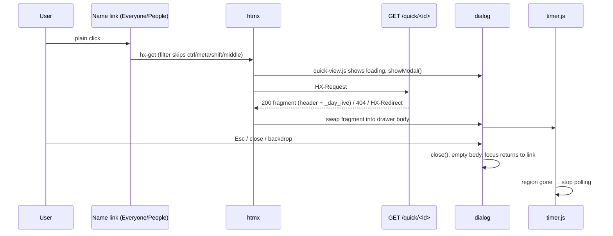

# feat: NITCO sign-in, favicon, Everyone flicker fix and person quick-view drawer

## Summary

Replace the admin-configurable sign-in branding with a professionally built NITCO sign-in page and favicon from the supplied assets. Fix the table re-flow flicker on Everyone. Add a right-side quick-view drawer that opens when a person is clicked on Everyone or People, instead of navigating away.

---

## Problem Frame

- The current sign-in "branding" is an admin upload form (logo, background image or colour) that produces an amateur result; the user wants the NITCO brand built in, done properly, and the settings removed.
- No favicon exists; the browser tab shows a generic icon.
- People's flicker was fixed in `bc55da2` (fixed table layout, batched status, history-restore fix). Everyone (`/team`) never got the fixed layout, so it still re-flows on navigation and on search.
- Clicking a name on Everyone opens the full Day page; on People it opens the edit form. Both cost a full navigation for what is usually a quick look.

---

## Requirements

- R1. Sign-in, code, setup and offline pages use a built-in NITCO layout: brand panel with the supplied art and white wordmark, plus a clean form column. Works at 375px through 1440px+, light and dark.
- R2. The NITCO "N" mark is the favicon on every page, in standard sizes, plus an Apple touch icon and a root `/favicon.ico`.
- R3. The "Sign-in branding" settings section, its routes, its public asset route and its context processor are removed. No admin control over sign-in appearance remains.
- R4. Everyone does not visibly re-flow on load, on search, or when rows change.
- R5. Clicking a person's name on Everyone or People opens a right-side drawer showing that person's details and today (ring, first in/last out, gross/breaks, attendance log, status), with links to the full Day, Week and (editors, on People) Edit pages.
- R6. The drawer closes on Esc, the close button and a backdrop click. Focus moves into it on open and returns to the clicked name on close. The page behind is inert while open.
- R7. Modifier clicks (Ctrl/Cmd/Shift/middle) and no-JS clicks still navigate to the full page. Access rules are unchanged: a person the viewer cannot see is a 404, inside or outside the drawer.
- R8. DESIGN.md and PRODUCT.md reflect the brand surface and the drawer, so the rules match what ships.

---

## Scope Boundaries

- No change to the Day and Week pages' own layout or copy.
- The app name ("Attendance Hub") and the sidebar brand mark stay as they are.
- No day navigation inside the drawer; it shows today only. Other days stay on the full Day page.
- No inline editing inside the drawer. The People row's Edit button (inline manager/role edit) is unchanged.

### Deferred to Follow-Up Work

- Swap the sidebar's `scan-line` brand mark for the NITCO N mark, if wanted after seeing the new sign-in page.
- Dropping the now-unused `branding_assets` table and the `signin_background*` settings rows with a future schema version (see KTD3).
- Day-log copy phrased for "you" ("if you stay in", "Ask HR...") when a manager views someone else. It already reads that way on the full Day page.

---

## Context & Research

### Relevant Code and Patterns

- `templates/_auth_base.html`: shared head and card for `signin_email.html`, `signin_code.html`, `setup.html` and `offline.html`. Currently calls `signin_branding()` and switches between three background modes.
- Branding feature surface to remove:
  - `essl_hub/web.py` (`signin_branding` context processor)
  - `essl_hub/routes/signin.py` (`brand_asset`, `/brand/<key>`)
  - `essl_hub/routes/admin.py` (`BRANDING_*`, `sniff_image_type`, `_branding_context`, three branding routes)
  - `essl_hub/routes/people.py` (`settings_upload_branding` branch in the 413 handler)
  - `templates/settings.html` (branding section and intro copy)
  - `static/styles.css` (`.auth-bg-*`, `.auth-logo`, `.brand-preview`, `.brand-modes`, `--auth-scrim`)
  - `essl_hub/db.py` (`branding_versions`, `branding_asset`, `set_branding_asset`, `delete_branding_asset`)
  - `tests/test_web.py` (fake-DB branding methods, branding tests around lines 2210–2360)
- `static/email-logo.png`: an existing 1655×452 transparent white NITCO wordmark (used by `essl_hub/mail.py`). It is the crisp wordmark for the brand panel.
- Supplied art lives in `.orca/drops/` (gitignored): `Nitco_C_Logo-F.png` (2428×648 banner: wave art with the wordmark baked in) and `Nitco_Favicon.png` (1254×1254 N mark on a blue gradient).
- `bc55da2` People fix: `.people-table { table-layout: fixed }` plus a `<colgroup>` with percentage widths, mobile override back to `auto`. This is the pattern for Everyone.
- `templates/_team_results.html`: the Everyone table, with no colgroup and auto layout.
- `essl_hub/routes/me.py` `day_view`: builds the whole Today context inline; `_subject()` enforces `access.can_view` with a 404.
- `templates/_day_live.html`: the self-contained Today region (`#day-live`), already rendered alone for htmx polls.
- `static/timer.js`: initialises once at script load, only if `#day-live` already exists; polls via `htmx.ajax` into `#day-live`.
- `essl_hub/routes/common.py`: `_login_required` already answers htmx requests with `HX-Redirect` on an expired session; `_htmx_partial` and `_vary_htmx` are the fragment conventions.
- `templates/base.html`: sets the htmx config meta (history cache off) and loads `static/vendor/htmx.min.js` (2.0.4).

### Institutional Learnings

- No `docs/solutions/` directory exists. The prior plan `docs/plans/2026-10-12-001-fix-punch-accuracy-and-admin-upgrades-plan.md` and commit `bc55da2` are the nearest record. Fragment views must send `Vary: HX-Request` and serve full pages for history restores.

### External References

- htmx 2.0.4 docs (ctx7 `/bigskysoftware/htmx/v2.0.4`): modal examples load the fragment with `hx-get` plus `hx-target`, then open the container after swap. `hx-trigger` accepts event filters such as `click[ctrlKey]`, which supports the modifier-click passthrough in R7.
- Native `<dialog>` with `showModal()` supplies the top layer, Esc to close, an inert background and focus return to the opener. This avoids a hand-rolled focus trap.

### Tooling on hand

- `ffmpeg` (with png, mjpeg and libwebp encoders) is installed for one-off asset crops and resizes. Pillow is not installed and is not to be added (no new deps).
- Playwright browsers are cached under `~/.cache/ms-playwright`, usable through `npx playwright` for screenshots and layout-shift measurement without adding a repo dependency.

---

## Key Technical Decisions

- **KTD1. Brand assets are static files, not database rows.** They live in `static/brand/` and are committed. The sources are copied out of the gitignored `.orca/drops/`. Generated derivatives are committed, not built at runtime.
- **KTD2. The brand panel uses a wordmark-free crop of the wave art plus the separate transparent wordmark.** The banner has the wordmark baked in, so any `cover` crop on a tall panel would cut it. Crop the wave-only region (left of the wordmark), scale it to cover the panel, and lay the crisp `email-logo.png` wordmark over it. On mobile the same art becomes a short top band with the wordmark centred.
- **KTD3. Removing the feature leaves the v5 table in place.** Migration v5 is applied and must not be edited (global rule). An empty, unused `branding_assets` table and two dead settings rows are harmless. A destructive v6 drop is deferred until it is clearly wanted.
- **KTD4. The drawer is one native `<dialog>` in `base.html`, filled by htmx.** Name links keep their `href` (full page) and add `hx-get` to a fragment endpoint, with a trigger filter that skips modifier and non-primary clicks. A small `static/quick-view.js` calls `showModal()` after the swap, handles backdrop click, shows a loading state and handles error responses. No new libraries.
- **KTD5. One quick-view endpoint for both pages: `GET /quick/<employee_id>` in `essl_hub/routes/me.py`.**
  - It is guarded by `_login_required` and `access.can_view`, so a non-visible or missing person returns 404.
  - A non-htmx request redirects to `/day?employee=<id>`, so the URL is never a dead end.
  - A `from=people` query parameter adds the Edit link only when the viewer may modify that person. Templates never decide access (KTD8 of the prior plan).
- **KTD6. The drawer reuses `_day_live.html` through a shared context builder.** `day_view`'s Today context is extracted into a helper that both `day_view` and the quick view call. The drawer then shows exactly what the Day page shows, with no second implementation.
- **KTD7. `timer.js` initialises on demand.** It gains an init path that runs when a `#day-live` region is swapped in (drawer open) after page load. It stops polling once the region leaves the DOM (drawer closed or emptied). The full Day page keeps today's behaviour. Only one `#day-live` exists on a page at a time, because Everyone and People have none of their own.
- **KTD8. No URL change while the drawer is open (no `hx-push-url`).** Back still leaves the page as it does today. Deep links go to the full Day page.
- **KTD9. The Everyone fix mirrors People.** It gets `table-layout: fixed`, a `<colgroup>` with fixed percentage widths, ellipsis on name and email, and an `auto` layout below 768px. The plan states the root cause as a hypothesis, and U4 confirms it with a measurement before and after.
- **KTD10. DESIGN.md is amended where it blocks the brand.** It gains a named "Brand surface" exception (sign-in pages only) permitting the supplied gradient art and the brand red. It also gains a "Drawer" component entry (neutral shadow, ≤150ms slide, reduced-motion respected). The app shell stays as it is.

---

## High-Level Technical Design

### Sign-in layout by breakpoint

```text
≥ 1024px                                   768–1023px / < 768px
┌──────────────────────┬─────────────────┐ ┌────────────────────────┐
│  wave art (cover)    │                 │ │ wave band  [NITCO]     │  ~140–180px
│                      │   Sign in       │ ├────────────────────────┤
│   [NITCO wordmark]   │   Work email    │ │  Sign in               │
│   Attendance Hub     │   [__________]  │ │  Work email            │
│                      │   [Send code]   │ │  [__________]          │
│                      │   note          │ │  [Send code]           │
│  ~50–55% width       │  form column    │ │  note                  │
└──────────────────────┴─────────────────┘ └────────────────────────┘
Brand panel identical in light and dark; form column follows theme tokens.
```

### Drawer interaction



---

## Implementation Units

### U1. NITCO brand assets and favicon on every page

**Goal:** Commit the brand assets and serve the favicon set on every page.

**Requirements:** R2, and the assets that R1 needs.

**Dependencies:** None.

**Files:**
- Create: `static/brand/` holding the favicon PNGs (32, 192, 512), `favicon.ico`, `apple-touch-icon.png` (180), the wave art crop(s) for desktop and mobile (WebP and/or JPEG), and the white wordmark (reuse or downscale `static/email-logo.png`)
- Create: `templates/_head_icons.html` (icon `<link>` tags)
- Modify: `templates/base.html`, `templates/_auth_base.html` (include `_head_icons.html`)
- Modify: `essl_hub/routes/signin.py` or `essl_hub/web.py` (root `/favicon.ico` route serving the static file with a long cache)
- Test: `tests/test_web.py`

**Approach:**
- Derive every file once with ffmpeg from the two sources in `.orca/drops/`. Keep the sources out of the repo; commit only the web-sized derivatives.
- Size budget: favicons a few KB each; each wave crop under ~150 KB.
- The `.ico` holds a 32×32 image (ffmpeg writes one size per ICO). Modern browsers use the PNG `<link>`s.
- Pick the exact crop box and output format during implementation (see Open Questions).

**Patterns to follow:** `static/` asset references via `url_for('static', ...)` as in `base.html`.

**Test scenarios:**
- Happy path: a signed-in page (`/day`) and the sign-in page (`/signin`) both include the icon links pointing at existing files under `static/brand/`.
- Happy path: `GET /favicon.ico` returns 200 with an icon content type and a cache header, without signing in.
- Edge case: every asset path referenced from `_head_icons.html` resolves to a file on disk. The test walks the template's hrefs, so a renamed file fails the suite.

**Verification:** The favicon shows in a browser tab on the sign-in page and on app pages. Asset sizes are within budget.

---

### U2. Remove the sign-in branding settings

**Goal:** Delete the admin branding feature end to end, leaving the database schema untouched.

**Requirements:** R3.

**Dependencies:** None. Land it before U3 so the new layout does not have to accommodate the old modes.

**Files:**
- Modify: `essl_hub/routes/admin.py`, `essl_hub/routes/signin.py`, `essl_hub/routes/people.py`, `essl_hub/web.py`, `essl_hub/db.py`
- Modify: `templates/settings.html`, `templates/_auth_base.html`
- Modify: `static/styles.css`
- Test: `tests/test_web.py`, `tests/test_db.py`

**Approach:**
- Remove the branding routes and helpers.
- Remove the public `/brand/<key>` route.
- Remove the context processor.
- Remove the 413-handler branch.
- Remove the branding DB methods.
- Remove the settings section, and update the settings intro sentence so it no longer mentions sign-in branding.
- Remove the branding CSS and the `--auth-scrim` tokens in all three token blocks. Keep `--shadow-card` for the drawer (U6), renaming it only if the implementer finds a clearer name.
- Leave migration v5 and its `test_db.py` test exactly as they are (KTD3).
- Delete the branding tests and the fake-DB branding methods in `tests/test_web.py`.

**Test scenarios:**
- Happy path: the admin settings page renders without a "Sign-in branding" section.
- Error path: `POST /settings/branding/logo`, `POST /settings/branding/logo/reset`, `POST /settings/branding-background` and `GET /brand/logo` all return 404 (or 405) for an admin.
- Integration: a database that still holds a `branding_assets` row and `signin_background=image` still renders `/signin` with the new built-in layout (the stale data is ignored).
- Regression: the existing schema-migration tests for v5 still pass unchanged.

**Verification:** `grep` for `branding`, `auth-bg` and `signin_branding` across `essl_hub/`, `templates/` and `static/` finds only the v5 migration. In `tests/`, the word appears only in the removal tests, the stale-data integration test and the v5 migration test. The full suite is green.

---

### U3. Rebuild the sign-in layout

**Goal:** A polished NITCO sign-in shared by every `_auth_base.html` page.

**Requirements:** R1.

**Dependencies:** U1, U2.

**Files:**
- Modify: `templates/_auth_base.html`
- Modify: `static/styles.css` (auth section)
- Review (copy and markup fit only, if needed): `templates/signin_email.html`, `templates/signin_code.html`, `templates/setup.html`, `templates/offline.html`
- Test: `tests/test_web.py`

**Approach:**
- Use the split layout from the High-Level Technical Design.
  - The brand panel is decorative art with the wordmark as an `` and a short product line ("Attendance Hub"). It sits outside the form landmark order, so screen readers reach the heading and form quickly.
  - The form column keeps the existing card content blocks unchanged: title, form, Turnstile and notes.
  - Width stays around 360–400px, vertically centred, with a comfortable top rhythm.
- Below 1024px the panel becomes a short top band.
  - Below 768px controls are 44px (the existing token).
  - No horizontal scroll at 375px.
- The brand panel is identical in light and dark (the art is already dark). The form column uses existing theme tokens, so AA contrast holds with no new colours in the form.
- Remove the existing in-card `brand auth-brand` block, because the panel carries the brand.
- On the mobile band, keep the Turnstile widget and the form fully visible without scrolling at 375×812.
- Iterate visually with Playwright screenshots at 1440×900, 1280×800, 1024×768, 768×1024 and 375×812, in light and dark. Show the user the 1440 and 375 shots before calling the unit done.

**Patterns to follow:** existing `.auth-*` classes and tokens in `static/styles.css`. DESIGN.md type scale and spacing.

**Test scenarios:**
- Happy path: `/signin` renders the brand panel with the wordmark image (`alt` text present) and the email form. There is no `auth-bg` class and no `/brand/` URL.
- Happy path: the code-entry page (after `POST /signin`), `/setup` (when allowed) and the offline page render through the same layout. Each keeps its own heading and form.
- Edge case: with a Turnstile site key configured, the widget container still renders inside the form column.
- Accessibility: the page has one `main`, the `h1` comes before the form, and the brand image has meaningful `alt`. The decorative wave is a CSS background, so it has no `alt` noise.

**Verification:**
- Screenshots at all five sizes in both themes look intentional, with no cropped wordmark and no horizontal scroll.
- The form text passes AA, which it does by reusing tokens.
- The user signs off on the look.

---

### U4. Stop Everyone from re-flowing

**Goal:** Remove the visible flicker on Everyone.

**Requirements:** R4.

**Dependencies:** None.

**Execution note:** Characterization first. Measure layout shift on navigation to `/team` and on a search swap before changing anything. Keep the numbers to compare.

**Files:**
- Modify: `templates/_team_results.html` (add `<colgroup>`)
- Modify: `static/styles.css` (Team section)
- Test: `tests/test_web.py`

**Approach:**
- Mirror the People fix (KTD9): `.team-table { table-layout: fixed; min-width: … }` with column widths for select, name, manager, first entry, last exit, effective, today and actions.
  - Add ellipsis on name, email and manager.
  - Revert to `auto` and hide the colgroup below 768px, as People does.
- Measure with Playwright using the `layout-shift` PerformanceObserver (or a frame-by-frame screenshot burst) on the cold load and on the typed search.
- If shifts persist after the layout fix, investigate the next suspects before closing the unit:
  - scrollbar appearance inside `.table-scroll`
  - late font swap
  - the out-of-band count swap
  - row re-sorting on search

**Patterns to follow:** `.people-table` rules and the `_people_results.html` colgroup from `bc55da2`.

**Test scenarios:**
- Happy path: `/team` renders a `<colgroup>` whose column count equals the header cell count.
- Happy path: the htmx search fragment (`HX-Request`) also carries the colgroup, so swapped tables keep fixed widths.
- Regression: a history-restore request still gets the full page, and `Vary: HX-Request` is still sent.

**Verification:** Measured cumulative layout shift on load and on search drops to roughly 0, compared with the before numbers. Watching the page by eye shows no flicker.

---

### U5. Quick-view endpoint and shared Today context

**Goal:** A server fragment for one person's quick view, built from the same Today context as the Day page.

**Requirements:** R5, R7.

**Dependencies:** None (independent of U1–U4).

**Execution note:** Extract the Today context helper behind the existing `day_view` tests first (they must stay green), then add the new route test-first.

**Files:**
- Modify: `essl_hub/routes/me.py` (extract the Today context builder, add the `quick_view` route)
- Create: `templates/_quick_view.html` (drawer header with name, email, device ID, manager and role; includes `_day_live.html`; footer actions)
- Test: `tests/test_web.py`

**Approach:**
- `GET /quick/<int:employee_id>` uses `_login_required`, resolves visibility with `access.can_view` (404 otherwise) and builds the shared Today context for that subject.
  - An HX-Request returns `_quick_view.html` with `Vary: HX-Request`.
  - A plain GET redirects to `me.day_view` with `employee=<id>`.
- Footer actions:
  - "Open full day" goes to `/day?employee=<id>`.
  - "Week" goes to `/week?employee=<id>`.
  - "Edit details" goes to `person_edit`, only when `from=people` and the viewer passes `access.can_modify_employee`. The flag is computed in the view.
- The fragment carries a heading with an id, so the dialog can be labelled by it.

**Patterns to follow:**
- `_subject()` 404 semantics.
- `_people_rows` / `_person_row` for view-computed access flags.
- `_vary_htmx`.

**Test scenarios:**
- Happy path: HR requests `/quick/<id>` with `HX-Request` and gets 200 with the person's name, the `#day-live` region and links to Day and Week.
- Happy path (Covers R5): a person inside right now gets a fragment with `data-live="true"` and a `data-poll` URL for that person.
- Happy path: `from=people` as HR shows "Edit details". The same request without `from=people` does not.
- Edge case: a manager viewing someone in their subtree gets 200; viewing someone outside it gets 404. A nonexistent id gets 404.
- Edge case: a person with no punches today gets the "No punches yet today" empty state inside the fragment.
- Error path: an expired session with `HX-Request` gets `HX-Redirect` to sign-in, not a sign-in page in the body.
- Integration: a plain GET (no `HX-Request`) redirects to `/day?employee=<id>`.
- Regression: all existing `/day` tests pass unchanged after the context extraction.

**Verification:** The new tests pass and the `/day` behaviour is byte-for-byte unchanged for existing tests.

---

### U6. Drawer shell and wiring on Everyone and People

**Goal:** Clicking a name opens the drawer. Closing it returns the user where they were.

**Requirements:** R5, R6, R7.

**Dependencies:** U5. U4 should land first so the Everyone table is stable underneath.

**Files:**
- Modify: `templates/base.html` (one `<dialog id="quick-view">` with a close button, a loading state and a body container; load `quick-view.js` and `timer.js` with `defer`)
- Create: `static/quick-view.js`
- Modify: `static/timer.js` (on-demand init and stop, KTD7)
- Modify: `templates/_team_results.html`, `templates/_person_row.html` (name links gain `hx-get`, `hx-target` and the filtered `hx-trigger`; the `href` stays)
- Modify: `templates/day.html` (drop its own `timer.js` tag if `base.html` now loads it)
- Modify: `static/styles.css` (drawer)
- Test: `tests/test_web.py`

**Approach:**
- The dialog is a right-anchored sheet.
  - It is about 440–480px wide on desktop and full width below 768px.
  - It has a sticky header with the person's name and an X button labelled "Close".
  - It uses the neutral `--shadow-card` and the page background tokens, and slides in within 150ms. Under `prefers-reduced-motion` there is no slide.
- Behaviour of `quick-view.js`:
  - On a qualifying click it shows the loading state and calls `showModal()`.
  - On `htmx:afterSwap` into the drawer body it moves focus to the drawer heading.
  - On `htmx:responseError` or `htmx:sendError` it shows an inline error with a "Open full page" link to the same `href`.
  - On backdrop click (the click target is the dialog itself) it closes.
  - On `close` it empties the body, which stops `timer.js`.
  - Clicking another name while open is impossible because the background is inert. Each open starts clean.
- Changes to `timer.js`:
  - Factor the existing start logic into an init function.
  - Run init at load (Day page) and after any swap that introduces `#day-live` when no tick or poll is running.
  - `schedulePoll` and `tick` stop when the region is gone.
  - Keep one shared state, since only one region exists at a time.
- Name links:
  - The trigger filter passes only primary clicks with no modifier, along the lines of `click[!ctrlKey && !metaKey && !shiftKey && !altKey]`; the middle button never fires `click`.
  - People links add `from=people`.
  - The People row's existing Edit button and inline edit are untouched.

**Technical design:** see the drawer sequence diagram in High-Level Technical Design.

**Patterns to follow:**
- `timer.js` IIFE style and `htmx:*` listeners on `document.body`.
- The `hx-target` / `hx-swap` usage in `_person_row.html`.

**Test scenarios:**
- Happy path: the `/team` and `/people` HTML contain `dialog#quick-view` once. Each name link has an `href` to its full page plus `hx-get` to `/quick/<id>`, and People links include `from=people`.
- Happy path: the `/day` page still loads `timer.js` exactly once.
- Edge case: a non-admin employee's `/day` page (no Everyone or People access) renders without errors with the dialog present but unused.
- Manual browser checks (Playwright or by hand), recorded in the PR or commit notes:
  - plain click opens the drawer with data, and focus lands in the drawer
  - Esc, the X and a backdrop click all close it, and focus returns to the clicked name
  - Ctrl/Cmd-click and middle-click open the full page in a new tab
  - with JS disabled, a click navigates to the full page
  - for a person inside, the drawer timer ticks, and a forced poll updates it
  - after closing, the network panel shows no further polls
  - at 375px the drawer is full width and scrolls internally
  - a 404 (stale row after a role change) shows the inline error, not an endless spinner
  - with the session expired, a click redirects the whole tab to sign-in

**Verification:** All manual checks pass on Everyone and People in light and dark at 1280px and 375px. The automated tests are green.

---

### U7. Update DESIGN.md, PRODUCT.md and README screenshots

**Goal:** Make the written design rules match what ships.

**Requirements:** R8.

**Dependencies:** U3, U6.

**Files:**
- Modify: `DESIGN.md` (Brand surface exception and Drawer component, KTD10; record the brand red and navy as brand-only values, not app tokens)
- Modify: `PRODUCT.md` (replace "No brand assets were supplied" with a note that the NITCO wordmark, mark and art are supplied and used on sign-in and favicon)
- Modify: `docs/screenshots/signin.png` and `docs/screenshots/everyone.png` (refresh from the new UI)

**Test expectation:** none. This unit is documentation and screenshots.

**Verification:** DESIGN.md no longer contradicts the sign-in page or the drawer. The README screenshots show the shipped UI.

---

## System-Wide Impact

- **Interaction graph:**
  - `base.html` now loads `timer.js` and `quick-view.js` on every app page.
  - `timer.js` must stay inert when no `#day-live` exists.
  - The `/day` polling contract (`data-poll` returning `_day_live.html`) is reused by the drawer unchanged.
- **Error propagation:**
  - Drawer fetch failures surface inline in the drawer.
  - Session expiry uses the existing `HX-Redirect`.
  - A work-day rollover poll from the drawer triggers the existing `HX-Refresh`, which reloads the page and closes the drawer. This is acceptable.
- **State lifecycle risks:** a poll in flight when the drawer closes would swap into a detached target. `timer.js` must ignore or abort it once the region is gone (covered in U6's checks).
- **API surface parity:** `/api/v1/*` is untouched. `/brand/<key>` disappears, but it was only used by the sign-in page.
- **Unchanged invariants:**
  - Access checks (`access.can_view`, `can_modify_employee`).
  - Full Day and Week pages.
  - People inline edit.
  - Export.
  - Schema v5 (no migration added).

---

## Risks & Dependencies

| Risk | Mitigation |
|------|------------|
| Upscaled wave crop looks soft on large or retina screens | Pick the crop with the most source pixels, keep the panel art as mood rather than detail, and screenshot at 1440 and 2× DPR. If it still looks soft, ask the user for a higher-resolution or vector source rather than shipping blur |
| `timer.js` refactor breaks the live Day page | Characterize first: the existing Day behaviour plus the manual timer checks from the prior plan (drift, phone lock, "retrying") are re-run after U6 |
| The trigger filter syntax behaves differently than expected in htmx 2.0.4 | Verify modifier clicks in a browser during U6. The fallback is a small delegated click handler in `quick-view.js` that checks the modifiers and calls `htmx.ajax` |
| The Everyone flicker has a second cause beyond table layout | U4 measures before and after, and lists the next suspects to check before closing |
| Removing branding surprises an admin who uploaded an image | The user explicitly asked for removal. Stored rows stay in the database (KTD3), so nothing is destroyed |

---

## Open Questions

### Resolved During Planning

- Admin branding settings: removed (user decision).
- Drawer placement: both Everyone and People (user decision).
- Drawer style: right-side drawer.
- DESIGN.md: amend where it restricts the brand (user decision).
- Drawer content: today only, read-only, with links out.

### Deferred to Implementation

- The exact crop box(es) on the banner art and the output format (WebP or JPEG), chosen from screenshots.
- The final drawer width and the colgroup percentages for Everyone.
- Whether `--shadow-card` gets renamed (for example `--shadow-overlay`) once it serves the drawer.
- Where the `/favicon.ico` route lives (`signin.py` vs an app-level route in `web.py`). It must not require sign-in.

---

## Sources & Research

- User assets: `.orca/drops/Nitco_C_Logo-F.png`, `.orca/drops/Nitco_Favicon.png`. Existing wordmark: `static/email-logo.png`.
- Prior work: `docs/plans/2026-10-12-001-fix-punch-accuracy-and-admin-upgrades-plan.md` (U6 branding, U7 People, U11 timer), commit `bc55da2`.
- htmx 2.0.4 docs via ctx7 (`/bigskysoftware/htmx/v2.0.4`): modal-loading examples and `hx-trigger` event filters.
