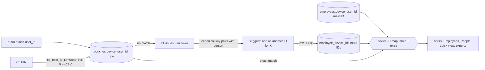

# feat: Employees rename, 7-day strip, People archive, device-ID fixes, and break accuracy

## Summary

Fix three user-reported bugs at their root (Device ID not editable from People, Chrome blank space below tables, lingering ID issues around X990 and zero-padded IDs), rename two confusing labels (Everyone → Employees, Roster → Directory), add a last-7-days strip to the person views, add a reversible Archive for ex-employees under People, and fix break math plus redesign how breaks are shown (summary on top, day bar, numbered break list).

---

## Problem Frame

User report, 2026-10-13: Device ID can't be edited in People; "Roster" reads as a shift roster; Chrome shows endless white space at the bottom; "Everyone" confuses; the person view only shows today; old people's punch data clutters views and needs a reversible archive; the X990 doesn't accept "0" and ID issues persist. Follow-up the same day: in the Attendance log, break time appears to get added into the next break; show individual breaks and inside/outside time separately, with the total break readable at a glance.

Root causes found during planning (read-only investigation against the code and a seeded copy of the DB):

- **Device ID edit.** Backend accepts the change for HR and admin (302, saved). With JS on, People offers no visible path to the field: the row "Edit" opens inline Manager/Role only (`templates/_person_row.html`), and the name link now opens the quick-view drawer (`static/quick-view.js`), whose "Edit details" is a small tertiary button that appears only from People. HR editing an admin is locked by design (`essl_hub/access.py` `ADMIN_PROTECTED_FIELDS`).
- **Chrome white space.** `.visually-hidden` is `position: absolute` and `.table-scroll` has `overflow: auto; max-height` but no `position`, so hidden spans deep in a scrolled table (status-chip ": anomalies" text in `templates/_status_chip.html`, lock labels in `_person_row.html`) take the page as containing block and stretch the document. Measured at 1280px: `/team` 850px and `/people` 1290px of blank space with five flagged rows; grows with roster size. Mobile is clean because `.table-scroll` becomes `overflow: visible`.
- **ID issues.** Punches join people by exact, case-sensitive `device_user_id` string (`essl_hub/export.py` `_load`, `essl_hub/db.py` `punches_for_device_users_range`, `unmapped_device_user_ids`, `device_id_summary`). Each person holds exactly one ID (`employees.device_user_id UNIQUE`). The C3 always formats PINs as `NP{pin:04d}` (`essl_hub/collectors.py` `c3_user_id`), while the X990 stores whatever was enrolled; if the X990 can't take the zero (`NP128` or `128` instead of `NP0128`), one person has two IDs and one device's punches are always "unknown". The ID-issues "link" action overwrites the single ID (`essl_hub/routes/people.py` `id_issues_link`), so the issue just moves to the other device and never clears. Twin detection (`essl_hub/id_issues.py` `id_twins`) only pairs an unknown ID with a roster ID that has never punched, so the common case (roster ID already has C3 punches) gets "Add as new person" — a duplicate. Secondary causes: "0", "00", "NP0000" all reduce to 0 and are accepted as IDs; lowercase input (`np0105`) is saved and never matches; Excel roster cells typed as numbers lose leading zeros (`essl_hub/roster.py` `_cell_text`); C3 PIN 0 becomes `NP0000`.
- **Breaks merging.** Math, not just layout, checked against the replica's 88k punches:
  - *Dropped unpaired swipes merge breaks.* `_pair_segments` (`essl_hub/hours.py`) drops an exit with no entry before it and an entry superseded by another entry. `log_items` (`essl_hub/day_story.py`) then prints one Break row from the previous segment's end to the next start, swallowing the dropped swipe, any untracked inside time and a second real break. Real C3 day: `14:24 exit, 15:55 exit, 16:00 entry` shows `Out 14:24 · Break 1:36:20 · In 16:00`. 1032 of 2797 C3 days (37%) have a dropped swipe inside a shown Break row.
  - *Duplicate X990 swipes flip In/Out.* X990 punches carry no direction, so `_resolve_directions` alternates. A double swipe seconds apart (`09:00:00, 09:00:04, 13:00, 14:00, 18:00`) becomes a 4-second stretch and every later In/Out flips: effective 1:00:04 instead of about 8h, inside time shown as breaks. 826 X990 days have two swipes 60s or less apart. A C3 entry followed by an X990 swipe a minute later causes the same flip on mixed days.
  - *Totals disagree with rows.* On a past day ending with an entry and no exit, a Break row is printed before "No exit recorded", but `break_seconds` (gross minus effective over closed segments) excludes it: 693 of 693 flagged X990 days disagree.
  - *Layout.* Break rows have no start/end times, and dropped swipes are invisible in the log (only in the review notice), so a merged break looks normal.

---

## Requirements

- R1. Device ID is editable from the People page with JS on, for every role/target combination the access rules allow.
- R2. No page scrolls past its content in Chrome at any width.
- R3. A person can carry more than one device ID (one per device format), and punches under any of them count for that person everywhere hours are computed.
- R4. ID issues offer the right fix for the two-format case ("Add as another device ID for X"), and resolving it clears the issue on both devices.
- R5. Device IDs whose numeric part is all zeros, and case variants, are rejected or normalised at every entry point (person form, inline edit, roster import, setup, ID-issues link); C3 PIN 0 never becomes a real-looking ID.
- R6. User-facing "Everyone" becomes "Employees" (managers keep "Team"); People's "Roster" subtab becomes "Directory", with roster-meaning copy in the People section updated to match.
- R7. The quick-view drawer and the full Today/day page show a strip of the last 7 work days; choosing a day shows that day's data in place.
- R8. HR/admin can archive an ex-employee; archived people disappear from Employees, People, exports, quick view, ID-issue suggestions and never-punched/name-mismatch rules, nav counts and sign-in; their device IDs stay mapped so punches never show as unknown, and all punches are kept.
- R9. An Archive subtab under People lists archived people; Restore brings a person and all their history back unchanged.
- R10. DESIGN.md, PRODUCT.md, README reflect the new labels and components.
- R11. Each break is one real Out→In gap: duplicate swipes don't flip directions, unpaired swipes never merge two breaks, and the Breaks total equals the sum of the break rows.
- R12. The person day view (Today page and quick-view drawer) shows total break and break count at the top, a day bar separating inside from outside time, and a numbered list of individual breaks with out/back times; raw punches stay available.
- R13. C3 "Too Short Punch Interval" swipes (event 20) are captured as attendance, flagged, and backfilled from the controller's history table; other denied events stay excluded.

---

## Scope Boundaries

- No shift rostering or scheduling.
- No hard delete of people or punches; punches stay append-only.
- No change to how the X990 itself is enrolled; the dashboard adapts to whatever IDs the devices send.
- The `/team` URL and internal names (`EVERYONE_ROLES`, `team.*` endpoints) stay; only user-facing copy changes.
- Roster *file* vocabulary (import sheet title "Roster", template filenames) stays for compatibility with files people already have.
- `/api/v1/checkins`, the Frappe push and the nightly snapshot are unchanged by archive; archive is a dashboard-level hide.

### Deferred to Follow-Up Work

- Live device test enrolling "0118" and "NP0009" on the X990 to record its exact ID rules and record format (needs the physical device).
- Viewing an archived person's history without restoring them.
- `/employees` URL alias for `/team`.
- `docs/solutions/` entries for the height bug, ID-format rules and break math (`/ce-compound` after merge).
- Re-syncing X990 In/Out alternation at long gaps (beyond duplicate collapsing); revisit if review notes stay high after U10.
- Paid vs unpaid break split and long-break flags (no policy defined).

---

## Context & Research

### Relevant Code and Patterns

- Schema and migrations: `essl_hub/db.py` — `SCHEMA_VERSION = 5`, `MIGRATIONS` dict, `_schema_version` (max of `PRAGMA user_version` and `settings.schema_version`), `_run_migration_statement` (skips an `ADD COLUMN` that already exists). Soft-retire precedent: `devices.retired_at` (v4) and `set_device_retired`.
- Employee consumers that need an archived filter: `db.employees()` feeds `access.visible_employee_ids`/`can_view`, `routes/team.py` `_team_rows`/`_export`, `routes/people.py` `_render_people`/`_render_row`/`_render_person_form`/`_issues`/`issue_count`, `routes/api.py` `api_hours`. Also `subtree_ids`, `manager_chain`, `employee_by_email` (sign-in), `session_employee` (`web.load_employee`), admin counts in `create_first_admin`/`ensure_bootstrap_admin`/`set_employee_role`.
- Punch join sites: `export._load`, `db.punches_for_device_users_range`, `punches_for_employee_range`, `unmapped_device_user_ids`, `device_id_summary`, `employee_by_device_user_id`.
- Day view: `routes/me.py` `day_view` (`?date=`, `?employee=`, `prev_date`/`next_date`), `_day_context(subject, day, today, request_now, target_minutes, day_start_hour)`, `quick_view` (`/quick/<id>`, htmx-only). Multi-day results in one query: `export.day_results` (as `_team_rows` uses). Shift-day boundary: `work_day(now, day_start_hour)`.
- People subtabs: `templates/_people_tabs.html` (anchors with `aria-current` from `request.endpoint`). Decorators `_login_required`, `_role_required` in `routes/common.py`; `_require_csrf()` on every POST; `_redirect_with_flash`/`_take_flash`; `forget_issue_count()` after issue-affecting writes.
- Test doubles: `tests/test_web.py` `FakeDatabase` mirrors every DB method; new DB methods land there too.
- UI: `templates/_ui.html` macros (`button`, `chip`, `field`, `empty_state`), `.subtabs`, `.segmented`, `.pager`/`.day-pager`.

### Institutional Learnings

- Next schema step is v6; guarded, re-runnable, bumps both version markers; v1–v5 never edited (2026-10-10 Turso plan KTD8; 2026-10-13 plan KTD3).
- All access rules live in `access.can_modify_employee`; templates never decide access (2026-10-09 roles plan).
- Keep raw IDs as stored; fix the mapping, never the punch history (commit `aeebe1f`, `id_issues.py`).
- htmx 2.0.4 calls `preventDefault` before evaluating trigger filters; the drawer uses a delegated click handler on `data-quick-view` (2026-10-13 plan review).
- Day/week boundaries go through the shift-day helper (`day_start_hour`, default 06:00) (2026-10-12 plan).

### External References

- pyzk source (`zk/base.py`, `zk/user.py`): 28-byte user records and 16-byte attendance records carry `user_id` as uint32, so leading zeros are lost ("0118" → "118"); 72-byte/40-byte records carry it as a 24-byte string and keep zeros and letters; 8-byte attendance records carry only the slot `uid`. No authoritative source on X990 rejecting ID 0. This makes "one person, two ID spellings" a structural risk, not a data-entry fluke — load-bearing for KTD2.
- Break display prior art (vendor help docs; medium confidence, no product ships the full combination): Keka separates gross vs effective hours with breaks as the difference (help.keka.com, "difference between gross and effective hours"); Zoho People gives breaks their own column per day (help.zoho.com, employee attendance); Jibble shows each break as its own typed entry with a marker and splits tracked time into worked/break (jibble.io/help, how timesheets work); Clockify/Toggl calendar views place entries proportionally on a time axis so gaps are visible (clockify.me/help, calendar view). greytHR hides individual swipes behind an Info pop-up away from the totals, the same confusion reported here. Chart accessibility guidance (accessibility.psu.edu/guidelines/charts): never colour alone, add pattern/texture and text labels, and pair a chart with an HTML table as the real content. Load-bearing for KTD10.

---

## Key Technical Decisions

- KTD1. **One v6 migration** adds `employees.archived_at` (guarded `ADD COLUMN`, as `retired_at` in v4) and a new `employee_device_ids` table (`device_user_id TEXT PRIMARY KEY`, `employee_id` FK `ON DELETE CASCADE`, `created_at`). Bumps `SCHEMA_VERSION` to 6 and both version markers. Rationale: both features need schema; one step keeps version checks in `nightly_export`, `scripts/migrate_postgres.py` and tests moving once.
- KTD2. **Explicit extra device IDs, not fuzzy matching at join time.** `employees.device_user_id` stays the main ID; `employee_device_ids` holds additional IDs. All punch joins resolve through both. Uniqueness across both tables is enforced in the write statement (insert-where-not-exists, check `rowcount`). Rationale: pyzk shows devices can legitimately report different spellings for one person; an explicit mapping is auditable, reversible, and never silently merges two real people the way a "strip zeros" join key would (`NP0128` vs `128` may be different people at another site). Canonical keys are used only to *suggest* links (KTD4).
- KTD3. **Normalise on input, never rewrite stored punches.** New IDs from any entry point are trimmed and upper-cased; IDs whose digits are all zeros are rejected with a plain message. Existing employee rows are not bulk-rewritten. Excel ID cells honour the cell's zero-padded number format. C3 PIN 0 is treated as unlinked (`C3-0`), joining the existing unlinked-PIN path.
- KTD4. **Twin suggestions use a canonical key** (upper-case, letters prefix optional, digits without leading zeros; all-zero numbers never pair) and pair an unknown ID with any roster person, including ones who already have punches. Primary fix for that pair becomes "Add as another device ID for X"; link from ID issues adds an extra ID by default and only replaces the main ID when the current one has never punched.
- KTD5. **Device ID joins the inline row edit** on People (Manager, Role, Device ID), with the same lock rules as the full form; the drawer's "Edit details" becomes a secondary button. Extra device IDs are managed on the full edit form. Rationale: inline edit is the path users actually hit; keeping email on the full form avoids a cramped row.
- KTD6. **Archive = `archived_at` timestamp**, filtered by default in `db.employees()` and every per-person lookup used for viewing; an explicit `archived_employees()` feeds the Archive tab. Archived IDs still count as "mapped" in `unmapped_device_user_ids`/`device_id_summary`, so ex-employees' punches never resurface as unknown. Archiving deletes the person's sessions; sign-in by email refuses archived people with the generic not-found response. Guards: can't archive yourself, the last admin, someone with direct reports (reassign first), and HR can't archive an admin. Archived person keeps their device IDs and email (uniqueness intact; clash messages name the archived person).
- KTD7. **Day strip = 7 work days ending today**, computed with `work_day`. Drawer uses `/quick/<id>?date=`; strip clicks are handled by the existing delegated listener in `static/quick-view.js` (same reason as the drawer itself) and swap `#quick-view-body`. Day page strip is plain links to `/day?date=&employee=`. Only today polls. Dates outside the window on `/quick` return 400; `/day` keeps its existing pager for older dates.
- KTD8. **Chrome fix in CSS**: `.table-scroll` gets `position: relative` so it contains its absolutely positioned descendants; `.visually-hidden` also gets `top: 0; left: 0` hardening so a future scroller without `position` can't recreate the bug.
- KTD9. **Break math: collapse, then pair, then derive.** Before direction resolution, collapse swipes from the same person within 60 seconds of the previous kept swipe (any device), keeping the first; collapsed swipes stay stored and appear in the raw-punch list as "duplicate, not counted". Unpaired swipes become explicit items in the day result. A break is a gap from a paired Out to the next paired In with no unpaired swipe between; a gap that contains an unpaired swipe is an "unclear" gap, listed and totalled separately, never counted as break. `DayResult` carries the gap list, and `break_seconds` is the sum of clean break gaps, so span = inside + breaks + unclear. No break row precedes "No exit recorded" on past days. Rationale: one source for rows and totals, and honest about missing data instead of folding it into a break. 60s matches the observed duplicate cluster (826 X990 days) and is a named constant.
- KTD10. **Break view = summary, day bar, break list, raw punches**, from the research combination. Summary row on top: Inside, Breaks total with count, and Unclear time only when present, plus a span line (first in → last out = inside + breaks [+ unclear]). Day bar: CSS flex from first in to last out (or now), widths proportional; inside solid, breaks hatched with their number, unclear dotted; `role="img"` with a one-line label; decorative detail is in the list. Break list: `#`, Out at, Back at, Duration, with a total row matching the summary; on phones each row reads "#2 12:40 → 13:10 · 30m". The existing In/Out log moves under a closed `
` "All punches (n)", showing unpaired and duplicate swipes marked. Same partial in drawer and Today page. No chart library.
- KTD11. **Event 20 counts as a swipe, flagged.** The C3 door "Punch Interval" (default 2s) denies a swipe arriving inside the interval and logs event 20; in practice that is the second person walking out on the first person's door opening, so the collector's access-granted filter (`C3_PUNCH_EVENT_TYPES`) loses real exits. Accept 20 alongside 0–3 in both the history-table and realtime paths, store it with `raw_state` noting "interval too short", and let KTD9's 60s collapse absorb same-person double swipes. Direction comes from the row's in/out byte as for normal punches. Rows without PIN and card stay dropped (no identity). Backfill is free: the 6-hourly full history read re-pulls retained rows and the existing identity dedupe prevents doubles. Device side: punch interval set to 1s by the site on 2026-10-13, which shrinks but does not remove event 20 (same-second swipes still trip it). Rationale: the person physically passed; dropping the swipe produced the orphan exits that merged breaks.

---

## High-Level Technical Design

Device ID resolution after this change:

Person lifecycle:

```mermaid
stateDiagram-v2
  [*] --> Active
  Active --> Archived: Archive (HR/admin; not self, not last admin, no direct reports)
  Archived --> Active: Restore
  note right of Archived
    hidden from views, counts, sign-in
    sessions deleted on archive
    punches and device IDs kept
  end note
```

---

## Implementation Units

### U1. Contain hidden text in table scrollers (Chrome white space)

**Goal:** Pages end where their content ends in Chrome at every width.
**Requirements:** R2
**Dependencies:** none
**Files:** `static/styles.css`
**Approach:** Add `position: relative` to `.table-scroll`; harden `.visually-hidden` with `top: 0; left: 0`. Audit other `overflow` containers holding `.visually-hidden` (drawer `.qv-scroll`, week table) for the same pattern.
**Test scenarios:** Test expectation: none -- pure CSS. Verify in headless Chromium instead.
**Verification:** With review-flagged rows on the last rows of `/team`, `/people` and `/week`, `document.scrollingElement.scrollHeight` equals the content height (within 2px) at 1280 and 375; the screen-reader text still reads (visually-hidden spans present, not `display: none`).

### U2. Rename Everyone → Employees and Roster → Directory

**Goal:** Labels stop implying "all users" and "shift roster".
**Requirements:** R6
**Dependencies:** none
**Files:** `templates/base.html`, `templates/team.html`, `templates/day.html`, `templates/week.html`, `templates/people.html`, `templates/_people_tabs.html`, `templates/id_issues.html`, `templates/people_import.html`, `essl_hub/routes/team.py`, `tests/test_web.py`
**Approach:** HR/admin nav label, h1, page title and day/week back links read "Employees"; managers keep "Team". Export scope copy "Everyone you can see" → "All employees you can see". Subtab "Roster" → "Directory"; People intro and ID-issues copy where roster means the employee list ("Not on roster", "Roster: <name>") → "Directory"/"not in Directory". Import page keeps "roster file" wording for the upload control only.
**Patterns to follow:** role-dependent label logic already in `base.html` nav.
**Test scenarios:**
- HR and admin see `Employees` in nav and `<h1>Employees</h1>` on `/team`; no `Everyone` in the rendered shell.
- Manager still sees `Team`.
- People subtab nav renders `Directory` with `aria-current` on `/people`.
- ID issues page for an unknown ID shows "not in Directory" wording.
**Verification:** grep of templates shows no user-facing "Everyone"/"Roster" outside the import-file wording; updated tests pass.

### U3. Schema v6: archived_at and extra device IDs

**Goal:** Storage for archive and multiple device IDs per person.
**Requirements:** R3, R8
**Dependencies:** none
**Files:** `essl_hub/db.py`, `tests/test_db.py`, `tests/test_migrate.py`, `essl_hub/nightly_export.py` (version check only if it pins a number), `scripts/migrate_postgres.py`
**Approach:** Add `MIGRATIONS[6]` per KTD1; bump `SCHEMA_VERSION`. `CREATE TABLE IF NOT EXISTS`; guarded `ADD COLUMN`. Fresh databases get both via `MIGRATIONS[6]`; `SCHEMA_STATEMENTS` stays v1. Leave v1–v5 untouched.
**Execution note:** Start with a failing migration test (v5 database → v6 has the column and table; re-run is a no-op).
**Test scenarios:**
- Fresh DB reaches v6 with `employees.archived_at` and `employee_device_ids` present (sqlite_master / `PRAGMA table_info`).
- A v5 DB migrates to v6; existing employees have `archived_at` NULL; both version markers read 6.
- Running migrate twice is a no-op.
- Deleting an employee cascades their extra IDs.
**Verification:** migration tests green; existing version-pinned tests updated to 6.

### U4. Device-ID input rules

**Goal:** Bad or ambiguous IDs can't enter the system.
**Requirements:** R5
**Dependencies:** none
**Files:** `essl_hub/roster.py`, `essl_hub/routes/people.py`, `essl_hub/routes/signin.py`, `essl_hub/collectors.py`, `tests/test_roster.py`, `tests/test_people_edit.py`, `tests/test_collectors.py` (or the existing collector test file)
**Approach:** One normaliser/validator in `roster.py` used by person form, inline edit, import, setup and ID-issues link: trim, upper-case, reject empty or all-zero digits ("0", "00", "NP0000"), keep everything else verbatim (letters and leading zeros allowed). `_cell_text` uses the cell's number format to restore zero padding for numeric ID cells. `c3_user_id` maps PIN 0 to `C3-0`.
**Test scenarios:**
- `np0105` saves as `NP0105`; `" 118 "` saves as `118`.
- `0`, `00`, `NP0000` rejected with "Device ID can't be zero" on form, inline edit, import row and setup.
- `0118` kept as `0118` (leading zeros allowed when not all zeros).
- Excel cell 118 with number format `0000` imports as `0118`; plain numeric 118 imports as `118`.
- `c3_user_id("0")` → `C3-0`; `c3_user_id("128")` → `NP0128` (unchanged).
**Verification:** tests green; no entry point bypasses the shared validator (grep for `device_user_id` writes).

### U5. Extra device IDs across hours, ID issues and the person form

**Goal:** A person's punches under any of their IDs count, and ID issues fix the two-format case for good.
**Requirements:** R3, R4
**Dependencies:** U3, U4
**Files:** `essl_hub/db.py`, `essl_hub/access.py`, `essl_hub/export.py`, `essl_hub/id_issues.py`, `essl_hub/routes/people.py`, `essl_hub/routes/common.py`, `essl_hub/routes/me.py`, `templates/person_form.html`, `templates/id_issues.html`, `templates/_quick_view.html`, `tests/test_web.py` (`FakeDatabase` + tests), `tests/test_id_issues.py`, `tests/test_people_edit.py`, `tests/test_export.py` (or existing export tests)
**Approach:**
- DB: employee dicts carry `device_ids` (main first). Punch queries take the full ID list per person; `unmapped_device_user_ids`, `device_id_summary` and `employee_by_device_user_id` resolve through both tables. Add/remove extra-ID methods enforce cross-table uniqueness in one statement.
- `export._load` groups punches by any of a person's IDs.
- Access: extra IDs are an admin-protected field alongside `device_user_id` in `access.can_modify_employee`.
- `id_issues`: canonical-key twins per KTD4; new fix kind "Add as another device ID for X"; link adds an extra ID by default, replaces only when the current main ID has never punched. Clash checks name the holder (including archived holders).
- Person form: "Other device IDs" list with Remove and an Add field, same lock rules. Quick view shows all IDs.
**Patterns to follow:** `id_twins`/`primary_fix` structure; `_redirect_with_flash` + `forget_issue_count()` after link.
**Test scenarios:**
- Person with main `NP0128` and extra `128`: punches under both appear in one day result on `/day`, `/team`, quick view and export.
- Unknown `NP128` + roster person `NP0128` who has C3 punches → primary fix "Add as another device ID for <name>"; POST link → extra ID stored, issue gone, punches counted, the main ID unchanged.
- Unknown ID twin with a never-punched roster ID → link replaces the main ID (existing behaviour kept).
- Two unknown IDs with the same canonical number → no auto-suggestion (ambiguous).
- Unknown `0`/`NP0000` never pairs.
- Adding an extra ID already used as someone's main or extra ID → 400 naming the holder.
- HR adding/removing an extra ID on an admin → 403; admin succeeds.
- Removing an extra ID makes its punches reappear as unknown in ID issues.
**Verification:** the two-format scenario clears end-to-end in the test client; full suite green.

### U6. Device ID editable from People

**Goal:** The field users look for is where they look.
**Requirements:** R1
**Dependencies:** U4
**Files:** `templates/_person_row.html`, `essl_hub/routes/people.py` (`people_assign`, `_render_row`), `templates/_quick_view.html`, `tests/test_web.py`
**Approach:** Inline row edit gains a Device ID input (form-associated like Manager/Role); `people_assign` validates via U4 and the same access check as `person_update`; locked rows show the lock label instead of an input. Row button aria-label becomes "Edit <name>". Drawer opened from People shows "Edit details" as a secondary button.
**Test scenarios:**
- HR edits an employee's Device ID inline → row re-renders with new ID; `/team` hours follow the new ID.
- HR inline edit on an admin row shows the ID locked; forged POST with a new ID → 403, unchanged.
- Duplicate ID inline → row re-renders with inline error naming the holder, other fields preserved.
- All-zero ID inline → inline error.
- Drawer from People renders "Edit details" with secondary styling; from Employees it doesn't render.
**Verification:** in headless Chromium with JS on, an HR user can change a Device ID from `/people` without leaving the page.

### U7. Archive and restore people

**Goal:** Ex-employees leave every working view without losing data, and come back intact.
**Requirements:** R8, R9
**Dependencies:** U3, U2 (Directory label on the tab bar)
**Files:** `essl_hub/db.py`, `essl_hub/access.py`, `essl_hub/auth.py`, `essl_hub/web.py`, `essl_hub/id_issues.py`, `essl_hub/routes/people.py`, `essl_hub/routes/team.py`, `essl_hub/routes/api.py`, `templates/_people_tabs.html`, `templates/people_archive.html` (new), `templates/person_form.html`, `tests/test_web.py`, `tests/test_people_edit.py`, `tests/test_db.py`
**Approach:**
- DB: `employees()` excludes archived by default; `archived_employees()`; `archive_employee`/`restore_employee` set/clear `archived_at` in one statement with guards checked in SQL where practical (last admin, direct reports) and `rowcount` checked; archive deletes the person's sessions. `employee_by_id` gains an `include_archived` flag used only by archive/restore and the archive tab; viewing paths treat archived as not found. `session_employee` ignores archived people. Admin counts ignore archived admins.
- Access: `access.can_archive(actor, target)` holds self/admin/HR rules.
- Routes: `GET /people/archive` (hr, admin) lists archived people (name, email, device IDs, archived date, last punch) with Restore; `POST /people/<id>/archive` and `POST /people/<id>/restore` with CSRF and flash. Archive button lives in a bottom "Archive person" section of the full edit form with a confirm step (native `<dialog>` or second POST), stating what happens.
- ID issues: archived people's IDs stay mapped; "never punched"/"name mismatch" rules skip archived people.
**Test scenarios:**
- Archive an employee → absent from `/team`, `/people`, exports, `api_hours`, quick view (404), manager's team; nav issue count unchanged by their IDs; their punches don't appear as unknown.
- Archived person appears on `/people/archive`; Restore → back everywhere with prior punches and hours intact.
- Archived person's open session is ended (next request redirects to sign-in); sign-in by their email gets the generic response and no code is sent.
- Guards: archive self → 400; last admin → 400; person with direct reports → 400 naming the count; HR archiving an admin → 403.
- Creating a person with an archived person's device ID or email → error naming the archived person.
- Employee role GET `/people/archive` → 403; POST without CSRF → 400.
**Verification:** archive → restore round trip in the test client leaves the employee row and punches identical except `archived_at`.

### U8. Last-7-days strip on quick view and Today

**Goal:** Pick any of the last 7 work days from the person view.
**Requirements:** R7
**Dependencies:** U2 (back-link copy), U5 (multi-ID punches feed the strip)
**Files:** `essl_hub/routes/me.py`, `templates/_day_strip.html` (new), `templates/_quick_view.html`, `templates/day.html`, `static/quick-view.js`, `static/styles.css`, `tests/test_web.py`
**Approach:** Helper builds 7 entries ending at `work_day(now)`: weekday short name, day number, status from one `export.day_results` call, selected flag. Rendered as a row of compact buttons/links (`aria-current="date"` on the selected one), status shown as dot plus text alternative (colour never alone). `/quick/<id>?date=` validates the date is within the window; strip clicks inside the drawer carry `data-quick-view` targets so the existing delegated handler swaps the body and returns focus to the selected chip. Day page renders the same strip above the existing pager as plain links preserving `employee`. Non-today views don't poll.
**Patterns to follow:** `_day_context`; `.day-pager`; DESIGN.md motion/colour rules.
**Test scenarios:**
- Strip lists 7 days ending today; respects `day_start_hour` (at 05:30 "today" is still yesterday's work day).
- `/quick/<id>?date=<3 days ago>` renders that day's ring and log, `is_today` false, no `data-poll`.
- `/quick/<id>?date=<8 days ago>` and future date → 400; malformed date → 400.
- Day page strip links keep `employee=`; selected day has `aria-current="date"`.
- Viewer without access to the subject → 403/404 as today's `quick_view`.
- Browser (headless): open drawer, click a past day → body swaps, focus on the selected chip, timer stops; click today → timer resumes.
**Verification:** strip works in drawer and on `/day` at 1280 and 375 widths without horizontal page scroll.

### U10. Break math: duplicates, unpaired swipes, consistent totals

**Goal:** Breaks and hours reflect real Out→In gaps.
**Requirements:** R11
**Dependencies:** none
**Files:** `essl_hub/hours.py`, `essl_hub/day_story.py`, `templates/_day_live.html` (only to stop printing the pre-missing Break row), `tests/test_hours.py`, `tests/test_day_story.py` (or the existing test files covering `compute_day`/`log_items`), `tests/test_web.py`
**Approach:** Per KTD9. Collapse duplicates in `compute_day` before `_resolve_directions`; have `_pair_segments` return unpaired swipes with positions; build gaps (break or unclear) in `hours.py` and expose them on `DayResult`; `break_seconds`/`break_minutes` derive from clean breaks; `log_items` and anomaly text read the same gaps. Effective time keeps counting only paired segments.
**Execution note:** Characterization first: pin current outputs for the clean cases (no duplicates, no orphans) so they provably don't change.
**Patterns to follow:** existing R3/R4/R17 handling and `_scored` minute/second reconciliation.
**Test scenarios:**
- Clean day `09:00E 13:00X 14:00E 18:00X`: one break 1:00:00; outputs identical to today.
- Direction-less `09:00:00 09:00:04 13:00 14:00 18:00`: duplicate collapsed; segments 09:00–13:00 and 14:00–18:00; effective 8:00:00; one break; raw list marks 09:00:04 duplicate.
- `09:00E 13:00X 14:00X 15:00E 18:00X`: no 2:00:00 break; gap 13:00–15:00 is unclear 2:00:00 with the 14:00 exit shown; breaks total 0.
- `09:00E 13:00X 14:00E 15:00E 15:30X`: superseded 14:00 entry shown; gap 13:00–15:00 unclear, not break.
- Mixed `09:00E 09:01(no dir) 13:00X 14:00E 14:01(no dir) 18:00X`: X990 swipes collapsed as duplicates; effective 8:00:00.
- Past day `09:00E 13:00X 14:00E`: no Break row before "No exit recorded"; summary breaks 0:00:00 equals rows.
- Two real swipes 61 seconds apart both count.
- Night shift `21:00E 01:00X 01:30E 05:00X`: break 0:30:00 (unchanged).
- Open day with live `now`: inside ticks; breaks total equals listed breaks.
- Property-style check over generated sequences: span = effective + breaks + unclear for every closed day.
**Verification:** characterization tests unchanged; replica spot-check of the NP0205 2025-10-27 and NP0039 2026-05-13 days shows split/unclear gaps instead of merged breaks.

### U11. Break view: summary, day bar, numbered break list

**Goal:** Total break readable at a glance; each break identifiable; inside vs outside obvious.
**Requirements:** R12
**Dependencies:** U10
**Files:** `templates/_day_live.html`, `templates/_day_breaks.html` (new partial), `essl_hub/day_story.py`, `static/styles.css`, `static/timer.js` (only if the open bar segment needs the existing tick), `tests/test_web.py`, `tests/test_day_story.py`
**Approach:** Per KTD10. `day_story` builds a view model: summary figures, bar segments (kind, number, start, end, percent width, label), break rows, raw punches. Bar segments narrower than a label show only the number; a visually-hidden sentence per segment is not needed because the break list is the text alternative (U1 keeps hidden text contained). Hatching via `repeating-linear-gradient` tokens with dark-mode values; unclear gaps use a dotted outline plus the word "Unclear" in the list. Live days: the open inside segment ends at `now` and refreshes with the existing poll; the Inside figure keeps its `data-tick`. Drawer uses the same partial; the raw-punch `
` stays closed by default in both.
**Patterns to follow:** `.day-section`, `ui.clock`, `ui.chip` tones; DESIGN.md colour/motion rules.
**Test scenarios:**
- Day with 3 breaks: summary shows "Breaks 1:20:00 · 3"; list rows numbered 1–3 with out/back times and durations summing to the total row; bar has 3 hatched segments labelled 1–3 and `role="img"` label "Inside 6:12, 3 breaks totalling 1:20".
- Day with an unclear gap: summary shows "Unclear 2:00:00"; list row reads Unclear with the unpaired swipe time; bar segment dotted; breaks total excludes it.
- No breaks: summary "Breaks 0:00 · none", no list table, bar single solid segment.
- Open day: last bar segment ends at now and is labelled inside; Inside ticks.
- Raw punches `
` lists every stored swipe, duplicates marked "not counted".
- Drawer renders the same partial; 375px: no horizontal scroll, list rows stack as "#2 12:40 → 13:10 · 30m".
- Dark mode: hatch and dotted patterns visible (contrast checked in screenshots).
**Verification:** headless screenshots at 1280 and 375, light and dark, for a clean, a 3-break and an unclear day; no `Break` merged rows remain.

### U12. Capture C3 interval-too-short swipes (event 20)

**Goal:** No swipe lost when two people pass a C3 door back to back.
**Requirements:** R13
**Dependencies:** none (U10's collapse handles same-person repeats; land U10 first or together so hours don't briefly double-count)
**Files:** `essl_hub/collectors.py`, `scripts/remap_c3_ids.py` (uses `_c3_is_punch`; keep its behaviour intentional), `essl_hub/day_story.py` (flag in raw punches), `tests/test_collectors.py`, `tests/test_day_story.py`
**Approach:** Per KTD11. Split the filter into `C3_GRANTED_EVENT_TYPES` {0,1,2,3} and `C3_ATTENDANCE_EVENT_TYPES` = granted + {20}; collectors use the attendance set; `_c3_trusted_direction`'s 15→exit rule stays limited to granted events unless replica rows show event 20 carries the same byte pattern. Raw-punch list shows "interval too short" chip. Before coding, check a replica/device history pull that event-20 rows carry PIN or card and an in/out byte.
**Patterns to follow:** existing `c3_identity` dedupe; `raw_state` formatting.
**Test scenarios:**
- History row event 20 with PIN and in/out 1: stored as exit, `raw_state` notes interval too short.
- Realtime record event 20: stored, same identity as a history re-read of the same row (no double insert).
- Event 20 with no PIN and no card: dropped.
- Events 27, 24, 202, 206: still dropped.
- Person A event 0 exit 13:00:00, person B event 20 exit 13:00:01: both stored; B's day shows the exit.
- Same person event 0 then event 20 within 60s: one counted swipe, the other "not counted" (via U10).
- Remap script: unchanged result on a fixture without event 20; documented behaviour with one.
**Verification:** replica history pull after deploy shows event-20 rows stored; a previously merged-break day with a known second swipe now splits.

### U9. Docs

**Goal:** Docs match the product.
**Requirements:** R10
**Dependencies:** U1–U8, U10, U11, U12
**Files:** `DESIGN.md`, `PRODUCT.md`, `README.md`, `docs/screenshots/everyone.png` (re-shot; keep filename or rename with README reference)
**Approach:** DESIGN.md: Day strip component, Day bar and break list components (hatch/dotted patterns, numbering), Archive tab pattern, rename references. PRODUCT.md: Employees/Directory vocabulary; device-ID model (main + extra IDs, zero rule). README: labels, archive, ID issues behaviour, `ESSL_C3_ID_FORMAT` guidance for sites whose X990 IDs lack zero padding.
**Test scenarios:** Test expectation: none -- documentation.
**Verification:** no stale "Everyone"/"Roster" (employee-list meaning) in docs; screenshot reflects new label.

---

## System-Wide Impact

- **HR/admins:** new labels; Device ID inline; Archive tab; ID issues fixes change from "add new person" to "add another ID".
- **Managers:** Team view loses archived reports only after reassignment (archive guard prevents orphaning).
- **Archived employees:** lose dashboard access immediately.
- **Hours everywhere:** U10 changes computed hours for past days with duplicate or unpaired swipes (exports, Week, api_hours, statuses). Hours are computed on read, so the change applies retroactively on deploy; punches themselves are untouched. Call this out in release notes.
- **Integrations:** checkins API, Frappe push and nightly snapshot unchanged; `scripts/migrate_postgres.py` and `nightly_export` version checks move to 6.

---

## Risks & Dependencies

| Risk | Mitigation |
|---|---|
| A missed `employees()`/join site shows archived people or drops extra-ID punches | Route every viewing path through `db.employees()`/`device_ids`; tests per surface in U5/U7; grep audit for `device_user_id =` joins |
| Cross-table ID uniqueness race | Single-statement insert-where-not-exists with `rowcount` check (KTD2) |
| Turso replica reads stale inside transaction | Guards expressed in the write statement, not read-then-write |
| Canonical-key suggestion links two different people | Suggest only; human confirms the link preview; ambiguous pairs never suggested |
| 60s duplicate window hides a genuine quick in-and-out | Named constant; collapsed swipes stay visible in raw punches marked "not counted"; tests pin 61s as counted |
| Retroactive hour changes surprise HR | Characterization tests for clean days; release note; replica spot-check before merge |
| X990's real rule differs from assumption | Design doesn't depend on it: any spelling can be added as an extra ID; live device test deferred |
| Event 20 rows lack identity or direction on this firmware | Pre-coding replica check (U12); rows without identity dropped; direction falls back to alternation |
| Backfill changes past hours | Covered by the same release note as U10 |

---

## Open Questions

### Deferred to Implementation

- Exact confirm UX for archive (native `<dialog>` vs second-step page) — pick whichever matches existing destructive actions (devices retire).
- Whether `punches_for_employee_range` callers all have the full ID list handy or need a lookup.
- Whether `.qv-scroll` or the week table also need `position: relative` after measurement.
- Exact view-model shape for bar segments and whether the open segment needs client-side width updates between polls.
