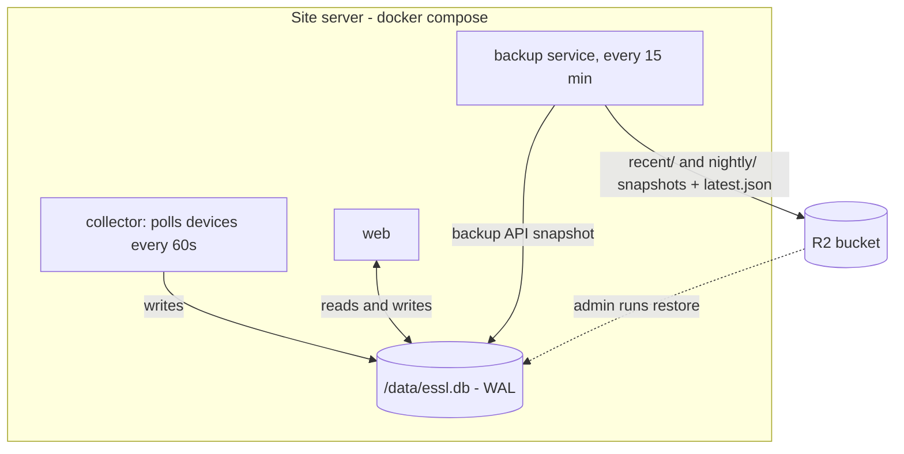
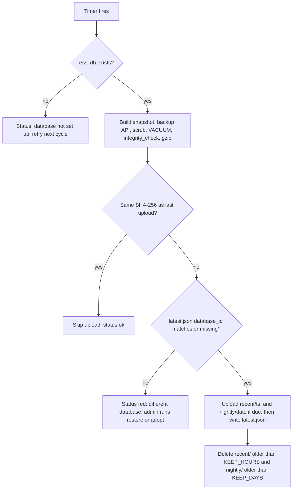
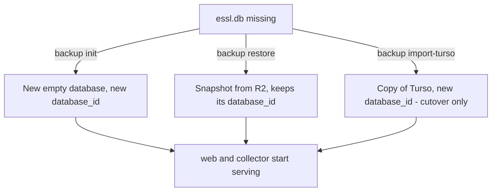

# refactor: Local-first database with 15-minute R2 snapshots

## Summary

The site server's SQLite file becomes the only working database, shared by the web app and the collector. Every read and write is local. The existing R2 export runs every 15 minutes instead of nightly and becomes the off-site copy. Turso is retired. Admins create, restore and inspect the database with a handful of commands, and they choose the host folder for it in docker compose.

---

## Problem Frame

Turso warned that 75% of the free plan's monthly sync quota was used: 2.28 GB of 3 GB. At the limit the database is blocked; the free plan has no overage billing.

The measured causes:
- **Nightly re-download:** the nightly export deletes its replica and downloads the whole database every night (`_export_once` in `essl_hub/nightly_export.py`). Prod is 10,871 pages × 4 KB = 44.5 MB, so that alone is about 1.3 GB a month.
- **Steady writes:** every write sends at least one 4 KB page back to each of three embedded replicas (web, collector, export).
- **Rebuilds:** a replica rebuild or a lost replica file downloads the whole 44.5 MB again.

Embedded replicas also send every write to Turso first. When the internet is down, the app turns read-only and punches go to the spool.

Turso serves nobody but this server; users reach the web app through the Cloudflare Tunnel. Turso's only job is to be an off-site copy, and the R2 export already makes one, just once a day.

Facts checked:
- **Prod data:** 91,407 punches, 76 employees, 2 devices, schema v6.
- **Frappe:** the push has never run.
- **Devices:** the X990 still holds 60,711 records and the C3 keeps a history table, so punches missing locally can be re-read from the devices.
- **Snapshot size:** a scrubbed snapshot of the 12 Oct replica is 39.8 MB raw and 11.0 MB gzipped.

Reviewers compared this design against a row-by-row copy to Turso. The row copy needed change triggers, an outbox, ID-collision guards, full-refresh logic and quota watching. The snapshot reuses code that already works.

---

## Requirements

**Local working database**
- R1. The web app and the collector share one SQLite file, and every read and write goes to it.
- R2. With the internet down, everything except emailed sign-in codes and the backup upload keeps working.
- R3. A punch shows on the dashboard as soon as the collector stores it.
- R4. The web app and the collector never create a missing database. They show or log the commands to create or restore one.

**Off-site copy**
- R5. A verified, gzipped snapshot reaches R2 every `ESSL_BACKUP_MINUTES` (default 15). Sessions and sign-in codes are removed from it.
- R6. Snapshots from the last `ESSL_BACKUP_KEEP_HOURS` (default 48) are kept, plus one per day for `ESSL_BACKUP_KEEP_DAYS` (default 30). Older ones are deleted.
- R7. A database that is not the one the backups came from cannot replace them until an admin confirms it.

**Admin commands**
- R8. One command each to: create a new database, restore the latest or a chosen snapshot, list snapshots, take a snapshot now, show status, confirm a database as the backups' owner (`adopt`), and do the one-time import from Turso.

**Operations**
- R9. `ESSL_DATA_DIR` in `.env` maps the data folder to a host path. When it is unset, the existing named volume is used.
- R10. The health page shows the age of the last snapshot and any backup error.
- R11. No new dependencies. Turso and embedded-replica code, settings and docs are removed, except for the one-time import.

---

## Key Technical Decisions

- KTD1. **The local file is the only source of truth, and R2 snapshots are the off-site copy.** This reuses `_build_snapshot` (backup API, scrub, VACUUM, `integrity_check`, gzip), which is already proven against the live file. It needs no Turso quota or token, and restore is a single file download.
- KTD2. **Run the existing export loop every 15 minutes.**
  - Uploads are about 11 MB × 96 a day ≈ 1 GB a day.
  - Stored data is about 48 h of recent snapshots (~2.1 GB) plus 30 nightly ones (~330 MB). That fits R2's free 10 GB, and uploads are about 2,900 Class A operations a month.
  - A cycle skips the upload when the snapshot's SHA-256 matches the last uploaded one. The gzip is written with `mtime=0` and no filename, so identical databases produce identical bytes. In practice the device heartbeat changes the data most cycles.
- KTD3. **Two key prefixes, both pruned by the app.**
  - `recent/<ts>.db.gz` holds every snapshot. `nightly/<date>.db.gz` holds the first successful upload after `ESSL_EXPORT_HOUR`, using the prefix today's nightly export already writes to.
  - Whether today's nightly copy is due is decided by checking R2 for today's key, so a restart or a new host gets it right.
  - The service deletes objects past their retention itself, so nobody has to set up R2 lifecycle rules. Existing `nightly/` objects older than `ESSL_BACKUP_KEEP_DAYS` are pruned like the new ones.
- KTD4. **A database ID guard stops a wrong database from replacing good backups.**
  - `init` and `import-turso` write a random `database_id` into `settings`. A snapshot carries it, so `restore` keeps it.
  - Each upload also writes `latest.json` to R2: `database_id`, key, punch count and time.
  - When `latest.json` holds a different ID, uploads stop and the health page turns red. The admin then runs `backup restore` to take the bucket's database, or `backup adopt` to make this database the owner.
  - A local database with no `database_id`, for example one restored from an old `nightly/` object, is also blocked until `adopt`. `adopt` writes a new ID first.
  - The first upload into a bucket with no `latest.json` is allowed, which covers the cutover. Only a 404 counts as missing. Any other read error skips that cycle's upload.
- KTD5. **Only commands create the database file.** `init` makes a new install and `restore` or `import-turso` recovers one. The web app shows a "Database not set up" page (503) with all three commands (`init`, `restore`, `import-turso`), and the collector and backup service wait and retry. This removes every startup race and the silent-empty-database case from a mistyped `ESSL_DATA_DIR`. All three commands refuse when `essl.db`, `essl.db-wal` or `essl.db-shm` exists, because a leftover WAL would replay another database's pages onto the new file.
- KTD6. **Settings for two processes sharing one file:**
  - WAL journal, `synchronous=NORMAL` and `busy_timeout` 5 s, set when the database is opened.
  - Mount the folder, not the file, so `-wal` and `-shm` sit next to the database.
  - Use a native Linux filesystem only. NFS, SMB and Docker Desktop file sharing break SQLite locking (sqlite.org/wal.html).
  - "database is locked" becomes `BusyError`: the web returns 503 "busy, try again" and the collector spools the punches.
- KTD7. **Keep `libsql` for the local file in this change.**
  - libsql 0.1.11 holds the GIL while it waits on a lock, and the feasibility reviewer measured this. During a lock wait, other threads in that process pause for up to `busy_timeout`.
  - Writes are short and chunked (`_insert_chunks`), so waits are rare and brief. The 5 s cap bounds the worst case.
  - Switching to stdlib `sqlite3`, which releases the GIL, is deferred.
- KTD8. **The one-time Turso import is a small libsql bootstrap written for it.** It replaces `_open_replica`, which U6 deletes. It is one 44.5 MB sync, and there is about 0.7 GB of quota left.
  - Order matters: libsql keeps recent frames in `-wal`. The import checkpoints with stdlib `sqlite3` (`wal_checkpoint(TRUNCATE)`, busy = 0) before deleting any sidecar.
  - It then checks the file, compares its punch count with the remote's, assigns a `database_id` and moves it into place.
  - No Turso code runs at runtime.
- KTD9. **Rename the `nightly-export` service to `backup`, backed by the new module `essl_hub/backup.py`.** The module holds both the loop and the admin CLI. Admins run `docker compose run --rm backup python -m essl_hub.backup <command>`. Only this service holds R2 credentials; the web app and the collector hold no cloud credentials. Every cycle and every command that touches backups holds an exclusive lock on `/data/backup.lock` and works in its own temp folder, so `backup now` can't collide with the running loop.
- KTD10. **One compose variable for storage:** `${ESSL_DATA_DIR:-essl-data}:/data` on every service, with `ESSL_DB_PATH=/data/essl.db` and the spool and status files next to it.

---

## High-Level Technical Design

One backup cycle:

Database lifecycle:

---

## Implementation Units

### U1. Shared local database

**Goal:** The web app and the collector open one local file safely and never create it.
**Requirements:** R1, R2, R3, R4
**Dependencies:** none
**Files:** `essl_hub/db.py`, `essl_hub/config.py`, `essl_hub/web.py`, `essl_hub/collector_main.py`, `essl_hub/routes/common.py`, `templates/offline.html` (reworded to "Database not set up" and "busy"), `tests/test_db.py`, `tests/test_collector_main.py`, `tests/test_web.py`
**Approach:**
- Local mode always.
- `Database` gains a "must exist" open that raises `DatabaseMissing` when the file is absent. The web app and the collector use it; the commands in U2 use the creating open.
- On open, set the KTD6 pragmas. `classify_error` maps "database is locked" to `BusyError`.
- The collector's `ensure_ready` no longer calls a Turso sync and does not create the file. It waits until the file exists, then runs `initialize()` for migrations as today.
- The web app catches `DatabaseMissing` at startup and per request, and renders the not-set-up page listing `init`, `restore` and `import-turso`.
- When the file appears after such a start, the first request runs the web boot steps once (migrations, seeding, bootstrap admin) under a lock.
- `/api/health` reports unhealthy while the database is missing, so the installer's start-up wait fails loudly.
**Patterns to follow:** `_prepare_database` and the `errorhandler(OfflineError)` in `essl_hub/web.py`; the `ensure_ready` retry loop.
**Test scenarios:**
- Opening a file sets `journal_mode=wal`, `synchronous=1` and `busy_timeout=5000`.
- With two `Database` objects on one temp file, the collector inserts while the web reads, and the reader sees new rows at once.
- A write lock held past the timeout raises `BusyError`; the web returns 503 and the collector spools.
- A missing file: the web serves the not-set-up page with 503 and the three commands, no file is created, and the collector logs and retries without creating it.
- An existing v6 file opens and migrates as today.
- After `init` runs while the web app shows the not-set-up page, the next request serves normally and the bootstrap admin is promoted without a restart.
- The collector polls with no network and no Turso variables set.
**Verification:** Neither the web app nor the collector opens a libsql replica, and starting the web app and collector against an empty folder leaves it empty.

### U2. Admin commands

**Goal:** Every database lifecycle action is one command.
**Requirements:** R4, R7, R8
**Dependencies:** U1
**Files:** `essl_hub/backup.py` (new; CLI: `init`, `restore [--key KEY]`, `list`, `now`, `status`, `adopt`, `import-turso`), `tests/test_backup.py` (new)
**Approach:**
- **`init`:** refuses if `essl.db`, `-wal` or `-shm` exists. Otherwise it creates the schema with `initialize()`, writes a new `database_id` and prints the next step (setup page or bootstrap admin).
- **`restore`:** refuses if `essl.db`, `-wal` or `-shm` exists, and says to move all three aside with the stack stopped. Otherwise it:
  1. Downloads the latest `recent/` object, or `--key`, into a temp file created with mode 0600.
  2. Gunzips it and runs `integrity_check` and `foreign_key_check`.
  3. Refuses a snapshot whose schema is newer than the code.
  4. Renames the file into place.
  It keeps the snapshot's `database_id`, and prints that `adopt` is needed when the snapshot has none. Older schemas migrate when the web app starts.
- **`list`:** shows `recent/` and `nightly/` keys with size and time. `now` runs one cycle. `status` prints the last upload, the next due time, the `database_id` match and the last error.
- **`adopt`:** after a confirmation prompt, writes a `database_id` if the database has none, then rewrites `latest.json` to make this database the bucket's owner.
- **`import-turso`:** refuses if `essl.db`, `-wal` or `-shm` exists. Per KTD8, it bootstraps into a temp file, closes libsql, checkpoints with `sqlite3`, then deletes the sidecars. It runs `integrity_check` and compares punch counts with the remote, then writes a new `database_id` and renames the file into place.
**Patterns to follow:** `nightly_export` R2 helpers and `_write_json_atomic`; `scripts/migrate_postgres.py` `finalize_file`.
**Test scenarios:**
- `init` on a missing file creates a schema-current database with a `database_id`. `init` on an existing file refuses and leaves it untouched.
- `restore` with a fake R2 holding two snapshots picks the newest. The restored file has the snapshot's rows and `database_id`, and sessions are empty.
- `restore --key` restores that exact object.
- A corrupt download (bad gzip or failing `integrity_check`) leaves no `essl.db` and removes the temp file.
- A snapshot whose schema is newer than the code is refused with a clear message.
- `init`, `restore` and `import-turso` refuse when `essl.db` exists, and also when only a leftover `essl.db-wal` exists.
- `adopt` rewrites `latest.json` with the local ID only after confirmation. On a database with no ID it writes one first.
- `import-turso` keeps rows that were only in the replica's `-wal`: a fake replica with uncheckpointed frames gives a file with every row and a matching punch count.
- `import-turso` with a fake libsql connect produces a plain local file with no `-info` sidecar and a fresh `database_id`.
**Verification:** Init, then a snapshot, delete the file, restore: the database matches except for the scrubbed tables.

### U3. Backup service: 15-minute snapshots, retention and guard

**Goal:** While uploads succeed, R2 holds a verified copy at most one interval old.
**Requirements:** R5, R6, R7, R10
**Dependencies:** U1, U2
**Files:** `essl_hub/backup.py` (loop), `essl_hub/nightly_export.py` (removed; its helpers move to `backup.py`), `essl_hub/config.py` (`ESSL_BACKUP_MINUTES`, `ESSL_BACKUP_KEEP_HOURS`, `ESSL_BACKUP_KEEP_DAYS`), `tests/test_backup.py`, `tests/test_nightly_export.py` (moved and renamed)
**Approach:**
- Follow the cycle diagram.
- Reuse `_build_snapshot`, changing only the source path and the deterministic gzip (KTD2).
- Each cycle holds the backup lock and uses its own temp folder (KTD9).
- The `nightly/` copy is the first successful upload after `ESSL_EXPORT_HOUR` each day.
- Prune by listing each prefix and deleting keys older than their retention. Pruning never touches `latest.json`, and old-format `nightly/<ts>.db.gz` keys are pruned by their timestamp.
- The status file `backup-status.json` lives next to the database and holds `last_ok_at` (last successful cycle, including skipped-unchanged ones), `last_upload_at`, `last_key`, `last_sha256`, `last_error`, `blocked` and recent entries (capped as today).
- An upload or prune failure is recorded and retried next cycle. It never deletes local files.
**Execution note:** test-first for the `database_id` guard and for pruning; those protect the backups themselves.
**Patterns to follow:** `run_export`, `append_status` and `next_run` in `essl_hub/nightly_export.py`.
**Test scenarios:**
- First cycle into an empty fake bucket: it uploads `recent/…`, writes `latest.json` with the local ID, and status is ok.
- A second cycle with no data change skips the upload because the SHA-256 matches, and `last_ok_at` still advances.
- A local punch insert causes the next cycle to upload a new object.
- `latest.json` with another `database_id`: no upload, status shows blocked and names `restore` or `adopt`.
- Retention: with `recent/` objects at 47 h and 49 h, only the 49 h one is deleted; with `nightly/` at 29 and 31 days, only the 31-day one is deleted, including an old-format `nightly/20260901T020000.db.gz` key; `latest.json` survives.
- The `nightly/` copy is written once per day, after the export hour, and a restarted service doesn't write a second one for the same day.
- Missing database file: status shows not set up, nothing is uploaded, and the service keeps running.
- An R2 upload error is recorded, the next cycle retries, and `latest.json` is unchanged.
- A `latest.json` read that times out or returns 500 skips the upload. Only a 404 allows the first upload.
- A local database with no `database_id` is blocked and the status names `adopt`.
- `backup now` started during a running cycle waits for the lock; neither run removes the other's files.
- A snapshot taken while the collector writes passes `integrity_check`.
**Verification:** Against a fake R2 over a simulated 3 days of 15-minute cycles, the object listing matches the retention rule.

### U4. Docker compose, env and installer

**Goal:** One folder setting, the `backup` service, and no Turso settings.
**Requirements:** R9, R11
**Dependencies:** U1, U3
**Files:** `docker-compose.yml`, `.env.example`, `deploy/install.sh`, `tests/test_shell.py` (if it checks compose text)
**Approach:**
- Every service mounts `${ESSL_DATA_DIR:-essl-data}:/data`.
- The web app, the collector and the backup service get `ESSL_DB_PATH=/data/essl.db`.
- The `backup` service replaces `nightly-export` and keeps the R2 variables. It gains `ESSL_BACKUP_MINUTES`, `ESSL_BACKUP_KEEP_HOURS` and `ESSL_BACKUP_KEEP_DAYS`.
- Remove `TURSO_*` from the web app and the collector. `TURSO_DATABASE_URL` and `TURSO_AUTH_TOKEN` stay optional on `backup`, for `import-turso` only.
- The installer:
  - Requires `ESSL_DATA_DIR`, when set, to be an absolute path. It creates the folder, then sets owner 10001:10001 and mode 700 by running chown through a container as root, as its writability fix already does.
  - Drops `TURSO_DATABASE_URL`, `TURSO_AUTH_TOKEN` and `TURSO_EXPORT_AUTH_TOKEN` from its required list, along with the URL format and token-difference checks.
  - Detects the install state:
    - **Fresh install:** no `essl.db`, no `-wal`, no `*-replica.db`, and no `TURSO_DATABASE_URL`. It runs `backup init` after the build.
    - **Upgrade from Turso:** no `essl.db`, but replica files exist or `TURSO_DATABASE_URL` is set. It skips the pre-update snapshot, builds, stops before `up` and prints the cutover steps.
    - **Normal update:** `essl.db` exists. It runs `backup now` before updating, then builds and starts.
  - Keeps the existing writability check.
**Test scenarios:**
- With `ESSL_DATA_DIR` unset, `docker compose config` uses the `essl-data` volume; with `ESSL_DATA_DIR=/srv/essl` it bind-mounts that path at `/data`.
- Compose validates with no Turso variables.
- Installer: manual check in a scratch folder covering three cases: a fresh install gets uid 10001 and mode 700 and runs `init` once; an upgrade from Turso stops with the cutover steps; a normal update runs `backup now`.
**Verification:** A fresh install with a host folder starts all services as uid 10001 with no permission errors.

### U5. Health page: backups signal

**Goal:** Admins see at a glance whether the off-site copy is current.
**Requirements:** R10
**Dependencies:** U3
**Files:** `essl_hub/routes/common.py` (`sync_health`, `_export_signal` → `_backup_signal`, `_collector_signal`), `essl_hub/routes/admin.py`, `templates/health.html`, `templates/base.html`, `tests/test_shell.py`, `tests/test_web.py`
**Approach:**
- Replace the Turso signal with "Backups":
  - Green when the last successful cycle (`last_ok_at`) is under 2 intervals old.
  - Amber under 6 intervals.
  - Red when older, when blocked, or on repeated errors.
  - Neutral "Off" when R2 is not configured.
- Show "Last backup N min ago" (from `last_ok_at`) and the last error. Keep error text admin-only, as the health page already is.
- Rebuild the collector and backup signals in local mode; the current local-mode path drops them.
- The recovery text lists the `status`, `list`, `restore` and `adopt` commands.
**Test scenarios:**
- A status 10 minutes old shows green "Last backup 10 min ago".
- 50 minutes old shows amber. Blocked shows red with the "different database" message.
- No R2 shows "Backups: Off" while the collector signal still renders.
- The header badge refresh keeps working with the new signal.
**Verification:** Headless screenshots of the ok, amber, blocked and off states.

### U6. Remove Turso and replica code, update docs

**Goal:** No dead replica code, settings or instructions remain.
**Requirements:** R11
**Dependencies:** U1–U5
**Files:**
- Code: `essl_hub/db.py` (`sync`, `reconnect`, `_open_replica`, `primary_reachable`, the freshness and rebuild code, `start_sync_loop`, the offline-degraded open), `essl_hub/config.py` (`turso_settings`, `turso_sync_seconds`, `WEB_SYNC_SECONDS`), `essl_hub/collector_main.py`, `essl_hub/web.py`, `essl_hub/frappe_sync.py` (offline checks)
- Scripts: `scripts/remap_c3_ids.py`, `scripts/backfill_c3_directions.py`, `scripts/migrate_postgres.py`
- Tests: `tests/test_db.py`, `tests/test_libsql_contract.py`, `tests/test_collector_main.py`, `tests/test_web.py`
- Docs: `README.md`, `PRODUCT.md` (if it mentions replicas)
**Approach:**
- Delete the replica code and the tests that only exercised it. `import-turso` keeps its own minimal libsql bootstrap (KTD8).
- Rewrite these README sections:
  - How it runs
  - Turso setup (becomes "Backups")
  - Sync health and offline behaviour
  - Nightly export
  - Recovery and the restore drill
  - Plan limits (now R2)
  - Configuration reference
  - A new "Upgrading from Turso" section with the cutover steps below
**Test scenarios:** Test expectation: none beyond the existing suite passing. Behaviour is covered in U1–U5, and the removed tests only covered removed code.
**Verification:** `grep` finds no `sync_url`, `rebuild_replica`, `TURSO_SYNC_SECONDS` or "embedded replica" outside `backup.py` `import-turso` and the docs' upgrade section. The suite passes.

---

## System-Wide Impact

- **Data:** the local file is authoritative.
  - With R2 configured and uploads succeeding, the most you can lose is the edits made since the last snapshot (≤ 15 min). During an R2 outage or a block, the copy is older, and the health page shows it amber or red.
  - Punches heal from device memory: the X990 returns its whole log on every poll, and the C3 history is read at start and every 6 h.
- **Security:**
  - The web app and the collector hold no cloud credentials. The R2 token stays on `backup` only.
  - Snapshots never contain sessions or sign-in codes.
  - After cutover, the Turso database still holds old sessions and sign-in codes, so the plan says to delete it once backups are confirmed.
- **Restore effect:** everyone signs in again, because sessions are scrubbed. API keys and revocations come back as of the snapshot.
- **Frappe push:** unchanged; it reads punches locally.
- **Rollback to the previous release:** that release needs Turso, so rolling back after cutover means re-creating Turso from a snapshot. Keep the Turso database until the new setup has run cleanly for a week.

---

## Risks & Dependencies

| Risk | Mitigation |
|---|---|
| Host folder on NFS or SMB corrupts SQLite | README says native Linux filesystem only |
| Bind folder not writable by uid 10001 | Installer sets owner and mode; web fails fast with a clear message |
| `database is locked` under load (libsql holds GIL while waiting) | WAL, 5 s timeout, short chunked writes; `BusyError` → 503 or spool; `sqlite3` switch deferred |
| Wrong or new database replaces good backups | `database_id` guard plus `latest.json`; `adopt` requires confirmation |
| Admin forgets to set up a new database | Not-set-up page and logs print the exact commands |
| R2 outage | Local app unaffected; backups retry; health page turns amber, then red |
| R2 free-tier growth as data grows | Both prefixes are pruned; sizes in KTD2 are measured; SHA-256 skip avoids duplicate uploads |
| Leftover `-wal` replays onto a new or restored file | `init`, `restore` and `import-turso` refuse while any of the three files exists |

---

## Operational Notes

**Cutover on the existing server:**
1. Stop the stack.
2. Optional: set `ESSL_DATA_DIR`. The installer, or a manual `chown 10001:10001` and `chmod 700`, prepares the folder.
3. Pull the new release and build it: `docker compose build`.
4. Run `docker compose run --rm backup python -m essl_hub.backup import-turso`. This is one 44.5 MB Turso sync.
5. Run `docker compose up -d --build --remove-orphans`, which also removes the old `nightly-export` container.
6. Check the health page. Backups should turn green after the first cycle, and `backup list` should show the first `recent/` object.
7. After a week of clean backups:
   - Delete the Turso database, which still holds old sessions and sign-in codes.
   - Remove the `TURSO_*` values from `.env`.
   - Delete the old `*-replica.db*` files from the old volume.

**Until the cutover:** to stop the nightly full download right away, run `docker compose stop nightly-export`. R2 snapshots pause until the upgrade.

---

## Scope Boundaries

- More than one server writing to the database.
- Live querying of the off-site copy.
- Any change to device polling.
- Point-in-time recovery finer than the 15-minute snapshots.

### Deferred to Follow-Up Work

- Swap the local driver from `libsql` to stdlib `sqlite3` and remove `libsql` along with `import-turso` (KTD7).
- An admin page button for "back up now" and a snapshot list. The CLI covers these for now.
- Retire the collector spool once `BusyError` handling has proven itself.

---

## Open Questions

### Deferred to Implementation

- Whether `libsql`'s bundled SQLite and stdlib `sqlite3` (used for the snapshot) share WAL locks cleanly on the same file. The current export already does this against a replica file. Confirm it with the two-writer test in U1 plus a snapshot during writes in U3.
- Whether `_build_snapshot` can keep its `mode=ro` source open when the stack is stopped and no `-shm` exists. If not, open the source read-write; the backup API is still safe.
- Exact wording of the not-set-up page and the health states.

---

## Sources & Research

- **Turso free plan:** 3 GB syncs, blocked at any limit (turso.tech/pricing, docs.turso.tech/help/usage-and-billing). Embedded replicas pull 4 KB frames per write and download the full database on bootstrap (docs.turso.tech/features/embedded-replicas/introduction).
- **Options rejected:**
  - Turso Sync / `pyturso` 0.8.3 is beta, has no `WITH RECURSIVE`, and doesn't support several processes on one file (github.com/tursodatabase/turso/blob/main/COMPAT.md).
  - A Turso row-level copy was rejected after review, because of the machinery listed in the Problem Frame.
- **libsql-python issues:** #113 (`execute` hang with no timeout) and #107 (sync deprecation discussion). The feasibility reviewer measured that libsql 0.1.11 holds the GIL during `busy_timeout` waits.
- **SQLite WAL:** same host only, no network filesystems (sqlite.org/wal.html). The backup API is safe alongside live writers.
- **Code:**
  - `essl_hub/nightly_export.py`: `_build_snapshot`, `run_export`, `_export_once` (nightly re-bootstrap), `upload_to_r2`.
  - `essl_hub/db.py`: `Database._open`, `classify_error`, the replica machinery.
  - `essl_hub/collector_main.py`: `ensure_ready`.
  - `docker-compose.yml`: three replica files on `essl-data`.
  - `deploy/install.sh`: pre-update export.
- **Prior art:** commit `c035860` removed an earlier restore tool (`essl_hub/restore_tool.py`, `deploy/restore.sh`). It's worth reading for the R2 download and verify steps.
