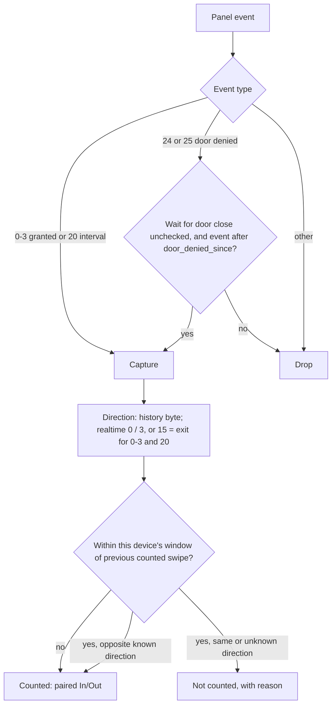
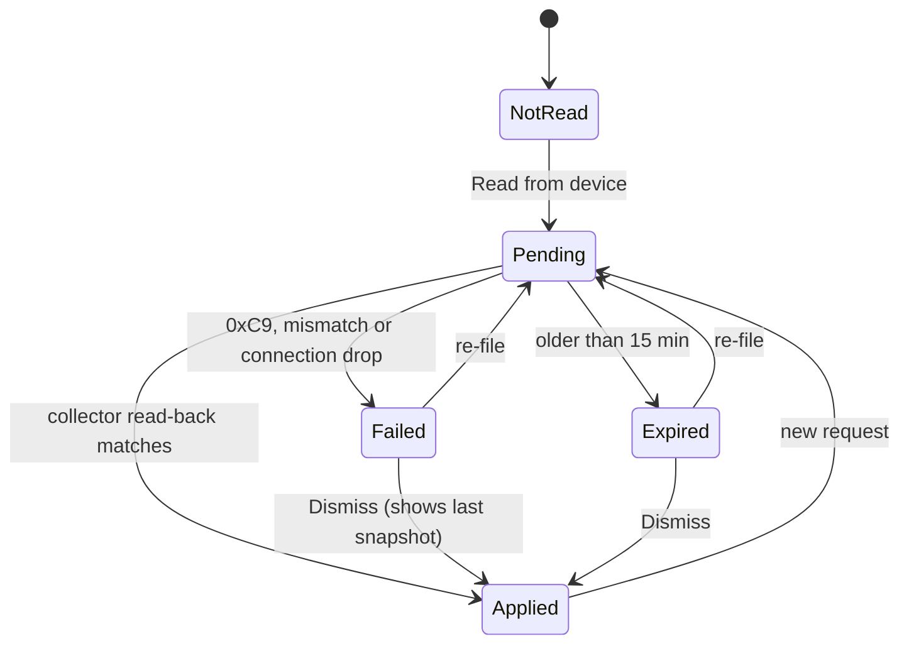

# fix: Full attendance history and per-device quick-swipe and door settings

## Summary

This plan makes four changes:

- Open every employee's stored history in the person views, with a pageable day strip and a date picker.
- Replace the global 60-second duplicate rule with a per-device quick-swipe window.
- Store the C3's realtime interval-too-short swipes with their real direction.
- Let an admin read and write the Gachibowli C3-400 door parameters from the Devices page, through the collector, so busy-door settings can be fixed without ZKAccess.

---

## Problem Frame

User report, 2026-10-26:

- The attendance view seems limited to one week, even though history is stored.
- On the Gachibowli C3-400, quick swipe-in and swipe-out pairs show "not counted", the same as on the X990.
- The site has many people moving through the door, so waiting for each door close does not work. The user wants a per-device option for whether door state matters, and wants to tune the panel's door settings from the dashboard.

The reference screenshot shows recent quick swipes marked "not counted". It was not available to the planner, so the screenshot-specific cause is checked against live data before coding (see Pre-implementation Check).

Root causes found during planning (read-only, against the code and a 2026-10-12 replica: 28,195 C3 punches since 2025-10-25, 60,063 X990 punches since 2026-05-13):

- **One-week view.** The data is stored; navigation exposes only 7 days.
  - `essl_hub/routes/me.py` fixes the day strip to `STRIP_DAYS = 7` ending today, with no paging. This was KTD7 in `docs/plans/2026-10-13-002-feat-employees-archive-device-id-fixes-plan.md`.
  - `/quick/<id>?date=` returns 400 for dates older than 7 days, so the drawer cannot go further back.
  - `/day` steps one day at a time, with no jump.
- **"Not counted" quick swipes.** The chip comes from `DUPLICATE_WINDOW_SECONDS = 60` in `essl_hub/hours.py` (`_resolve_directions`). It is one global rule for every device.
  - *X990.* Swipes carry no direction, so the second swipe of any in-and-out within 60 s is collapsed. Commit 75cf2c3 fills a missing alternation only when a later known-direction swipe exists, and the X990 never has one.
  - *C3, realtime path.* Between 6-hourly history reads, the collector reads the realtime log. `zkaccess-c3` decodes only in/out bytes 0, 2 and 3, so a real exit (protocol byte 1) arrives as 15. `_c3_trusted_direction` maps 15 to exit only for granted events, so event 20 rows are stored with no direction. If such a row lands within 60 s of the previous swipe, it collapses as "not counted" until the next history read fills the direction (`Database.fill_punch_directions`). Recent swipes are the most exposed.
  - *C3, same direction.* A same-direction re-swipe within 60 s also collapses. The replica has 59 exit-exit and 23 entry-entry pairs, against 1,444 counted opposite-direction pairs.
- **Door state on the panel.**
  - The punch interval (`DoorNIntertime`) denies swipes inside it as event 20. The vendor default is 2 s; the site set it to 1 s on 2026-10-13.
  - Interlock denies a swipe while another door's sensor reads open (event 25). It is the only documented setting that waits on door state.
  - Anti-passback denies by swipe history (event 24).
  - The collector drops events 24 and 25. The dashboard cannot see or change any of these settings.

---

## Requirements

**History**
- R1. A viewer can open any past work day of any person they may see, from the Day page and the quick-view drawer, back to the person's first punch.
- R2. The day strip pages a week at a time. It never pages past today, or earlier than the week holding the person's first punch.
- R3. A date picker on the Day page and in the drawer jumps straight to a chosen day, bounded by the person's first punch day and today.

**Swipe policy (per device)**
- R4. Each device has its own quick-swipe window in seconds, where 0 means count every swipe. Existing devices keep 60.
- R5. Hours apply each punch's own device window on read, so a policy change re-scores every past day. The Devices page states this before saving.
- R6. Every "not counted" swipe states why: the earlier counted swipe it repeats, and the gap between them in seconds.
- R7. C3 realtime swipes, event 20 included, get the direction the history table would give them. History reads stay authoritative.
- R8. Each C3 has a "Wait for door close" setting, checked by default (today's behaviour). When it is unchecked, interlock (25) and anti-passback (24) denials from that moment on are captured as attendance and flagged.

**Door parameters (C3)**
- R9. The Devices page shows the panel's current door parameters and when they were read.
- R10. An admin can change whitelisted door parameters. The collector applies the change and reads it back, and the page shows it as applied, failed or expired, per key.
- R11. The values from before the last write are kept. One confirmed action restores them.
- R12. The dashboard never writes connection or identity parameters (`ComPwd`, `IPAddress`, `NetMask`, `GATEIPAddress`, `RS232BaudRate`, `DeviceID`), and never writes `DoorNVerifyType`.
- R13. Every policy change and door-parameter action records who did it, when, and the old and new values.

---

## Scope Boundaries

- Per-device policy only. Per-site policy is not needed while each site has one device.
- No change to export range limits or to Frappe sync rules, except as decided in Open Questions.
- X990 ADMS/cloud-push mode and X990 device-parameter writes are out.
- Who may view a person is unchanged. `/day` already paged to any past date for anyone `access.can_view` allows, so full history in the drawer widens no visibility.

### Deferred to Follow-Up Work

- A month calendar per employee.
- A seven-day `/week` that shows weekend punches.
- A per-device history-refresh interval. Today `ESSL_C3_HISTORY_HOURS` is global; lowering it is an operational lever, not code.
- Reading C3 door events 200/201 (opened/closed) as proof of passage.
- Writing reader-level anti-passback values (16–240).

---

## Pre-implementation Check

The screenshot was not available during planning. Before U3 or U4, run read-only checks on the live database and the panel.

1. **Collapsed swipes.** Take Gachibowli punches from the last 14 days whose day result collapses a swipe, and classify each one:
   - direction-less event 20 from the realtime path;
   - same direction within 60 s;
   - direction-less granted event.
2. **The 15→exit gate.** Take realtime rows with in/out 15 that a later history read filled. Count how often the filled direction is exit, split by event type. If event 20 maps to exit in less than 95% of filled rows, U3 keeps 15 as unknown for event 20.
3. **Door-denied traffic.** Read `InterLock`, `AntiPassback` and `DoorNSensorType` from the panel. Count events 24 and 25 that carry a PIN or card in the panel transaction table over the same 14 days. If both counts are zero and both settings are 0, record that R8 has no current effect at Gachibowli.

Record the results in the plan's Sources section. They set the recommended Gachibowli window.

---

## Key Technical Decisions

- KTD1. **The strip window follows the selection.**
  - The strip shows 7 days ending at `strip_end`.
  - Default `strip_end` is today when the selected day is within the last 7 days. Otherwise it is the selected day plus 3, capped at today.
  - "Earlier week" and "Later week" move `strip_end` by 7 without changing the selected day.
  - "Earlier week" is disabled once the strip reaches the first punch day.
  - Rationale: today stays one click away, and old weeks stay browsable.
- KTD2. **Drop the 7-day guard on `/quick`.**
  - Any valid date up to today renders. Future and malformed dates still return 400.
  - The picker's `min` is the person's first punch work day.
  - Days before the first punch render with their own empty text ("Before <name>'s first punch on <date>"), so an empty day never reads as lost data.
- KTD3. **The quick-swipe window belongs to the punch's own device.**
  - It is stored in `devices.duplicate_window_seconds` (integer, default 60, range 0–300). The rest of the plan calls it the quick-swipe window.
  - It is loaded once per request into a device→window map, and `Punch` carries its window.
  - `_resolve_directions` uses the current punch's window both for "near" and for the same-direction re-swipe.
  - The comparison becomes strictly less than the window, so 0 counts every swipe, same second included.
  - Hours stay computed on read, so a change re-scores every past day (PRODUCT principle).
- KTD4. **Realtime in/out 15 means exit for events 0–3 and 20.**
  - The library yields 15 only for bytes outside {0, 2, 3}, and PullSDK documents 0, 1 and 2.
  - Gated by the Pre-implementation Check. Realtime 24/25 rows with 15 stay direction-less.
  - `fill_punch_directions` also overwrites a direction on C3 rows whose `raw.source` is `realtime_fallback` when the history byte disagrees. History stays authoritative, and a wrong realtime guess lives at most until the next history read.
- KTD5. **"Wait for door close" gates capture of events 24/25 from the moment it is unchecked.**
  - Unchecking sets `devices.door_denied_since` to now. Re-checking clears it.
  - The collector keeps 24/25 rows that carry a PIN or card and whose timestamp is at or after `door_denied_since`. Their `raw_state` notes "door denied: interlock" or "door denied: anti-passback".
  - No backfill and no forced history read. Months of stored denials would otherwise re-score closed weeks and flood Frappe.
  - Re-checking stops new captures. Stored rows stay and keep their chip.
  - Capture-time gating keeps Frappe sync and the read API consistent with the hours view.
- KTD6. **Door parameters go through the collector.**
  - The C3 serves one PullSDK session, and the collector already holds it.
  - The web stores a request: a JSON map of key to value, plus `door_params_requested_at`.
  - On the device's next poll the collector applies the request, reads back, and stores the snapshot, `door_params_read_at` and the per-key results.
  - It clears the request with a guarded update that matches `door_params_requested_at`.
  - A request older than 15 minutes is marked "Expired, not applied" and never written. The admin confirmed against values that may since have changed.
  - This mirrors the existing Pending→applied pattern for connection edits (`connection_updated_at`).
- KTD7. **SetDeviceParam uses the library's own 0x03 path, one key per call, verified by read-back.**
  - The call is `panel._send_receive(0x03, panel._kv_to_message({key: value}))`, the path `set_device_datetime` already uses.
  - A 0xC9 reply surfaces as `ConnectionError("Error <n> received in reply…")` and fails that key with the decoded code. A socket error is a connection failure.
  - A key is "applied" only when GETPARAM returns the written value.
- KTD8. **The writable set is a closed whitelist, validated by one function in `essl_hub/door_params.py`.** Web and collector both call it.
  - It accepts only JSON integers (no strings, no bools), checks the range, and rebuilds the frame text from the parsed integer, so no comma or `=` can smuggle a second key.
  - N runs to the panel's `LockCount`. Before the first read, the form is hidden.

  | Key | Input | Allowed values (labels) | Busy-door suggestion |
  |---|---|---|---|
  | `DoorNIntertime` | number | 0–10 s ("Punch interval") | 0 |
  | `DoorNDrivertime` | number | 1–254 s ("Unlock time") | 5–8 |
  | `DoorNDetectortime` | number | 1–254 s ("Door-open alarm after") | Unlock time + 10 or more |
  | `DoorNCloseAndLock` | select | 0 Off, 1 On ("Lock when door closes") | 1 |
  | `DoorNSensorType` | select | 0 None, 1 Normally open, 2 Normally closed | Match wiring; never suggested |
  | `AntiPassback` | select | 0 Off, 1–6 door-level combinations per PullSDK | 0 |
  | `InterLock` | select | 0 Off, 1–5 door combinations per PullSDK | 0 |

  The hint states that unchecking "Wait for door close" counts the denials the panel still issues. Setting InterLock and AntiPassback to 0 stops those denials at the source.
- KTD9. **One snapshot per write request is the rollback.**
  - The collector stores `door_params_previous` and `door_params_previous_for` (the request's `requested_at`) only for a non-empty write request, and only once per `requested_at`.
  - Read-only requests and history-time reads never touch it.
  - "Restore previous values" goes through the same confirm page (current → previous, with the snapshot's read time). It files only whitelisted keys whose value differs from the current one.
- KTD10. **Schema v7 is additive.** New `devices` columns and a `device_changes` table are added through the existing migration-step pattern in `essl_hub/db.py`. No applied migration is edited.
- KTD11. **`device_changes` is an append-only audit log.** Each row holds the actor employee id, device id, kind (policy, door write, door read, door restore, door dismiss), old and new values as JSON, and a timestamp. The admin routes write it in the same transaction as the change.

---

## Open Questions

- **Door-denied rows and Frappe.** Should rows captured under KTD5 be excluded from Frappe sync, or pushed like any other punch? Recommendation: exclude by default, because payroll cannot see the flag. Excluding needs a filter in the Frappe punch query (`essl_hub/db.py`, around the `frappe_sync_log` join).
- **Bench behaviour.** Does AC Ver 18.1.2 apply a written door parameter at once, or only after a reload? U4's bench check answers this. If a reload is needed, the Applied state gains "Takes effect after a device restart".

---

## High-Level Technical Design

How one swipe is counted (U2, U3):



Door parameter change (U4, U8):

```mermaid
sequenceDiagram
  participant Admin
  participant Web
  participant DB as SQLite devices row
  participant Col as Collector
  participant C3 as C3-400
  Admin->>Web: Save door settings, confirm old -> new
  Web->>DB: door_params_request, requested_at, device_changes row
  Col->>DB: poll reads device rows
  alt request older than 15 min
    Col->>DB: mark Expired, clear request
  else
    Col->>C3: GETPARAM current values
    Col->>DB: door_params_previous (once per requested_at)
    loop each changed key
      Col->>C3: SETPARAM 0x03 Key=Value
      Col->>C3: GETPARAM Key, verify
    end
    Col->>DB: snapshot, read_at, per-key results; clear request where requested_at matches
  end
  Web-->>Admin: Applied / Failed / Expired per key
```

Door-settings card states (U8):



---

## Implementation Units

### U1. Schema v7: policy, door-parameter state and audit log

- **Goal:** Store per-device policy, door-parameter state and an audit trail.
- **Requirements:** R4, R8, R9, R10, R11, R13
- **Dependencies:** none
- **Files:** `essl_hub/db.py`, `tests/test_db.py`, `tests/test_web.py` (`FakeDatabase`)
- **Approach:**
  - Bump `SCHEMA_VERSION` to 7.
  - Add `devices` columns:
    - `duplicate_window_seconds INTEGER NOT NULL DEFAULT 60`
    - `door_denied_since`
    - `door_params`, `door_params_read_at`
    - `door_params_previous`, `door_params_previous_for`
    - `door_params_request`, `door_params_requested_at`
    - `door_params_result`
    - `policy_updated_at`
  - Create the `device_changes` table (KTD11).
  - Add database methods:
    - Set the policy (validated range).
    - File and dismiss a door request (both guarded).
    - Record a read or apply result.
    - Clear the request guarded by `requested_at`.
    - Return the device→window map.
    - Append an audit row.
  - `device_connection_info` returns the policy fields the collector needs.
- **Patterns to follow:** the v4 and v6 steps in `_MIGRATIONS`, `_ADD_COLUMN` idempotence, `update_device` and `connection_updated_at`.
- **Test scenarios:**
  - Migrating a v6 database adds the columns and the table. Existing devices read window 60 and no `door_denied_since`.
  - Re-running the migration is a no-op.
  - Window -1 and 301 are rejected; 0 and 300 are accepted.
  - Request filed at T1, then replaced at T2: clearing with T1 leaves the T2 request in place.
  - Dismiss clears the request and result, and files nothing.
  - Recording a result leaves the policy columns untouched.
- **Verification:** `tests/test_db.py` passes on fresh and migrated databases.

### U2. Per-device quick-swipe window and "not counted" reasons

- **Goal:** Judge each punch by its own device's window, and make every collapsed swipe explain itself.
- **Requirements:** R4, R5, R6
- **Dependencies:** U1
- **Files:**
  - `essl_hub/hours.py`
  - `essl_hub/routes/common.py` (`_day_for_employee`)
  - `essl_hub/export.py` (`_load`)
  - `essl_hub/db.py` (punch range queries return `device_id`)
  - `essl_hub/day_story.py` (`break_view`, `RawPunch`)
  - `templates/_day_breaks.html`
  - Tests: `tests/test_hours_breaks.py`, `tests/test_hours.py`, `tests/test_day_story.py`, `tests/test_export.py`
- **Approach:**
  - `Punch` gains a window (default `DUPLICATE_WINDOW_SECONDS`). Callers set it from the device→window map, loaded once per request or report.
  - The "near" test becomes strictly less than the window (KTD3).
  - `DayResult.collapsed` carries, per collapsed punch, the kept swipe it repeats, its direction and the gap.
  - The chip stays "not counted". Visible text beside it reads "same as In 10:00:03, 12s earlier", or "same as swipe 10:00:03, 12s earlier" when the direction is unknown.
- **Execution note:** Add characterization tests for today's 60 s behaviour before threading the window through.
- **Patterns to follow:** commit 75cf2c3 (alternation fill), and how `DUPLICATE_WINDOW_SECONDS` is used in `essl_hub/hours.py`.
- **Test scenarios:**
  - X990, window 0: In 09:00:00, swipe 09:00:20, swipe 18:00 → three counted alternating swipes, none collapsed.
  - X990, window 60, same swipes → 09:00:20 is collapsed, with reason "same as In 09:00:00, 20s earlier".
  - Window 0, two swipes in the same second → both count.
  - Mixed day: C3 entry 09:00:00 (window 10), then X990 swipe 09:00:30 (window 60). The X990 swipe is judged by 60 and collapsed.
  - C3 known entry then known exit 5 s apart, window 60 → both count (unchanged).
  - C3 entry, entry 30 s apart:
    - window 60 collapses the second;
    - window 10 counts both, and the second is shown "unpaired".
  - Export and the Day page agree on effective minutes for the same day under a non-default window.
- **Verification:** Existing hours tests pass unchanged at window 60, and the new cases pass.

### U3. C3 collector: realtime direction and door-denied capture

- **Goal:** Give realtime C3 swipes their real direction, and capture door-denied swipes when the device policy says so.
- **Requirements:** R7, R8
- **Dependencies:** U1, Pre-implementation Check
- **Files:**
  - `essl_hub/collectors.py`
  - `essl_hub/config.py` (`DeviceConfig` gains the policy fields)
  - `essl_hub/collector_main.py` (`merge_device_configs`)
  - `essl_hub/db.py` (`fill_punch_directions`)
  - `essl_hub/day_story.py` (`punch_flags`)
  - `scripts/remap_c3_ids.py` (keeps 24/25 rows when present)
  - Tests: `tests/test_collectors.py`, `tests/test_collector_main.py`, `tests/test_db.py`, `tests/test_remap_c3_ids.py`
- **Approach:**
  - `_c3_trusted_direction` maps 15 to exit for events 0–3 and 20 (KTD4). If the Pre-implementation Check misses 95%, event 20 stays unknown.
  - `fill_punch_directions` overwrites realtime-sourced directions that the history byte contradicts.
  - `_c3_keep` takes `door_denied_since` and keeps 24/25 rows at or after it (KTD5).
  - The `punch_flags` chip reads "door denied (interlock)" or "door denied (anti-passback)" on Day, Today and the drawer.
- **Test scenarios:**
  - Realtime event 20 with in/out 15 → exit. Realtime event 0 with in/out 0 → entry (unchanged).
  - Gate-miss branch: with the event-20 rule off, realtime event 20 with in/out 15 → null direction.
  - Realtime event 25 with in/out 15 → null direction. A later history read fills it.
  - Realtime row stored as exit, then a history byte of 0 for the same fingerprint → the row becomes entry.
  - History event 25, in/out 1, timestamp after `door_denied_since` → stored as exit with the door-denied note.
  - The same event before `door_denied_since`, or with the policy off → dropped.
  - Event 24/25 with no PIN and no card → dropped.
  - Event 27 → always dropped.
  - Realtime and history reads of the same event 25 → one fingerprint.
- **Verification:** Collector tests pass. A replay of the replica's realtime rows yields directions that match the history-filled ones.

### U4. C3 door-parameter read and write in the collector

- **Goal:** The collector reads door parameters and applies whitelisted changes safely.
- **Requirements:** R9, R10, R11, R12
- **Dependencies:** U1
- **Files:**
  - `essl_hub/door_params.py` (new: whitelist, ranges, labels, validator)
  - `essl_hub/collectors.py` (door-parameter functions)
  - `essl_hub/collector_main.py` (door step after `collect_once` for C3 devices; `collect_once` reports whether it read history)
  - Tests: `tests/test_door_params.py` (new), `tests/test_collectors.py`, `tests/test_collector_main.py`
- **Approach:**
  - **Reads.**
    - GETPARAM in batches of at most 30: `LockCount`, `ReaderCount`, `AntiPassback`, `InterLock`, and for each door N ≤ `LockCount` the five `DoorN*` keys plus `DoorNVerifyType` (display only).
    - A read happens when a request is pending, alongside each history read, and on "Read from device" (an empty write map).
  - **Writes.**
    1. Snapshot once per `requested_at` (KTD9).
    2. Send one SETPARAM per changed key (KTD7), then read it back.
    3. Record per-key results and clear the request.
    4. Expire requests older than 15 minutes (KTD6).
  - **Failures.**
    - A connection drop after any SETPARAM was sent marks the request Failed. It records per-key outcomes (applied / failed / not attempted), clears the request and re-sends nothing.
    - A connect failure before any write leaves the request pending, subject to expiry.
    - The door step runs after punches commit, in its own try block, on its own connection.
    - Error text never includes the communication password or raw frames.
- **Execution note:** Bench-verify on the panel before trusting the code:
  1. Write `Door1Intertime` 0 and read it back.
  2. Without rebooting, swipe one card twice within 1 s and confirm both are granted (no event 20).
  3. Reboot and read again.
  4. Write and read back one `AntiPassback` value.
  - Record the results in the `README.md` C3 notes.
- **Patterns to follow:** `C3.set_device_datetime` in the vendored library, `_friendly_error`, and the error/spool split in `collect_once`.
- **Test scenarios:**
  - The validator rejects:
    - `ComPwd`, `IPAddress`, `Door1VerifyType`;
    - `Door5Intertime` on a `LockCount` 4 panel;
    - `Door1Intertime` 11, the string `"0,ComPwd=1"`, and `true`.
  - Fake panel replies 0xC8 and reads back the written value → applied, and previous holds the old value.
  - 0xC8 but the read-back differs → that key reads "panel kept X". Other keys proceed.
  - 0xC9 -14 → Failed with "communication password rejected". Punches from the same poll are still stored.
  - Drop after key 1 of 2 → key 1 applied, key 2 not attempted, request Failed and cleared, previous holds both original values.
  - A read-only request leaves previous unchanged.
  - Request older than 15 minutes → Expired, and no SETPARAM is sent.
  - The web replaced the request meanwhile → the collector's clear does not wipe the newer request.
- **Verification:** The new tests pass. The bench results are recorded.

### U5. Devices page: swipe policy

- **Goal:** An admin sees and changes each device's quick-swipe window and, on a C3, "Wait for door close".
- **Requirements:** R4, R5, R8, R13
- **Dependencies:** U1, U2, U3
- **Files:** `essl_hub/routes/admin.py`, `templates/devices.html`, `static/styles.css`, `tests/test_web.py`
- **Approach:**
  - Every device card gets a "Swipe policy" disclosure.
  - **Quick-swipe window.** A number input in seconds, with presets Off (0), 5, 10 and 60. Hint: "0 = count every swipe. Applies to every past and future day for this device; reports recalculate."
  - **Wait for door close.** C3 only. A checkbox with the KTD8 hint, plus "Unchecking counts denials from now on; past denials are not added."
  - The card shows the last change time (`policy_updated_at`).
  - Route: `POST /devices/<id>/policy`. Admin-only, CSRF-checked, and writes a `device_changes` row.
- **Patterns to follow:** `devices_update` (validate, re-render with the error, redirect `saved=`) and the `.device-edit` disclosure.
- **Test scenarios:**
  - Admin saves window 10 → redirect, the row reads 10, and one audit row is written.
  - HR or manager → 403.
  - Window "abc" or 400 → re-render with the error, nothing stored.
  - X990 card has no door-close checkbox.
  - Unchecking "Wait for door close" sets `door_denied_since`; re-checking clears it.
  - Missing CSRF → 400.
- **Verification:** Web tests pass. The page renders at 375px and 1280px with no horizontal scroll.

### U8. Devices page: C3 door settings

- **Goal:** An admin reads, changes, restores and dismisses C3 door parameters from the Devices page.
- **Requirements:** R9, R10, R11, R12, R13
- **Dependencies:** U1, U4
- **Files:** `essl_hub/routes/admin.py`, `templates/devices.html`, `static/styles.css`, `tests/test_web.py`
- **Approach:**
  - **Values table.** Shows the last read values with the KTD8 labels, grouped per door (one collapsible group per door at phone width), plus the read time.
  - **States.** The card follows the state diagram:
    - *Not read yet:* "Not read yet. Use Read from device."
    - *Pending:* "Requested HH:MM, applied on the device's next poll (about 1 min)."
      - Past 2 poll intervals: "Collector has not picked this up." The 15-minute expiry still applies.
    - *Applied.*
    - *Failed* or *Expired:* per-key results and a Dismiss action.
  - **Edits.** The form posts to a confirm page listing old → new, with busy-door suggestions beside the inputs; nothing is auto-applied. Confirming re-validates against the whitelist and files the request.
  - **Restore.** Uses the same confirm page. It is disabled when no snapshot exists.
  - **Routes.** All admin-only, CSRF-checked, and auditing:
    - `POST /devices/<id>/door` (confirm, then file)
    - `POST /devices/<id>/door/read`
    - `POST /devices/<id>/door/restore`
    - `POST /devices/<id>/door/dismiss`
- **Patterns to follow:** the `pending` computation in `_device_rows`, and the `devices_update` error re-render.
- **Test scenarios:**
  - An X990 card shows no door section.
  - Before any read, the edit form is hidden and "Read from device" is offered.
  - `Door1Intertime` 0 → the confirm page lists "Punch interval, door 1: 1 → 0". Confirming files the request and writes an audit row. The card shows Pending.
  - A posted `ComPwd` or `"0,ComPwd=1"` → 400, nothing filed.
  - Restore with no snapshot → button disabled; a forced POST returns 400.
  - Restore with a snapshot → the confirm page lists current → previous, for differing whitelisted keys only.
  - Dismiss on Failed → the result clears, nothing is filed, an audit row is written.
  - HR → 403 on every door route. Missing CSRF → 400.
- **Verification:** Web tests pass. A manual check at 375px and 1280px.

### U6. Full history: pageable strip and date picker

- **Goal:** Make any stored day reachable from the Day page and the drawer.
- **Requirements:** R1, R2, R3
- **Dependencies:** none
- **Files:**
  - `essl_hub/routes/me.py` (`_day_strip`, `day_view`, `quick_view`)
  - `essl_hub/db.py` (first punch across a person's IDs)
  - `templates/_day_strip.html`, `templates/_quick_view.html`, `templates/day.html`, `templates/_day_live.html` (before-first-punch empty text)
  - `static/quick-view.js`, `static/styles.css`
  - `tests/test_web.py`
- **Approach:**
  - `_day_strip` takes `strip_end` (KTD1) and returns the paging targets and the first punch day.
  - **Arrows.**
    - Links on `/day`; `data-qv-day` swaps in the drawer.
    - `aria-label`s "Earlier week, <range>" and "Later week, <range>", with 44px targets.
    - After a drawer strip swap, focus returns to the same arrow.
  - **Picker.**
    - On `/day`: a GET form with a visible Go button.
    - In the drawer: a new delegated `change` listener on `input[data-qv-date]`. It builds `/quick/<id>?date=` (carrying `from` and `strip_end`) and calls `htmx.ajax` into `#quick-view-body` with focus on the selected chip. The form's submit is prevented. A plain GET to `/quick` would redirect to `/day` and drop the date.
  - At 375px the arrows and 7 chips sit on one row, with the picker below them.
  - `/quick` drops the window guard (KTD2).
- **Patterns to follow:** the 2026-10-13 strip and drawer swap, the `a[data-qv-day]` branch in `static/quick-view.js`, and the `prev_date`/`next_date` pager in `templates/day.html`.
- **Test scenarios:**
  - `/quick/<id>?date=<40 days ago>` → 200, renders that day, no polling.
  - Future date → 400. Malformed date → 400.
  - `/day?date=<40 days ago>` → the strip ends 37 days ago, with the selected chip marked.
  - Selected today → the strip ends today, and "Later week" is absent.
  - `strip_end` beyond today → clamped.
  - Strip at the first punch week → "Earlier week" disabled.
  - Day before the first punch → before-first-punch text.
  - Person with no punches → picker min equals today, and the page renders.
  - Viewer without access → 404, unchanged.
  - Drawer picker change → the drawer swaps to the chosen day and stays open.
- **Verification:** Web tests pass. A manual check in the drawer and on `/day` at phone and desktop widths.

### U7. Documentation

- **Goal:** Docs match the new behaviour.
- **Requirements:** all
- **Dependencies:** U2–U6, U8
- **Files:**
  - `README.md`: duplicate rule, Devices page, C3 notes with the bench results.
  - `PRODUCT.md`: duplicate-rule bullets.
  - `DESIGN.md`: strip paging, date picker, door-settings states, reason text.
- **Approach:**
  - Replace every "60 seconds" statement with the per-device rule.
  - Document the whitelist and the never-written keys.
  - Explain how "Wait for door close" relates to InterLock and AntiPassback.
- **Test expectation:** none, docs only.
- **Verification:** No doc still claims a fixed 60 s rule or a 7-day drawer limit.

---

## System-Wide Impact

- **Hours everywhere.** Day, Today, Week, Employees, exports and the API all score through `compute_day`. After U2 they take the window from the punch's device, so one policy change moves every view and past day together.
- **Frappe sync.**
  - Realtime rows that now carry a direction reach the HRMS as before.
  - Door-denied rows follow the Open Questions decision.
- **Collector load.**
  - A door read adds one GETPARAM round trip per history read.
  - Writes happen only on an admin request.
- **Live door hardware.** U4 and U8 change how the Gachibowli door behaves. Wrong values can lock people out or leave the door open. The whitelist, read-back, expiry, single snapshot, confirm step and audit log all exist for this reason.

---

## Risks & Dependencies

| Risk | Mitigation |
|---|---|
| 0x03 is not the generic SetDeviceParam on AC Ver 18.1.2, or values apply only after a reload | Bench check first (U4). A key counts as applied only on read-back. The page reports failure honestly. A reload need is an Open Question. |
| A written value does not survive a reboot | The bench reboot test. Every history read refreshes the snapshot, so drift shows as changed values. |
| Window 0 on the X990 lets a habitual double tap flip every later In/Out | It is a per-device choice. Reason text and "unpaired" chips make it visible. Suggest 5–10 s for the X990. |
| 15→exit mislabels a realtime row | Gated by the Pre-implementation Check. Limited to events 0–3 and 20. The history byte now overwrites realtime-sourced directions. |
| The C3 realtime cache holds only 30 events, and a busy minute overflows it | Already healed by the 6-hourly history read (same fingerprints). |
| Counting interlock or anti-passback denials counts people who did not pass | Off by default. No backfill. Every row is flagged. The Frappe handling is an Open Question. |
| Web and collector race on devices-row writes | Guarded clears keyed on `door_params_requested_at`. The collector never writes policy columns. |

---

## Sources & Research

- `docs/plans/2026-10-13-002-feat-employees-archive-device-id-fixes-plan.md`: KTD7 (7-day strip), KTD9 (60 s collapse), KTD11 (event 20).
- Replica analysis, 2026-10-12 snapshot:
  - C3 pair directions within 60 s.
  - Realtime rows `0 · 15` are stored with a null direction.
- Vendored `zkaccess-c3`:
  - `consts.py`: `InOutDirection` covers 0, 2, 3 and 15. The parameter list includes `DoorNIntertime`, `DoorNCloseAndLock`, `AntiPassback` and `InterLock`.
  - `core.py`: `set_device_datetime` sends 0x03 `Key=Value` through `_send_receive`.
- PullSDK User Guide v2.0 (via github.com/licjapodaca/Pull-SDK-Demo):
  - `SetDeviceParam` takes `Key=Value` pairs, at most 20 per call.
  - Parameter ranges as tabled in KTD8.
  - C3-400 AntiPassback door-level values 1–6; InterLock values 1–5.
  - Error codes -13 and -14.
- github.com/vwout/zkaccess-c3-py: 0x03 used for `DateTime=` writes; replies 0xC8/0xC9.
- ZKAccess 3.5 manual: punch interval 0–10 s, default 2.
- ZKBioSecurity 3.2 manual: interlock requires door sensors; sensor delay default 15 s.

### Pre-implementation Check results (2026-10-26)

Live database was not reachable from the dev host; checks 1–2 ran on the 2026-10-12 replica, check 3 against the panel (read-only).

1. **Collapsed swipes, 14 days before 2026-10-12.** C3: 71 same-person pairs under 60 s — 66 opposite-direction (counted), 3 exit→exit (collapsed), 2 entry→direction-less realtime row (collapsed). X990: 285 pairs under 60 s, all direction-less, all collapsed; gaps spread evenly 0–60 s. The X990 window is the larger "not counted" source.
2. **15→exit gate.** History rows carry only in/out bytes 0 (14,195) and 1 (13,958); no 2 or 3. The library turns byte 1 into 15, so realtime 15 is exit in 100% of cases. The replica holds no history event-20 rows; the rule extends to event 20 because the panel emits only bytes 0/1. Gate passes. 22 realtime 15 rows (18:42–21:54 on 2026-10-12) were stored direction-less, confirming the realtime exposure.
3. **Panel (AC Ver 18.1.2, LockCount 4).** `AntiPassback=0`, `InterLock=0`; every door: `Intertime=1`, `Drivertime=5`, `Detectortime=15`, `CloseAndLock=1`, `SensorType=0`, `VerifyType=7`. No door sensor is configured, so the panel never waits on door state; R8 has no current effect at Gachibowli. The event 24/25 count was not taken: the transaction download was reset by the panel (the production collector holds the session).
   - Recommended windows: Gachibowli C3 10 s (directions are trusted after U3); Uppal X990 5–10 s.
