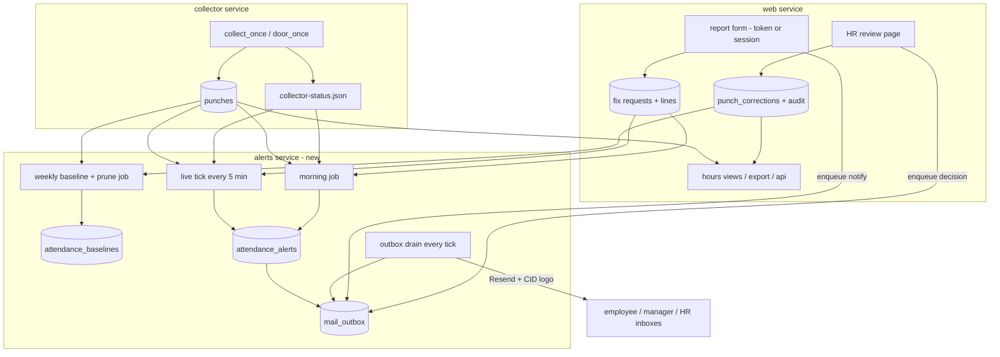
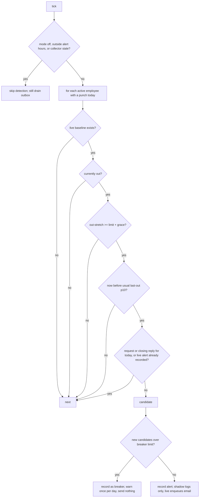
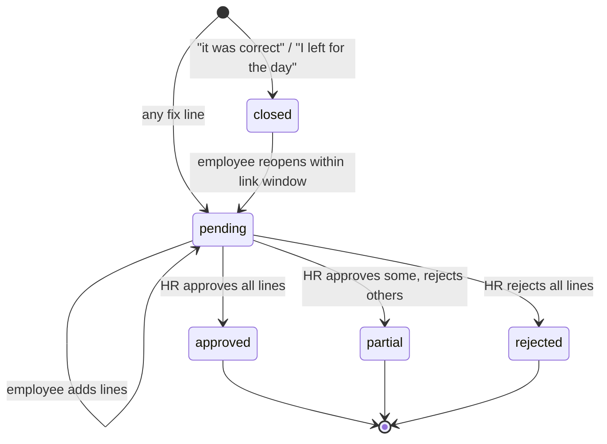

# feat: Missed-punch alerts, employee fix requests and HR approval

## Summary

Learn each employee's normal day from their own history, recomputed weekly, and email them when a day looks wrong:

- **Live:** an "out too long" email during the day.
- **Next morning:** an email when yesterday's swipes don't add up.

The email links to a short form where the employee reports what happened. The request goes to their manager and HR, and only HR approves it, on a dedicated review page.

An approved fix is an overlay: it changes computed hours everywhere while device punches stay untouched. Detection uses deterministic rules plus robust statistics, with no LLM.

---

## Problem Frame

Missed swipes look like long breaks. Two causes are common:

- **Forgotten swipe:** a person forgets to swipe in or out.
- **Missed tap:** the single-reader Gachibowli C3-400 misses a tap, and the next tap is recorded with the wrong direction, so a person who is inside reads as out.

Today nobody learns about it until hours are reviewed, and there is no way to fix a day. The app has no manual punch, override or correction concept. Hours are computed on read from raw punches (`essl_hub/hours.py` `compute_day`), and the only per-day rule is the global daily target. Emails exist only for sign-in codes (`essl_hub/mail.py`).

The weekly recompute matters because habits drift: a baseline frozen months ago would alert on a schedule the person no longer keeps. Alerts are only for people who came in. Someone absent all day must never be emailed.

---

## Requirements

**Baseline**
- R1. Once a week, rebuild every active employee's baseline from up to 8 weeks of their own clean workdays.
- R2. No alerts of any kind until an employee has 10 punched workdays in the lookback. No live alerts until they have 10 clean workdays.
- R3. Days with a sequence problem, an open or approved fix request, or unclear gaps are excluded from training.

**Detection and email**
- R4. During the day, email an employee who punched in today and whose current out-stretch exceeds their personal limit plus a grace period. Only fire before their usual last-out and inside alert hours (default 09:00–20:00 IST).
- R5. The morning after a work day, email an employee who punched that day and whose day has a missing final OUT, an OUT with no IN, a double IN, or an unclear gap.
- R6. Send at most one live email and one morning email per employee per work day. Never email someone who did not punch that day.
- R7. Emails carry the NITCO logo, a factual date-first subject and a warm, non-accusatory message that assumes a device miss. They never reveal the person's baseline.
- R8. Never alert while collector data is stale. The morning email waits for C3 history to confirm guessed directions.

**Reporting and approval**
- R9. The email links to a report form that works without signing in. A signed-in employee can open the same form for their own recent days from their day view.
- R10. A report can be any of:
  - "missed IN at time"
  - "missed OUT at time"
  - "this swipe was the other direction"
  - "ignore this swipe"
  - "I left for the day"
  - "it was correct"

  The last two close the day at once without HR.
- R11. A report needing HR sends one email to the employee's manager and to every HR user.
- R12. Only HR approves, on a dedicated review page. Nobody approves their own request. When no HR user other than the requester exists, an admin other than the requester may approve.
- R13. HR can edit a line's time or direction before approving, and must give a note when rejecting. The employee is emailed the decision.
- R14. Approved fixes change hours in every view and export without modifying device punches, and every decision is audited.

**Operations**
- R15. An admin can set alerts to off, shadow (compute and log, send nothing) or live, and can set alert hours and the morning send hour.
- R16. Frappe sync is unchanged and does not receive fixes.

---

## Scope Boundaries

- No LLM anywhere in detection or wording.
- No SMS, Teams or WhatsApp; email only.
- No alerts to managers. Managers get one FYI email when their report files a fix.
- No leave or holiday calendar. Early departures before the usual last-out can still trigger a live email; the "I left for the day" reply stops repeats that day.
- No direct HR edits without an employee request.

### Deferred to Follow-Up Work

- Pushing approved fixes to Frappe HRMS as Employee Checkin or Attendance Request.
- HR or manager digest emails instead of per-request emails.
- Per-employee opt-out of live alerts.
- Separate per-weekday baselines, once 15 or more samples per weekday exist.
- Per-site stale checks, so one site's outage does not pause the other's alerts.

---

## Key Technical Decisions

- **KTD1. Deterministic rules plus robust statistics, no LLM.** The inputs are a few dozen timestamps per person. Medians, percentiles and MAD:
  - give the same answer every run
  - run offline
  - are explainable to HR
  - send no attendance data to a third party

  An LLM adds cost, nondeterminism and privacy exposure for no gain.
- **KTD2. Baseline shape.**
  - **Lookback:** 8 weeks rolling, all workdays pooled. A per-weekday split gives too few samples.
  - **Training metric:** the longest single OUT→IN gap per day.
  - **Gating stats:** last-out is stored as p10, median and p90, and live gating uses p10. First-in is stored for the HR view only.
  - **Limit formula:** `clamp(max(90 min, 1.5 × p90, median + 4 × 1.4826 × MAD), 90 min, 4 h)`.
    - p90, not p95, because p95 sits near the sample max at n≈20–40.
    - The floor covers MAD = 0.
  - **Snapshots:** each weekly run writes a new snapshot with `computed_at`, so a running tick never sees a half-built set.
- **KTD3. A separate `alerts` service on the same image.**
  - **Not the collector:** it deliberately avoids mail imports, and a C3 history read can stall its cycle for about 80 s.
  - **Not inside web:** gunicorn threads are tied to the worker lifecycle.
  - **Pattern:** the service follows `backup.run_loop`. It mounts `/data`, opens the shared database with `must_exist=True`, and waits for schema v8 rather than migrating.
- **KTD4. Fixes are an overlay, never punch rows.** Inserting into `punches` would leak into Frappe, `/api/checkins` and ID issues, and would break fingerprint uniqueness.
  - **Storage:** an approved line becomes a row in a correction table keyed by `employee_id`. Device user IDs can move between people, so they are not the key.
  - **Kinds:** add a punch, ignore a punch, or set a punch's direction. Rows that target a device punch reference it by `fingerprint`.
  - **Merge:** both punch read paths resolve owners through `employees` / `employee_device_ids`, the same way `_attach_device_ids` and `_MAIN_ID_SQL` do, and merge the overlay.
  - **Added punches:** carry the owner's main `device_user_id`, a trusted direction, a null `device_id` and a zero quick-swipe window.
  - **Ignored punches:** stay in the raw list with a marker and are filtered out before `compute_day`.
  - **Dangling targets:** an overlay whose target fingerprint no longer exists goes inert and is flagged on the review page.
- **KTD5. At most one pending request per employee per work day, with line items.**
  - **Adding lines:** a second report while one is pending adds lines to it.
  - **After a decision:** a report on a day whose request is already decided opens a new request linked to the earlier one.
  - **Per-line decisions:** HR decides each line.
- **KTD6. Approver rule.**
  - **Who approves:** role `hr`, never the requester.
  - **Admin fallback:** an admin who is not the requester may approve only when no active HR user other than the requester exists. In that case admins are added to the request notification.
  - **Day-changed warning:** each request stores a hash of the day's punch set, covering fingerprints and directions. Review flags "day changed since report" when fresh device data or a history read changed the day.
- **KTD7. Report links are random tokens, hashed at rest.**
  - **Token:** `secrets.token_urlsafe`, stored as SHA-256 like login codes and sessions, and bound to one employee and one work day.
  - **Lifetime:** expires at work day + 7 days, which is also the backdate limit. Reusable until then.
  - **No side effects on GET:** GET and HEAD only render, because mail scanners such as Outlook Safe Links pre-fetch links.
  - **POST:** carries the token in the form body and needs no session.
  - **Limits:**
    - POSTs are rate-limited per IP, using the Cloudflare-aware client-IP helper already used for sign-in, and per token.
    - A request is capped at 10 lines.
    - Notes are capped at 500 characters.
  - **Hygiene:**
    - pages send `Referrer-Policy: no-referrer`
    - app logs redact the token path segment
    - the token never creates a session or grants HR actions
- **KTD8. Send-once and outbox.**
  - **Send-once:** an alerts table unique on (employee, work day, kind) is written before sending, in shadow mode too, so switching from shadow to live mid-day never resends.
  - **Outbox:** emails go through an outbox row with status and up to 3 retries. A failed send leaves the alert recorded, so it never resends a new one.
  - **Body scrubbing:** outbox bodies are nulled once a row reaches sent or failed, so raw report tokens do not persist. `mail_outbox` joins `fix_report_links` in `backup.SCRUBBED_TABLES`.
  - **Mail module:** `mail.py` gains a generic send taking subject, deduplicated recipients, text and HTML. `send_login_code` stays as it is. The Cloudflare provider sends text only, so the logo appears only via Resend.
- **KTD9. Stale-data and guess guards.**
  - **Stale skip:** the live tick and the morning job read `collector-status.json` through `config.collector_status_path()`. They skip when `last_poll` is older than 10 minutes, when `spool_depth` > 0, or when the file is missing. Device `last_success` is not used, because the collector rewrites it only every 15 minutes when idle.
  - **Circuit breaker:**
    - **Trigger:** a tick that would alert more than 5 people, or 20% of those in today, records those candidates with status `breaker` and sends nothing.
    - **No recount:** recorded candidates are not counted again on later ticks.
    - **Logging:** at most one warning is logged per work day.
  - **C3 guesses:** the live check accepts a C3 realtime exit (`C3_REALTIME_15_EXIT_EVENT_TYPES`) as out. If that guess is wrong, the person is inside but reads as out, which is exactly the case the email should prompt them to report. Door-denied rows never count. The morning job holds a day containing unconfirmed C3 guesses until a history read confirms them, and drops it at the end of the work day on which the morning job runs.
- **KTD10. Tone: warm and plain, no humor.** Humor from an HR system reads as sarcasm, and in a high power-distance workplace people feel obliged to laugh along.
  - **Framing:** the copy blames the device ("the reader may have missed a swipe").
  - **Content:** only times and the out-stretch.
  - **Banned words:** violation, anomaly, flagged, suspicious.
  - **Action:** one clear button leads to the form, followed by a "no action needed if this is right" line.
- **KTD11. Rollout defaults to shadow.** A fresh install computes and logs for two weeks before an admin switches to live. The settings page's Attendance alerts panel shows would-have-sent counts per site to tune against.

---

## High-Level Technical Design

### Components

The web service enqueues; only the alerts service sends. The outbox drain runs on every tick regardless of alert mode, so turning alerts off never silences fix-request or decision emails.

### Live alert decision

### Fix request lifecycle

- **Suppression:** a pending, closed or decided request suppresses further alerts for that day. A rejected request never re-alerts.
- **Further reports:** a report on a decided day starts a new linked request (KTD5).

---

## Implementation Units

### U1. Schema v8 and repository methods

- **Goal:** Add the tables and `Database` methods every later unit uses.
- **Requirements:** R1, R6, R9–R14
- **Dependencies:** none
- **Files:**
  - `essl_hub/db.py`
  - `essl_hub/backup.py`
  - `tests/test_db.py`
  - `tests/test_web.py` (FakeDatabase)
  - `tests/test_backup.py`
- **Approach:**
  - **Migration:** `MIGRATIONS[8]` is additive only, using `CREATE … IF NOT EXISTS`.
  - **New tables:**

    | Table | Holds |
    |---|---|
    | `attendance_baselines` | snapshot id, employee, metrics, punched days, clean days, `computed_at` |
    | `attendance_alerts` | employee, work day, kind, mode, status; unique on employee, work day and kind |
    | `mail_outbox` | recipients, subject, text, html, status, attempts, last error, created |
    | `fix_report_links` | token hash, employee, work day, expiry |
    | `fix_requests` | employee, work day, status, punch-set hash, source (link or session), previous request id |
    | `fix_request_lines` | kind, target fingerprint, time, direction, note, line status, HR-edited values |
    | `punch_corrections` | employee, work day, kind, fingerprint, timestamp, direction, request line id |
    | `fix_request_events` | audit rows, mirroring the `device_changes` shape |

  - **Column types:**
    - New timestamp and JSON columns are registered in `TIMESTAMP_COLUMNS` / `JSON_COLUMNS`.
    - `_bind` stores `datetime.date` as ISO text, checked after the `datetime` branch because libsql rejects `date` parameters.
    - A new `DATE_COLUMNS` set parses dates back on read.
  - **Atomic writes:** approving a line, writing its correction and writing its audit row happen in one `transaction()`.
  - **Backups:** `fix_report_links` and `mail_outbox` join `backup.SCRUBBED_TABLES`.
  - **Fakes:** every web-facing method is mirrored in `FakeDatabase`.
- **Patterns to follow:** `MIGRATIONS[7]` and `_insert_device_change` in `essl_hub/db.py`; `login_codes` hashing via `essl_hub/hashing.py`.
- **Test scenarios:**
  - Upgrading from v7 creates every table and leaves existing punches and settings intact. Re-running the migration is a no-op.
  - A `work_day` date round-trips as a `date`.
  - A second `attendance_alerts` insert for the same employee, day and kind fails cleanly and reports "already recorded".
  - Approving a line writes the correction, flips the line status and writes one audit row in a single transaction. A forced failure mid-way leaves none of them.
  - Token lookup by raw token matches only by hash, and an expired token returns nothing.
  - A backup snapshot contains no `fix_report_links` or `mail_outbox` rows.
- **Verification:** Database tests pass on a fresh database and on one upgraded from v7.

### U2. Correction overlay in every hours read path

- **Goal:** Approved fixes change hours everywhere while raw punches stay immutable.
- **Requirements:** R14, R16
- **Dependencies:** U1
- **Files:**
  - `essl_hub/db.py`
  - `essl_hub/hours.py`
  - `essl_hub/routes/common.py`
  - `essl_hub/export.py`
  - `essl_hub/day_story.py`
  - `templates/_day_breaks.html`
  - `static/styles.css`
  - `tests/test_db.py`
  - `tests/test_hours_breaks.py`
  - `tests/test_day_story.py`
  - `tests/test_export.py`
  - `tests/test_web.py`
- **Approach:**
  - **Read paths:** `punches_for_employee_range` and `punches_for_device_users_range` both select `fingerprint` and `raw_state`, resolve owners in SQL, and merge `punch_corrections` for those owners and window:
    - **Added punches** come back as KTD4 describes, with a marker in `raw_state`.
    - **Set-direction rows** override the direction of their fingerprint.
    - **Ignored fingerprints** come back marked.
  - **Pure merge:** the merge logic is one pure helper, so the HR preview (U8) can apply proposed lines in memory.
  - **Before `compute_day`:** callers in `routes/common.py` and `export._load` drop ignored rows, and `punch_from_row` gives corrected punches a zero window.
  - **Chips:** `day_story` adds "added by HR", "direction fixed", "ignored", "fix pending" and "fix rejected", each with a text label, never colour alone.
  - **Day bar:** its `aria-label` names added and ignored punches.
  - **Untouched readers:** Frappe, `/api/checkins` and ID issues read `punches` directly and stay as they are.
- **Patterns to follow:** `_PUNCH_FLAGS` and `break_view` in `essl_hub/day_story.py`; `_attach_device_ids` / `_MAIN_ID_SQL` in `essl_hub/db.py`; `punch_from_row` window lookup.
- **Test scenarios:**
  - An X990 day "in 09:00, out 13:00, out 18:00" with an added IN at 13:40 reads as two segments ending at 18:00. Without the overlay it shows one long break.
  - A C3 day with a wrongly recorded OUT at 13:40 and a set-direction-to-IN correction reads as inside from 13:40.
  - Ignoring a duplicate swipe removes it from the hours, and the raw list still shows it with an "ignored" chip.
  - An added punch 30 s after a real punch of the same direction is not collapsed.
  - An employee whose fix targets a punch on their extra device ID gets it applied. An added punch is grouped under that employee in the export.
  - A correction whose fingerprint no longer exists has no effect and does not raise.
  - Team, People, export and `/api/hours` all show corrected hours. Frappe pending punches and `/api/checkins` never include overlay rows.
- **Verification:** The same corrected day shows identical hours on the day view, the quick view, the team list and the CSV export.

### U3. Baseline engine

- **Goal:** A pure module that turns an employee's past `DayResult`s into a baseline, or "not enough history".
- **Requirements:** R1, R2, R3
- **Dependencies:** U2 (the clean-day rule must see overlay-merged day results)
- **Files:** `essl_hub/baselines.py` (new), `tests/test_baselines.py` (new)
- **Approach:**
  - **Input:** `export.day_results` over the 8-week window ending yesterday.
  - **Day counts:**
    - A punched day is any day with at least one punch.
    - A clean day has at least one paired segment and no anomalies, unpaired swipes, unclear gaps, or open or approved request.
  - **Outputs:**
    - punched-day and clean-day counts
    - longest OUT→IN gap stats and the KTD2 limit, when there are at least 10 clean days
    - last-out and first-in percentiles, in minutes since the work-day start
  - **Purity:** minutes since `day_start_hour` keep evening times linear. No I/O, and every number is a named constant.
- **Patterns to follow:** pure-function style of `essl_hub/hours.py`.
- **Test scenarios:**
  - Nine clean days give no live limit. Ten give one.
  - Twelve punched days with four clean ones give a morning-eligible result with no live limit.
  - A day with "No exit after 17:00" and a day with an unclear gap are excluded from the clean count but included in the punched count.
  - Breaks of 30–45 min give a 90 min limit (the floor).
  - One 3 h outlier among 20 days of 40 min leaves the limit near the floor.
  - Identical breaks give MAD = 0 without a division error.
  - Average 3 h breaks cap the limit at 4 h.
  - An evening shift ending after midnight sorts last-out correctly.
- **Verification:** Every scenario passes, and the same input always gives the same output.

### U4. Detection rules

- **Goal:** Pure checks that decide the live alert and the morning issues for one employee-day.
- **Requirements:** R4, R5, R8
- **Dependencies:** U3
- **Files:** `essl_hub/punch_alerts.py` (new), `tests/test_punch_alerts.py` (new)
- **Approach:**
  - **Live check:** takes today's `DayResult`, the baseline, now, and settings. Returns an alert with the out-stretch minutes, or a reason code. The reason codes feed the shadow logs.
  - **Grace:** the alert fires once the out-stretch reaches limit + 15 min, so no state is kept between ticks.
  - **Morning check:** takes yesterday's `DayResult` and whether it contains unconfirmed C3 guesses. Returns issue items drawn from `anomalies`, `unpaired` and unclear gaps, or "hold".
- **Test scenarios:**
  - In 09:00, out 13:00, limit 90 min: alert at 14:45, none at 14:40.
  - Same day with usual last-out p10 at 14:30 and now 15:00: no alert, reason "after usual last-out".
  - Currently inside: no alert.
  - A C3 person whose latest punch is a realtime exit (byte 15) is treated as out and alerted. A door-denied row is never treated as out.
  - Outside alert hours: no alert.
  - Morning: a day ending on an entry reports "missing final OUT".
  - Morning: an exit with nothing open reports "OUT with no IN".
  - Morning: two entries report "double IN".
  - Morning: a clean day reports nothing.
  - Morning: a day with an unconfirmed C3 guess returns "hold".
- **Verification:** Every reason code is covered by at least one scenario.

### U5. Generic mail sending and alert email templates

- **Goal:** Branded, multi-recipient emails with proper subjects for every notification in this feature.
- **Requirements:** R7, R11, R13
- **Dependencies:** none
- **Files:**
  - `essl_hub/mail.py`
  - `essl_hub/alert_mail.py` (new)
  - `tests/test_mail.py`
  - `tests/test_alert_mail.py` (new)
- **Approach:**
  - **Generic send:** add one generic send (subject, recipients, text, HTML) next to `send_login_code`, reusing the provider helpers.
    - Recipients are deduplicated case-insensitively.
    - Resend sends with the CID logo.
    - Cloudflare sends text only.
    - Console prints.
  - **Templates:** `alert_mail.py` builds subject, text and HTML for each email:
    - live check
    - morning check, listing each issue with its own sentence
    - new request, HR variant: a "Review request" button to the detail page
    - new request, manager variant: FYI only, listing the lines and stating that HR will decide, with no button
    - decision to the employee, including HR's note
  - **Layout:** every template reuses the sign-in email's table layout, header logo and `color-scheme` meta, and ships a plain-text part.
  - **Subject lines** (final wording settled in shadow review):

    | Email | Subject |
    |---|---|
    | Live check | "Attendance check for Mon, 26 Oct – a swipe may be missing" |
    | Morning check | "Yesterday's attendance: your swipe-out wasn't recorded" |
    | New request | "Fix request from <name> for Mon, 26 Oct" |
    | Decision | "Your attendance fix for Mon, 26 Oct was approved" |

  - **Headers:** `Auto-Submitted: auto-generated`, plus Reply-To an HR address when `ESSL_HR_REPLY_TO` is set.
- **Patterns to follow:** `render_html` and `_send_via_resend` in `essl_hub/mail.py`.
- **Test scenarios:**
  - The live email HTML contains `cid:nitco-logo`, the out-stretch and the times. It never contains the baseline limit or the words "violation", "anomaly", "flagged" or "suspicious".
  - Every template escapes an employee name and a note containing `<script>`.
  - The text part carries the same link as the HTML button.
  - The manager variant has no review link.
  - A manager who is also HR receives one copy, the HR variant.
  - Under the Cloudflare provider a template sends text only and does not raise.
  - Existing `send_login_code` tests still pass unchanged.
- **Verification:** Each template's rendered HTML opens cleanly in a browser preview, and mail tests pass for all three providers.

### U6. Alerts service

- **Goal:** Run the weekly baseline job, the live tick and the morning job, and drain the outbox.
- **Requirements:** R1, R2, R4–R6, R8, R15
- **Dependencies:** U1, U3, U4, U5
- **Files:**
  - `essl_hub/alerts_main.py` (new)
  - `essl_hub/config.py`
  - `docker-compose.yml`
  - `.env.example`
  - `tests/test_alerts_main.py` (new)
- **Approach:**
  - **Loop:** shaped like `backup.run_loop`, with an injectable IST clock. Every step is wrapped so one exception logs and the loop continues. The loop waits for schema v8 before its first tick.
  - **Weekly job:**
    - **Schedule:** the first tick after Sunday 02:00 IST once the newest snapshot is older than 6 days, and on first start when none exists.
    - **Pruning:** the same job deletes alert rows older than 90 days, outbox rows older than 30 days and expired report links, and keeps only the last 4 baseline snapshots.
  - **Live tick:** every 5 minutes, gated per KTD9 and the live decision diagram.
  - **Morning job:** runs every tick after the morning hour for the previous work day.
    - **Eligible:** active employees who punched that day and have 10 punched workdays in the lookback.
    - **Hold:** C3-guess days are held, then dropped at the end of the current work day.
    - **Gates:** the same stale and breaker gates as the live tick apply.
  - **Outbox drain:** runs every tick regardless of mode, alert hours or stale gates. Up to 3 attempts with backoff.
  - **Config:** `ESSL_PUBLIC_URL` and `ESSL_HR_REPLY_TO` go in the shared compose env anchor, so web and alerts both read them. The alerts service refuses live mode and logs why when the URL is unset.
  - **Compose:** a new `alerts` service with the app env anchor, mail env vars and the `/data` mount.
- **Patterns to follow:**
  - `essl_hub/backup.py` `run_loop` and `export_hour`
  - `frappe_sync.SyncScheduler` clock injection
  - `collector_main` handling of `DatabaseMissing` / `OfflineError`
  - `_read_json` of collector status in the health view
- **Test scenarios:**
  - **Shadow and live**
    - Shadow mode records alerts and sends nothing.
    - Switching to live the same day does not resend.
  - **Repeat suppression**
    - An employee alerted at 14:45 is not re-alerted at 14:50.
    - An employee who replied "I left for the day" gets no further live alert that day and no morning email.
  - **Stale data**
    - A `collector-status.json` with `last_poll` 15 minutes old skips detection, but an enqueued HR email still sends.
    - An idle collector whose `last_poll` is 1 minute old does not skip, even with a device `last_success` 12 minutes old.
    - `spool_depth` above 0 skips detection.
  - **Circuit breaker**
    - Six simultaneous candidates in an office of 20 are recorded as breaker, sending nothing and logging one warning.
    - The next tick neither recounts them nor warns again.
  - **Morning job**
    - A day with an unconfirmed C3 guess is held, then sent after a history read confirms it.
    - An employee with 12 punched days and 4 clean ones gets a morning email but no live alert.
  - **Sending and retries**
    - A Resend failure leaves the outbox row pending, and the next tick retries it.
    - After 3 failures the row is marked failed with its body nulled, and the alert is not re-created.
    - Mode off still drains a web-enqueued decision email.
  - **Weekly job**
    - It runs once per week across many ticks, writes one snapshot, and prunes old rows.
  - **Employee edge cases**
    - An archived employee is never evaluated.
    - An employee with a main and an extra device ID is evaluated on both IDs' punches.
  - **Resilience**
    - A database-offline error during a tick logs and the loop continues.
- **Verification:** Run in shadow mode locally against a copy of the production database; the logged would-send list for one day looks plausible.

### U7. Employee report flow

- **Goal:** Let an employee report a day's problem from the email link, or from their own day view.
- **Requirements:** R9, R10, R11
- **Dependencies:** U1, U2, U5
- **Files:**
  - `essl_hub/routes/fixes.py` (new blueprint)
  - `essl_hub/routes/__init__.py`
  - `essl_hub/routes/me.py`
  - `templates/fix_report.html` (new)
  - `templates/_fix_report_form.html` (new)
  - `templates/fix_report_done.html` (new)
  - `templates/day.html`
  - `tests/test_web.py`
- **Approach:**
  - **Form shape:**
    - Each raw swipe row has two toggles: "this was the other direction" and "ignore this swipe".
    - An "Add a missed swipe" repeater takes a time and IN/OUT, up to the 10-line cap.
    - An optional note field.
    - Two separate buttons, "Everything's correct" and "I left for the day", close the day. They cannot be mixed with fix lines.
  - **Layout:**
    - The form is one partial using `ui.field` with `aria-invalid` and inline errors.
    - Touch targets are 44 px under 768 px.
    - The token pages extend `templates/_auth_base.html`, with no nav. The signed-in entry renders inside `base.html`.
  - **States on GET:**
    - **No request:** the empty form.
    - **Pending:** the existing lines, with the option to add more.
    - **Decided:** a read-only summary with HR's decision and note, plus a "Report another problem" action (KTD5).
    - **Closed:** "You told us …", with an "Actually, something's wrong" action that reopens the form.
    - **Unknown or expired token:** one "this link has expired or isn't valid" page with a sign-in link.
    - GET and HEAD never change state.
  - **Signed-in entry:**
    - The day view shows "Report a problem" on the signed-in employee's own days within the last 7 days, today included.
    - It never appears on other people's days.
    - The route takes the employee from the session and ignores any employee id in the request.
  - **Validation:**
    - Times fall inside `work_day_window`, are not in the future, and the work day is no older than 7 days.
    - Every target fingerprint must belong to the requester's own punches that day.
    - The line cap and note length apply.
    - The per-IP and per-token POST limits apply.
  - **Notifications:**
    - The first fix line on a request enqueues one manager email and one HR email. Lines added later appear on the review page without new emails.
    - With no manager, only HR is emailed.
    - Admins are added when the KTD6 fallback applies.
  - **Done page:** summarises what was sent and who will review it.
- **Patterns to follow:**
  - `routes/signin.py` form handling and client-IP helper
  - `_redirect_with_flash` and post-redirect-get in `routes/people.py`
  - `_require_csrf` in `routes/common.py`
- **Test scenarios:**
  - **Viewing the link**
    - GET and HEAD with a valid token render swipes and create nothing.
    - An expired token, and an unknown token, both show the expired page.
    - The token page response carries `Referrer-Policy: no-referrer`.
  - **Filing a fix**
    - A POST with "missed IN 13:40" creates a pending request with one line and enqueues the manager and HR emails.
    - A second POST adds a line to the same request and enqueues no new email.
  - **Closing and reopening**
    - "Everything's correct" closes the day and notifies nobody.
    - Reopening it shows the form again.
  - **Decided days**
    - A report on a day whose request was rejected creates a new request linked to it.
  - **Token and ownership limits**
    - A token for employee A cannot file for employee B or another day.
    - Posting another employee's fingerprint with a valid token is rejected.
    - A manager or HR user posting to the session route for someone else's day gets 403.
    - A signed-in employee's report from the day view lands on the same pending request as one filed from the email.
  - **Validation limits**
    - A time outside the work-day window, or in the future, gets a form error.
    - An 11th line is refused.
    - The 11th POST from one IP in a minute is refused.
  - **Approver fallback**
    - With no HR user, the request email goes to the admins.
- **Verification:** The full path from email link to done page works in a browser at 375 px and 1280 px.

### U8. HR review page and approval

- **Goal:** A dedicated page where HR reviews, edits, approves or rejects fix requests.
- **Requirements:** R12, R13, R14
- **Dependencies:** U2, U7
- **Files:**
  - `essl_hub/routes/fixes.py`
  - `essl_hub/routes/signin.py`
  - `essl_hub/access.py`
  - `essl_hub/web.py`
  - `templates/fix_review.html` (new)
  - `templates/fix_review_detail.html` (new)
  - `templates/fix_review_confirm.html` (new)
  - `templates/base.html`
  - `tests/test_web.py`
  - `tests/test_access.py`
- **Approach:**
  - **List page:**
    - Pending requests first, then recent decisions.
    - `ui.empty_state` copy when there is nothing pending.
    - A nav badge with the pending count and an accessible name, built like `web.id_issue_badge`.
  - **Detail page:**
    - Raw swipes for the day.
    - Each line with editable time and direction and an approve/reject choice that defaults to approve.
    - A note field, required when any line is rejected.
    - The flags: "day changed since report" and "target swipe no longer exists".
  - **Confirm page:** submitting the detail page shows the confirm page. It summarises each decision with a before/after hours preview computed by the U2 pure merge plus `compute_day`, and Confirm applies it. Edits and the note travel in the form, as in the `devices_door` confirm flow.
  - **Applying:** all line decisions, corrections and audit rows are written in one transaction, then the employee decision email is enqueued.
  - **Already decided:** a line decided meanwhile shows "already decided by <name>" and is skipped.
  - **Access:** `access.can_approve_fix(actor, request, database)` encodes KTD6. The requester is excluded for every role. Managers and employees get 403.
  - **Deep links:** sign-in keeps a safe `next` URL through the email-code step via `_safe_next`, so the "Review request" button lands on the detail page.
- **Patterns to follow:**
  - `id_issues_view` and the `?confirm=1` preview in `routes/people.py`
  - `devices_door` confirm-then-apply in `routes/admin.py`
  - `id_issue_badge` in `essl_hub/web.py`
- **Test scenarios:**
  - **Approving**
    - HR approves a "missed IN" line: the correction exists, the day view shows corrected hours, an audit row names the approver, and the decision email is enqueued.
    - HR edits 13:40 to 13:35 before approving: the correction uses 13:35, and the audit records both values.
    - A request whose day changed since the report shows the warning and still approves.
  - **Rejecting**
    - Rejecting without a note is refused.
    - Rejecting with a note writes no correction and includes the note in the employee email.
    - A rejected day never re-alerts.
  - **Mixed decisions:** one line approved and one rejected gives status partial.
  - **Who can approve**
    - HR opening their own request sees it read-only.
    - An admin cannot approve while another HR user exists.
    - An admin can approve when the requester is the only HR user.
    - An admin can never approve their own request.
    - A manager or employee gets 403.
  - **Concurrency:** two HR users confirming the same line produce one correction, and the second sees "already decided".
  - **Sign-in redirect**
    - A signed-out HR user following the email link signs in and lands on the request detail.
    - An off-site `next` is ignored.
- **Verification:** A request filed from an email link can be approved end to end in a browser, and the employee's hours update on their next page load.

### U9. Admin settings, privacy notice and docs

- **Goal:** Admin control over alert mode and timing, an employee-facing notice, and updated docs.
- **Requirements:** R15, R7
- **Dependencies:** U6
- **Files:**
  - `essl_hub/routes/admin.py`
  - `templates/settings.html`
  - `templates/fix_report.html`
  - `README.md`
  - `PRODUCT.md`
  - `DESIGN.md`
  - `.env.example`
  - `tests/test_web.py`
- **Approach:**
  - **Settings panel:** the settings page gains an "Attendance alerts" panel with:
    - mode (off / shadow / live)
    - alert hours and morning hour
    - would-have-sent counts per site for the last 7 days
    - baseline coverage ("N of M people have enough history")
    - empty-state copy for a fresh install
  - **Live-mode guard:** live mode is refused while the web process's `ESSL_PUBLIC_URL` is unset, or no HR user exists.
  - **Privacy notice:** a short notice for employees covers what is used, why, who sees it, and that alerts are never used as disciplinary evidence. It is linked from the report page footer and from every alert email.
  - **Docs:** the README covers the new service, environment, roles, the report and review flow, and the Cloudflare logo limitation. PRODUCT and DESIGN cover the new rules and components.
- **Patterns to follow:** `settings_set_day_start` validation and redirect in `essl_hub/routes/admin.py`.
- **Test scenarios:**
  - An admin sets mode to shadow and the setting persists.
  - An invalid alert-hours range is rejected with a form error.
  - Setting live with no HR user, or with no public URL, is refused with a message.
  - A non-admin posting to the settings route gets 403.
- **Verification:** Settings round-trip in the browser, and the README configuration reference lists every new variable.

---

## System-Wide Impact

- **Hours everywhere:** both shared punch queries change, so every view, export and `/api/hours` reflects approved fixes. Frappe and `/api/checkins` stay on raw punches, so HRMS hours can differ from dashboard hours for fixed days until the deferred Frappe push lands.
- **New service:** compose gains `alerts`, which needs mail credentials, `/data` and `ESSL_PUBLIC_URL`. It is one more writer on the shared WAL database, relying on the existing busy timeout and short transactions.
- **Data and privacy:** the feature derives a personal pattern (the baseline) and stores alert and request history.
  - Baselines are never shown to managers or in emails.
  - Retention is enforced by the weekly prune (U6).
  - Token-bearing tables are scrubbed from backups.
- **Roles:** `hr` gains an approval duty and `admin` a narrow fallback. Managers gain only an FYI email.

---

## Risks & Dependencies

| Risk | Mitigation |
|---|---|
| False "out too long" emails erode trust | Shadow mode first; usual-last-out gate, grace, one per day; closing replies counted to tune |
| Early departures without leave data still trigger one live email | Known false-positive class; "I left for the day" stops repeats; measured in shadow |
| Collector outage looks like everyone left | Stale skip on collector status and spool, plus circuit breaker (KTD9) |
| One added punch flips later X990 alternation unexpectedly | Before/after preview on confirm; trusted direction on added punches |
| Late device data contradicts an approved fix | Punch-set hash warning; fingerprint-targeted overlay goes inert when its target vanishes |
| Mail scanners pre-fetch report links | GET is side-effect free; actions need POST (KTD7) |
| A leaked link spams HR | One notification per request, line and note caps, per-token and per-IP limits |
| No HR user configured | Admin fallback approver is notified; live mode refused without an HR user |
| Cloudflare provider can't show the logo | Documented; Resend is the branded path |

---

## Open Questions

### Deferred to Implementation

- **Email copy:** final copy and subject wording, reviewed in shadow mode before going live.
- **Breaker thresholds:** whether 5 people or 20% need tuning once shadow data exists, especially at small sites over lunch.
- **Day-start changes:** behaviour when an admin changes `day_start_hour` while requests are pending. Requests store absolute timestamps, so a warning on the settings page may be enough.
- **Cloudflare headers:** whether the Cloudflare send API accepts the Reply-To and Auto-Submitted headers.

---

## Sources & Research

- **Code:**
  - `essl_hub/hours.py` (`compute_day`, `_resolve_directions`, `_pair_segments`)
  - `essl_hub/db.py` (`punches_for_employee_range`, `punches_for_device_users_range`, `_attach_device_ids`, `FRAPPE_GUESS_HOLD`, `MIGRATIONS`, `_bind`)
  - `essl_hub/collectors.py` (`C3_REALTIME_15_EXIT_EVENT_TYPES`)
  - `essl_hub/collector_main.py` (status file, heartbeat throttle)
  - `essl_hub/export.py` (`day_results`)
  - `essl_hub/mail.py`
  - `essl_hub/backup.py` (`run_loop`, `SCRUBBED_TABLES`)
  - `essl_hub/routes/people.py` (ID issues review)
  - `essl_hub/access.py`
- **Robust statistics:** modified z-score with MAD, and the need for a MAD floor ([MetricGate](https://metricgate.com/docs/robust-z-score-modified/)).
- **Regularization flows in Indian HR products:** [Keka](https://help.keka.com/hc/en-us/articles/39946614770321-How-can-an-employee-Regularize-his-attendance), [greytHR](https://www.greythr.com/help-admin/workflows/regularization-permission-policy/), [Zoho People](https://prezohoweb.zoho.com/people/help/adminguide/attendanceregularization.html).
- **Double entry/exit detection:** [Verkada anti-passback](https://help.verkada.com/access-control/access/configure-access-control-areas/secure-access-control-areas-with-anti-passback).
- **Alert fatigue (wait before notifying, repeat rarely):** [Prometheus Alertmanager](https://prometheus.io/docs/alerting/latest/configuration/).
- **Message tone (nonjudgmental, no humor in repeated messages):** [NN/g](https://www.nngroup.com/articles/error-message-guidelines/).
- **Email rendering:**
  - CID inline images in new Outlook: [Microsoft](https://devblogs.microsoft.com/microsoft365dev/changes-to-inline-images-in-outlook).
  - No SVG logos in new Outlook (MC1130385).
  - Gmail sender rules; List-Unsubscribe applies only to marketing mail: [Google](https://support.google.com/a/answer/14229414).
- **Link pre-fetch:** Safe Links pre-fetching email links ([Microsoft Defender](https://learn.microsoft.com/en-us/defender-office-365/safe-links-about)).
- **Privacy:** DPDP Act legitimate-use basis for employment data, and transparency expectations ([KS&K](https://ksandk.com/data-protection-and-data-privacy/can-employers-monitor-employees-dpdp-act/)). Core rule obligations apply from about May 2027.
