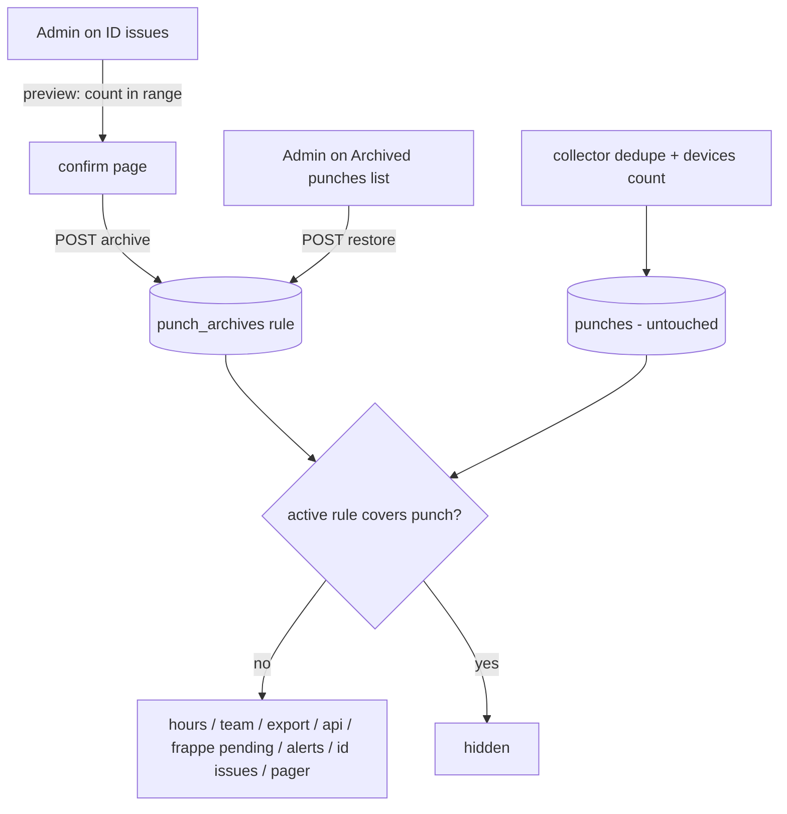
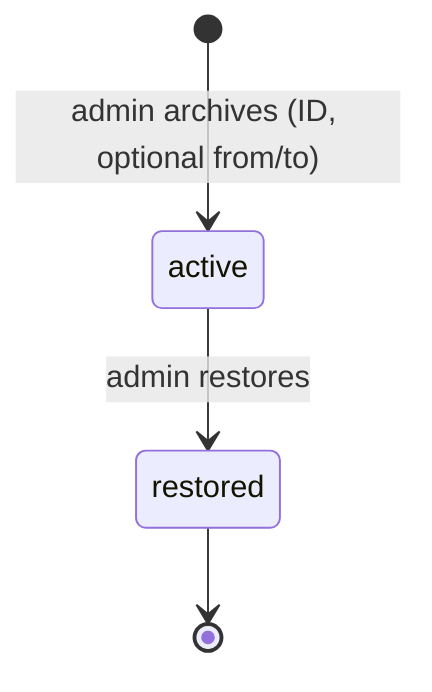

# feat: Archive ID-issue punches and role-based UI polish

## Summary

This plan does three things:

- **Archive unwanted punches.** An admin can archive the punches of an unknown device ID (old, temporary or test cards) straight from the ID issues page, optionally limited to a date range. Archiving can be undone at any time.
- **Fix two bugs.** The broken "Wait for door close" checkbox on the Devices page, and a crash that takes the Devices page down when any device is retired.
- **Polish the UI.** It applies the high-impact, low-risk changes from a live walkthrough of every role at phone and desktop width:
  - navigation that always shows where you are
  - team and device summaries at the top of pages
  - less repeated text
  - mobile layouts that fit

---

## Problem Frame

The ID issues page lists device user IDs that count for nobody. Temporary cards, test swipes and departed contractors stay there forever: "unknown" issues cannot be dismissed, and their punches clutter Team banners, the Devices page and ID issue counts. Today the only way out is linking the ID to a person, which is wrong for junk data.

The devices resend their whole history on every poll. Deleting punch rows would let the collector insert them again, and it would break Frappe sync state. Any clean-up must therefore hide punches without touching the stored rows.

A walkthrough rendered 45 pages for the employee, manager, HR and admin roles, at 375 px and 1280 px, in light and dark mode. It found these problems:

- **Bugs:**
  - The door checkbox is broken because a generic `.field input { width: 100% }` rule also hits checkboxes.
  - The Devices page crashes (500 error) once any device is retired, because `retired_at` is not converted to a timestamp.
- **Wrong navigation highlight:** the highlighted nav item is wrong or missing on many sub-pages.
- **Mobile breakage:** the day pager breaks on phones.
- **Buried information:**
  - Team has no summary of who is in, out or short.
  - Notices about unknown device IDs sit below thousands of pixels of table.
  - A failing device does not show in system health.
- **Copy errors:** a chip has the wrong style, and some text says the wrong thing (it tells employees to "ask HR" when a report button exists).
- **Space-wasting mobile layouts** on the day strip, week and people lists.

---

## Requirements

**Punch archive**
- R1. An admin can archive the punches of one unknown or shared device ID from the ID issues page.
- R2. An archive optionally takes a from date and a to date. By default it covers everything up to the moment of archiving.
- R3. Before archiving, the admin sees how many punches will be hidden and confirms.
- R4. Archived punches disappear from:
  - hours, day views, week and Team
  - People, exports, `/api/v1/hours` and `/api/v1/checkins`
  - Frappe pending sync, alerts and baselines
  - the ID issues list and unknown-ID notices
  - the history pager
- R5. Stored punch rows are never modified or deleted, and the collector never inserts archived punches again.
- R6. An admin can restore any archive. Restored punches reappear everywhere at once.
- R7. Every archive and restore records who did it and when. HR can see the list of archives but cannot change it.

**Bug fixes**
- R8. The "Wait for door close" checkbox sits next to its label on every screen size.
- R9. The Devices page loads when a retired device exists.

**UI polish**
- R10. The navigation always highlights the section the user is in, including sub-pages and other people's days.
- R11. Team and Employees open with a one-line status summary. The unknown-ID notice sits above the table.
- R12. A device whose last poll failed (status error) shows in the health badge and on the Devices nav item.
- R13. Chips, copy and spacing are corrected: the needs-review chip, the "if they stay in" wording, report-a-problem guidance, and section spacing.
- R14. Phone layouts fit at 375 px:
  - the day pager stays one row
  - day strip labels never clip
  - future week days collapse
  - the people list drops desktop-only columns
  - the health table labels its values

---

## Scope Boundaries

- No hard delete of punches.
- No archive for IDs mapped to a person ("name" issues). That would silently change someone's hours; use a fix request instead.
- No redesign of brand, colours or typography.
- No new pages beyond the archive list.

### Deferred to Follow-Up Work

These are from the walkthrough, medium risk or medium impact:
- Day strip showing Met / Short / Incomplete instead of "In".
- Week day names styled as links.
- Health entry in the nav.
- Fix review wording ("Worked" → "Effective") and day status on the detail page.
- Day card de-duplication of "Inside" and "Needs review".
- Door panel text trimming.
- Collapsible export panel.
- ID issues de-duplication and sort by punch count.
- Health backup table summary.
- Settings form alignment.
- People table truncation.
- Retired-device chips.
- A compact one-row report form.
- A full compact-row redesign of mobile people lists.
- Dark-mode "Short" bar contrast.

---

## Key Technical Decisions

- **KTD1. Archives are rules, not row edits.** A new `punch_archives` table (schema v9) holds:
  - `device_user_id`, an optional `from_ts`, and a `to_ts`
  - `reason`
  - `created_by` and `created_at`
  - `restored_by` and `restored_at`

  Reads hide punches covered by an active rule.
  - This keeps the "punches are never edited" rule (README).
  - It keeps collector de-duplication by `fingerprint` intact.
  - Restore is a single field update, like the correction overlay (`punch_corrections`).

  Rejected alternatives:
  - **An `archived_at` column on `punches`:** edits device rows, makes bulk updates under the shared lock, and has no per-action audit.
  - **Moving rows to another table:** the collector would insert them again, and Frappe sync logs would cascade away.
- **KTD2. One shared SQL filter applied to every read that must hide archived punches.**
  - An `_ACTIVE_PUNCH_SQL`-style fragment sits next to `_MAIN_ID_SQL` / `_FRAPPE_HELD_SQL` in `essl_hub/db.py`.
  - **Uses the filter:**
    - `_overlaid_punches` (both punch read paths)
    - `raw_punches_for_device_users_range`
    - `first_punch_at`
    - `device_id_summary`, `unmapped_device_user_ids`
    - `archived_employees`, `archived_employees_with_punches`
    - `frappe_pending_punches`, `frappe_oldest_held_punch`
    - `checkins_since`
  - **Deliberately unfiltered:**
    - collector `_unseen` / `insert_punches` (dedupe must see every row)
    - `fill_punch_directions`
    - `devices()` "Punches stored" (a device health number)
    - backup counts
    - the fix-line direction lookup by fingerprint in `essl_hub/db_fixes.py`
    - the `frappe_sync_log` re-queue subqueries in `update_employee` / `add_extra_device_id`
    - the `device_name` subquery inside `device_id_summary` (the outer query is filtered)
- **KTD3. Range rules.** A rule hides punches with `from_ts <= event_timestamp < to_ts`.
  - **Defaults:** no from date means from the beginning, and no to date means up to now.
  - **Day boundaries:** an explicit from date starts at that day's work-day start. An explicit to date is inclusive, ending at the next work-day boundary.
  - **Future swipes:** `to_ts` is always clamped to the archive time, so swipes made after archiving stay visible. A reused card handed to a new hire is never hidden.
  - **Invalid range:** from after to is refused, and no rule is written.
- **KTD4. Admin archives and restores; HR sees the list read-only.** This keeps a destructive-looking action with the role that runs the system. Archive is offered only for `unknown` and `shared` issues.
- **KTD5. Frappe and API semantics:**
  - Archived punches leave Frappe pending sync and the shift watermark.
  - Checkins already sent stay in Frappe; there is no delete call.
  - On restore, punches without a sync log are pushed again.
  - `/api/v1/checkins` pull clients that already paged past a restored timestamp will not see it. This is documented.
- **KTD6. The alerts service requires schema 9.** The filter lands in reads the alerts service shares, so `alerts_main.REQUIRED_SCHEMA` moves to 9. `backup.py` already refuses snapshots older than `SCHEMA_VERSION`.
- **KTD7. Navigation highlight from the request endpoint.**
  - `base.html` takes an `active_section` value computed once in `essl_hub/web.py`, from the endpoint plus whether the viewed employee is someone else. Today it compares exact endpoints.
  - Rules are checked in order; the first match wins:
    1. `people.id_issues*` and the archive-list endpoints → ID issues
    2. `people.*` → People
    3. own `me.week_view` → Week
    4. own `me.day_view` / `me.quick_view` and `fixes.report_*` → Today
    5. another person's `me.*` and `team.*` → Team/Employees
    6. `fixes.review_*` → Fix requests
    7. `admin.devices*` → Devices
    8. `admin.settings*` (including POST re-renders) and `admin.health` → Settings
  - Any other endpoint gets no highlight.
- **KTD8. Device health reads the devices table.**
  - **Unchanged:** `unreachable_devices()` stays as it is for the alerts service.
  - **Signal:** `current_sync_health` reads the error devices' id, name and `last_success`, and passes them to `sync_health` as a new `devices` argument. Retired devices are excluded.
  - **Audience:** the same people who see the sync badge today.
  - **Message:** one signal lists the devices, e.g. "X990 unreachable since 25 Oct" or "2 devices unreachable".
  - **Title builder:** it must cope with a signal that has no `times` entry.
  - **Nav badge:** the Devices nav item gets a count badge for admins, with an accessible name ("1 device unreachable"), like `id_issue_badge`.
- **KTD9. CSS fixes stay narrow.**
  - `.field input` (and the `.auth-field` / `.device-edit-field` twins) excludes checkbox and radio.
  - The pager gets `flex-wrap: nowrap; width: max-content` and `--radius-lg`, per DESIGN.md.
  - Mobile-only hiding uses existing breakpoints.
  - The walkthrough proved the checkbox and pager fixes in rendered screenshots.

---

## High-Level Technical Design

### Archive data flow

The collector and the device punch count read `punches` directly, never through the filter. Every other reader goes through the filter.

### Archive lifecycle

A restored rule stays in the table as the audit record. Archiving the same ID again creates a new rule.

---

## Implementation Units

### U1. Fix the door checkbox and the retired-device crash

- **Goal:** Devices page renders correctly and never crashes.
- **Requirements:** R8, R9
- **Dependencies:** none
- **Files:** `static/styles.css`, `essl_hub/db.py`, `tests/test_db.py`, `tests/test_web.py`
- **Approach:**
  - Exclude checkbox and radio from the `.field input` / `.auth-field input` / `.device-edit-field input` width rules.
  - Add `retired_at` to `TIMESTAMP_COLUMNS`. Check every other timestamp column added since v1 for the same omission (grep the schema for `TIMESTAMP` columns not in the set).
- **Patterns to follow:** the existing `TIMESTAMP_COLUMNS` registry; the `.check-label` flex rule.
- **Test scenarios:**
  - A real-database test: retiring a device, then reading `devices()`, returns `retired_at` as a datetime.
  - A web test with a real database: GET `/devices` with a retired device returns 200.
  - A unit check that every `TIMESTAMP` column in the schema statements and migrations is listed in `TIMESTAMP_COLUMNS`. This guards against the same bug coming back.
- **Verification:** the re-run walkthrough screenshot of the Devices page C3-400 door settings panel shows the checkbox inline with "Wait for door close" at 375 px and 1280 px.

### U2. Schema v9 and the shared archive filter

- **Goal:** Archive rules exist, and every read that must hide archived punches does.
- **Requirements:** R2, R4, R5, R6, R7
- **Dependencies:** none
- **Files:**
  - `essl_hub/db.py`
  - `essl_hub/db_archives.py` (new mixin)
  - `essl_hub/alerts_main.py`
  - `tests/test_db.py`
  - `tests/test_web.py` (FakeDatabase)
  - `tests/test_frappe_sync.py`
  - `tests/test_api_checkins.py`
  - `tests/test_alerts_main.py`
- **Approach:**
  - **Migration:** `MIGRATIONS[9]` creates `punch_archives` plus an index on `device_user_id`. It is additive only.
  - **Timestamp columns:** register `from_ts`, `to_ts` and `restored_at` in `TIMESTAMP_COLUMNS`. `created_at` is already listed.
  - **Mixin methods:**
    - `archive_preview(device_user_id, from_ts, to_ts)` → punch count, first and last time
    - `archive_punches(...)` → rule id, recording the actor
    - `restore_punch_archive(id, actor)`, guarded on `restored_at IS NULL`
    - `punch_archives(include_restored)` → list with actor names and the live hidden count
  - **Filter:** add the shared filter to every KTD2 read. Add the `p` alias where a query lacks one.
  - **Alerts service:** `REQUIRED_SCHEMA = 9`.
  - **Fake database:** mirror the filter in FakeDatabase's punch reads and ID summary.
- **Patterns to follow:**
  - `db_fixes.py` mixin with the `_core()` lazy import
  - `_MAIN_ID_SQL` / `_FRAPPE_HELD_SQL` fragments
  - the v8 migration test
- **Test scenarios:**
  - Migrating from v8 to v9 keeps data, and re-running it is a no-op.
  - Archive of ID `9999` with no range hides all its punches in:
    - `punches_for_device_users_range`
    - `device_id_summary`
    - `unmapped_device_user_ids`
    - `first_punch_at`
    - `checkins_since`
    - `frappe_pending_punches`
  - The `devices()` stored count and collector `unseen_punches` are unchanged.
  - The collector re-polling the same device history after an archive inserts nothing new.
  - A from/to range hides only punches inside the range. A punch after the default `to_ts` (a swipe after the archive time) stays visible.
  - Restore makes every punch reappear in all the reads above. Restoring twice is refused cleanly.
  - An already-synced Frappe log row is untouched by archive. After restore, a punch with no log row is pending again.
  - Overlapping rules: a punch covered by two rules stays hidden until both are restored.
  - The alerts service waits while the schema is 8.
- **Verification:** the full suite is green, and grepping `FROM punches` shows every read either filtered or listed as deliberately raw in KTD2.

### U3. Archive and restore on the ID issues page

- **Goal:** Admins clean up junk IDs in two clicks, and everyone can see what was archived.
- **Requirements:** R1, R3, R6, R7
- **Dependencies:** U2
- **Files:**
  - `essl_hub/routes/people.py`
  - `essl_hub/id_issues.py`
  - `templates/id_issues.html`
  - `templates/punch_archives.html` (new)
  - `tests/test_web.py`
  - `tests/test_id_issues.py`
- **Approach:**
  - **Archive action:** `unknown` and `shared` issue cards get an "Archive punches" action, shown to admins only. It opens a confirm section, following the ID issues `?confirm=1` preview pattern, with:
    - optional from and to dates
    - an optional reason
    - the live count: "18 punches from 3 Oct to 12 Oct will be hidden"
  - **Preview:** works out the exact range once, e.g. "up to 27 Oct 14:02", and carries `from_ts` / `to_ts` as hidden fields. The saved rule then matches the count shown.
  - **Empty range:** a count of 0 disables Confirm and shows "No punches in this range".
  - **Invalid range:** from after to shows an inline form error.
  - **POST:** admin-only with CSRF.
    - It re-checks the issue kind server-side and refuses mapped IDs.
    - It then calls `forget_issue_count()` and redirects with a flash ("Archived 18 punches from ID 9999").
    - Restore also calls `forget_issue_count()`.
  - **Later mapping:** if an ID with an active archive is later linked to a person (ID issues link, or People edit/add device ID), the confirm step states "N punches of this ID are archived and stay hidden". It links to Restore.
  - **Archive list:** a new page in the `people` blueprint lists archives:
    - Active archives come first, with ID, range, reason, who, when, current hidden count, and Restore for admins.
    - Restored archives follow in a muted section, showing who restored them and when, with no count.
    - The empty state reads "No archived punches".
    - HR sees it read-only.
    - It is linked from the ID issues footer and its intro, so it is findable even when no issues remain.
  - **Restore:** uses the same confirm-then-POST shape.
- **Patterns to follow:**
  - `id_issues_view` confirm preview and `id_issues_link` POST in `routes/people.py`
  - `_redirect_with_flash` / `_take_flash`
  - `people_archive.html` restore list
- **Test scenarios:**
  - An admin previews archive for ID 9999 with no range: the count matches its punches. Confirming hides them, the issue leaves the list, and the flash shows the count.
  - Preview with a date range shows only in-range punches. Archiving keeps out-of-range punches and the issue remains with the remaining count.
  - HR sees no archive button. HR posting directly gets 403.
  - Posting archive for an ID mapped to a person (a name issue) is refused (400) with no rule written.
  - Archive list: HR sees entries without Restore. An admin restores and the issue reappears with its full count.
  - A restore POST for an already-restored archive shows "already restored" and no error.
  - CSRF is missing → 400.
  - A to date of today is clamped to now: a swipe made a minute after archiving stays visible.
  - from after to is refused with a form error and no rule.
  - A range with 0 punches shows "No punches in this range" and no enabled Confirm.
  - The preview's hidden `to_ts` is what gets stored, even if new punches arrive between preview and confirm.
  - Linking an ID that has an active archive shows the archived-punches warning on the confirm step.
  - The archive list empty state renders, and a restored entry shows in the muted section.
- **Verification:** walkthrough re-run shows the archive action on unknown cards and the archive list page renders at both widths.

### U4. Navigation that always shows where you are

- **Goal:** The highlighted nav item matches the section on every page, and the mobile day pager stays one row.
- **Requirements:** R10, R14
- **Dependencies:** none
- **Files:**
  - `essl_hub/web.py`
  - `templates/base.html`
  - `static/styles.css`
  - `tests/test_web.py`
- **Approach:**
  - A context processor computes `active_section` per KTD7.
  - `base.html` compares nav entries against the section instead of exact endpoints.
  - The pager CSS gets the KTD9 fix.
- **Patterns to follow:** existing nav tuples in `base.html`; the `fix_review_badge` context processor.
- **Test scenarios:**
  - People archive, new, edit and import pages render with People `aria-current`.
  - The door confirm page renders with Devices current.
  - Fix review detail renders with Fix requests current.
  - The signed-in report form renders with Today current.
  - A manager viewing a report's day (`/day?employee=`) renders with Team current, not Today. An employee's own day renders with Today current.
  - Health renders with Settings current for admins. A settings POST that re-renders (e.g. a new API key) keeps Settings current.
  - An employee's own Week renders with Week current.
  - The ID issues page and the archive list render with ID issues current, not People.
- **Verification:** the walkthrough re-run of the past-day page at 375 px shows a single-row pager.

### U5. At-a-glance summaries and device health

- **Goal:** Managers, HR and admins see status counts and problems without scrolling.
- **Requirements:** R11, R12
- **Dependencies:** U2 (the unknown-ID notice counts must exclude archived IDs)
- **Files:**
  - `templates/team.html`
  - `templates/_team_results.html`
  - `templates/devices.html`
  - `essl_hub/routes/team.py`
  - `essl_hub/routes/common.py`
  - `essl_hub/web.py`
  - `templates/base.html`
  - `tests/test_web.py`
- **Approach:**
  - **Team summary:** Team/Employees replaces "N people" with "7 people: 3 inside · 2 met · 1 short · 1 no punches".
    - Each person is counted once, using today's day status: open → inside, met → met, short → short, incomplete → needs review, empty → no punches. The parts add up to the total.
    - It becomes the content of the existing `#team-count` aria-live element. `_team_results.html` swaps it out-of-band, so search results recount it.
  - **Manager column:** managers no longer see the Manager column, which always shows themselves.
  - **Unknown-ID notice:** moves above the table on Team and to the top of Devices. It is shown only to HR and admins, who can act on it, as one line linking to ID issues.
  - **Health signal:** `sync_health` gains a devices signal when `unreachable_devices()` is non-empty ("X990 unreachable since 25 Oct").
  - **Devices badge:** the Devices nav item shows a count badge for admins.
- **Patterns to follow:** `sync_health` signals; the `id_issue_badge` / `fix_review_badge` context processors.
- **Test scenarios:**
  - A team of 7 with 4 inside, 2 met and 1 with no punches renders "7 people: 4 inside · 2 met · 1 no punches". Zero-count parts are omitted.
  - A search narrowing to 2 people returns an out-of-band count recomputed for those 2.
  - Managers do not see the unknown-ID notice.
  - Two devices in error produce one signal saying "2 devices unreachable". A retired device in error is ignored.
  - A manager's Team view has no Manager column. HR's Employees view keeps it.
  - The unknown-ID notice appears before the table markup on Team and at the top of Devices. With all unknown IDs archived, it disappears.
  - With one device in error, the health badge is not "All systems healthy", names the device, and the Devices badge shows 1. With all devices connected, there is no badge.
- **Verification:** walkthrough re-run of Team (manager) and Devices with a failing device shows the summary and the warning above the fold.

### U6. Chips, copy and spacing

- **Goal:** Remove misleading text and mis-styled elements.
- **Requirements:** R13
- **Dependencies:** none
- **Files:**
  - `templates/_status_chip.html`
  - `templates/_day_live.html`
  - `templates/settings.html`
  - `static/styles.css`
  - `tests/test_web.py`
- **Approach:**
  - **Needs-review chip:** uses its own chip class (warn tone) instead of `.review-flag`, which belongs to the fix-review warning paragraph.
  - **Target-reached copy:** "Target reached … if you stay in" switches to "they" when the viewer is not the person.
  - **Needs-review notice:** three cases.
    - **Your own day inside the report window:** it points to the Report a problem button.
    - **Your own older day:** "This day is too old to report here — ask HR."
    - **Someone else's day:** it keeps an HR-facing line.
  - **Spacing:** `.admin-section h3` and `.person-archive` get top spacing.
- **Patterns to follow:** existing chip tones in `_status_chip.html`; `can_report` from `routes/me.py`.
- **Test scenarios:**
  - The needs-review chip renders with the warn chip class and not `review-flag`.
  - An HR user viewing an employee's met day sees "if they stay in". The employee sees "if you stay in".
  - An employee's needs-review day within 7 days shows the report-a-problem guidance and no "Ask HR".
  - The same employee's 10-day-old day shows the "too old to report here" line.
  - A manager's view shows the HR line.
- **Verification:** walkthrough re-run of People and the day view shows the chip inline and the corrected copy.

### U7. Phone layouts that fit

- **Goal:** Pages are usable at 375 px without wasted screens.
- **Requirements:** R14
- **Dependencies:** none
- **Files:**
  - `static/styles.css`
  - `templates/week.html`
  - `templates/_day_strip.html`
  - `templates/_people_results.html`
  - `templates/_team_results.html`
  - `templates/health.html`
  - `tests/test_web.py`
- **Approach:**
  - **Day strip:** under 600 px the status word is hidden. The day label stays visible, and the status dot carries a per-status glyph (✓ met, – short, ! needs review, · none), so status never relies on colour alone. The full status stays in the link's `aria-label`, and links keep a 44 px touch height.
  - **Week:**
    - Future days get an `is-future` class. Under 768 px they collapse to one non-interactive line, e.g. "Wed 29 Oct · not yet".
    - Each card's date becomes its heading instead of a repeated "Day" row.
  - **People lists:** hide the email column under 768 px. The export checkbox stays, because it is the only way to pick people for export on a phone.
  - **Health:** the backup table cells get `data-label`.
- **Patterns to follow:** existing `@media` breakpoints and `data-label` card tables in `_team_results.html`.
- **Test scenarios:**
  - Week rows for future days carry the `is-future` class; past days do not.
  - Health backup cells carry `data-label` attributes.
  - Day strip links keep a status `aria-label` for every chip.
  - Test expectation for pure CSS changes: verified visually through the walkthrough re-run, not unit tests.
- **Verification:** walkthrough re-run at 375 px shows unclipped strip chips, a week view under about half its old height, and labelled health rows. No page scrolls sideways.

### U8. Docs and before/after walkthrough

- **Goal:** Document the archive and confirm the UI changes visually.
- **Requirements:** R1–R14
- **Dependencies:** U1–U7
- **Files:** `README.md`, `PRODUCT.md`, `DESIGN.md`
- **Approach:**
  - **README:** gains an "Archiving ID-issue punches" section covering:
    - what is hidden and what is not
    - restore
    - Frappe and checkins semantics
    - admin-only
  - **PRODUCT.md:** notes that archive is a read-time rule, like fixes.
  - **DESIGN.md:** records the nav-section rule and the summary line component.
  - **Walkthrough:** re-run the UI audit script into a new output folder and compare key pages before and after.
- **Test expectation:** none, documentation and visual verification only.
- **Verification:** before/after screenshots exist for:
  - the door card
  - the past day on mobile
  - Team (manager)
  - People (HR)
  - Week on mobile
  - ID issues with the archive action

---

## System-Wide Impact

- **Hours everywhere:** archived punches leave every computed view. They should only ever cover unknown or shared IDs, so no rostered person's hours change.
- **Frappe and API consumers:**
  - Pending pushes skip archived punches.
  - Pull clients of `/api/v1/checkins` may miss punches restored after they paged past them.
- **Schema:** v9 is additive. Web and collector migrate, the alerts service waits, and backup refuses older snapshots.
- **Roles:** admins gain archive and restore. HR gains a read-only archive list.

---

## Risks & Dependencies

| Risk | Mitigation |
|---|---|
| A punch read is missed and archived punches still show somewhere | KTD2 inventory, plus a test asserting each listed read hides an archived ID, plus a grep check during verification |
| Archive accidentally covers a real person's ID | Server-side kind check (unknown/shared only), count preview, restore |
| Collector re-inserts archived punches | Rows stay in `punches`; dedupe untouched; explicit re-poll test |
| Nav highlight logic misfires on an unmapped endpoint | Default to no highlight, plus per-section tests |

---

## Sources & Research

- **Code:**
  - `essl_hub/db.py` (`_overlaid_punches`, `device_id_summary`, `frappe_pending_punches`, `checkins_since`, `_unseen`, `TIMESTAMP_COLUMNS`)
  - `essl_hub/id_issues.py`
  - `essl_hub/routes/people.py` (`id_issues_view`, `id_issues_link`)
  - `templates/devices.html:31-35`
  - `static/styles.css:360-371, 598, 712`
- **Walkthrough:** artifacts and the re-run script are in the session scratchpad under `ui-audit/`. The proof screenshots of the checkbox and pager fixes were rendered with the proposed CSS.
